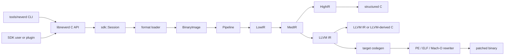

**Languages**: [English](architecture.md) | [简体中文](zh-CN/architecture.md) | [繁體中文](zh-TW/architecture.md) | [日本語](ja/architecture.md) | [한국어](ko/architecture.md) | [Français](fr/architecture.md) | [Deutsch](de/architecture.md) | [Español](es/architecture.md) | [Italiano](it/architecture.md) | [Русский](ru/architecture.md) | [العربية](ar/architecture.md)

[← Documentation Index](README.md)

# NeverD Architecture

This guide describes the production boundaries a contributor needs in order to
change NeverD safely. It intentionally covers NeverD-owned code only; the LLVM,
Capstone, and Unicorn submodules keep their own internal architecture.

## System boundary

NeverD has four IR representations, but they are not one mandatory four-hop
sequence. `LowIR -> MedIR` is shared. Structured decompilation then uses
`MedIR -> HighIR -> C`; `lift`, `decompile --llvm`, and `patch` use the direct
`MedIR -> LLVM IR` route. In particular, patch and lift modes deliberately skip
HighIR.

Both source routes apply the same module-wide return modeling before recovering
call arguments. On 32-bit targets, a callee proven to return a 64-bit integer
uses the two integer return registers; HighIR and LLVM emission must preserve
both halves through callers and source returns.

The CLI parses commands in `tools/neverd`, creates a `neverd_session_t`, and
calls the public API in `include/neverd/sdk/NeverDCAPI.h`. Engine state lives in
`lib/sdk/SessionImpl.h`; `neverd_session_load` selects a loader and builds a
`BinaryImage`, while IR-backed operations run `lib/pipeline/Pipeline.cpp`
lazily. The `neverd` executable links `neverd_shared`; the component archives
and their LLVM/Capstone dependencies are private implementation details of
that shared library. The CLI uses LLVM Support for its command-line UI,
but it does not bypass the C API to drive the engine.

ARM32 ELF code mode is taken from defined executable function symbols,
ARM/Thumb mapping symbols and an executable entry point, before normalizing
Thumb address tags. Distinct ARM and Thumb regions produce explicit mixed-mode
metadata; `BinaryImage::instructionModeAt` is the shared address-specific mode
contract for discovery, decoding, lifting, SDK disassembly and rewriting.
Conflicting evidence at one address is rejected, and `$d` mapping intervals
cannot be decoded as instructions. CFG edges carry their incoming mode when
the target lacks stronger mapping evidence. For linked ELF images without
mapping symbols, the loader follows direct branches from exact code entries
and records only the decoded instruction spans. Unreached gaps remain unknown
even when all reached instructions use one mode. An exact ARM literal branch
veneer may supply an additional executable target, but function discovery must
verify it before treating it as callable. ELF section and in-place rewriting
compile each authenticated source function in its own mode, encode Thumb code
pointers with bit 0, and validate final direct calls before publication.
Unsupported cross-state branches that need a veneer fail clearly. Loading a
new image into an SDK session resets its previous decoder state; data symbols
and unrelated names do not select a decoder mode. A fully stripped image can
leave an indirect target's state unknowable from static bytes alone; the
file-level default is not proof that all of its executable bytes use one mode.

For 32-bit ARM Mach-O, the loader seeds exact Thumb entries from executable
`N_ARM_THUMB_DEF` symbols, including object address zero, then follows direct
control-flow edges through the shared reachable-mode analysis. A cross-state
`BLX` can establish an ARM target without treating an unflagged symbol as ARM
proof. Decoding is limited to reached instruction spans; an unproved gap in a
mixed image retains unknown mode.
Validated ARM and Thumb instruction relocations can also seed their exact
instruction addresses. This can recover an otherwise uncalled function when
its entry instruction has such a relocation, without assuming that an
unmarked symbol elsewhere in the section is ARM code.
The ARMv6-M, ARMv7-M, ARMv7E-M, ARMv8-M Base/Main, and ARMv8.1-M Main Mach-O
CPU subtypes are Thumb-only, so their processor constraint supplies a mode even
for unmarked functions without a relocation. An ARM instruction relocation in
such an image is contradictory and fails loading. Other ARM CPU subtypes do not
establish a function mode.

`BinaryImage::readImmutableARMLiteral` is the shared authority for folding a
fixed-width read from a `$d` island inside executable storage. Both HighIR and
LLVM emission require the whole read to stay in the island and reject writable
or relocated bytes.

After ARM call-arity recovery, MedIR propagates a proven pointer parameter
through direct calls only when the argument is the exact incoming parameter;
computed register versions do not inherit that role. HighC uses the same
parameter type as LLVM emission. For private frame addresses, HighC projects a
power-of-two alignment only when the input is a certified entry-stack offset
within the synthetic frame. LLVMC preserves a host pointer through a mask
that is an identity at the target pointer width, so generated C does not
truncate valid host address bits.

Before either source route, MedIR can replace a stack-alignment mask with an
exact offset only when an authenticated entry-SP definition and the target
ABI's guaranteed alignment prove every discarded bit. Binary lift and patch
keep the original operation. The LLVM-to-C route explicitly requests this
source projection even though it otherwise uses the direct LLVM pipeline.

The HighIR `HighSourceFlow` analysis owns emitted statement edges, local identities,
and definite assignment. Both source validation and dead PHI copy elimination
use this graph. Bounded partitions track repeated equality tests between scalar
locals or against zero. Swapped operands and unchanged-width integer views
share the same fact; writing either operand invalidates it. Escaped locals stay
unknown, inconsistent widths are rejected, and partition exhaustion
falls back to the conservative graph. A PHI copy is removed only when its scalar
value is dead in every feasible context. Calls, loads, and stores keep their
observable behavior; source labels survive removal. Adjacent byte slices of
the same local are simplified in HighIR before this analysis, preserving their
result type. This identity does not merge independent loads or calls.

HighIR supports narrowing a 64-bit source local to 32 bits under the same proof used for 128-bit carriers: every definition must agree on the carrier and prefix widths, and every read must explicitly select the low prefix. A full-width integer AND also selects that prefix when its constant mask fits the low word without sign-extending from a narrower type; the narrowed local is zero-extended at that use before applying the unchanged mask. Full-width stores, escapes, upper-byte reads, or effectful upper expressions prevent narrowing. Source-parameter padding remains unknown.
Exact whole-variable copies can share this proof through a bounded graph when a constructing definition establishes the prefix width. Every copied destination must itself qualify for narrowing; a full-width consumer invalidates all upstream exemptions. Unseeded cycles, conflicting widths and exhausted budgets preserve the original values.
Bounded integer casts, zero-offset slices and extensions can carry this proof when every intermediate width retains the prefix. Each use is checked under its own statement root. Two bounded rounds can expose a narrower prefix after removing vector padding.

The shared MedIR source-entry analysis owns observable byte masks for physical
register inputs. Native helper inference uses these masks to represent proven
low float/double lanes without claiming original source types or a rewriting
ABI. HighIR separately narrows a source-local CONCAT only when all definitions
construct the same scalar prefix and all reads explicitly select that prefix.
Only effect-free upper expressions are discarded; lower expressions and their
control-flow positions remain unchanged. Unknown lanes are never filled in.

When an unrelated unresolved value prevents a complete entry-demand graph,
native helper inference may retain an independent full-word, call-preserved
entry register used directly by an effect. LowIR must confirm the same read and
the existing preserved-state proof still applies. A prologue spill value alone
does not establish a source parameter. MedIR keeps narrow physical-register
views for source-flow validation when the entry binder cannot insert a byte
slice into their consuming operation.

HighIR may also discard undefined upper bytes from a reconstructed integer only
when a following constant mask cannot observe any bit above the complete low
operand. A direct `CONCAT`, a bounded integer cast, a zero-offset `SUBBYTES`
view, or a same-width zero-bit logical right shift may expose that low operand.
The low operand may fill the masked result width. The replacement is an
explicit zero extension and the mask remains in place. The upper expression
must be bounded and discardable; calls, loads, ordered accesses, traps,
malformed widths, and masks that reach an upper bit retain the original
unknown value.

An internal void summary for a native cleanup forwarder does not assert an
original void prototype. It contributes no result carrier. Calls must match
validated runtime declarations, exact native source contracts or canonical
dynamically loaded Swift value-witness declarations. A callee may return a
value used inside the helper: that value does not establish a return carrier
on every exit from the helper itself. MedIR and LowIR must agree on the exact
instruction address and operation sequence, direct or indirect call form, and
static target when one exists. Exact Swift String bridge imports participate
through their own validated static target and source ABI. A bounded LowIR fixed
point tracks exact incoming register bytes and private stack spills, requiring
restored preserved registers,
stack pointer and link register at every exit. The frameless source-bound tail
shape instead proves that those registers are never written and uses a bounded
byte-taint fixed point to reject stack-derived call targets, arguments or stored
values.
Partial writes,
implicit zero extensions, call clobbers and overlapping stores invalidate the
affected identities. A store through an address with no frame-derived bytes is
disjoint from the current invocation's private frame and keeps its exact spill
facts. Partial or exact frame-derived addresses still reject possible escapes;
frame-address spills and call arguments are rejected, except that an exact
`objc_msgSendSuper2` binding may synchronously borrow its first argument as a
read-only 16-byte `objc_super` object. The proof requires the complete pointer
and object to stay inside the currently allocated frame; ordinary messages,
partial pointers and objects crossing either frame boundary remain rejected.
Unallocated stack bytes cannot survive a call.
The ordinary CFG and source dependency proofs still apply.
Re-lifted callers that observe a missing result retain their unknown value and
cannot pass source publication.

After re-lifting a native void candidate, its dependency fixed point can remove
an auxiliary register parameter with no occurrence anywhere in the resulting
HighIR body. This uses the existing HighIR private-frame cleanup instead of
adding another store-elimination rule. Canonical parameters and auxiliary
reads or writes remain intact. Changed signatures require another pipeline run;
neither an inferred signature nor its refinement certifies a publishable body.

Non-returning native source helpers use an internal void ABI only when both
IR stages agree and the shared MedIR termination analysis independently
rechecks the current graph. Bound calls retain their exact parameters and
effects; only recognized architectural terminators bypass the ordinary
intrinsic restriction. The final interprocedural no-return fixed point copies
its result into each exact native source-call hint, including clearing stale
effects on a later run. HighIR therefore sees the same termination boundary.
Publication revalidates the typed callee's complete source flow and requires
its dependency closure; a function flag alone never authorizes a terminating
source call. Reports, writes and traps before termination remain observable.
HighIR cleanup, trailing-return insertion, and source-flow validation share
the same exact source-termination predicate. An unconditional architectural
trap removes an otherwise synthetic unknown return only when no branch enters
that return; resumable debugger traps preserve fallthrough.

At source-bound runtime calls, Low-to-Med lowering carries the authenticated
external no-return declaration into the MedIR call effect.
An imported runtime veneer may also appear in the native function inventory.
The no-return fixed point preserves an existing machine termination fact when
the validated runtime binding and complete call operands agree; a source hint
alone cannot create that fact. The binding names the import slot, while the
call names the veneer. Inferred native effects are still recomputed from the
current graph, and source publication revalidates the import identity.

Native two-word integer returns are requested by an observed low-prefix read of
the second return register after an exact direct call in the same LowIR block.
The read may be narrower than a word, but an intervening call, intrinsic or
overlapping register write ends the demand. Demand also follows a one-block
direct tail forwarder whose last operations are an adjacent call and return of
the first result word. Neither observation nor forwarding proves an ABI: both
result registers must independently pass the existing bounded MedIR
return-path proof. The candidate then uses an
internal two-field record and the shared `ReturnComponents` lowering for calls
and returns. A later dependency iteration may extend an inferred native scalar
contract when its second word becomes provable; external and declared source
contracts are never extended. Re-lifting and the normal source body/closure
checks remain mandatory, and an unproved second result remains unresolved.

Block consumer escape analysis also uses this graph. A bounded fixed point carries pointer identities and private frame spills across branches and loops. Joins retain possible context addresses; only complete overwrites erase them. Unknown edges, exceptional flow, and exhausted proof budgets reject the binding.

An exact zero-offset `SUBBYTES` view may preserve a complete low pointer word
from a wider physical register view. Partial frame, context, and invoke-pointer
views retain their source identity and byte interval; only ordered, contiguous,
same-source `CONCAT` operations that cover the complete pointer restore an
address. Every other partial view remains tainted and is rejected if it reaches
memory, a call, control flow, storage, or an observable return. Equal scalar
bits never acquire pointer identity.
When an exact source ABI declares a narrow scalar result, an explicit
`CONCAT` may contribute undefined high physical-return padding. Escape
analysis checks the complete declared low result and ignores only that
structured high padding; a context pointer in any observable return byte is
still rejected.

A block invoke may pass an address in its own fresh frame to a bound call only
while that frame contains no context, invoke, ISA, or other proven pointer
identity. Storing any such identity makes an unbounded frame argument an
escape again. This distinguishes ordinary callback locals such as an error
result slot from the block context without weakening the context escape proof.

Stack-block construction distinguishes an exact literal base from other frame
arguments before interpreting a call as a block consumer. Ordinary frame
arrays may therefore be passed before construction; wide frame initialization
is retained as poisoned byte coverage, so it cannot satisfy a block header or
owned capture. Once an ISA identity is live, other frame arguments remain
rejected until a declared copying or nonescaping consumer invalidates the
literal storage. This keeps later unrelated frame calls available without
forgetting a block identity that still exists on any reaching path.
An unchanged entry pointer parameter cannot address the current invocation's
fresh private block frame, so an ordinary scalar store through that exact
parameter does not invalidate construction. Loaded pointers, reassigned
parameters, pointer-derived values, and unsupported store effects remain
unproven aliases.
An exact `objc_msgSendSuper2` call may synchronously borrow a separate,
fully initialized 16-byte `objc_super` record in the same frame. Its two words
must contain no block or frame identity, and every live pointer-identity byte
must remain inside a known, disjoint block literal. Other frame arguments
remain subject to the ordinary escape proof.

Capture-free global block literals may share one compiler descriptor. Source
dependencies and generated helpers follow the exact literal references in the
current source closure: an unreferenced literal sharing that descriptor neither
adds its invoke dependency nor appears in the emitted storage. The descriptor
remains shared, and the same original literal keeps one shared generated
identity across methods.

Darwin block consumers have one loader-owned callback and lifetime contract.
The generated catalog distinguishes compiler-declared `noescape` parameters
from audited runtime copying consumers. The latter covers `dispatch_after`,
`dispatch_async`, `dispatch_barrier_async`, `dispatch_group_async`,
`dispatch_group_notify`, and `dispatch_source_set_event_handler`, whose API
contracts specify copying the block. Every contract requires exact
import/provider identity, four-profile compiler agreement, and a matching
complete callback ABI.
Source publication still proves the stack header, initialized captures,
copy/dispose helpers, and invoke dependency. Either kind of consumer invalidates
the caller's construction facts after use; a copied consumer is never reported
as nonescaping. Unannotated block parameters confer no lifetime permission.
An invoke may call a block stored in its own capture only when the containing
literal has a complete descriptor, the capture word was initialized, and its
validated copy helper assigns that strong field with block flag 7. The source
pipeline passes these exact field offsets to LowIR call binding on a later
round; ordinary initialized capture words contribute only observed integer
carriers. Conflicting assignments or descriptors with different fields remove
the proof, and the call still requires an exact receiver-plus-16 target load.
An invoke callback may receive a class-qualified object parameter from its
compiler block signature. The source plan must first prove the literal's
descriptor-to-invoke link and agree on the same class for every literal using
that invoke. Call analysis carries this declared class through ordinary
receiver copies; publication re-reads the descriptor and checks the final
plan link. Bare `id`, conflicting descriptors, and unrelated invocations
remain unqualified, and dynamic message dispatch is unchanged.
An invoke body's unresolved nested block does not erase an independently
validated outer literal's parameter declaration: that declaration may be
needed to prove the nested block consumer on the next pipeline round.
An authenticated `NSArray` fast-enumeration call may borrow its
`NSFastEnumerationState` (64 bytes) and object buffer (`count * 8` bytes)
from an invoke's frame while another validated block is live. Both ranges
must fit the recovered frame and be disjoint from complete validated block
literals and every private context identity byte. Unknown counts, receivers,
and call bindings still fail the capture proof.
Individual literal probes merge import evidence only for the isa slot they
inspect; whole-image block discovery still walks the complete import inventory.

Objective-C SDK `noescape` block parameters use the same loader-owned
boundary. A catalog row is accepted only when the current message still has
the exact SDK parent-method ABI and parameter position, its block descriptor
has the exact compiler callback ABI, and any qualified receiver follows a
complete, conflict-free class hierarchy to the declaring owner. An
unqualified selector is usable only when all matching catalog rows agree on
one callback contract. This proves the caller-side lifetime only: dispatch
remains dynamic, no implementation address is selected, and methods without a
cataloged `noescape` declaration continue to reject stack-block escape.
The two Core Data `performBlock:` instance methods instead enqueue work after
returning, so their block parameters require a copied lifetime. Their audited
contracts use the same exact method and callback ABI checks and additionally
require a revalidated receiver lineage to `NSManagedObjectContext` or
`NSPersistentStoreCoordinator`; an unqualified `performBlock:` selector does
not prove copying. `performBlockAndWait:` remains a separate nonescaping
contract.
The same copied-contract boundary covers `NSBlockOperation`
`blockOperationWithBlock:`, `CLGeocoder`
`reverseGeocodeLocation:completionHandler:`, and the two asynchronous
`UNUserNotificationCenter` settings and authorization callbacks. The
`NSPersistentContainer loadPersistentStoresWithCompletionHandler:` callback
also uses a copied contract because store descriptions can request asynchronous
addition and the SDK imports the completion as escaping. The receiver must
resolve to `NSPersistentContainer` and both method and callback ABIs must match.
The authorization callback is unavailable on x86-64 in this catalog because the
macOS and iOS SDKs encode its `BOOL` argument differently.
Rejected Objective-C block consumers distinguish an unqualified receiver,
callback ABI mismatch, and unproven message binding in their dependency
diagnostic, so a missing lifetime proof can be traced without treating a
selector name alone as authority.

An invoke may pass a nested stack block only when construction proves every
header and owned capture byte, the exact call consumes that frame base, and the
consumer's lifetime contract is still bound. The outer context cannot be
smuggled through a nested capture or another frame argument. Complete 16-byte
loads from initialized captures may pass through private vector spills as
opaque bytes; partial pointer values and computed wide expressions retain
their private or unproven identity and cannot establish a capture.

Calls through copied stack blocks reuse the loader's source-call fixed point.
A complete stack header and descriptor establish the invoke ABI before an
authenticated `objc_retainBlock` or `_Block_copy` supplies a copied-block
identity. Only an invoke-field load and receiver with that same identity can
bind a dynamic call. Conflicting aliases, partial pointer operations, escaping
copies, unknown calls and ambiguous writes discard the proof. Image stores
preserve private construction facts only when the shared loader range check
proves a complete writable file-backed range disjoint from private storage.
For an AArch64 register tail branch through a captured block, the loaded
invoke register is a call target rather than an extra callback parameter.
The synthetic call-and-return pair at one instruction address may use the
descriptor-bound entry's void result ABI only when its instruction boundary
proves an indirect tail call with no successor. An ordinary call still needs
observed result evidence.
Stack adjustments retain their full pointer width with bounded narrow numeric
offsets; SIMD zero extension can preserve the unchanged low image-byte recipe
without creating a wider pointer or interpreting floating-point values.

Source-call discovery uses a bounded forward fixed point for register facts.
At ordinary joins, a selector, import slot or numeric address survives only
when every reached predecessor agrees. Independent and exceptional entries
start unknown. Call bindings are published only after backedges converge;
physical alias writes, unknown calls and instruction-local temporaries cannot
carry stale facts into a later block. Invalid edges or exhausted work budgets
reject the proof.

On x86-64, `CallRegisterEffects` owns which general-purpose registers a
direct call may change. Whole-program register allocation (MSVC `/LTCG`) lets
a caller keep a value in a volatile register across a call to a helper that
never writes it, so the ABI clobber set would lose that value. After LowIR,
the pipeline summarizes each lifted function's register writes together with
those of its direct callees, lifting callees it did not already lift up to the
`Limits.h` depth and count. A summary exists only when every function in the
call tree lifted completely, resolved every indirect branch and made no
indirect or import call. Calls that do not return are ignored. LowToMed marks
direct calls with the GPR families their callee never writes. MedSSA keeps
those values across the call and a call whose callee never writes the return
register has no result. Vector registers, flags and unsummarized callees keep
the ABI clobber set. The same pass records which registers each callee reads
before writing, including arguments it only passes on to its own callees.
For Win64 calls LowToMed publishes those argument registers as CALL inputs.
SSA then sees a caller's pass-through argument, and HighC passes exactly the
arguments the callee reads. Stack arguments follow the 32-byte home area.

Function starts follow the same evidence rule. An x64 `RUNTIME_FUNCTION` with
chained unwind info continues its parent function (`BinaryImage::
ContinuationCodeStarts`), and an entry guessed only from inter-function padding
(`Symbol::IsBoundaryGuess`) may be a hot/cold split chunk. A direct jump to
either stays inside the jumping function. A guessed entry that another function
absorbed this way is audited as `AbsorbedFunctionChunk` rather than decompiled
twice.

At a validated source-call boundary, an exact integer constant zero may supply
a pointer parameter even when the machine expression uses a narrower integer
carrier than the declared pointer. Generated C emits an explicit null pointer
constant. This exception applies only to the literal zero and only to a
declared pointer parameter; nonzero integers and other width mismatches remain
explicit source-call failures.

Selector-wide Objective-C lookup normally requires every complete local,
protocol, property and active SDK declaration to agree. When complete
declarations disagree only in their result contract, an exact post-call
scalar-register read may narrow the set if exactly one declared result carrier
defines the observation. Integer observations may consume a fully defined
subrange, including an explicitly extended narrow result. Floating observations
must match the declared register, offset and width exactly; reading four bytes
does not reinterpret a declared double as a float. Full-width copies can
transport that evidence. Recognized runtime calls preserve only ABI-preserved
aliases, including only the low 64-bit prefix of AArch64 `Q8`-`Q15`. Unknown
calls, overlapping writes, unused results, incomplete declarations and multiple
matching carriers leave the message unresolved. The selected carrier range is
stored with the source-call hint and revalidated against the current image at
publication, so a local dataflow observation cannot bypass global declaration
checks.

An exact declared pointer parameter from the enclosing Objective-C method may
also narrow incompatible declarations when that unchanged entry value reaches
one message argument and exactly one complete declaration has the same source
type at that position. An ordinary opaque object pointer additionally requires
that the unchanged entry value first reach an exactly bound `objc_retain` call;
this authenticated object consumer may distinguish a pointer declaration from
a non-pointer declaration. Every method record sharing the entry must agree
before the parameter fact is seeded. Stack reloads after the frame escapes,
transformed values, multiple matching arguments or pointer declarations, and
incomplete declarations remain unresolved. The hint records the method entry,
source ABI carrier, object-consumer fact and message parameter index;
publication rebuilds the method and selector declarations from the current
image before accepting the call.

An exact Objective-C wrapper may supply a selector declaration that is absent
from both the image and active SDK catalogs. The call must use one unchanged,
declared method-entry parameter as its receiver, forward every selector
argument from an unchanged full-width integer-register parameter, and
immediately return the call output with the wrapper's declared result ABI. The
selector arity, caller parameter locations and return carrier must all agree
with a freshly assigned Darwin ABI. Any incomplete declaration is a veto, and
every complete declaration that does exist must match the reconstructed
signature. The hint records the caller entry and parameter mapping;
publication rebuilds the method signature and requires the exact HighIR
parameter operands before accepting the message.

Full-width receiver and declared pointer identities may survive an
exact private-frame spill and reload. A returning call preserves the entry-SP
identity even when its source signature is unknown. When a frame address is
visible to a call or stored elsewhere, only typed spills wholly below that
address remain private: reaching them would require a backwards access outside
the source object rooted at the escaped address. An escaped address at or below
the spill, an inexact frame-derived carrier, an overlapping write, a partial
load, conflicting control-flow facts, an invalid stack adjustment or an
analysis budget limit discards the identity. Ordinary frame contents retain
the stricter whole-frame escape rule.

An exact address of bounded private frame storage may provide the same
pointer-to-pointer shape evidence when it flows directly to one message
argument. This fact identifies only the storage shape, not its pointee class or
value; exactly one complete declaration must require an eight-byte
pointer-to-pointer at that position. Positive entry-SP-relative addresses,
loads or reloads, transformed or ambiguous values and multiple matching
declarations remain unresolved. Publication replays only contiguous
single-definition aliases from the function entry, checks the exact negative
offset and private frame bounds, and rebuilds the current selector declarations.
Address escape does not change the address category, but no fact about the
storage contents is inferred after an escape.

Required Swift value-witness operations have a separate symbol-independent call
proof. A bounded backward trace must show that the indirect target is loaded
from the operation's required `metadata[-1][slot]` entry and that the same
metadata value occupies its canonical Swift argument carrier. The supported
operations are `destroy` and `initializeWithCopy`. Every predecessor must agree,
and malformed CFG edges, partial writes, ordered loads, call clobbers or
exhausted budgets reject the binding. Generated C repeats the table lookup
through the live metadata; it never retains the witness address from the
analyzed image.

A compiler-generated Swift protocol witness accessor uses a different exact
proof. The loader pairs its `Wl` code symbol with the matching writable,
zero-initialized `WL` cache, then verifies the cache load, the
`swift_getWitnessTable` call with the exact conformance descriptor and type
metadata objects, the release store, and both return paths. Call sites receive a
zero-argument, pointer-result callee contract without changing the accessor's
own machine-inferred entry signature. Generated C rebuilds a fresh shared cache
and repeats the runtime query; it never publishes the captured process cache or
witness pointer.

Standard Swift metadata storage addresses use compiler-generated `.self`
queries; standard Hashable witness storage uses the direct witness argument
of a compiler-generated constrained generic call. Both require matching SDK
exports across ARM64/x86-64 macOS and Mac Catalyst.
`Any.self` is the one supported full-existential exception: compiler IR must
return the exact eight-byte interior metadata member of an externally exported
`%swift.full_existential_type`, while the catalog records and rebuilds the
owning `$sypN` storage base. This does not authorize any other interior pointer
or infer the full-existential layout from a mangled name.
Only direct external, non-TLS globals qualify. The loader authenticates each
symbol and provider before binding its runtime address; this supplies neither
a metadata/witness layout nor a call ABI for accessors, witness members or
arbitrary mangled symbols.

Objective-C property metadata supplies accessor declarations independently of
method implementations, including dynamic, readonly and custom accessors.
When class and category records declare the same selector, each validated IMP
may still produce its own source body. The export retains the collision
diagnostic and does not choose a runtime dispatch winner; calls require
agreement across all declarations.
The loader checks the class, category or protocol record layout and derives
scalar/pointer signatures through the shared encoding parser and Darwin ABI.
Call binding requires agreement with all matching property, method, protocol
and active SDK declarations. Property records never create native functions
or increase the runtime method inventory. The 64-bit record layout follows
[Apple's runtime ABI](https://github.com/apple-oss-distributions/objc4/blob/main/runtime/objc-runtime-new.h);
optional category class properties require the
[image layout flag](https://github.com/apple-oss-distributions/objc4/blob/main/runtime/objc-abi.h).
Unsupported property encodings and malformed lists remain explicit diagnostics.

Source record declarations preserve natural field layout independently of ABI
classification. The source ABI layer assigns Darwin ARM64 homogeneous floating
records with one to four float or double leaves, including nested records and
whole-record stack arguments after the FP bank is exhausted. MedIR binds each
physical member before SSA; HighIR reconstructs one logical record parameter,
call argument or result. Structural C declarations include layout assertions.
Darwin ARM64 and x86_64 also support nested records containing one or two
64-bit integers or pointers. When the whole record spills, ARM64 exhausts the
integer bank; x86_64 leaves unused registers available to later arguments.
Fixed C calls on Darwin ARM64 may also return records of three signed
64-bit integers through the hidden x8 result pointer. The source ABI owns
that classification. Low-to-Med lowering preserves the pre-call pointer,
produces one logical record result, and writes its three fields into the
caller-owned storage. Ordinary arguments keep their original registers; x0 is
still clobbered and does not acquire a result. Call-hint discovery invalidates
facts about escaped result storage. Entry projection and native preservation
proofs reject these indirect results until their own storage proofs exist;
Objective-C indirect results remain rejected by selector-wide and ordinary
receiver lookup because nil message dispatch leaves the original result buffer
untouched. One receiver-qualified ARM64 call may use the fixed record ABI when
the receiver is exactly the current method's non-null self and x8 names the
complete, private, unescaped frame range. Source publication revalidates the
method entry, self operand, receiver declaration, record size and frame bounds;
missing or changed evidence leaves the message unresolved.
Three-word records with unsigned or pointer fields, three-word parameters and
x86_64 indirect results remain unsupported.
Darwin ARM64 fixed C calls also return naturally laid-out records of exactly
six doubles through x8. These are not homogeneous floating aggregates under
the four-member register limit. By-value six-double parameters remain
unsupported until their indirect argument storage is modeled.
Padding, packed fields, mixed floating/integer classes and incomplete components
remain explicitly unsupported. Source record carriers never authorize binary
rewriting.

The generated Darwin C catalog takes declarations only from its explicit public
header set and intersects all four macOS/iOS architecture profiles with SDK
export evidence. Public `notify.h` functions use this path, including exact
`libSystem` and `libsystem_notify` providers; a header declaration alone cannot
authorize a call.
The shared type parser can preserve an Objective-C `^?` value as an opaque IMP
carrier, but fixed C declarations reject unknown function-pointer prototypes,
including nested pointers and by-value record fields. Exact runtime contracts
may supply a complete callback prototype independently. Opaque aggregate
pointees remain uninterpreted storage.

Fixed Darwin C imports may use a public declaration outside the generated
command-line-tools catalog only at an exact symbol and dyld provider boundary.
On ARM64, `NSStringFromCGSize` and `UIGraphicsBeginImageContext` use the shared
homogeneous-record ABI for their natural two-double `CGSize` parameter.
`UIGraphicsGetCurrentContext` and
`UIGraphicsGetImageFromCurrentImageContext` return opaque pointers, while
`UIGraphicsEndImageContext` returns void; generated source keeps every real
UIKit call. Weak imports, addends, conflicting storage identities, other
providers and architectures without the same compiler evidence remain
unbound. The final source check rebuilds the hint from the current image
instead of trusting an earlier call-site annotation.

The ARM64 UIKit Objective-C catalog has the same evidence boundary. Each row
must agree between compiler-produced iPhoneOS and arm64 iPhoneSimulator
artifacts, retain its declaring framework owner and require the exact system
UIKit provider. Selector-wide lookup still rejects incompatible declarations.
Receiver provenance or an exact observed result carrier may narrow that set,
but cannot supply a declaration or widen an unsupported carrier. Architectures
without matching compiler evidence remain unsupported.

Objective-C receiver facts distinguish method-entry self from an exact class
reference. All metadata records sharing an entry must agree before self is
seeded. Full-width copies and ABI-preserved registers carry the fact through
the same fixed point, including entry backedges.
An unbound but authenticated `objc_msgSend` retains a declared object
parameter's provenance only in a complete callee-saved register; it does not
preserve unknown argument or frame facts. Declaration agreement uses
class/instance scope, recorded categories, superclass chains and adopted
protocols; entry self also includes known subclass declarations. Compiler
catalogs retain declaration owners and hierarchy separately from selector-wide
agreement. The SDK revalidates the receiver origin and applicable declarations
against the current image before publishing source. These facts neither select
an IMP nor authorize binary rewriting.
A compiler-shared native thunk may receive the address of a validated
Objective-C class-reference slot instead of the class object stored in it.
Source recovery preserves that extra indirection with one rebuilt cell per
original slot, initialized through `objc_getClass` or `objc_getMetaClass`.
The binding is permitted only when the exact typed native dependency proves
only full-width loads from that parameter with no store, offset, escape or
unsupported memory effect. A bare slot address still cannot act as a message
receiver or acquire class-object identity.
An agreed named object result extends that provenance through the declared
message-result step. Exact ARC routines whose catalog contract returns their
object argument preserve the complete step after normal call clobbers. For
example, UIKit's `+[UIScreen mainScreen]` result remains a `UIScreen` receiver
after `objc_retainAutoreleasedReturnValue`, so `-[UIScreen scale]` uses its
owner-qualified `double` ABI instead of an incompatible selector-wide guess.
An authenticated `objc_msgSend` or `objc_msgSendSuper2` target has the Darwin
call-preservation contract even when its selector declaration is unavailable.
Across such a call, the dataflow may retain only receiver identities held in
complete call-preserved registers. It still marks private frame storage as
escaped and discards caller-saved, selector, import, block and numeric facts.
A later message still needs its own exact receiver declaration and source ABI.
Missing external hierarchy requires selector-wide agreement instead of a receiver-specific signature; explicit unsupported or conflicting declarations remain negative evidence.

Declared object ivars extend a receiver proof through at most eight full-width
loads. Each step records its runtime offset slot, carrier width and any literal
byte offset used by the machine access. A literal must still match the current
layout; a runtime offset reference can follow a moved field. The loader checks
the recorded class lineage and exact field declaration. Partial accesses, bare
id, blocks, protocol-only types, ambiguous storage and unknown pointer bases do
not provide class facts. Source validation repeats the entire path against the
current image. These facts describe declared types, not object identity or
permission to remove memory operations.

When control flow selects among authenticated Objective-C ivar-offset cells,
the source binding may move the runtime offset values to the predecessor edges
and merge those values instead of merging cell addresses. Every reaching leaf
must name an ivar of the same class with the same carrier width, the address
chain may contain only same-width local or SSA aliases, and the merged address
must feed exactly one full-width load. Mixed classes or widths, arithmetic,
stores, escapes and additional loads retain the unresolved address diagnostic.

Writable pointer initializers require the same resolved local data-pointer relocation and target-owner proof as immutable pointer loads, without treating writable contents as a constant value. The source layer admits only complete, uniquely named eight-byte cells initialized with validated constant strings. Shared storage helpers initialize those cells before exposing their addresses; subsequent loads, stores and authenticated `objc_storeStrong` calls use the mutable cells. Initializer objects share the ordinary constant-object identities. A null store does not repeat initialization.

A shared Swift once getter may expose the two machine words of a `String` only
under one exact four-carrier contract: predicate, initializer, and two ordered
storage words. The getter must make one authenticated `swift_once` call, feed
the two unmodified words to the exact Swift `String`-to-`NSString` bridge, and
use each address parameter only through pure same-width aliases and the proven
loads. Callers must pass adjacent words of one validated writable storage
region.
The callback and all dependencies still require ordinary source closure; the
storage proof does not authorize skipping an initializer or inventing contents.

A shared object getter may also carry unused Objective-C `self` and `_cmd`
registers before its predicate, object cell and initializer. The five-carrier
form is accepted only after the complete use scan proves that the leading two
registers are unobserved and the three trailing roles are exact. It proposes
a callback ABI only when the initializer independently ignores its context;
multi-level initializers without that proof remain unresolved.
For either getter form, the cell may start at an interior offset of a named
writable region when the complete prefix through the cell has no intervening
symbol or pointer relocation. Projection keeps the region's shared base and
the exact field offset, so independently emitted accesses use one rebuilt
storage object.

A compiler-emitted zero-argument Swift lazy-global addressor is rebuilt only
when the exact `vau`/`vpZ`/`_Wz`/`_WZ` symbol family agrees with one canonical
load, completion test, authenticated `swift_once` call, and the same storage
return on both paths. The load may be a separate statement or be inlined into
the test; both forms must preserve the same single predicate read. Its
initializer must ignore the incidental context and
close as ordinary source. Projection creates a fresh shared once token and
value cell; no predicate, value, or initializer address from the loaded image
is retained. Its zero-argument source callee ABI applies only at call sites;
the native entry ABI remains separate so incidental context carriers stay
available to the contract proof.

A Swift once callback that initializes a writable two-word `String` through a
merged tail helper may call an independently proven zero-argument addressor.
The caller-specific projection requires the exact callback and helper bytes,
the addressor's current initializer and storage contract, disjoint complete
16-byte source and destination cells, and an authenticated
`swift_bridgeObjectRetain` import. It calls the addressor once, copies both
words in order, retains the second word, and keeps the initializer as a source
dependency. Revalidation repeats the machine, call, storage and projected-body
proofs; a helper address or saved callback hint alone cannot authorize it.

An ordinary native `swift_once` call can similarly bind a writable predicate
and exact initializer when that callback ignores its context. The native
entry ABI remains intact. Only after the projected callee body and its
dependencies close, and the erased context parameter has no other source use,
may a direct caller replace an effect-free unknown argument at that exact
position with zero. Other arguments and computations remain observable.

An authenticated `dispatch_once_f` call may likewise rebuild its predicate and
local callback address. The loader must prove the exact libdispatch export,
the complete writable predicate cell, a unique code target that has no ordinary
direct callers, and the public `void (*)(void *)` callback ABI. The callback is
re-lifted with that contract and remains an ordinary source dependency. The
generated unit uses fresh shared predicate storage and the recovered callback
definition; neither original image address is retained. Unknown providers,
unproved storage, non-code targets and conflicting call ABIs remain unbound.

If such an initializer calls a compiler-emitted imported Objective-C class
metadata accessor, projection requires the exact zero-cache, class-reference,
`objc_opt_self`, `swift_getObjCClassMetadata`, and release-publication template.
It emits the authenticated runtime lookup directly and retains no image cache.

A Swift concrete-metadata cache/reference pair may rebuild its mangled type
reference only when the zero cache, immutable metadata-reference record, every
relative descriptor slot, and the exact `MR`/`Md` symbol spelling agree. The
type reference consists of printable mangling bytes and at most eight symbolic
context descriptors; expanding every descriptor must reproduce a
complete symbol name that itself passes a bounded Swift type demangle. Imported
nominal descriptors require a bounded demangle and the exact system-framework
install name derived from the declared module.
Local protocols and bounded module/class/structure/enum nominal paths require a
resolved read-only relocation to one unique data symbol with exactly one
matching export. On AArch64, the exact private imported Darwin
`os_unfair_lock_s` descriptor may instead be converted from a direct `0x01`
reference to its public textual mangling after checking its immutable flags,
parent module, name, accessor, and unique local symbols. Other direct `0x01`
or symbolic references, unexported private contexts, weak or mismatched
providers, malformed records, and ambiguous symbols remain unsupported.
When the exact pair passes that proof but its addresses travel through local
variables, source projection may bind the defining constants. Each local must
have one direct constant definition, be definitely assigned before use, and be
read only as an argument in typed native calls carrying that same proven pair.
Any reassignment or other use leaves the address unbound.

On 64-bit AArch64 and x64 images, a direct integer store value narrower than a
pointer remains numeric when its exact IR occurrence has scalar provenance,
even if its bits collide with a mapped image address. Full-width values,
unknown or address provenance, address consumers, and pointer-typed values
still require a relocatable binding.

An explicit pointer-typed load or store supplies the same eight-byte cell extent
as an integer machine carrier. It uses the existing named writable-storage and
initializer proofs, including zero-initialized cells. The pointer value itself
still requires its ordinary source binding; an accepted destination cell does
not authorize an unbound image pointer or change retain/release effects.

An exact named-storage argument proof may follow a direct native call chain
when every edge has a complete matching source ABI and forwards the same
pointer parameter without arithmetic. The terminal callees must still use the
parameter only for bounded full-width accesses. Ordinary loads and stores are
accepted; a writable cache may additionally use an exact release store because
the emitted dependency preserves that atomic ordering. Read-only class-reference
cells still reject every store. Indirect or mismatched calls, other atomic
orders, escapes, cycles, depth or evidence-budget exhaustion fail closed.

A profiling-counter address may pass into an exact native source dependency
when that dependency's complete typed HighIR uses the corresponding pointer
parameter only as the exact address of bounded, unordered numeric loads and
stores. The caller then passes the matching interior address in the shared
reconstructed `__llvm_prf_cnts` section. Returning, storing, comparing,
offsetting or forwarding the pointer, pointer-typed memory accesses, incomplete
callee ABIs and accesses outside the rebuilt section all retain the unresolved
image-address limitation.

Complete immutable `S_CSTRING_LITERALS` sections can be rebuilt as one shared static byte array. Section-wide bounds, mapping and fixup checks authorize the full contents; source hints revalidate that exact extent. Interior addresses use the shared base plus their original offset, including associated-object keys. Embedded NUL bytes do not define separate object boundaries. This storage preserves aliases and pointer lifetime, so callers may retain it; the separate borrowed-byte contract still requires a nonretaining consumer. The one MiB extent limit bounds source growth, and each method inventories the helper that must be defined once when linking recovered sources.

An exported, read-only Swift static `String` with an exact inline ASCII representation may expose its storage address. The binder checks the structured static-property mangling, all 16 bytes, the small-string tag and padding, unique symbol/export identity, and the absence of fixups. It rebuilds one aligned immutable cell shared by recovered callers and revalidates the source hint and image when emitting the helper. Other String storage forms remain unresolved.

Runtime keys may be rebuilt as shared pointer identities only at an authenticated identity-only argument. Objective-C associated-object calls accept the existing immutable string-key proof and exact, uniquely named writable data symbols; `dispatch_get_specific` and `dispatch_queue_get_specific` accept uniquely named data symbols only when storage is read-only initially or after Mach-O relocations. The binding records the symbol name and exact runtime parameter, and publication revalidates the import provider, signature, parameter position, storage guarantee and symbol identity. Arithmetic, loads, returns, ambiguous symbols and unrelated calls retain the unresolved image-address diagnostic; writable dispatch-specific keys remain unresolved.

KVO context tokens use a separate writable-identity proof. A uniquely named writable data symbol may be rebuilt only in the declared context argument of `addObserver:forKeyPath:options:context:`, or in a direct equality comparison with parameter 5 of the unique supported `observeValueForKeyPath:ofObject:change:context:` method at that IMP. The method encoding, assigned ABI, source parameters, SDK message declaration, exact symbol address and helper identity are revalidated. Loads, arithmetic, interior or ambiguous symbols, other parameters, other callbacks and ordinary address uses remain unresolved.

The loader validates bounded, acyclic graphs of Darwin constant strings, integer objects, arrays and sorted dictionaries. Every container field and edge requires immutable mapped storage and unambiguous import or relocation evidence; unsupported encodings, cycles and incomplete graphs fail explicitly. Source bindings revalidate the graph and any incoming pointer slot. Generated helpers preserve integer bits, child order and shared object addresses, reusing existing string identities. Container slots initialize once with acquire/release publication; initialization calls only validated child helpers. Each helper carries its own child declarations so independently recovered methods can share one definition. Portable graph tests cover malformed inputs and proof budgets; native compiler fixtures compare contents, aliases, copy identity and concurrent initialization against the original methods.

## IR representations and routes

The experimental [interpreter recovery stage](interpreter-recovery.md)
specializes strictly lifted LowIR before the common MedIR boundary. Its
provider owns immutable image evidence, `SymExec` owns instruction semantics,
and the residual CFG reuses the ordinary SSA and source backends. Recovery
evidence remains separate from native occurrence and binary patch certificates.

| Representation | Purpose | Primary definitions and transformations |
|----------------|---------|-----------------------------------------|
| LowIR | Architecture-neutral `NdOp` operations, basic blocks, CFG, and jump-table metadata | `include/neverd/ir/low`, `lib/ir/low`, produced by `lib/decode` + `lib/lift` |
| MedIR | Types, ABI/calling conventions, memory and stack model, flags, calls, and SSA-like data flow | `include/neverd/ir/med`, `lib/ir/med` |
| HighIR | Structured expressions and control flow for readable C | `include/neverd/ir/high`, `lib/ir/high`, emitted by `lib/backend/c/HighC` |
| LLVM IR | Optimization, LLVM-derived C, target code generation, and binary rewrite input | `lib/backend/llvm`, optimized/orchestrated by `lib/pipeline` |

Constant values carry occurrence-specific scalar/address provenance and address
ownership from LowIR through MedIR into HighIR. Equal numeric bits do not merge
different origins. HighIR symbolic simplification keeps address identities
opaque; source binding uses the shared numeric-operand classification and still
requires relocation bindings for memory and pointer consumers.

MedIR owns bounded invariant-constant propagation across same-width SSA copies and complete PHIs, including loops. Every incoming value must converge to the same bits, width, provenance and address owner. Unknown definitions, unseeded cycles, incomplete edges and conflicting constants prevent substitution; budget exhaustion leaves the function unchanged. The analysis substitutes operands without removing calls, loads, stores or their effects. Both HighIR and LLVM consume the same result.

| User route | Representation path | Exit |
|------------|---------------------|------|
| Low/Med dump | Binary -> LowIR, optionally -> MedIR | Diagnostic text |
| High dump or `decompile` | Binary -> LowIR -> MedIR -> HighIR | HighIR or structured C |
| `lift` | Binary -> LowIR -> MedIR -> LLVM IR | `.ll` |
| `decompile --llvm` | Binary -> LowIR -> MedIR -> LLVM IR | LLVM-derived C |
| `patch` | Binary -> LowIR -> MedIR -> LLVM IR -> codegen | Rewritten binary |

LLVMC normalizes ordinary vector memory accesses and lane operations on a
private module clone. Packed vector casts use the source data layout both
before and after scalarization, since scalarization can introduce new casts
when lane widths change. Volatile vector memory, unsupported vector operations,
vector global/local storage, and floating-vector function interfaces remain
rejected. Selected-function emission also rejects referenced vector storage,
including storage reached through opaque pointers; unrelated globals do not
expand the selected function's scope. The exact AArch64
BFMMLA intrinsic retains native float/bfloat lanes and emits the ACLE operation;
its matrix arithmetic is not approximated with scalar multiply/add.
Inline and materialized LLVM GEP expressions share data-layout-derived byte
offsets, including nested aggregates and signed dynamic indices. Ordinary raw
scalar accesses with insufficient alignment use exact-width byte copies.
Integer comparisons share one LLVMC rendering rule across inline expressions,
assigned results, and inverted branches. Operands retain their LLVM bit width
before C integer promotion, and signed predicates interpret that width's sign
bit. A comparison with zero must preserve modular truncation before any Boolean
shorthand is applied.

`lib/pipeline/Pipeline.cpp` is the source of truth for route selection. Keep
representation-specific logic in its owning IR or backend library; the pipeline
should orchestrate those components rather than absorb their algorithms.

## Cross-architecture translation contract

`include/neverd/translate` defines a contract layer, not an
execution backend. `GuestState` models architecture-neutral, machine-visible
state for `x86_32`, `x86_64`, `AArch64`, and `ARM32`. Its canonical version-1
serialization uses fixed-width little-endian fields, stable register IDs,
sorted collections, and fail-closed validation, so persisted state never
depends on the host C++ layout.

The `GuestState` wire-v1 baseline is permanently frozen. Modeled state outside
that baseline must use an extension-register ID in the extension range with a
canonical lower-case name, or move to a new wire version with an explicit
upgrader; changing the v1 baseline in place is forbidden.

For an `ARM32` guest, `ExecutionMode` is the authoritative decode mode and must
agree with `CPSR.T`. The stored PC is always the canonical instruction address
with bit 0 cleared; ARM mode additionally requires word alignment.

The pair-policy contract defines `x86_64 -> AArch64`,
`AArch64 -> x86_64`, `x86_32 -> AArch64/ARM32`, and
`ARM32 -> x86_32/x86_64`. `ContractDefined` means that a request can be
validated and persisted; it does not mean that code can be translated or
executed. JIT policy accepts only the native process host, while AOT policy
requires an explicit host architecture and target triple; a selected CPU or
feature set is explicit as well.

`ResolvedHostTarget` makes that selection concrete. `Native` resolution derives
the process triple, CPU, and enabled/disabled feature set; `Explicit` resolution
validates and normalizes the caller-provided architecture, triple, CPU, and
features and rejects conflicts. Its versioned cache identity is built from the
normalized target inputs in deterministic byte order and contains no process
addresses or locale-dependent text.

A versioned `TranslationExit` records a stable stop reason and the matching
typed payload for syscalls, exceptions or signals, breakpoints, unsupported
instructions, self-modification, resource budgets, external calls, memory
faults, and other terminal conditions. Consumers therefore do not have to
reinterpret an untyped integer according to the stop reason.

For every stop other than the matching `BudgetExhausted` case, the reported
instruction, block, and generated-code counts must not exceed the corresponding
non-zero request budget. Instruction and block exhaustion stop exactly at the
limit. Generated-object size is an indivisible post-codegen measurement, so its
exhausted result may report `Observed > Limit`; that rejected object is never
linked, published, or executed. Every `BudgetExhausted` payload identifies the
exact requested limit, never a derived or implementation-private threshold.

The backend-private `RuntimeControlBlockV1` contract is exactly
128 bytes, aligned to 8 bytes, and guarded by fixed v1 magic, version, size,
field offsets, zeroed reserved fields, and coherent typed exits. It contains no
C++ containers, host pointers, or guest-address aliases. It is neither the C++
layout nor the wire format of `GuestState`; a backend implementing this contract
must convert state into this record explicitly.

The fixed v1 generated-code call surface contains exactly eight helpers:
`nvd_rt_v1_load8_le`, `nvd_rt_v1_load16_le`, `nvd_rt_v1_load32_le`,
`nvd_rt_v1_load64_le`, `nvd_rt_v1_store8_le`, `nvd_rt_v1_store16_le`,
`nvd_rt_v1_store32_le`, and `nvd_rt_v1_store64_le`. Their names, signatures,
and pointer provenance must match exactly; a backend binds this finite table
explicitly and never falls back to ambient symbol resolution. Executable-
generation validation and budget/cancellation polling are trusted-dispatcher-
only operations: `nvd_rt_v1_validate_generation` and `nvd_rt_v1_poll` are not
generated-code helpers. The trusted host dispatcher also owns block selection
and is not callable from generated IR; translated blocks return a typed exit
code instead. Generated IR may directly read only the declared scalar-result
runtime slot.

`RuntimeSymbolRegistryV1` turns that helper table into a closed host-side
registry. Construction validates the complete ABI-v1 set, exact canonical
names, helper classes, signatures, and one non-null class-matching function
pointer per entry. Lookup is exact-name only, never consults ambient process or
dynamic-loader symbols, and supplies the same sorted names as the artifact
verifier allowlist. Its versioned identity covers names, helper classes, and ABI
shape but deliberately excludes native addresses, making it stable across
ASLR.

`RuntimeCodeMemory` owns page-isolated generated-code storage with a one-way
`RW -> RX` publication transition. It is never writable and executable at the
same time, cannot be reopened for writes, bounds-checks writes and entry
offsets, and invalidates the host instruction cache when published. The native
smoke test executes only a tiny host instruction sequence after publication;
that proves this W^X memory boundary, not a translation engine.

`GuestMemoryRuntime` is isolated from logical `GuestState`: construction first
validates the state and copies region bytes and metadata into a sorted private
index. Guest virtual addresses are lookup keys and are never converted to host
pointers. Checked scalar access reports typed width, alignment, overflow,
mapping, cross-region, permission, executable-write, generation-overflow,
generation-mismatch, and policy faults. Instruction/block budgets,
cancellation, generation tracking, and the `RejectExecutableWrites`,
`InvalidateOnExecutableWrite`, and `ValidateBeforeDispatch` code-write policies
also produce coherent typed records rather than implicit host-side behavior.

`TranslationObjectCompilerV1` is the verified LLVM-IR-to-object boundary. It
validates a const input module, clones it before applying any transformation,
composes proof-gated semantic simplification with LLVM optimization at `O0`
through `O3`, validates the final IR again, and emits relocatable ELF, COFF, or
Mach-O objects for the four contract host architectures. It canonicalizes the exact
target-mangled block and runtime-symbol manifests, audits every emitted object,
and returns the runtime-registry identity plus versioned request and artifact
cache keys. A non-zero generated-byte budget bounds which object may proceed to
artifact verification. LLVM first emits into a private buffer to measure the
exact indivisible object; an oversized object is rejected before publication
and artifact audit, with typed telemetry retaining the observed size and exact
requested limit. Zero means unlimited by caller policy. The compiler stops at
audited relocatable bytes: it does not link, publish, dispatch, or execute them,
and it does not supply guest instruction lowering.

The post-codegen verifier audits relocatable ELF, COFF, and Mach-O
objects as a closed set. Format and architecture must match the selected host;
undefined symbols require exact membership in the finite helper allowlist and
dynamic symbols are forbidden. Relocations are explicit direct whitelists with
checked encoding, width, alignment, offset, loadable destination, and an
object-local non-preemptible or exactly allowlisted target. The verifier rejects
W+X, unwind/exception and initializer metadata, TLS, IFUNC, GOT and ordinary
PLT indirection, dynamic relocations, weak/preemptible or selectable
definitions, unknown allocated sections, and linker directives. LLVM's hidden
x86-64 ELF `R_X86_64_PLT32` spelling is accepted only when the v1 policy proves
it is a sealed direct branch to an exact runtime helper; it does not authorize a
PLT or GOT path. ELF `ET_REL` artifacts must contain no program headers or
segments. Mach-O load commands use a positive list: exactly one width-matching
segment and at most one symbol table, dynamic-symbol table, platform-version,
and data-in-code command, with their dependencies checked; linker options and
every other command are rejected.

`TranslationObjectRequestV1` is the first public, deliberately narrow
guest-byte-to-object slice built on these contracts. Within the published
version-1 fail-closed x86-64 scalar-register subset, it accepts only canonical
encodings without legacy prefixes: REX.W full-width GPR `MOV`, `ADD`/`SUB`, and
`AND`/`OR`/`XOR` forms over the supported register/immediate LowIR shapes.
Schema 9 also accepts full-width register-only `CMP` encodings `39/3B`,
register/immediate `CMP` encodings `81/7`, `83/7`, and `3D`, full-width
register-only `TEST` encoding `85`, and register/immediate `TEST` encodings
`F7/0` and `A9`.
Arithmetic forms retain their scalar flag computations; logical and `TEST`
forms compute their architecturally defined flags while preserving `AF` in the
NeverD state model. Canonical `C3` `RET`
and `C2 iw` `RET imm16` terminate return blocks; canonical `EB cb` and `E9 cd`
direct-relative `JMP` encodings terminate direct-branch blocks. The published
lowering schema is 9. Canonical, legacy-prefix-free traditional Jcc branches
terminate blocks only in these forms: `JO`/`JNO` short `70/71 cb` or near
`0F 80/81 cd`; `JB`/`JAE` short `72/73 cb` or near `0F 82/83 cd`; `JE`/`JNE`
short `74/75 cb` or near `0F 84/85 cd`; `JBE`/`JA` short `76/77 cb` or near
`0F 86/87 cd`; `JS`/`JNS` short `78/79 cb` or near `0F 88/89 cd`; `JP`/`JNP`
short `7A/7B cb` or near `0F 8A/8B cd`; `JL`/`JGE` short `7C/7D cb` or near
`0F 8C/8D cd`; and `JLE`/`JG` short `7E/7F cb` or near `0F 8E/8F cd`.
`JRCXZ`/`JECXZ`/`JCXZ` and `LOOP`/`LOOPE`/`LOOPNE` remain unpublished and
fail closed. Reserved `F7 /1`, guest-memory and partial-register forms, legacy
prefixes, and semantically redundant REX extension bits also fail closed.
It emits only an audited,
little-endian AArch64 ELF or Mach-O relocatable object. Ordinary guest-memory
operations, partial-register forms, any instruction or encoding outside that
exact subset, all other control flow, and every LowIR operation not implemented
by the lowerer are rejected before object emission.
The checked return-address read required by `RET` is internal to its terminator
contract and does not publish general guest-memory lowering. The request
rebuilds and validates the block descriptor, uses one resolved target machine
for lowering and object emission, and combines proof-gated semantic
simplification with LLVM's default `O2` optimization pipeline. This slice is
not coverage for other x86-64 instructions, other guest/host pairs, or the
reverse AArch64-to-x86-64 direction.

The public C entry point
`neverd_translate_x86_64_block_to_aarch64_object_v1`, the Python ctypes wrapper
`translate_x86_64_block_to_aarch64_object`, and the
`neverd translate-object` command expose that same object-only boundary. Python
uses `TranslationObjectFormat.ELF` or `.MACHO`. Native translation failures
raise a typed `TranslationError` carrying `TranslationErrorCode`; local
argument validation instead raises `TypeError` or `ValueError`. Success returns
an immutable, Python-owned result. The C result owns its object bytes, stable
cache identities, and optimization telemetry; the CLI writes only the selected
ELF or Mach-O object. These C, Python, and CLI object surfaces stop before
linking, loading, dispatch, execution, and debugging; they are not execution
session interfaces.

`verifyTranslationLinkGraphV1` adds a second, pre-allocation audit. It builds
an ephemeral LLVM JITLink graph from an accepted AArch64 ELF or Mach-O object
and checks its target, section permissions, block/runtime symbol manifests,
external-symbol closure, and edge kinds and targets. The graph is destroyed
after the address-free audit result is produced. Passing this audit does not
link, allocate, resolve, load, publish, dispatch, or execute code.

`linkTranslationObjectV1` is the separate native linking boundary. It re-audits
the trusted descriptor, raw object, and JITLink graph before and after pruning,
allocation, symbol resolution, and fixup. Runtime symbols come only from the
sealed registry. A dispatcher credential binds the one manifest entry to its
session, block identity, guest entry PC, cache generation, and code epoch;
invocation also requires the runtime guest `RIP` to match that entry. Successful
finalization publishes executable memory with final protections, and unload
revokes new invocations and waits for an active invocation before releasing the
allocation. A credential-free overload remains audit-only and cannot invoke.

`NativeTranslationSessionV1` composes those pieces into the experimental C++
x86-64-to-native-AArch64 execution boundary. On a little-endian AArch64 ELF or
Mach-O process it preserves one checked guest-memory runtime and fixed guest
state across a compile-link-validate-invoke-unload dispatcher loop. A canonical
direct jump continues at its exact static target. A published canonical Jcc
branch continues only at the taken or fallthrough
successor declared by the block manifest; the dispatcher rejects every other
selected PC. A return
terminates. Global instruction, block, and generated-object-byte accounting
remains exact across blocks, and successful guest stops commit executed state
and authoritative memory together. Cancellation is linearized against that
final commit.

This is an executable vertical slice, not a complete translator. It does not
yet cover ordinary guest-memory instructions, partial registers, conditional
control flow outside the exact schema-9 traditional-Jcc slice above—including
`JRCXZ`/`JECXZ`/`JCXZ` and `LOOP`/`LOOPE`/`LOOPNE`—indirect control flow, calls,
floating-point, SIMD, x87, atomics, system instructions, general exception
propagation, block caching, other guest/host pairs, or the reverse
AArch64-to-x86-64 direction. The execution session has no C, Python, CLI, or
JSON surface yet, and debugging remains separate and unsupported. The object
APIs above remain useful without opting into native execution.

The generated-IR contract requires every translated block governed by it to be
hidden and non-preemptible with the C ABI `i32 (ptr state, ptr runtime)`.
Blocks are discoverable only through a private registry, never through ambient
process symbol lookup; direct block-to-block calls are forbidden.

The IR verifier also caps integer widths at the host scalar-register width to
avoid known compiler-runtime libcalls introduced during legalization. That
check is necessary, not sufficient: any execution backend implementing this
contract must perform an exact audit of post-codegen control transfers,
`MachineIR`, and target-object relocations against the same finite
runtime-symbol allowlist.

Direct TranslationIR loads and stores, and values held by private constants,
may contain only one scalar integer no wider than the host scalar-register
width. Aggregates must be scalarized before the verifier boundary so compact IR
cannot trigger unbounded backend expansion.

The generated-code ABI is defined only for scalar integers. Floating-point,
SIMD, x87, atomics, and system instructions are outside this contract. The
`ProvenSemanticAndLLVM` policy requires any implementation that selects it to
run NeverD's proof-gated semantic simplification to a joint fixed point with
LLVM optimization; the policy does not supply an executable translation
backend.

## Windows driver emulation

`lib/emulation` is an optional execution component, enabled by
`NEVERD_ENABLE_DRIVER_EMULATION`. The `emulate-driver` CLI reaches it through
the public C API. `DriverSession` owns bounded x64 WDM initialization and
optional serial create/IOCTL/read/write/cleanup/close/unload invocations;
Windows image mapping consumes the existing loader's complete `BinaryImage`,
and the Windows model owns guest objects and API semantics. The Unicorn adapter
owns CPU execution and the authoritative guest memory. This path does not use
the experimental native translation pipeline or alter its supported profile.

Unicorn is configured once through `cmake/NeverDUnicorn.cmake`, shared with
semantic tests and available when `BUILD_TESTING=OFF`. Unknown APIs and CPU
environment behavior stop explicitly; a driver-returned failure remains
distinct from an incomplete emulation. See [driver emulation](driver-emulation.md)
for limits, reports, and unsupported lifecycle operations.

The original C API remains initialization-only. Scenario JSON uses one strict
parser over the same execution options, with fields and request kinds declared
in `.def` inventories. Requested rebasing and security-cookie initialization
belong to the execution loader. The Windows model owns IRP/stack-location/file
objects and validates synchronous or work-item-driven pending completion; the
session sequences callbacks under shared execution budgets. Unused unknown
imports are lazy bindings; executing them or reading unmodeled export data
stops explicitly.

The export registry assigns stable guest addresses to both static imports and
dynamic routine lookups. Export availability is separate from implementation:
explicit absence resolves to NULL, a present unmodeled routine binds to a trap,
and unspecified dynamic availability stops. The request model owns independent
file identities and request-owned MDLs, including mapping permissions and expiry.
Each in-flight IRP has an explicit record retaining its file, device and MDL
identity independently of guest packet storage. Dispatch return, completion and
finalization are separate boundaries; completed packets may already be retired
before their dispatch returns. The current synchronous file profile serializes
requests per file, and public scenarios still submit and drain requests in order.
The same MDL authority also owns standalone driver descriptors: nonpaged pool
provenance is recorded by pool allocation, building a descriptor retains the
original pool VA, and descriptor release never frees or remaps its backing
buffer. Guest `Next` links are authoritative within checked acyclic MDL chains;
primary replacement and secondary append preserve IRP association. Terminal
completion preflights dependencies before automatic unlock/free. Partial MDLs
retain independent descriptor, root-lock and borrowed-alias ownership.

`KernelRegistry` owns the explicitly configured session tree, per-handle access
rights and lifetime, value serialization, and mutations. Scenario preflight and
runtime operations share its validation limits. The model does not consult a
host registry; reports distinguish original configuration from the final live
key/value snapshot. Closing a registry handle does not delete its key, and
requested unload rejects leaked handles.

The runtime reads guest varargs through the session's checked Win64 argument
reader. Backend faults retain their first structured cause; observation and
reporting do not resume a faulted CPU or imply Windows exception handling.

`X64ExecutionPolicy` admits read-only, absolute 8-byte accesses to `GS:[0x188]`, including compiler forms such as MOV and CMP. A private read-only processor field supplies `KernelModel::currentThreadObject`; the backend executes the original instruction with its original register and flag semantics. This exposes one field, not a complete KPCR/KTHREAD layout. The identity follows the existing logical thread key through nested continuations; system threads reuse their existing borrowed object. The memory guard rejects opaque-object dereferences. Other GS offsets, all FS accesses, indexed/partial reads and stores remain rejected by the common CPU environment policy.

`KernelScheduler` owns ready-queue order, callback identity and timer
deadlines; `KernelDispatcher` owns opaque DPC, timer and event objects and
their signals. `KernelModel` owns wait registrations, work-item/device
lifetimes and IRP completion. `DriverSession` suspends and resumes separate
callback stacks and complete CPU contexts, including Win64 stack arguments,
with shared guest memory. Virtual time advances at timer/wait/cancellation boundaries only when no frame
is ready. DPCs run at `DISPATCH_LEVEL` and workers at `PASSIVE_LEVEL`, on
CPU0 with deterministic cooperative scheduling. Framework cancellation
callbacks follow the queue execution level at `PASSIVE_LEVEL` or
`DISPATCH_LEVEL`; only passive callbacks may block. `DriverSession` may defer callback draining
across pending WDM requests or supported parallel KMDF requests on independent
files or on one explicitly asynchronous file; `KernelModel` still owns each IRP's completion and
finalization. The FILE_OBJECT open mode controls synchronous flags and
same-file admission, while CLEANUP/CLOSE require all earlier transfers to
finalize. This does not provide general
thread/APC/spinlock scheduling, arbitrary concurrent request arrival, PnP
cancellation, full PnP/power or general hardware. API IRQL ceilings come from `KernelAPIIRQL.def`, with
argument-dependent checks in the owning model.

`KernelModelDeviceStack` keeps each device's driver owner, allocation, attachment neighbors, delete-pending state and internal references in one record. The guest `NextDevice` inventory and the host-owned attachment graph have different meanings. Namespace resolution retains the named lower device for `FILE_OBJECT` and reports, selects the current top for initial dispatch and READ/WRITE buffer flags, and captures a retained route. Detach/delete cannot expire devices still owned by a request or callback; the public `ReferenceCount` remains an open-handle count.

`DriverUserMemory.h/.def` own explicit user-region and pointer-reference facts;
`DriverScenario` validates the complete graph without interpreting private IOCTL
layouts. `KernelModelUserMemory` allocates process-owned regions, initializes
pointers and coordinates revocation with the existing physical-memory authority.
WDM MDLs and WDF locked-memory objects alias that same backing.
`KernelPhysicalMemory` owns each page's immutable cache attribute alongside its
identity and pins. User MDL views are keyed by process and virtual address;
only the active process is installed in the CPU adapter. The optional
`GuestMemory::replaceAliases` operation preflights an entire removal/addition
batch, then exchanges exact aliases without copying or retargeting physical
pins. Ordinary validation failures preserve all old aliases; unexpected engine
failures prevent resume. Canonical RAM and surviving derived aliases remain
owned independently. Exact unmapping releases the virtual address and mapping
budget for reuse. Process switching preflights physical backing and opaque
object dependencies before changing aliases, original user permissions or the
published process context. Final user-buffer
observations use the separate `GuestMemory::snapshotBacking` boundary: it copies
adapter-owned RAM only while stopped, includes terminal faults, and never clears
fault state or invokes device callbacks. It does not authorize runtime access.

`KernelModelIRPStack` owns bounded stack cursors, exact-target lower dispatch and completion unwinding over the original guest packet. Inline Copy/Skip/SetCompletion writes remain authoritative. Dispatch status, completion callback control and final `IoStatus` are distinct; pending propagation may occur after dispatch returns. `STATUS_MORE_PROCESSING_REQUIRED` retains packet/MDL/buffer storage until resumed terminal unwinding, including nested completion. `KernelGuestCall` carries a subsystem owner and local token so WDM and WDF nested continuations cannot collide; `DriverSession` retains CPU frames and inherited IRQL. One guest driver may attach above separately owned scenario PDOs; caller-allocated packets use the bounded internal IOCTL path below. A KMDF FDO may forward CREATE/CLEANUP/CLOSE over its direct retained PDO route through the same WDM stack and completion authority. Other WDF target forwarding, live-stack attachment, intermediate detach, changed forwarded majors and targets outside the captured route remain unsupported. Each consumed lower stack location is cleared before the upper completion callback runs.

`KernelModelDriverIRP` owns caller packet allocation and storage release independently of dispatch. `KernelModelDriverIRPRequests` validates the initial header, kernel buffers and exact lower route at first submission, then adopts the packet into the shared IRP stack/cancellation authority. `IoFreeIrp` invalidates guest packet storage while retained C++ call metadata survives until dispatch and completion frames return. Free inside a completion requires MPR; a held MPR leaves the caller responsible for a later free. Caller buffers and MDLs never become scenario-owned resources. Kernel-only request admission is declared in `DriverRequestKinds.def` and checked by shared native/JSON preflight; `DriverResult` renders actual `driver_allocated_irp` rows without a FILE_OBJECT or synthetic user transfer. Synchronous builder/thread-owned IRPs, general reuse, other caller-created formats remain outside this contract.

Explicit `parent_id` relationships form the provider devnode graph. Shared scenario preflight validates the complete acyclic graph before allocation; `KernelModelPnpDevices` resolves stable `ParentPDO` identities after allocating every configured PDO. Parent identity is independent of WDM attachment and WDF object lifetime and remains reportable after provider retirement. Child START requires a present, Started parent in physical D0 with no pending lifecycle or power transition. Parent STOP and SurpriseRemoval require children to leave active PnP states and drain pending transitions and WAIT_WAKE; parent REMOVE requires every child provider to retire first. No implicit cascade occurs. No guest bus-enumeration API or inferred hardware topology is introduced.

`DriverPnp.h` and public `DeviceLifecycle.def` own lifecycle enums and exact-success contracts; `devicePnpFinalStatusError` is shared by scenario preflight and final guest completion. `KernelModelPnpDevices` owns stable PDO identity, the separate provider driver inventory and actual AddDevice observations. `KernelModelPnpRequests` ties lifecycle transactions and immutable device/file identity to the existing IRP record, without inventing an I/O rejection from stop, remove-pending or power state. Ordinary IRPs reach real guest dispatch; the driver decides which operations succeed, fail or wait. `KernelModelPnpCompletion` owns actual bus receipt/completion and virtual deadlines, reusing `KernelModelIRPStack` and owner-tagged continuations. Final upper completion commits lifecycle state; successful PnP requires completed provider forwarding, while an early Start/QueryStop/QueryRemove failure may retain null bus observations. Stop/CancelStop/SurpriseRemoval/CancelRemove/Remove require exactly STATUS_SUCCESS. QueryStop STATUS_RESOURCE_REQUIREMENTS_CHANGED (0x119) is rejected because resource requery is unmodeled. Provider retirement and guest detach/delete remain separate; leaked guest devices are never silently cleaned up. The eight common minors support resource-free and register-bank providers; PnP packets remain serial, and Remove requires closed files and drained earlier requests. `KernelFramework` passes explicit `WdfDeviceInitSetDeviceType` and `WdfDeviceInitSetExclusive` values through the host bridge; the existing WDM device creator remains the only writer of `DEVICE_OBJECT.DeviceType` and the initial `DO_EXCLUSIVE` flag. `FILE_DEVICE_UNKNOWN` and nonexclusive remain the absent-value defaults. Open exclusivity is checked on the named object, not the upper dispatch target: an exclusive PnP FDO does not make its named PDO or entire stack exclusive. `KernelFramework` owns KMDF device D0 state, while each queue owns its power-management policy. A managed queue exposes `WdfIoQueuePnpHeld` until D0 entry finishes and during D0 exit; the request router and queue presenter share this gate. A leaving-D0 transition invokes a registered EvtIoStop for driver-owned managed-queue requests before D0Exit and ReleaseHardware. Completion or WdfRequestStopAcknowledge resolves each stop: true returns the request to the queue, while false retains driver ownership for EvtIoResume after the next D0Entry. With no EvtIoStop, or when that callback returns without action, the transition retains the PnP IRP and waits for each delivered request to complete; a request completion continuation resumes D0Exit only after the last owner retires. A wait without a completion producer stalls explicitly. Framework-queued requests stay parked across STOP and are presented when D0 resumes; the driver scenario retains their IRPs without treating them as a stalled callback. Configured register-bank assignments come from the existing WDM resource authority; `KernelFramework` copies their raw/translated descriptors into read-only guest regions for the WDF list handles, then retires those regions after ReleaseHardware. The final upper PnP completion checks mapping release, after framework callbacks have run. This does not provide other PnP operations, general hardware/resources or the broader KMDF PnP contract.

`KernelFrameworkFiles` owns the WDF file handle as a child of its WDF device and indexes it by the WDM request host's existing `FILE_OBJECT`. The initializer copies file callback and context configuration before device creation; CREATE completion owns failed-open deletion, while CLEANUP and CLOSE callbacks run on their corresponding WDM IRPs. For a direct FDO/PDO route, filter-default or explicit file auto-forwarding copies the original stack location to the PDO and consumes a declared synchronous provider response; framework callbacks run before lower CLEANUP/CLOSE dispatch. WDM owns the original packet and final status. CLOSE schedules context cleanup/destroy before request finalization. Requests refer to the WDF handle only while the original file identity is live. The authoritative WDM file state still enforces open, cleanup and close ordering; no second file namespace is created.

`KernelRemoveLocks` is the sole authority for remove-lock registration, exact DEVICE_OBJECT ownership, size, Tag multiplicities and the drain latch. It is separate from `DeviceLifecycle` transactions; neither PDO state nor an IRP-shaped Tag supplies ownership. `KernelModel` validates complete extension storage and opaque access, routes the four Ex exports, and registers typed resumable RemoveLock waits. The final release makes the waiter ready before callback return, using existing CPU continuations rather than a synthetic callback. The bounded AndWait context check requires an associated REMOVE route and actual provider receipt, not lower completion or a live Tag packet; it is not full Driver Verifier enforcement. REMOVE admission keeps the closed-file/earlier-request limits while allowing callbacks to release locks. The session retains the REMOVE route through remaining frames and validates final teardown before releasing ownership. Acquisition/wait storage checks occur before delete-pending mutation; actual extension retirement unregisters the lock. Draining does not consume work-item or route references.

`DriverResources.h` / `DriverResources.def` and `DriverInterrupts.h` / `DriverInterrupts.def` define fixed `register_bank` memory and interrupt assignments. `DriverScenario` owns JSON/native preflight; `DriverResult` records initial configuration without duplicating observed bank state. `KernelResources` alone owns packed raw/translated assignments, resource epochs, physical presence and power. `KernelMMIO` owns persistent register values and independent mapping aliases; `KernelInterrupts` owns assigned interrupt identities, epoch-bound captured
connections, shared lines and nonrecursive interrupt locks.
`KernelModelResources` builds the raw/translated guest resource descriptors
from the same assignment. Scenario facts
explicitly distinguish latched pulses from level-source assert/deassert events
and declare each level line's positive sampling interval. Shared latched
samples visit every captured ISR; level samples stop when claimed but retain
each source's assertion until explicit deassertion. All same-deadline source
changes precede sampling, and a line has one future sampling deadline. Neither
ISR return nor register access fabricates acknowledgement. Pure batch preflight
checks connection/epoch/power validity, callback capacity and delivery budget
before publication. `KernelModelInterrupts` decodes legacy and selected Ex
ABIs and delegates lock-storage ownership to the existing nonpaged allocation
model. ISR/synchronization callbacks execute at synchronization IRQL, while
scheduler priority remains the assigned hardware DIRQL. Caller-provided locks
may span connections with matching synchronization IRQL; executive lock APIs
cannot bypass their ownership. `KernelGuestCall` preserves owner/token and
caller CPU/IRQL state. `DriverResult.Interrupts` reports actual per-handler and
per-sample observations, with source transitions separate from ISR returns.
Unavailable or stale captured sources fail without rebinding. These explicit
synthetic sources do not provide arbitrary controller state or
instruction-level preemption; explicit message resources and passive ISR
delivery use the same ownership model described below.

`KernelModelInterruptEvents` preflights same-time producer capacity before
clock advancement or observation changes, including exact framework
cancellation callback counts. Provider hardware publication precedes interrupt
eligibility; admitted ISRs precede DPCs and passive callbacks. Virtual time
advances only while idle, and zero delay does not imply instruction preemption.
Armed events outlive their source IRP. BOOLEAN uses only AL; manual locks retain
the original execution and saved IRQL, and callbacks cannot return with leaked
locks. Interrupt reports never fabricate an IRP or an NTSTATUS completion.

`KernelFrameworkLocks` owns WDF handle validation and retained external-lock references. `KernelModelFrameworkLocks` delegates spin ownership to the existing executive lock model and wait ownership to `KernelDispatcher`; explicit wait locks are nonrecursive and carry actual thread identity, APC state and scheduler deadlines. `KernelInterrupts` uses the same dispatcher authority for external passive interrupt locks. Reserved interrupt callbacks have typed token ownership until their real execution thread is selected; passive APC observations follow that thread through suspension. `KernelModelFrameworkSynchronization` gates callback entry on the inherited device/queue lock, retains the synchronization object, and balances automatic same-thread recursion. Manual object locks remain nonrecursive. Callback retirement releases the gate before validating guest state and flushes passive object destruction afterward.

`DriverPowerPolicy.h` / `DriverPowerPolicy.def` declare explicit idle/activity/wake observations and component/power decisions. `DriverD3Cold.h` / `DriverD3Cold.def` separate dedicated-supply capability, default policy and S0/Sx cold wake from the ordinary PDO wake capability. `KernelFrameworkPowerPolicy` owns driver settings, balanced power references, idle deadlines and ordered arm/trigger/disarm continuations. `KernelModelPowerPolicy` retains each event's successful START epoch, executes real framework-owned WAIT_WAKE IRPs, and requests D0/D2/D3 through the existing requested-power FIFO and provider completion path. Sx wake signals cannot manufacture a system Working request. Reports distinguish framework power children, retained WAIT_WAKE packets and captured policy observations. Completed framework WAIT_WAKE cancellation is expected control flow; unrelated canceled requests retain their existing success rules. Resource epochs, provider power and WDM device lifetimes remain authoritative in the existing resource/device models.

`KernelPoFx` owns copied PoFx v1 descriptions, component references, idle-state constraints and distinct callback entry/acknowledgement/return lifetimes. `KernelModelPoFx` validates the genuine WDM ABI and schedules guest callbacks through existing continuations; blocking calls retain their actual thread. Explicit `component_idle_state` and `power_not_required` events use the registered owner and captured START epoch. Hints constrain those decisions without predicting OS policy. `KernelModelPoFxPolicy` bridges system-managed KMDF idle to the same component authority, using one internal F0 component by default. It acknowledges device-power changes only at real completion and retires registration on STOP/REMOVE. PoFx v2/v3, directed power management and general PEP power-control remain unsupported.

`KernelFrameworkPoFx` owns the copied, once-per-device `WdfDeviceWdmAssignPowerFrameworkSettings` contract and the single-component registration phases. System-managed idle must be assigned first; the custom settings must precede completion of the first START. The model host validates component descriptions and schedules guest component callbacks, with internal defaults for omitted callbacks. `EvtDeviceWdmPostPoFxRegisterDevice` receives the registered handle before management starts; failure unwinds START, suspending running self-managed I/O before D0 exit and hardware release. STOP/REMOVE first quiesces the component engine, cancelling only unissued decisions and draining existing component callbacks before D0Exit. A pending device-power acknowledgement rejects teardown before hardware changes; its real D-state transaction must finish first. This is a profile serialization boundary, not a universal WDK rule. Teardown then calls `EvtDeviceWdmPrePoFxUnregisterDevice` while the handle is valid and retires it only after return. Restart reuses copied settings with a fresh handle. Physical D0 completion and active F0 readiness are separate: component restoration can proceed after D0 while power-managed queues remain held until active F0. The guest may complete idle callbacks and set component hints on this handle; framework activity references, device-power acknowledgements and registration lifetime remain exclusively framework-owned in this profile. Settings require zero `PoFxDeviceFlags`, `DirectedPoFxEnabled=WdfFalse` and no power-control callback.

`KernelResources` owns successful D3hot→D3cold entry and a power generation independent of its assignment epoch. Framework ExcludeD3Cold policy combines explicit provider support, default and current S0/Sx wake needs; missing cold wake leaves D3hot. `KernelDMA::canPowerDownPDO` rejects outstanding hardware transactions and channel ownership without requiring idle adapters or common RAM to disappear. `KernelMMIO` restores configured register values once per cold generation before the next authorized D0 access, across every retained alias. Failed entry does not reset registers; ordinary D3hot does not advance the generation. No shared power rails or firmware capabilities are inferred.

`DriverDMA.h` / `DriverDMA.def` own explicit per-PDO capabilities and independent external transactions. `KernelPhysicalMemory` registers exact live RAM allocations, assigns shared page identities and pins byte ranges; MDLs are views of that authority, not copied buffers. `GuestMemory` / `UnicornBackend` provide whole-span backing access that bypasses CPU permissions without changing them, rejects MMIO/running/reentrant or faulted access, and latches unexpected backend failures. `KernelDMA` owns independent logical domains, adapter-bound method identities, common/SG mappings, map-register admission and callback references; `KernelDMAEvents` resolves captured PDO epochs at actual delivery. `KernelModelPhysicalMemory`, `KernelModelDMA` and `KernelModelDMATransfers` bridge original allocation/MDL ownership and real indirect guest callbacks. Available SG resources permit inline delivery, while queued callbacks reserve identity and capacity until FIFO promotion. Mapping and callback lifetimes are separate: Put can release data/descriptor pins before callback return, and callback retention does not keep completed IRPs alive. `DmaWritable` records lock intent independently of CPU mapping permissions. Same-time provider publication precedes DMA RAM effects and then interrupt eligibility. Resource epochs/presence/power remain solely in `KernelResources`; DMA does not infer vendor registers, assert an IRQ, complete an IRP or own a second lifecycle. Logical addresses are never recycled, and transaction validation failures retain observations without changing RAM. The modeled interface includes coherent common-buffer, version-one SG and translated bus-master channel DMA over bounded model RAM; general hardware, subordinate controllers and other DMA interfaces remain unsupported.

`KernelDMAChannels` extends that same domain allocator with channel reservations and a typed SG/channel FIFO. It keeps callback state, retained map registers and each operation's aggregate mapping separate. A channel operation reserves its logical aperture once and grows one physical pin in place, so interleaved MapTransfer calls do not copy RAM, double-charge registers or overlap another mapping. Pure transfer, return, flush and release plans validate identities and complete promotion batches before publication. `KernelModelDMAChannels` decodes the indirect ABI and actual CurrentIrp registration snapshot, and shares the MDL view helper with SG. The scheduler's distinct `DMAAdapterControl` kind shares DMA ordering, capacity and inline-parent preservation; only the DMA model interprets the callback's low 32-bit return action. A queued captured IRP is protected before terminal stack unwind, while callback entry releases that input hold so completion from its body is legal. Aggregate flush retires mapped bytes; exact FreeMapRegisters retires the independent reservation. `KeFlushIoBuffers` has a coherent-cache contract and does not discharge either obligation.

`DriverPower.def` declares power type/action spellings and request origins, while `DriverPnp.h` shares one `DriverPowerOperation` between scenario packets and per-PDO response FIFOs. `KernelModelPowerRequests` owns explicit packet facts, captured routes and per-DEVICE_OBJECT notification state; `PoSetPowerState` returns that object's previous explicit notification value without changing the lifecycle transaction. `KernelModelPowerCompletion` owns real `PoRequestPowerIrp(Query/Set)` children, each with a separate IRP, result row and response index. It consumes only the matching PDO FIFO head, never infers a parent from callback context or borrows a parent's result. Nested dispatch and terminal five-argument void callbacks reuse owner-tagged continuations, retained routes and separate callback stacks; the callback's status snapshot survives waits until callback return. Inline child completion may precede the API's STATUS_PENDING return, and a system S0 parent may complete before its device D0 child. Final upper completion controls observed lifecycle state; bus observations remain independent. This bounded profile requires DO_POWER_PAGABLE without DO_POWER_INRUSH and PASSIVE_LEVEL dispatch, supports Query/Set for D0/D2/D3 and Working/Sleeping3, and keeps the explicit 32-bit SystemContext opaque. It does not provide general power policy, shutdown/hibernate, general hardware, idle/wake policy or concurrent public scenario submission.

`KernelModelPowerCompletion` also issues native WAIT_WAKE without a response FIFO. `KernelModelPnpRequests` owns the actual successful START ticket; `KernelModel::ProviderWakeIRPs` retains one exact native or framework IRP per PDO with separate framework policy identity. `KernelProviderCallbacks.def` declares provider-scoped native cancel routines, independent of kernel imports. `KernelModelIRPStack` keeps ordinary completion, MPR and terminal callback ownership; only the still-retained incomplete packet may be parked. `KernelModelPowerEvents` captures typed framework, native `(PDO, START, IRP)` or PoFx targets. A stale native event cannot bind to a replacement, and success/cancellation share one provider claim. Wake does not commit a device/system power transition or infer WDM parent propagation. Native WAIT_WAKE accepts Working/Sleeping3 at stable D0 after lower START success; WAIT_WAKE issuance remains PASSIVE_LEVEL and native issuance through WDF routes is rejected before allocation.

`PowerRequestDelivery` separates Inline and Queued preparation. `planPowerRequest` validates the captured route, operation and lifecycle without mutation; packet/snapshot space and scheduler capacity are checked before `commitPowerRequest` reserves the real IRP, device-power ticket and route references. `DeviceLifecycle::validateSystemPowerRequest` shares system validation with its begin method; device/system preflight also checks ticket exhaustion. Elevated Query/Set creates no immediate guest callback and never lowers the caller’s IRQL. `WDMDispatch` queues the actual DispatchPower PC in the PASSIVE worker FIFO. `WDMProviderDispatch` is a typed internal task with no executable PC; `KernelModelScheduling` consumes it and transfers its existing scheduler slot to a real `WDMCompletion` when necessary. Both use the existing PowerDispatch token and `ScheduledModelContinuations`; no guest work-item object or additional completion slot is fabricated. Captured routes retain devices through detach/logical deletion until dispatch and callbacks drain.

`DriverUsbIdle.def` owns public role/cause/field spellings and `KernelUsbIdleValues.def` owns the WDK ABI constants. `KernelUsbIdle` owns only registration protocol, exact IRP/START keys, info borrowing, callback/D2 causality and the first completion cause; existing IRP, topology and lifecycle owners remain authoritative. `KernelModelUsbIdle` validates real kernel packets and queues typed PASSIVE callbacks with `GuestCallOwner::UsbIdle`. Permission captures all composite members and preflights the complete scheduler batch before any callback publication. Cancellation uses a separate provider routine and withdraws a queued invocation before retiring its record; entered callbacks defer completion through their actual return. `KernelModelUsbIdleReceipt` resumes the original provider receipt after nested idle IoCompletion/MPR, including a provider-only queued power task. Receipt and hardware acknowledgement remain distinct. Old registration/borrow retirement precedes guest completion so rearm cannot be erased by the old frame. `DriverResult` adds only evidence-backed observations and expected control-flow results; the callback phase is `UsbIdleCallbackPhase`.

`KernelModelFrameworkUsbIdle` owns real framework packet/info storage and retirement while reusing `KernelUsbIdle` protocol ownership. Exact native callback identity is a typed provider binding, not an executable guest callback. `FrameworkUsbIdle` scheduler tasks transfer to real WDF callbacks in the same slot; D2 completion, callback return and packet completion retain distinct identities. Policy resolves Maximum from explicit DeviceWake, stores the exact USB key/epoch and cancels before activity or teardown. All composite callbacks are preflighted as one batch. Direct and forwarded managed-queue admission use the same activity semantics; actual D0 acknowledgement and D0Entry gate presentation.

`KernelFramework::Device` separates the physical `PowerQueuesHeld` gate from `PoFxComponentHeld`; `queuesHeld()` combines them only for presentation. Required acknowledgement checks actual D0 readiness without waiting circularly on the component activation it enables. `CompletePowerNotRequired` validates and retires the exact PoFx callback ownership after a retained USB submission or explicit decline in D0; non-USB idle still waits for actual Dx completion. USB permission keeps its exact IRP/START owner. `DispatchQueues` owns per-type routes; validation precedes publication and `WdfDeviceEnqueueRequest` captures the selected queue. Its continuation preserves that accepted route and transfers actual object-parent ownership. Mapping changes affect new arrivals, never migrate retained requests, and cannot create a second IRP owner. At `RemovePending` D0 failure, the actual failed guest transition in `PoFxQuiesce` and the exact returned Required token authorize one atomic quiesce/acknowledgement. The original IRP keeps its failure and remaining hardware cleanup; no F0/ActiveCondition callback or successful readiness is fabricated.

`DriverPnp.h::isSupportedDriverDevicePower` derives D0/D2/D3 admission from `DriverPower.def`; native/JSON preflight, framework transitions and PoSetPowerState use this common profile decision. `DeviceLifecycle::validateDevicePowerRequest` owns the separate Windows transition graph and validates without allocation or ticket consumption. Different low-power SET targets require an actual intermediate D0. The framework chooses its configured Sx `DxState` when own or captured-child wake applies, otherwise D3. `KernelModelPowerRequests` compares that target with the completed lifecycle state and consumes a real preparatory D0 response before the target response when necessary. Neither packet state nor callbacks substitute D3 for D2.

`KernelPowerPolicy::IdleSettings` and `WakeSettings` store the selected D2/D3 targets. Idle preflight and both issue paths share the stored target; non-USB PoFx idle acknowledgement still waits for the actual completed device-power IRP; managed USB can acknowledge a retained idle request in D0. Existing provider wake flags promise D3hot wake and also cover D2. These generic flags do not supply bus DeviceWake; USB Maximum resolution requires the separate explicit capability. The register-bank provider's D2 retention is explicit model behavior: mappings, assigned resources, common RAM and registers remain, while hardware access requires D0. D3cold alone advances the cold reset generation. An idle DxState=D2 never authorizes D3cold, even when system sleep later chooses D3. Repeated successful SET D3 while already cold preserves the existing power generation and still completes its actual provider and lifecycle transaction. The required intermediate D0 follows the [documented device power-state graph](https://learn.microsoft.com/en-us/windows-hardware/drivers/kernel/device-power-states).

`KernelFramework` owns KMDF 1.33 bindings, table identity, WDF objects/contexts, control-device initializers, manual, sequential and finite or unlimited parallel default and nondefault queues, and request handles. Its typed device and request hosts delegate WDM namespace, storage, packet state, MDL mapping and completion validation to `KernelModel`; neither side invents duplicate devices or IRPs. Queue routing carries a framework-owned dispatch status separately from the void guest callback return. Caller-context callbacks can obtain original neither-I/O user VAs; the request host checks page rights and locks the same physical bytes under a request-owned WDFMEMORY system alias. Buffered and direct request memory handles borrow the existing request buffers without adding MDL pins. Completion continuations run cleanup while buffers remain valid, complete the original IRP, release pinned user pages and invalidate request memory aliases, then destroy children when references permit. External references retain only WDF context. Pending-request deletion is rejected before ancestor mutation; automatic cancellation/draining during deletion remains unsupported. `DriverSession` executes nested callbacks with shared budgets and can batch pending parallel-queue requests before draining work items. Sequential automatic queues have one presentation slot and accept incoming requests into a FIFO wait list while it is occupied; finite parallel queues also hold excess requests until a slot opens. Manual default queues retain incoming requests without a delivery callback. Queue Stop/Start toggles delivery without refusing new requests; GetState counts framework-queued and driver-owned requests, and a stop-completion callback waits for the delivered count to reach zero without waiting for queued requests. Forwarding to another queue transfers ownership and may present its own callback; manual and sequential queues can explicitly return pending requests to the driver. Automatic delivery without a matching callback completes the request after a slot opens. `DriverImage` validates CFG metadata; `GuardControlFlow` owns declared image/API targets, and the CPU adapter preserves check/dispatch calling state. Direct FDO/PDO pairs for resource-free and configured register-bank devices form the supported PnP subset: `KernelFramework` owns the AddDevice initializer, WDF object graph, PrepareHardware/ReleaseHardware, D0Entry/D0Exit and QueryStop/QueryRemove/SurpriseRemoval callbacks, bounded resource-list handles and failed-Add or Remove cleanup callbacks, while `KernelModelPnpDevices` owns PDO identity and provider retirement. `KernelModelIRPStack` defers a provider-completed PnP IRP until the ordered framework guest callbacks return; `KernelModelFramework` resumes the same packet and applies failed hardware or D0 callback status. `DriverSession` drains callbacks before finalizing those phases. Query callbacks
run before lower forwarding and can reject the original packet without any bus
observation or power transition; surprise notification is void and also precedes
the bus. File-send timeouts use the existing virtual clock for both relative
and absolute deadlines, with lower completion winning ties and immediate
completion. The function-table API names come from `KernelFrameworkAPIs.def`; WDM call-site names come from `KernelAPIs.def`. Other resource types, broader queue power policy, class extensions and UMDF remain unsupported.

Scenario cancellation is a per-transfer virtual deadline, owned by the IRP record in `KernelModel` and configured by `cancel_after_100ns`. Public scenarios submit serially by default; explicit `defer_callback_drain` permits bounded batching of supported requests. The model records the actual absolute `cancel_requested_at_100ns` independently of whether a callback is registered. `KernelModel` applies zero-delay cancellation after framework routing and before guest I/O dispatch, preserves completion-first outcomes, and includes positive cancellation deadlines in idle time advancement. `KernelFramework` owns mark/unmark state, queued versus delivered cancellation and an internal reference through callback return. A queued callback cannot authorize completion; after delivery, a worker may coordinate completion while the cancellation callback waits. WDF lifetime retention never revalidates completed IRP storage. The scheduler carries cancellation callbacks separately from work items, preserving callback kind through suspend/resume and enforcing shared capacity and dispatch budgets. This bounded control-device contract does not add a WDM cancel routine or a general queue scheduler.

Legacy `WdfRequestMarkCancelable` supports IRQL through `DISPATCH_LEVEL`. An already canceled IRP uses a nested `GuestCall` only when its queue execution level permits the current IRQL and the current thread does not hold the same callback lock. Otherwise the API queues the callback at its required worker/DPC level and returns. Cancellation becomes delivered only after the actual guest frame acquires its callback lock and enters. Inline cancel, cleanup and final destroy continuations may wait where their IRQL permits; cancellation after registration uses the scheduler. `KernelFramework` owns WDF handle identity and the defined neutral getter results during/after completion. Its request-accessor host delegates the original IRP, 64-bit Information and MDL identity to `KernelModel`, which also rejects guest WDM completion of a framework-owned IRP. A single request-owned SystemBuffer MDL is allocated lazily; direct buffers retain their existing descriptor, and retrieval alone does not map it. Completion retires both descriptor kinds with the IRP/buffers, independently of retained WDF context references.

`KernelGuestException` is a typed API outcome carrying a 32-bit status,
separate from model errors and backend faults. `DriverImage` retains the
loader's preferred-base exception metadata. `KernelSEH` owns a bounded pure
search/unwind state machine over x64 version-one C scopes: it plans real guest
filter callbacks, selects the handler, then invokes only the exited finally
scopes. `KernelSEHEpilogue` recognizes canonical V1 epilogues from live executable
bytes before applying any stack read, tracking biased return PCs separately
from fault PCs. Partial prologues, validated chains and full nonvolatile GPR/XMM
restoration share the loader's unwind authority. `DriverSession`
executes filters/finally on a private child stack with stable guest exception
records and a saved full CPU context; callbacks inherit the parent's thread,
process identity and existing user-access authority. Creating a child does not
turn an unrelated worker into a requestor-context execution. A negative filter
may resume an admitted user read/write CPU fault using validated integer/control
context changes. The adapter's narrow recoverable-fault channel never clears an
unrelated retained terminal fault. Handler execution remains on the original
stack. Nested filter dispatch joins explicit logical stack segments and links
exception records; collided finally dispatch advances past entered cleanups.
Only abandoned exception callback frames are retired. API-raise continuation,
C++ personalities and incomplete metadata remain explicit failures.
`KernelSEHGS` validates `__GSHandlerCheck_SEH` and standalone
`__GSHandlerCheck` using loader-decoded offsets
and live image/stack storage. GS checks are independent of wrapped C-handler
flags. The unwind plan retains one check before each frame’s cleanup group,
including frames with no finally, so search-time validation cannot hide later
cookie corruption. Dynamic slot alignment does not change the frame pointer
used to encode the cookie. Standalone GS owns only its cookie payload and never
invents C language scopes. Loader classification requires an exact symbol or
import identity for that standalone personality; a cookie-shaped payload or
anonymous instruction sequence cannot establish it.

`KernelFrameworkPowerWake` owns Sx parent reasons and captured child PDO/START-epoch obligations. Child-aware Sx arming captures only successfully armed children and refuses late enrollment while the direct parent is in Sx/Dx. The independent policy flags control arming for children and recursive parent-wake propagation. `KernelModelPowerPolicy` retains the actual WAIT_WAKE IRPs and validates all captured providers, epochs and completion ownership before completing a wake or cancellation batch. Cancellation preflights the child and every child-only ancestor before changing packets or captured obligations. Successful reports carry the original source identity; cancellation is never reported as wake. A child-only parent loses its retained WAIT_WAKE and receives one disarm when its last captured child is canceled; its own wake reason or successful wake preserves normal D0 disarm. Neither WDF object parenting nor WDM attachment infers topology, and no guest bus-enumeration or raw WDM child-wake callback contract is implied.

`KernelFrameworkPower` owns the ordered self-managed I/O, hardware and D0
callback plan. `KernelModelPowerCompletion` creates independent framework power
policy IRPs using the same explicit response FIFO and completion authority as
WDM children. Framework ownership, parent continuation and report origin are
explicit facts; no callback address or diagnostic string selects behavior.

`KernelPhysicalMemory` also owns independent MDL page allocations and exact
pinned residency. `KernelModelMDL` centralizes their allocation, partial views,
release dependencies and system-view protection. Actual backend page rights
remain the authority for access checks; aliases can reuse retired VA ranges
without creating a second permission flag. Pure `canAccess` queries may run
inside CPU hooks without entering the execution engine.

`KernelFrameworkInterrupts` owns WDF interrupt objects, their typed continuations
and power callback plan. `KernelModelFrameworkInterrupts` connects the typed
host to `KernelInterrupts`; resource assignment, epoch, lock, IRQL and ISR
ownership are never copied into a second interrupt model. An explicit service
argument list supplies the WDF ISR signature while retaining the same WDM
connection. Per-message connections preserve resource order, and excess WDF
objects stay unassigned. Enable/disable callbacks use interrupt execution tokens
mapped to framework continuations, preserving complete NTSTATUS values rather
than interpreting them as ISR BOOLEAN results. Internal passive locks retain
waiting executions and prevent disconnection while owned.

`KernelScheduler` keeps interrupt DPCs, interrupt work items and deferred
framework continuations as distinct callback kinds. They reuse the DPC/worker
FIFOs, budgets and suspended-execution ownership. Interrupt queueing coalesces
only while queued; framework passive continuations cannot duplicate an
outstanding token. `DriverSession` preserves wait state before nested, detached
and scheduled continuation entry. Power-down disables ordinary interrupt sources and
waits for deferred callback retirement before D0Exit and hardware release;
`KernelModel` resumes this drain after releasing scheduler ownership.
DISPATCH_LEVEL request completion defers real cleanup and subsequent delivery
to a retained PASSIVE_LEVEL framework continuation, without broadly relaxing
other WDF API restrictions. External WDF locks and automatic parent
serialization use the shared lock authorities described above. Retained inactive
connections reuse the same registration and epoch, with active-state eligibility
owned by `KernelInterrupts`. A passive wake connection requires explicit assigned
wake capability and an armed framework source. Dx pulses retain ISR ownership
until physical D0 and successful D0Entry; wake interrupts stay enabled instead of
being reported inactive. Final hardware release still disconnects.

Message interrupt descriptors retain per-message assignment facts while
`KernelInterrupts` owns the captured PDO-wide registration and opaque guest
message table. Passive synchronization uses owned event holds and preserves
independent suspended execution frames. Arrival observation precedes blocked
admission, so a retained interrupt cannot prevent timer or DPC progress.

## Exception-rewrite boundaries

Mach-O compact unwind has a strict parser for original `__unwind_info`, a
fixup-aware parser for generated `__LD,__compact_unwind` records, an exact
original/generated range merge, a deterministic regular-page encoder, and a
transactional final-section installer. The installer rewrites an existing
file-backed `__TEXT,__unwind_info` only when the encoded table fits its declared
capacity; it revalidates the architecture, layout, and byte preimage, clears
the unused tail, reparses the result, and proves semantic equivalence before
the enclosing Mach-O transaction commits once. Generated records are
authenticated by an exact compiler-recorded IR source-function to target MC
owner-symbol mapping (including private definitions, with no object-format
prefix or mangling guesses), opaque nonzero range IDs, and exact half-open
fragment ranges. Every generated FDE must match exactly one authenticated
fragment, and every required fragment must match exactly one FDE installed by
that transaction unless an exact, strictly validated non-DWARF compact row
covers it. Adjacent or disjoint fragments owned by the same function may reuse
one source recipe, while missing, duplicate, dangling, cross-owner, or
boundary-mismatched identities fail before mutation. The injected RX segment
is committed only after a unique terminal `__LINKEDIT`, checked offset
relocation, and a strict replay of the final file and virtual layout have been
proved. When the final section is absent, generated compact rows are not
installed and the transaction may proceed only through the exact authenticated
DWARF-FDE closure above; an existing but undersized or malformed final section
still fails closed. A linked native throw/catch proof is still pending.

External references are classified from the complete MC fixup contract. Calls
may select only authenticated callable targets; generated compact-unwind
personality fields may select only validated non-lazy pointer slots, whose file
contents are never dereferenced. TLS, authenticated-pointer, subtractive,
malformed compact-field, and unknown relocation forms fail closed.

For ARM32 compact unwind, encoded stack adjustment and GPR layout have
`Complete` semantic status. D-register pattern selectors 0 through 3 are also
`Complete`; selectors 4 through 7 are `Partial` because the compact word alone
cannot prove every runtime-aligned CFA-relative slot. `Partial` entries retain
proven register identities for analysis, but every rewrite path rejects them
fail-closed. Each EH-frame install receipt binds the exact target architecture,
pointer width, and byte order, and
compact-unwind DWARF binding rejects any receipt mismatch.

The top-level ARM32 section transaction is narrower than the compact-unwind
decoder. It is enabled only when the Mach-O header is exactly
`CPU_SUBTYPE_ARM_V7K` and the original symbol table's `N_ARM_THUMB_DEF` bits
positively authenticate every required function as Thumb code. The exact
`thumbv7k-apple-watchos` triple and Thumb mode then remain bound throughout
code generation, whose input feature requirements may not exceed the
Cortex-A7 ceiling. Unflagged or unknown functions, generic non-v7k subtypes,
ARM mode, mixed or unknown external-code targets, the ARM Mach-O in-place
entry point, and C-source ARM Mach-O patching all fail closed before output
mutation. Stripped inputs whose only function discovery source is
`LC_FUNCTION_STARTS` are not yet supported.

PE, ELF, and Mach-O each have format-specific exception components, but NeverD
does not yet publish an all-formats, all-exception-types end-to-end rewrite
pipeline. Unsupported encodings or unresolved registration/layout requirements
must fail before output mutation; existing partial format support must not be
described as full exception closure.

Recognizing an Ada or D Itanium personality is not Ada or D exception support.
GNAT, GDC, DMD, and LDC address-form LSDAs are parseable; type-table slots stay
opaque (`Exception_Id` / `Exception_Data` for GNAT, `ClassInfo` for D) and are
never followed as `std::type_info`. Native reconstruction emits LLVM
`personality` plus address-form `invoke`/`landingpad` clauses. Corpus-proven
status is a separate claim and is not implied by personality recognition or
native lowering.

## Verified LowIR concolic branch flips

`NeverDConcolic` follows one native LowIR trace from explicit entry-register
byte ranges. Its concrete shadow is a second `SymExec`, so concrete and
symbolic execution share the same operation and bit-width semantics. Missing
register bytes, unsupported operations, opaque effects, unsummarized calls,
and unresolved memory effects stop the exact trace; none is filled with an
invented zero.

Each non-constant control decision has a stable occurrence identity containing
its machine address, sequence, block, LowIR operation index, loop invocation,
and kind. For a conditional decision, the engine asks the bounded bit-vector
solver for the exact earlier constraint prefix plus the opposite polarity. A
SAT model is projected only from epoch-zero register-input origins that are
fully covered by the caller's baseline seed. The candidate is published only
after the query evaluates true under the projected bytes and a fresh execution
reaches the same earlier decisions and target occurrence with the target
polarity reversed. Indirect-target equalities remain prefix constraints but
version 1 does not enumerate alternate indirect targets.

The result is deliberately one trace, never path coverage: public reports use
`trace_complete`, `trace_exact`, and the literal `exhaustive: false`. Solver,
projection, replay, and candidate-budget failures retain typed statuses and do
not publish an unverified seed. JSON image identity hashes `BinaryImage::Raw`,
the exact snapshot parsed by the loader, rather than reopening the source path.
The initial public slice is register-seeded and intraprocedural on x86-64 and
AArch64 PE, ELF, and Mach-O images.

## Component map

The optional Z3 backend remains inside `lib/solver`; `lib/symbolic` has no
external solver dependency. It translates the expression DAG directly and
caches nodes within a solver session. Permanent assertions and per-check
assumptions remain separate. Expression synthesis selects its proof backend
through the existing verifier boundary; inconclusive results never authorize a
rewrite. See [bitvector proof backends](solver.md) for build and validation.

Shared symbolic expression builders recover comparisons from bounded
highest-bit Boolean networks. They check an exact modular subtraction relation
before replacing a sign/overflow or borrow observation with a predicate. The
same local matcher handles split sign flags and their byte-sized Boolean
carriers. Width adapters preserve zero extension versus sign extension;
full-word consumers retain their original values. Node/edge limits and unknown
shapes leave the original expression intact without invoking a solver.

`SymState` separately owns memory-input creation provenance and historical
load provenance. `memoryInputOrigins()` records a symbolic region, byte offset,
and width when untouched input bytes are first materialized; later stores or
loads of equal or forwarded values do not change that origin. Unknown inputs
created after memory clobbering have no node-entry memory origin.
`loadOrigins()` retains historical observations for its existing consumers.
Interpreter control discovery uses creation origins to nominate exact
entry-frame-relative fields. Historical load addresses may still explain
address dependencies, but do not establish entry slots. Neither record proves
current memory contents, accessibility, or disjointness.

Interpreter specialization also owns context keys for exact entry-frame-relative
pointers. Full-width proven displacements stay distinct from numeric constants;
no sampled root address enters a key. When an unsupported operation is reached,
bounded reverse traversal can nominate fields from the nearest undecided
predecessor guards for control-state refinement. This is a candidate heuristic,
not an unreachability proof: a fresh complete specialization must still prove
all retained paths before publication. The binary provider certifies native
control forms; the common specializer preserves guest stack effects and proves
finite call and internal-return targets. The x64 lifter owns an instruction-local
memory-call target projection that reuses `operandRead` and `computeEA` for an
explicit load, including address-size wrapping. It verifies canonical raw
prefixes because normalized decoder details may omit ignored prefixes. The
ordinary import-slot representation remains unchanged. The specializer retains
only a temporary-only address prefix ending in one ordinary eight-byte target
load, then captures the value before any stack change or return-address store.
Memory-call slot addresses never stand in for loaded callees; immutable reads
and initialized guest-memory values still require the existing bounded proofs.

At the explicit machine-state source boundary, guest code and data addresses
remain their original numeric values, including scalar register outputs that
observe them. Neither C backend may rebind these values to generated global
objects. The caller provides the required original guest mappings; recovery
proofs and reports remain attached to the input image. This machine-state
contract does not change ordinary decompilation's address-binding policy.

Interpreter specialization owns finite-query reuse in its run-local
`FiniteQueryCache`. Complete domains and proved domain-limit excesses are
keyed by the full ordered expression DAG under consistent free-variable
renaming, retaining widths, constants, semantic payloads, and sharing. No
symbolic references or inconclusive results cross contexts. Key construction
and retained storage are bounded; misses use the existing `FiniteValues`
proof path and all global work budgets remain in force. Relation projection
can reuse a complete single varying column when all other columns are proved
singletons under the same reachable predicate. A complete masked domain is
omitted as an unconstrained factor only after the shared bit-origin proof
establishes independence from the predicate and all other columns. Marginal
domains alone never authorize a Cartesian-product assumption.

MBA simplification keeps exact derivations inside `lib/symbolic/mba`.
Split-word arithmetic recovery also lives there as a solver-independent
candidate generator: it partitions low-word dependencies from high-word inputs,
infers signed coefficients from modular basis responses, and proposes packed
arithmetic over up to four operands. The caller's bitvector equivalence proof
is required; deterministic samples only discard candidates. An exact modular
carry identity removes a wide constant offset before proof. The HighIR and
LLVM bridges translate exact concatenation and defined carry predicates into
the shared expression; the LLVM bridge admits a disjoint packed OR and a
widened no-wrap shift only when operand widths prove the flags for every input.
Unknown operators, incomplete proofs, and unprofitable output leave the
original expression intact.
Before HighIR algebra, private-frame forwarding uses source-local identities
after renaming and the shared target-width frame-address proof. Exact integer
reads in straight-line functions can reuse a stored value while its inputs and
bytes remain unchanged. Unknown or overlapping writes invalidate facts;
calls, ordered memory, malformed graphs and control-flow joins prevent this
proof. Replayed operations must be total and explicitly typed, store/load
truncation is retained, and budgets count rendered trees including repeated
DAG edges. The proof applies to both 32-bit and 64-bit targets.
HighIR's scalar-definition proof also survives an ordinary store whose address
and value contain no hidden effects: the store changes memory, not an
unescaped register or temporary. A derivational rewrite that ties the local
expression's size may still replace it when expanding those definitions proves
a smaller expression; dead scalar assignments are then removed without another
copy-propagation round.
On the LLVM route, temporary allocas are promoted first. Exact accesses wholly
inside the synthetic private frame then regain their frame-pointer provenance
before SROA and MBA simplification. Dynamic offsets, escaping pointers,
ordered accesses and out-of-frame ranges keep their original representation.
A 32-bit view of the entry stack pointer qualifies only for a 32-bit target;
truncating a 64-bit target address does not prove a frame alias.
When an explicit return reads a proven private-frame slot, the optimizer keeps
that value-flow fact on the return terminator through SROA. LLVMC uses it to
distinguish an intentional memory-derived result from a residual call register
when inferring whether generated C should return a value.
The MedIR-to-HighIR memory boundary recovers a target-width unsigned address
view only from an explicit zero extension of that width into the LowIR VA
carrier. Arbitrary wide expressions and sign extensions remain intact; frame
address analysis accepts only bit-preserving views at the target width.
HighC's later text-based store forwarding records the names used by each cached
value. Liveness includes those dependencies at surviving loads, and subsequent
value inlining cannot hide a definition still named in cached text.
Candidate selection uses one cached rendering score: expanded operator and
leaf count first, then fewer operations on a size tie. Associative infix
chains count every printed binary operator. Signed literals are leaves;
all-ones is omitted only as an implicit negative unit coefficient. A sum's
binary subtraction absorbs that term's unary sign, and `Not(Eq)` prints as
one inequality. The printer and score share the sign and leading-term rules.
Shared sources are charged per appearance, so a smaller DAG cannot justify
duplicating a larger printed tree. Saturated sizes do not authorize growth.
The cache grows geometrically and visits each appended node and edge once;
it never expands shared trees into strings to compare them. Public size
counters report the first component; an equal-size rewrite can improve the
second component. These counters are not directly comparable with older
versions that counted n-ary nodes once and omitted all all-ones literals.
Verification samples reuse the compiled evaluator's word-sized path when both
plans and all context variables fit in 64 bits. Corner assignments and the
random stream stay unchanged; wider inputs retain arbitrary-width evaluation.
Region candidates are independently proved over the completed abstraction,
then instantiated with that abstraction's hidden-input mapping. The identity
holds for arbitrary independent inputs, so restoring related sources cannot
invalidate it even when canonical builders combine their coefficients.
Independent summand groups are measured separately before a whole-region
truth table is attempted. A nonzero constant may accompany one group in up
to four bounded trials; each trial includes it exactly once and must reduce
the cost of the complete restored expression. Add/Mul regions also have a
bounded sparse polynomial reading over integers modulo the word width.
Complements on those arithmetic paths are read as `~X = -1-X`; bitwise
consumers and other operations remain opaque. The chosen spelling is
re-expanded before acceptance. Bounded checks stop further region search for
proved minimal unary variables and products of distinct free variables.
Equal word coefficients can also be factored without modular division,
including noninvertible even coefficients. A coefficient-only opportunity is
read once at the end of the public shallow or deep request, rather than at
each layer of a growing arithmetic tail. The final polynomial comparison,
strict cost decrease, and remaining work and storage allowances still apply;
an incomplete optional attempt retains the previously established expression.

Hidden affine inputs may supply exact inverse relations when a coefficient
is odd. An even-scaled hidden input `P = k*T` can replace an arithmetic
multiple `d*T` with `q*P` only after checking `k*q = d` modulo the original
word width; it never recovers `T` by dividing an even coefficient. Those
substitutions apply only in arithmetic positions, preserving the independent
bitwise inputs required by the coefficient proof. Shared linear tails reuse
coefficient summaries; optional relation recovery spends the same work
budget and also bounds its temporary storage. An incomplete recovery leaves
the original abstraction intact.

Complete hidden affine inputs may also be identified as bitwise complements
after their offsets and every coefficient establish `F+G=-1` at the original
word width. This relation needs no inverse, including for even coefficients.
A hash index only selects candidates for the full comparison. Replacements
refer to the original placeholders without following newly created aliases;
the same work and storage bounds cover indexing and rebuilding.
A bounded offset-parity check skips the index when known offsets cannot sum
to an odd value. Ambiguous nested arithmetic keeps the complete comparison.
If this exact abstraction becomes a literal constant, the region retains it
through the ordinary proof and cost checks, charging the single zero-input
corner. Nonliteral zero-input expressions remain ineligible.

Restoring hidden inputs can expose a new bitwise relation outside the deep
walk's original postorder. A strictly smaller restored Add/Mul result with
a visible bitwise term gets at most one further region reading, using the
same remaining budget. Only a strict cost decrease is retained; this does
not introduce a recursive fixed-point search.

The deep walk also visits new internal nodes in an emitted candidate once,
before comparing the complete restored spellings. It shares completed-node
results with the original walk, charges the new frontier to the same work and
storage budgets, and does not recursively extend that frontier with further
generated nodes. An emitted root is remeasured when its children change or
when the final region exposes an unmeasured additive bitwise relation.
Already-completed roots and candidates whose children are all completed keep
their fast exit; the extra reading does not extend the fixed frontier.
When child rewrites obscure an arithmetic input shared by a sum's bitwise
terms, the original region remains a bounded alternative.
An immediate sum of products may also retain a complete shared operand before
child rewrites erase it. At most two such operands are removed syntactically
from their terms and the original factor is restored. Distributivity proves
this candidate directly; an optional quotient replacement requires its own
proof. A completed factorization survives refusal of the optional search.
Shallow bitwise quotient terms on disjoint free variables skip that search
above one bit. Only a strictly smaller complete expression is retained.
Fixed term and edge limits bound both the scan and canonical flattening
before construction, and this reading never reenters itself.

After the established linear and polynomial readings have been proved, a
two- or three-input region may subtract one affine atom from its measured
weights and synthesize a two-valued Boolean residual. Aligning the two halves
of that atom's table needs at most two coefficient trials and no modular
division. The search reuses the existing small Boolean recipes, accounts for
wide coefficient storage, and independently proves each form before restoring
hidden inputs. Exhausting this optional search preserves earlier proved
candidates.
A three-input, four-weight table may additionally describe a sum of two
Boolean selectors when the opposite weight sums agree modulo the word width.
At most 24 labelings share six cached selector recipes. The earlier affine
reading already covers singleton selectors and two-input tables, so those
cases are skipped. The additional candidates use the same proof, restoration,
cost and remaining-resource checks, including for even or wide coefficients.

Boolean synthesis can peel independent singleton XOR terms from an algebraic
normal form, leaving a kernel of at most three inputs for cached exact
recipes. The scan, projection and construction share the existing allowance;
this does not raise the exhaustive synthesis ceiling. The resulting candidate
must improve on the established construction's actual cost. An unavailable
construction remains unavailable even when the caller's cost limit is unlimited.

The LLVM bridge includes shared integer instructions only when every use stays
inside the measured region. External-use boundaries propagate to their operands
before instruction savings are counted; poison and opaque-effect checks still
apply. The HighIR bridge models integer casts using source signedness, explicit
extensions, and byte slices. It visits numeric regions beneath predicates and
other opaque operations without moving their evaluation or removing effects.
Within a straight-line HighIR statement sequence, the bridge may consult
previous pure integer definitions while proving a shorter expression. Bindings
use the emitted local's identity and matching integer types. Writes invalidate
transitive dependencies; address escape, control flow, calls, and memory effects
block propagation. Definitions remain in HighIR for the existing dead-store
analysis, and the published expression must be smaller than the original use.
Integer views of one parameter share a widest symbolic carrier; narrower views
extract its low bits without assuming any value for the remaining upper bits.

Synthesis shares one candidate checker within a request. It remembers
counterexamples and validation-grid mismatches for canonical candidates, but
never caches inconclusive proof results or shares rejections across requests.
Repeated offers still spend search work; only actual verifier calls count as
proof queries.

The expression builders own local word-mask normalization shared by execution,
MBA simplification, and expression rebuilding. Constant-masked copies of an
identical source merge under OR, or under addition when every mask is disjoint.
A retained low-prefix mask can remove redundant masks from immediate addends;
this changes only the masked consumer, not other users of the complete sum.
Matching power-of-two multiplication and logical right shifts reconstruct a
masked word using the original shift-count width. These rules inspect immediate
operands and leave deeper sources opaque. They do not recursively normalize a
whole DAG to a fixed point or relax MBA's mask-column independence checks.

The word-complement builder can negate a sum of scaled free variables and
complement its constant offset when that spelling is strictly cheaper.
It estimates the operator change before construction and rechecks the actual
reading cost afterwards. Compound and nonlinear inputs keep their complement
boundary so shared products and bitwise relations remain recognizable.
One-bit flag networks retain the Boolean structure used by comparison recovery.

Low-bit extraction also projects modular addition, multiplication, and bitwise
operations through a shared DAG. It retains narrower operands' sign or zero
extension, and leaves high slices, division, and shift counts intact. Adjacent
slice reconstruction recognizes these projected prefixes so byte-addressed
register storage can still reassemble the original computed word.

Every component is a static archive created by `add_neverd_component_library`.
The table lists important NeverD dependencies, not the common LLVM and Capstone
libraries supplied by the CMake helper.

| Directory | Responsibility | Important dependencies |
|-----------|----------------|------------------------|
| `lib/loader` | Format detection, PE/COFF, ELF, and Mach-O loading; normalized `BinaryImage`; function discovery | LLVM Object APIs |
| `lib/lift` | Hand-written x86/i386, AArch64, and ARM32 instruction semantics | IR data types |
| `lib/decode` | Capstone/native decode and dispatch into the architecture lifters | `NeverDIR`, `NeverDLift` |
| `lib/ir` | Common types plus LowIR, MedIR, HighIR, and intrinsic definitions/transforms | Its four IR subcomponents |
| `lib/pipeline` | Function detection and Low/Med/High/LLVM route orchestration | IR, decode, lift, LLVM backend, debug info, IR passes |
| `lib/backend/c` | HighIR-to-C and LLVM-IR-to-C rendering | IR |
| `lib/backend/llvm` | MedIR-to-LLVM lowering | IR |
| `lib/backend/codegen` | Target code generation plus PE/ELF/Mach-O patch and in-place rewrite | IR, loader |
| `lib/sdk` | Public C ABI, session lifecycle, queries, persistence, plugins, lift/decompile/patch/audit/hunt entry points | Aggregates the engine components into `libneverd` |
| `lib/pass` | LLVM IR obfuscation passes and MIR pass runner | IR |
| `lib/debug` | DWARF, PDB, and linker-map debug contexts | IR |
| `lib/sigs` | Signature parsing, databases, and matching | Loader |
| `lib/libc` | Known libc names and call-model support | Standalone component |
| `lib/symbolic` | Width-exact symbolic execution, bounded path exploration, stable control-decision histories, and the exact concrete shadow | LowIR |
| `lib/solver` | Bounded bit-vector encoding, incremental SAT solving, models, and typed unknown/invalid outcomes | Symbolic |
| `lib/concolic` | Exact-prefix conditional branch flips with register-model projection and fresh replay receipts | Symbolic, Solver |
| `lib/safety` | Heap-lifetime audit and copy-overflow hunt on lifted IR | Symbolic, Solver |
| `lib/support` | Shared binary-loading helpers | Loader |
| `lib/translate` | Versioned guest state/policy/exits, fixed runtime ABI, checked guest memory, generated-IR/object/LinkGraph audits, sealed native linking, and the experimental x86-64-to-AArch64 C++ dispatcher | IR, LLVM, LLVM Object, and JITLink contracts |

Public headers mirror these areas under `include/neverd`. Avoid making an
internal C++ class part of the SDK by accident: stable external operations
belong in the pure C header and one of the focused `lib/sdk/NeverDCAPI*.cpp`
files.

## Strict lifting contract

`Decoder` and every architecture lifter start in strict mode. If Capstone can
decode an instruction but the selected lifter has no implementation, the
lifter throws `UnliftedInstruction`. The exception records the instruction
address, mnemonic, and operand string; unsupported semantics must therefore
fail visibly instead of being omitted or guessed.

The internal non-strict path emits `NdOp::NOP`, but it is a diagnostic escape
hatch, not an acceptable implementation of an instruction. Contributor and CI
tests should keep strict mode enabled. When a strict failure appears:

1. Reproduce it with the smallest architecture-specific fixture.
2. Add the missing semantics in `lib/lift/<ISA>`.
3. Assert the expected LowIR shape in `unittests/lift`.
4. Add a Unicorn differential roundtrip in `unittests/semantic` when the
   instruction has observable behavior.

Do not catch `UnliftedInstruction` merely to make a pipeline continue. A new
intentional approximation would need an explicit contract and tests; it must
not masquerade as 1:1 lifting.

## Format and ISA ownership

Input format logic and output rewrite logic are deliberately separate:

| Format | Load, metadata, and input relocations | Patch and output relocations |
|--------|---------------------------------------|------------------------------|
| PE/COFF | `lib/loader/COFF` | `lib/backend/codegen/COFF` |
| ELF | `lib/loader/ELF` | `lib/backend/codegen/ELF` |
| Mach-O | `lib/loader/MachO` | `lib/backend/codegen/MachO` |

Architecture lifters live in `lib/lift/X86`, `lib/lift/AArch64`, and
`lib/lift/ARM`. The corresponding public lifter/register declarations live in
`include/neverd/lift`. Target-specific LLVM emission and code generation live
under `lib/backend/llvm/<ISA>` and `lib/backend/codegen/CodeGen<ISA>.cpp`.

### Support and test depth

The root support matrix means that each cell is implemented. It does not mean
that every opcode, ABI edge case, binary producer, or operating-system version
has been exhaustively tested. Strict mode fails closed when instruction
semantics are outside the implemented lifter coverage.

All 12 format-by-architecture cells have semantic rewrite-backend coverage in
`unittests/semantic/PatchFullSubstRTTests.cpp`. Integration depth is more
specific:

| Format | x86-64 | i386 | AArch64 | ARM32 |
|--------|--------|------|---------|-------|
| PE/COFF | Linked fixture | Backend grid | Linked fixture | Linked Thumb fixture |
| ELF | Linked fixture + semantic roundtrip | Object pipeline + semantic roundtrip | Linked fixture + semantic roundtrip | Linked fixture + semantic roundtrip |
| Mach-O | Linked fixture\* | PIC/no-PIC object pipeline\* | Linked fixture\* | Backend grid |

- **Linked fixture** exercises a linked executable through loader/pipeline and
  patch behavior for representative programs.
- **Object pipeline** exercises loading, all IR stages, and decompilation of a
  relocatable object, but not host linking and execution of a patched binary.
- **Backend grid** compiles representative IR through the exact rewrite
  code-generation path and compares behavior in Unicorn; it does not exercise
  that format's loader on a linked executable.
- `*` Mach-O linked fixtures depend on a host toolchain that can produce the
  requested target. Modern macOS cannot link historical i386 executables, so
  i386 coverage uses both PIC and no-PIC thin objects plus the rewrite grid.

Treat linked-fixture cells as the strongest format-integration
evidence for those representative programs. Object-pipeline and backend-grid
cells have partial format-integration coverage. No cell is “fully tested”
without that qualification, and none claims exhaustive ISA coverage.

The principal evidence is
[`PatchFormatTests.cpp`](../unittests/lift/format/PatchFormatTests.cpp) for linked ELF
and PE fixtures,
[`COFFARMFormatTests.cpp`](../unittests/lift/format/COFFARMFormatTests.cpp) for Windows
ARM loading/decompilation,
[`MachOI386RelocationTests.cpp`](../unittests/lift/format/MachOI386RelocationTests.cpp)
for i386 thin objects,
[`X86_64_PipelineE2ETests.cpp`](../unittests/lift/x86_64/X86_64_PipelineE2ETests.cpp)
and
[`AArch64_PipelineE2ETests.cpp`](../unittests/lift/aarch64/AArch64_PipelineE2ETests.cpp)
for linked Mach-O, and
[`PatchFullSubstRTTests.cpp`](../unittests/semantic/probe/patchfull/PatchFullSubstRTTests.cpp)
for the 12-cell backend grid. See the [testing guide](testing.md) for commands.

## Where to edit

| Change | Start here | Minimum focused verification |
|--------|------------|------------------------------|
| Add or fix an instruction | Matching files in `lib/lift/X86`, `AArch64`, or `ARM`; public lifter header if dispatch changes | Architecture test in `unittests/lift`; semantic roundtrip in `unittests/semantic` |
| Add an `NdOp` | `include/neverd/ir/NdOps.h`, then audit Low-to-Med, emitters/renderers, verifier/emulator, and dumps | `NeverDLiftTests` + relevant `NeverDSemanticTests` cases |
| Change CFG or function discovery | `lib/ir/low`, `lib/loader/FunctionDiscovery*.cpp`, `lib/pipeline/PipelineFuncDetect.cpp` | Lift CFG/jump-table tests and focused semantic transform suite |
| Add a PE input relocation or unwind rule | `lib/loader/COFF` | `COFFARMFormatTests` or a new focused loader fixture |
| Add a PE output relocation or patch rule | `lib/backend/codegen/COFF` | `PatchFormatTests`, `RewriteCodegenRTTests`, and the PE backend grid |
| Change ELF or Mach-O format behavior | Matching `lib/loader/<Format>` and/or `lib/backend/codegen/<Format>` directory | Matching format tests plus rewrite grid |
| Change MedIR/ABI recovery | `lib/ir/med` | Calling-convention lift tests + cross-ISA semantic roundtrips |
| Change structured control-flow recovery | `lib/ir/high` | `NeverDCFGLoopXformTests` and structured-C tests |
| Add an LLVM transform | `lib/pass/ir`, public header in `include/neverd/pass/ir`, pipeline toggle if exposed | Focused transform suite + `NeverDPatchFullTests` when patch output changes |
| Add a C API operation | `include/neverd/sdk/NeverDCAPI.h`, focused `lib/sdk/NeverDCAPI*.cpp`, `SessionImpl.h` only for state | SDK/CLI semantic tests; preserve `neverd_last_error` and allocation conventions |
| Add a CLI command | `tools/neverd/NeverDCLIOptions.cpp`, `NeverDCLI.h`, a focused `NeverDCmd*.cpp`, and dispatch in `neverd.cpp` | `unittests/semantic/CLIEndToEndTests.cpp` and direct CLI smoke test |
| Change heap-lifetime audit or copy-overflow hunt | `lib/safety`, `include/neverd/safety`, `include/neverd/sdk/NeverDCAPISafety.h` | `NeverDSafetyTests` and `NeverDSafetyIntegrationTests` |
| Add a semantic regression | Focused `unittests/semantic/*Tests.cpp`; register a new file in `unittests/semantic/CMakeLists.txt` | Build its test binary, then use `ctest -R` for the named case |

Keep edits narrow. Files that define a representation may change with their
transforms, but unrelated loaders, lifters, and backends should not be modified
solely to make a broad refactor appear uniform.

Runtime call catalogs may declare `ReturnedArgument` only for exact imported routines whose result is the original argument pointer. Receiver analysis reads the declared physical argument before applying normal ABI clobbers, then restores only its proven receiver type on the result. The SDK revalidates this effect; it never removes the call, its ownership effects or memory accesses.

The compiler-derived framework and receiver catalogs share one provider list: Foundation, CoreData, CoreLocation, CoreSpotlight, QuartzCore, UniformTypeIdentifiers and UserNotifications. QuartzCore uses its public `CoreAnimation.h` umbrella; compatibility imports for other frameworks do not contribute owned declarations. Both generators retain the same four preprocessing profiles, exact framework identities and negative declaration evidence.

Object result types extend the same bounded receiver proof through agreed method declarations. Named object results and compiler-declared related result types contribute class facts; bare id alone does not. Field loads and message results share an eight-step budget, and source validation rechecks every step against the current declarations. Exact imported allocation helpers use the corresponding message result contracts; calls, custom overrides and ownership effects remain intact. Conflicting result classes or incomplete receiver hierarchies cancel propagation.
For an exact WMF method whose runtime encoding erases a named argument class,
the source declaration may seed that class only after the method identity and
ABI are rechecked against the image. `saveGroupForTopRead:...` additionally
requires the embedded `WMFFeedTopReadResponse.articlePreviews` declaration to
agree on `NSArray`; its subsequent messages remain dynamically dispatched.
The exact WMF content-source declarations that take a named
`NSManagedObjectContext *` can similarly seed the corresponding parameter
only when the embedded method, source ABI and imported Core Data declaration
agree. A `performBlock:` stack literal then uses Core Data's independent
copied-block contract; this parameter fact does not authorize other selectors.

Format-call bindings retain their language contract. NSString attributes and the documented predicate entry points are checked against SDK declarations and all runtime alternatives. Predicate substitution excludes single- and double-quoted literals and treats `%K` as an object argument for a property name. Exact Darwin `snprintf` imports use their public fixed prototype only when the format is a uniquely mapped, immutable, NUL-terminated C string with no fixups. Its `printf` grammar admits the supported promoted scalar conversions and rejects Objective-C conversions, `%n`, long double and unsupported wide-string forms. The same promoted scalar and Darwin variadic ABI rules assign the actual arguments. Unsupported escapes and formatting modifiers fail explicitly. Source validation repeats the language, constant identity and argument proof; generated code still calls the original framework or C runtime parser.

An exact selector-specific Objective-C stub may also bind a dynamic format object when the recovered call ends at the declaration's fixed prefix, or when every variadic value has a complete source pointer type or a complete definition chain ending in an authenticated pointer-returning Objective-C runtime call. An empty tail cannot depend on the format contents; a proven pointer-only tail keeps the same promoted pointer carriers for every runtime format. Generated code passes the original format object and values to the framework parser without inferring conversions. Tails outside the bounded pointer and integer contracts, non-exact stubs, declaration conflicts and physical ABI mismatches remain unresolved.

Compiler-declared fixed C imports and Objective-C messages share the same source ABI assignment for supported records. Only explicitly declared parameters consume carriers; the Objective-C layer supplies its hidden receiver and selector parameters. Exact SDK export and signature agreement remains required. Scalar-only callbacks and variadic arguments retain their existing restrictions.

Source function declarations retain their calling convention as part of signature identity. The shared ABI layer supports bounded Swift calls with 1-, 2-, 4-, or 8-byte integer parameters and pointer parameters, assigning the integer register bank before entry-SP-relative stack carriers. Each narrow carrier records its exact extension rule; results support up to two integer or pointer words, plus exactly four full words returned in x0–x3 on arm64. HighC preserves `swiftcall` in declarations and definitions. On arm64, Swift float and double parameters and results use the independent FP register bank; a four-double homogeneous record uses four successive FP lanes. The exact compiler-observed CGRect constructor places that record in v0–v3 with its class receiver in `swiftself`. An exact class `init(coder:)` constructor carries `NSCoder` in x0, the class receiver in `swiftself`, and a pointer result in x0 (optionally null when failable); only the complete initializing-constructor mangled type authorizes this binding. FP stack arguments, other Swift record shapes and x86_64 Swift FP signatures remain unsupported. Compiler-observed Foundation value bridges may also declare one `swift_indirect_result` pointer and one `swift_context` pointer: arm64 uses x8/x20 and x86_64 uses RAX/R13, and neither consumes the ordinary integer-argument bank. HighC preserves both parameter attributes. Public Foundation metadata imports require agreement between compiler symbol graphs, actual metadata-query IR and exact SDK exports across ARM64/x86-64 macOS and Mac Catalyst. A mangled suffix alone supplies no ABI. Generic or undeclared hidden arguments, Swift callback types and unsupported carriers remain rejected. Mac Catalyst declarations do not establish iOS-device execution coverage.

Swift 6.1 arm64 code generation additionally establishes two direct floating-property ABIs: a `Double` extension getter returning `CGFloat` has `swiftcc double(double)`, and a nongeneric nested value’s `Double` property initializer has `swiftcc double()`. The getter receives its value in v0, and both return in v0. Only a complete mangled tree supplies these declarations; lifting, source-body validation, and dependency closure remain necessary for publication. A generic outer type can have the same initializer tree while requiring a hidden metadata argument, so only the exact verified initializer symbol is accepted.

Swift 6.1.2 arm64 code generation also places a direct class getter's `Optional<any P>` result in an indirect output pointer at x8 and its receiver in `swiftself` at x20. Only a complete getter/class/optional/single-protocol mangled tree supplies this declaration; the caller and any shared implementation still need complete lifting, call binding and source closure. Protocol compositions and class-constrained existentials have no declaration from this rule.

The exact strongly imported UIKit `UIImage(imageLiteralResourceName:)`
initializer accepts two Swift `String` words. When they encode a validated
immortal UTF-8 literal, source projection rebuilds its immutable bytes and
preserves the original count, flags, storage bias and tag. Other Swift calls
do not inherit that literal-input contract from their argument widths alone.

The operation-scoped code-owner index also records exact primary-to-fragment relationships from runtime metadata. Indexed and live queries share one relationship visitor, preserve raw primary entries and reject orphan or non-primary parent references. Jump-table target validation, bound proofs and temporary group analyses use the same immutable index and lookup-cost calculation. Foreign indexes fall back to live metadata, and exhausted budgets still reject incomplete proofs.

The source ABI explicitly records 32-bit sign or zero extension for narrow integer register parameters on Darwin ARM64 and x86_64. HighIR preserves that carrier through saved copies while retaining the original source parameter type. Reads beyond 32 bits, stack padding and registers clobbered by calls remain unknown. This follows Apple’s [ARM64](https://developer.apple.com/documentation/xcode/writing-arm64-code-for-apple-platforms) and [Intel](https://developer.apple.com/documentation/xcode/writing-64-bit-intel-code-for-apple-platforms) calling conventions; observed native low-byte values alone provide no extension evidence.

At a bound Darwin ARM64 call, a 1- or 2-byte integer register argument reads the complete 32-bit `Wn` carrier before SSA and then extracts only its declared low bytes. This keeps converging `Wn` definitions in one SSA web without claiming that the call observes extra source bytes. x86-64 keeps its separate partial-register rules.

Before an AAPCS64 call clobbers a full `Q8`–`Q15` carrier, MedIR materializes the low `D` view established by the latest full-vector write. The call preserves that exact 64-bit value while the upper half remains unknown. HighIR keeps ARM `FMINNM`/`FMAXNM` as IEEE number-selecting operations, and HighC emits the matching typed compiler builtins.

Mach-O loading preserves the segment’s explicit read-only-after-fixups guarantee without changing its initial permissions. Source byte and pointer readers share unique, file-backed storage checks; section names alone provide no immutability proof. An ordinary full-width load may bind a resolved local data pointer to an independently validated constant-string object. The binding retains its originating slot for revalidation, and aliases share the target object’s generated identity. Mutable storage, conflicting fixups, partial or ordered loads, and the slot’s own address remain unsupported.

A bounded indexed load may rebuild an immutable Objective-C object-pointer table when its range proof covers a complete prefix, every eight-byte slot is either an authenticated relocation to a rebuildable constant object or exact relocation-free null, and every occurrence uses the same table contract. The generated table initializes each slot from the shared rebuilt object identity and publishes its address only to those contextual loads. An integer machine carrier is accepted only when direct local copies lead to a declared pointer parameter or pointer return and every use in that chain has pointer semantics. Publication revalidates the bounds, slot relocations, target objects, helper metadata and non-escaping use; arbitrary pointers, partial slots, arithmetic consumers, writable storage and unbounded indexes remain unresolved.

For an immutable scalar byte table, a small fixed addition or subtraction in the address expression may be folded into the table base before the indexed range proof. The emitted offset then contains only the bounded index and stride. Publication rejects any later fixed-bias edit to that offset, so the helper's base and byte count continue to cover every load exactly.

Jump-table recovery emits transfers to ordinary successor blocks instead of rebuilding their statements through a separate path. Each block keeps one lowering owner, including shared cases, default targets and loop entries. Dispatch-edge PHI copies execute before the corresponding transfer, with parallel snapshots preserved; incomplete edge bindings remain explicit failures.

Loop structuring preserves exact native entry ownership. An always-true wrapper keeps the first body instruction's label rather than duplicating it. A conditional backedge exits to its original continuation, including edge copies with no native address. Only exact continuation targets become breaks; transfers inside nested loops or switches keep their control scope.

Dead-value elimination normalizes native entry ownership before deleting PHI edge copies. The shared coalescer distinguishes the branch entry from its direct synthetic edge prefix; noncontiguous and unrelated nested labels remain ambiguous.

`scripts/collect_objc_sdk_declarations.py` gathers framework-owned classes, protocols, categories and method ABI alternatives from actual device, simulator, Mac Catalyst and desktop SDK profiles. Each profile retains public header/export and compiler evidence, including unsupported declarations and related object result types. Partial SDK collections record their exact scope; a failed profile leaves an incomplete receipt. The CI artifact supplies input for subsequent catalog agreement and does not itself enable new source bindings.

Objective-C call facts include bounded, entry-SP-relative private stack slots. Exact values intersect at CFG joins; possible frame-derived bytes unite so conflicting paths and partial register writes cannot hide an escape. Declared ABI calls retain only private, allocated storage outside outgoing arguments. Escapes, unknown calls, overlapping or atomic writes, and stack deallocation revoke the relevant proof. Backedges must converge before any binding is published.

HighC represents partial integer carriers up to 128 bits with exact-width `_BitInt` types. Plain memory helpers transfer the IR byte count independently of C object padding; unsigned arithmetic preserves wrapping and shift bounds. Partial-width atomic accesses remain unsupported instead of becoming wider accesses.

MedIR source parameter validation traces demanded bytes backward from declared results, control flow, memory effects and calls. COPY, PHI, CONCAT, extraction and extension preserve byte demands; other operations conservatively demand all inputs. Unused upper floating-register lanes do not invent extra arguments. Observable lanes, incomplete graphs and exhausted analysis budgets retain the original rejection. This analysis neither removes machine operations nor grants a rewriting ABI.

Conditional structuring keeps fallthrough PHI copies on their original edge. Their provenance address cannot become a newly invented continuation target; when moving a run would require that target, the shared continuation remains in place. An unconditional synthetic loop also shares its first native instruction’s continuation when there are no operations before that exact header; conditional tests and preceding effects prevent this equivalence.

Native source helper inference proves a complete integer result on every machine return path with a bounded CFG analysis. Predecessor facts meet across shared exits; entry paths prevent unseeded loops from proving themselves. Calls and partial writes invalidate the carrier until another complete computation. Malformed graphs, input-only returns and x86-64 epilogue restores remain rejected. This produces only a candidate source signature: the second pipeline run must still validate the body and its dependency closure, without changing the rewriting ABI.

Bound MedIR calls carry one operand per physical ABI component, plus their
call target. Native source inference and call-ABI recovery use
`sourceABIParameters` to validate that count, as call lowering does. A record's
logical parameter count cannot validate its split register operands; accepting
a missing component or replacing renamed operands with a register scan loses
source semantics.

Immutable relocated C-string pointer slots reuse the complete literal pool.
Their slot-specific source helpers revalidate the relocation and current
interior offset, then return that offset within the same permanent pool used
by direct pointers. Mutable, unresolved, partially mapped or conflicting slots
remain unsupported; the loaded value does not authorize use of the slot's
image address.

Native context inputs still require observable complete entry bytes and an
independent full-width machine read. A helper that writes preserved registers
must additionally prove that every exit restores the incoming preserved,
stack and link state; exact private spills may satisfy this proof. If the
candidate context register is itself overwritten, its complete entry identity
must first reach a non-preservation use such as a bound call or an address
calculation. COPY operations, returns, prologue spills into the private frame
and their matching restores cannot invent a source parameter. The same
state analysis handles framed leaf bodies and source-bound runtime, native or
Objective-C dispatch calls. Its one frame-borrow exception is the exact
two-word `objc_super` input to a bound `objc_msgSendSuper2` call; the runtime
contract is synchronous and read-only, and both words must lie in the allocated
private frame. Missing call-site evidence, other frame escapes, partial
restoration and hidden preserved-register outputs cannot supply this proof.
After re-lifting, void and scalar helpers may shed auxiliary parameters used
only by eliminated private saves. An exhaustive HighIR use scan must preserve
all observable inputs and reject unresolved bodies or incomplete scalar returns;
the refined candidate then passes through lifting and source validation again.
Entry-byte demand keeps result proof separate from effect proof. An undefined
or partially defined return carrier may block a source result without hiding an
independent context register consumed by a load, store or bound call. Narrow
unsigned AArch64 extracts retain their actual input-byte boundary so unrelated
upper register bytes do not enter either proof.

A single straight-line ARM64 helper may retain an unmodified, fully observed entry context when at most two Swift runtime imports are independently revalidated and exactly the final call terminates. A returning prefix uses ordinary call-clobber rules. The same byte-identity and frame-escape proof checks every preceding operation and requires each outgoing scalar stack argument to occupy completely written private bytes. Branches, returns, exceptional edges and unknown calls remain unsupported. Effects-only entry-byte demand accepts independently proven terminal graphs; the default dead-input proof still requires an observed return. This produces a candidate signature whose source body and dependency closure must still validate.

A Swift lazy-global addressor can supply a call-only ABI to native state restoration only through an independently rebuilt contract from the current image and pipeline result. The shared once validator rechecks its exact body, storage/initializer identities and canonical callback ABI, and proves that the current initializer ignores its context. Existing MedIR or persisted option hints do not authenticate this contract. Native inference matches the exact direct target and zero-argument pointer ABI, then retains the complete Low/Med call-occurrence and byte/frame restoration proof. Calls keep their ordinary clobbers and initialization effects; the contract neither declares a read-only or terminating call nor closes any source body or dependency.

Ordinary ARM64 calls may consume an aligned eight-byte scalar stack argument only when every byte was written into the allocated private frame in the same LowIR block and no byte derives from a frame address. The call ABI and every native occurrence remain independently validated. AAPCS64 permits the callee to overwrite its incoming argument area, so the proof invalidates the entire outgoing argument extent, including padding, after the call before checking later arguments or restoring saved registers. Reusing that slot requires a new complete write. Cross-block definitions, partial words, tail calls and x64 remain unsupported by this extension; all ordinary clobber and exit-restoration checks still apply.

For linked Mach-O ARM64 code, LowIR may follow an original unconditional B into a shared epilogue whose complete range precedes the current function entry. The bounded shape contains only full-width LDP restores of x19–x30 from SP, exactly one aligned positive stack release, and a final branch to a registered executable import. Unique immutable bytes, absence of fixups, and absence of interior function entries are checked for the exact edge. Both CFG entry gates use that edge evidence; BL, conditional branches and fallthrough cannot independently authorize decoding across an entry. Once decoded, the block retains all its physical CFG predecessors. The original loads, stack update and external transfer remain in LowIR, the shared function remains independently lifted, and the existing frame proof still decides source recovery. Earlier shared blocks do not enlarge the primary function size.

An additional arm64 dynamic-format contract admits a nonempty tail of 64-bit integers only when every reaching definition ends in a currently validated Objective-C declaration returning the same complete integer type. Equal-width integer casts preserve its carrier; raw loads, bare parameters, constants, cycles, floating or narrow intermediates, and conflicting signedness remain unsupported. A complete native ABI must agree with the shared Darwin variadic assignment before binding, and publication repeats the value and declaration proof. This does not infer the runtime format text or change its parser: emitted messages retain the fixed prefix, true ellipsis and original argument bits.

Stack block source-flow transfers temporarily swap their owned output facts into local scratch state. This avoids copying all local and byte facts twice per node while preserving the same joins, work and storage budgets, successful evidence, and failure diagnostics. An untyped call result cannot supply the value for a cast in this proof; that candidate is rejected with a diagnostic rather than being treated as a block identity.

Native state preservation uses the shared validated ABI mapping for every register component of a record argument, including ARM64 homogeneous floating aggregates. Both framed calls and frameless tail calls check every component for frame-address escape. Frame borrowing remains attached to the original scalar parameter index and never authorizes a record member; stacked records and indirect result storage still require separate proofs. This changes state-preservation evidence only, not the callee ABI or source-closure requirements.

For a bounded ARM64 Objective-C class factory, the SDK proves the complete five-instruction caller and nine-instruction shared body before projecting that caller. The caller fixes the profiling counter and metadata accessor; the shared body increments the same counter, calls the accessor indirectly, restores its frame, and tail-calls the authenticated Swift class conversion. Superclass getters and factories share the current eight-instruction class-accessor proof. The original indirect LowIR occurrence retains its independently validated ABI and full frame proof. Source helpers use the existing whole-section profiling storage, preserve unsigned 64-bit wraparound and call order, retain accessor dependencies, and revalidate at publication. Other callers and the shared native ABI are unchanged.

ARM64 native source recovery may try a Float64 candidate only after the existing integer return fails its defined-carrier check. A source-only SSA proof requires a complete local write of the low eight return bytes on every normal exit and a reachable, currently source-bound Float64 call in their provenance. All PHI arms must be defined, definitions must dominate their uses, and every cyclic component needs a real external seed. This first scope rejects entry-block backedges. Partial call clobbers follow the exact current CallSiteId and recorded PreservedInput for the target ABI’s eight-byte preserved prefix; stale narrow aliases cannot substitute for that record. Constants alone, loads, arithmetic and unknown returned values do not prove Float64. The existing current-call, definedReturnPaths, native-state, re-lifting and final-binding checks remain mandatory; generic Med type inference is unchanged.

An ordinary ARM64 frame proof can also include an exact `__stack_chk_fail` exit, authenticated through the current loader call binding and the strong `___stack_chk_fail` import from `/usr/lib/libSystem.B.dylib`. Its declaration must be a zero-argument `void` call that does not return. Only that final call may end a block without successors or restored registers; all earlier memory and argument checks remain. At least one reachable normal return is required, and every normal return must restore all preserved machine state. The separate terminal-entry proof retains its original rules.

LowIR owns exact call occurrence identity: instruction address, operation sequence, opcode and static target. Native state and source result proofs share this identity while retaining separate permissions. An ARM64 single-bit result proof checks every reachable path before treating zeroed bits 63:1 as unobservable; a permitted call clobber does not establish that the callee overwrote those bits. When a difference reaches a call, every volatile general-purpose, vector and flag byte may differ afterward; preserved bytes retain their prior facts. Ordinary calls still need independently established complete ABIs. The separately authenticated Swift comparison candidate records the compiler's raw one-bit result and exact import provider; it does not publish a byte-return declaration or authorize a source projection by itself.

HighC emits ordinary memory stores through byte-copy helpers with the exact value width. Machine addresses do not establish C alignment or effective type. Statement stores, expression stores and assignments through memory all use the same helper path, which evaluates each address and value once and returns the stored value for expression results.

Swift Boolean qualification combines the current Objective-C entry ABI, immutable direct-call bytes, exact strong runtime import and complete LowIR consumer proof. Other calls require freshly catalogued runtime ABIs, a fixed object-returning SDK message with only pointer arguments, a complete eight-instruction class-accessor proof, or an exact strongly imported super `init` with two pointer arguments and a pointer result. Native dependencies and super receiver/frame checks remain mandatory at publication. Unproved native or dynamic calls and duplicate occurrences are rejected; these facts alone never publish source or declare a runtime byte-return ABI.

A native entry with a function symbol at its exact image address may provisionally claim only a full x0 word as observable. Once source inference binds its complete ABI, publication reruns the same LowIR proof against that bound entry; the provisional claim supplies no source or byte-return ABI by itself. Native preserved-register inference may use such a Boolean call only after requalifying its exact LowIR occurrence under the current entry ABI. Entry-byte and complete state-restoration proofs still decide whether an observed preserved register becomes a parameter. A bound two-word native result may extend observation to x0/x1 only when both carriers pass the native pair proof; publication re-infers the complete pair before accepting the Boolean call.

The exact libswiftCore Hasher seed, String.hash(into:), and Hasher.finalize imports may borrow a 72-byte private ARM64 frame region through their verified Swift ABI argument. The state proof invalidates every borrowed byte after the call and rejects overlap with saved registers or an escaped frame; a matching name without the current import and ABI proof grants no borrow.

Swift 6.1.2 client IR also gives the exact libswiftCore `_DictionaryStorage.allocate(capacity:)` import a pointer result, an integer capacity, and dictionary metadata in `swiftself` on ARM64 and x64. This authenticated ABI binds the call while retaining allocation effects; it does not by itself recover the caller or other dictionary dependencies.

Swift 6.1.2 also defines the exact libswiftCore `_DictionaryStorage.copy(original:)` and `resize(original:capacity:move:)` imports as pointer-returning calls with concrete dictionary metadata in `swiftself`. Resize additionally carries an integer capacity and a Boolean byte. The proof keeps the calls and their allocation effects, validates the provider and complete ABI, and leaves callers with any other unresolved dependencies unpublished.

Swift 6.1.2 arm64 and x86-64 client IR specializes `Array<AnyObject>.append` into three exact libswiftCore imports: `_makeUniqueAndReserveCapacityIfNotUnique`, `_createNewBuffer`, and `_appendElementAssumeUniqueAndCapacity`. They mutate the array through `swiftself`; buffer creation also takes Boolean, integer-capacity, and Boolean inputs, while element append takes an integer index and object pointer. Only matching strong, zero-addend imports receive these complete ABIs. Their allocation and mutation effects remain in the caller's source dependency proof.

Swift 6.1.2 arm64 client IR declares the exact libswiftCore `String` range
subscript as four ordinary input words (two `String.Index` bounds, then both
`String` words) and a four-word `Substring` result in x0–x3. Binding requires
the strong import and this complete ABI; the last result word remains a
pointer, and x86-64 has no ABI declaration from this probe.

Swift 6.1.2 arm64 client IR calls the exact libswift_Concurrency
`swift_defaultActor_initialize` and `swift_defaultActor_destroy` entries as
`swiftcc void(ptr)`. Their bindings retain the actor storage argument and
require a strong import from that provider.

The SystemConfiguration SDK declares `SCNetworkReachabilityCreateWithName`
with allocator and C-string inputs and a reference result. It declares
`SCNetworkReachabilitySetCallback` and
`SCNetworkReachabilitySetDispatchQueue` with an unsigned byte `Boolean`
result. The former takes a reachability reference, a three-argument callback
and a context pointer; the latter takes the reference and a dispatch queue.
Their source bindings require the exact strong framework import and preserve
the callback prototype even when a particular caller unregisters it with
null arguments.

The exact libswiftCore `KEY_TYPE_OF_DICTIONARY_VIOLATES_HASHABLE_REQUIREMENTS` import takes one type-metadata pointer and never returns, as declared by Swift 6.1.2. Only its authenticated provider and ABI receive this termination contract; the original call and trap remain in the source path. In an ordinary returning ARM64 helper, this exact call may end a successorless exceptional branch, including one with an immediate trap. Every normal return still requires a complete state proof.

The eight-instruction ARM64 class-accessor proof has one shared machine owner. It validates immutable instructions and the strong `objc_opt_self` import, proving that incoming arguments are unused and all eight result bytes come from that runtime call. These facts do not establish the class object’s identity or source closure. Super getters and metadata factories retain their independent class, pipeline, frame and dependency checks. Structural unwind acceptance is also shared; partial decoding and language dispatch remain unsupported.

Boolean normalization proofs treat SP as an implicit input to every call, including calls with no arguments or only register arguments. A differing incoming SP is rejected before the call; restoring SP later cannot undo the callee’s stack accesses.

A successorless ARM64 `BRK` block is a terminal Boolean-proof path only when
its one LowIR intrinsic and the current immutable instruction bytes agree.
That path has no return observation; ordinary paths must still prove the
normalized result and complete return and preserved-register state.

The Boolean result proof tracks exact difference bits through constant integer left, logical-right and arithmetic-right shifts within the operand width, and through bitwise results truncated to a smaller destination. This covers ARM64 bit-test predicates without declaring unobserved runtime padding defined. A variable shift or SELECT is accepted only when all inputs are identical in both executions; differing-input variable shifts, out-of-range constant shifts and padding that reaches a branch, argument, store or returned value still reject normalization.

ARM64 comparisons and carry, signed-overflow and signed-borrow flag
operations may combine a full-width register with a narrower encoded
immediate. The proof accepts that shape only for a one-byte predicate result:
equal inputs remain equal, while any differing input taints the whole byte
rather than inventing its value.

An inferred native 64-bit integer return can be refined to its low 32 bits when every return supports that projection and at least one explicitly contains undefined upper padding. Complete source flow and all local definitions must agree; unknown low bytes, cyclic definitions, missing branches and effectful upper expressions remain rejected. The candidate is re-lifted with its new source ABI. Callers that observe the discarded upper word retain unresolved values and cannot publish recovered source.

Constant Objective-C arrays and dictionaries can retain exact imported CoreFoundation Boolean singletons as elements. Each edge requires a strong, zero-addend SDK data binding in unique immutable file-backed storage, with no overlapping fixups. Generated helpers return the imported object address, preserving repeated-element identity without copying its representation. An import slot address is never interchangeable with its loaded object, and imported Booleans do not become dictionary string keys. Publication revalidates the complete graph.

AArch64 Swift type-reference recipes also accept the exact `_ContiguousArrayStorage` nominal descriptor exported by `libswiftCore`, using the retained device and simulator SDK export evidence. This requires a strong, zero-addend import in unique immutable storage and the existing cache/reference/mangling proof; generated C preserves descriptor identity, relative references and the shared writable cache without copying descriptor bytes. The exact `_DictionaryStorage` and `ManagedBuffer` descriptors are also accepted only when the linked image proves a strong, zero-addend `libswiftCore` bind; other standard-library descriptors remain unsupported. A recipe containing a separate direct local descriptor still needs that descriptor's independent export proof.
An exported nominal descriptor passed through a native Swift metadata helper can be rebound when the helper's verified source ABI carries that exact argument in x2 and its typed body forwards the argument to the authenticated `swift_getSingletonMetadata` import. The generated reference uses the export's symbol identity; a missing export, changed runtime provider, or helper without the forwarding path leaves the address unresolved.
Repeated type-reference revalidation merges import evidence for the one descriptor
slot under inspection. The scoped merge uses the same validation, priority and
conflict rules as the complete image inventory, and reads current image state
each time; it does not cache a proof across image changes.

Exact data addresses of immutable self-pointer globals share the same reconstructed pointer-sized storage as loads of their values. The initial pointer refers to that storage itself, preserving both opaque-key identity and pointer contents. Direct-address publication revalidates unique mapped storage, the local self-rebase and immutability; mutable, overlapping, truncated or conflicting storage remains unresolved.

Source recovery can project a bounded local AArch64 leaf containing only full-width register copies and `RET x30`. The loader authenticates immutable linked Mach-O bytes, local linkage and the exact original BL occurrence; platform, frame, link and zero-register operands, memory effects and other instructions are rejected. Sequential copies normalize to leaf-entry values, and every consumer snapshots reads before writing destinations. MedIR conversion, Objective-C receiver/frame facts and native state restoration share that transfer while preserving the real BL link-register write. Original LowIR and generic lift/patch behavior stay unchanged. MedIR and HighIR retain matching receipts, and source publication revalidates current bytes and caller boundaries. Missing, duplicate, conflicting or stale evidence remains unresolved; memory-bearing outlined helpers require a separate proof. Writes to preserved registers also prevent declaring the leaf as an ordinary C function.

This source-only leaf projection also admits `ADRP` followed by unshifted 64-bit `ADD` for complete constant-string object addresses. Register values explicitly distinguish entry inputs from object addresses. Page values remain internal; any page left at return, arithmetic overflow or unverified object rejects the entire projection. Address calculation uses the callee instruction PC. `readObjCConstantString` authenticates each final object and payload, retained in the receipt for fresh comparison. MedIR marks the complete object as `DataAddress` with that object as owner; publication still uses ordinary source binding. Constant writes invalidate overlapping receiver, entry-register and frame-byte facts while preserving untouched registers and memory. The same effects govern native input inference and private-output rejection.

A separate ordinary-call receipt covers a local `ADRP x8; LDR x0,[x8,#imm]; RET x30` class getter. The shared loader proof authenticates the original BL, complete leaf, immutable class-import slot and exact SDK class/provider ownership. Objective-C fact transfer uses its proven zero-input behavior to retain frame privacy and recover the class receiver; it never clears an earlier escape. The CALL remains and still needs an independently bound native signature and closed source body. MedIR and HighIR retain matching getter receipts; publication rechecks current machine bytes, import identity and the unique remaining ordinary call. The dedicated class-import storage check permits only matching class metadata; ordinary byte and import readers retain their existing rules.

A projected leaf may additionally perform exactly one `STR Xn,[SP,#0]` of a freshly authenticated constant-string address. Its receipt preserves the original instruction and the value at the store independently of final register values. Both fact propagation and byte preservation require a known, 16-byte-aligned current SP and a complete eight-byte slot in the allocated private frame; overwritten facts and outgoing argument storage are invalidated. Escaped frames cannot regain privacy. Every published function with this effect, including Objective-C and pretyped native bodies, must pass the complete framed state proof with matching explicit Med/High entry ABIs. No frameless fallback or ordinary standalone helper ABI is allowed for this effect.

The same single SP store may carry a normalized leaf-entry register value. Every consumer snapshots that independent input before final register writes. Byte preservation rejects any frame-derived source byte and replaces all overwritten facts; a written slot does not define unknown input bits. Only a declared outgoing argument consuming eight complete, contiguous entry-register bytes can establish an observed entry use; an unused preservation spill cannot. Objective-C propagation retains only proven scalar or receiver/parameter facts, rejects known copied-block identities, and never restores frame privacy. The complete input-definition, ABI, framed-state and source-closure checks remain mandatory.

An opaque direct native call may participate in Boolean normalization only when every physical register and flag has identical bits in both executions at that occurrence. A current, explicit native source ABI can instead prove that its declared inputs are identical and clear only its complete declared result carriers; publication still requires the callee's validated source body and dependency closure. Native inference and publication collect the same conflict-free MedIR call ABIs; publication also matches each one to a current HighIR callee and complete pipeline audit before rerunning the Boolean proof. An exact `objc_msgSend` selector stub with a fixed SDK pointer ABI can also use that ABI: the receiver, explicit pointer arguments, and SP must be equal, and only its full pointer result is cleared. The authenticated stub overwrites x1 with its fixed selector before dispatch. This applies to selectors with arguments, while publication still revalidates the original message and receiver. Other authenticated raw Swift Boolean calls define bit 0 of x0 when their inputs agree; higher bits remain unknown and no byte-return ABI is published. The proof rejects differing memory observations, retains temporary differences, and repeats these checks on loop backedges. Recognizable import veneers without a current ABI and invalid existing bindings remain rejected.

A native Boolean owner may also carry the closed mangled Swift String-bundle ABI. Qualification rechecks the exact function symbol and complete nine-argument, two-word ABI before using its return carriers; a Swift-mangled origin tag alone does not authenticate the entry.

Swift lazy object getters also admit a separately authenticated `swift_retain` followed by `objc_autoreleaseReturnValue`. Both calls and their actual result chain remain intact. An optional empty label before initialization must contain no expressions, nested statements or memory effects. Removing the incidental once context still requires an independently context-free initializer and current evidence at publication.

The Swift `NSObject` equality candidate uses the independently verified device and simulator ABI `swiftcc i1(ptr, ptr, ptr swiftself)`: object arguments occupy x0/x1 and metadata occupies x20. It requires the exact strong import from `libswiftObjectiveC`, immutable storage and the existing complete caller normalization proof. HighC derives the `_Bool` prototype and `swift_context` parameter from the same canonical input contract; lookup alone never publishes a byte-return ABI.

A fixed zero-argument Objective-C object getter may occur inside that normalization proof only as an opaque identical-state call. The current selector stub, all 20 immutable instruction bytes, selector reference, strong `objc_msgSend` import and exact SDK pointer ABI must agree; failed `__objc_stubs` evidence cannot fall back to an unknown native call. This grants no clobber, result or source-binding fact, so every physical register, flag and memory observation must already be identical at the occurrence.

The shared HighIR private-frame address proof accepts either operand order for target-width integer addition when one operand is a proven frame base and the other is a bounded constant offset. Subtraction remains ordered. This lets exact Objective-C nil-terminated argument spills be revalidated without accepting an unproved frame address.

For AArch64 source binding, a full-width store whose scalar bits coincide with an image address stays numeric only when an exact local instruction sequence constructs a zero-extended W-register payload and a canonical inline Swift String tag, then stores both contiguous words with one STP. The instruction bytes and absence of relocation are rechecked; a missing pair or unproved provenance remains unresolved.

Native source inference can borrow the exact 24-byte private scratch record passed to authenticated libswiftCore `swift_beginAccess` and `swift_endAccess` calls. The begin call writes its second argument; the end call may modify its first. The existing LowIR proof still checks the call ABI, bounded frame offset, separation from saved registers, and complete state restoration before accepting the helper.

The profiled, whole-module Swift merged `@objc` `CGFloat` setter uses a C ABI with self, selector, double value, ivar-offset pointer, and profile-counter pointer. Its exact mangled symbol and the x3 counter load/increment/store at the machine entry are required before assigning that five-parameter ABI; the unprofiled helper has only four parameters. The candidate still needs its ordinary source-body, data-binding, and dependency-closure proofs.

## Mobile source scopes

The bounded mobile CLI pipeline is separate from the native C API pipeline. Its
Dalvik source validator owns shared anonymous-member and enum plans for each
immutable class graph. Linking and Java recovery reuse those plans within the
same entry operation for generic validation and emission; separate entry points
still perform their complete validation. No plan is cached across model changes.
Shared-member discovery inspects a repeated type once per exact method and
declaration/body context, while charging every instruction to the work budget.
Generic projections and erased comparison calls consume the same validated
recursive Comparable contract, and projected source arguments are checked again
before emitting method bodies.

The common generic validator resolves external class/interface ancestry and
inherited instance member Signatures when an input parameterized parent consumes
them. Unused private/static methods and constructor capture metadata stay opaque.
It checks exact declaration scopes, parent and method erasures, generic bounds
and declared exceptions. Unrelated dependency declarations remain lazy. The
bridge planner composes those validated edges and uses the same complete member
substitution for direct and inherited contracts; it does not infer dependency
scopes. Source chains keep complete per-edge proofs, while known opaque class
chains keep dependency bodies in their original binary and compose class-member
contracts for input overrides. A separate nominal graph check detects cycles
before equal diamond arguments are deduplicated. Dependencies remain declaration-only inputs.

An original class-scoped interface-super call reuses the shared most-specific
default selector and complete consumer-to-provider generic substitutions. Its
receipt records the exact declaration under the original direct qualifier;
lookup and emission consume that same receipt. Scalar argument words and the
unchanged own-formal carrier result keep their original contracts. Redundant
qualifiers, class overrides, re-abstraction, ambiguous defaults and incomplete
generic paths remain unsupported. The Java body retains lexical interface
`super` dispatch and independently validates receiver, effects and results. SDK default covariance with scalar
parameters uses the same complete class-scoped result proof, and unchanged SDK
compiler slots consume exact original class-bridge body receipts. No dependency
body is inferred or copied.

Total integer preparation is shared by constructor ownership, allocation
discovery/value graphs and ordinary emission. Literal division and remainder
consume the original instruction, a valid signed literal width and a nonzero
divisor. The opcode-only receipt cannot establish that condition. This keeps
zero/register divisors on their existing throwing-operation path, while
preserving signed truncation and the defined int overflow at MIN_VALUE / -1.

A final class can retain a pure generic property writer beside its same-class
reference updater when the original JVM slots differ only by return type.
The full own-formal field/parameter/result identity, exact incoming writer call
and complete hierarchy with no inherited void obligation own the source-name
receipt. Only the void declaration and resolved input callers share that name.
The report keeps original and source identities separately and discloses the
void method's changed runtime name, binary ABI and name reflection.

A superclass constructor may consume an original instance getter result when
its complete generic result is composed from the exact incoming receiver
parameter and unchanged callee class/method declarations. The constructor
origin map retains an operation-local result contract through copies; full
argument equality and original runtime erasures still select the target. The
actual virtual call, nullable result, incoming array and all effects remain
unchanged; no stored result identity or dependency implementation is inferred.

The common validator also proves zero-argument abstract interface result
covariance through complete known nominal ancestry. A Signature-free target
uses its original runtime return type without inventing generic metadata. The
bridge planner consumes the resulting exact method pair and retains the
original abstract declaration. If javac adds an erased default bridge, the
report records that additional slot and its dispatch, reflection and stack
differences; it is never counted as a recovered original method.
Raw empty marker ancestors use the existing bounded marker DAG proof, including
known declarations, cycles and absence of fields, methods or generic contracts.

External default selection may traverse known source interfaces that declare
neither the erased nor the fully substituted slot. The same inheritance pass
checks their complete generic edges and rejects unequal diamond arguments.
These intermediate declarations cannot become providers; the selected body
stays in its original external interface. Source projections, competing source
slots, unknown declarations and cyclic paths remain rejected by this proof.

A final input class may own a public final void JVM entry beside an inherited
scalar entry with the same name and runtime parameters. The source planner
requires independently scoped owners, unchanged complete class/method
Signatures, no method formals or throws and only empty direct marker roots.
It composes the actual class edges to the nearest original public concrete
provider, then compares every complete parameter in its resolved owner scope.
Missing roles, raw/mismatched bindings, competing nearest declarations and
invalid access cannot acquire the proof. The void entry receives one recorded
`incompatible-inherited-return-slot` source name. Original callers and every
inheritance/default comparison use that same map; the inherited provider and
both original bodies stay unchanged. Reports disclose the source name and
runtime-name/reflection differences. The regular member planner still proves
all other original class and interface requirements.

The shared inheritance plan also owns source names for a bounded incompatible
JVM return-slot profile. An independent input interface returns its own complete
class formals while an external same-parameter contract returns a primitive,
void or an unconstrained ancestor class formal. One collision-free name is
shared across known input declarations, implementations, proven bridge targets
and resolved callers. Original model identities, Signatures and body proofs
stay unchanged. Default selection compares those planned source names without
discarding external contracts. Recovery reports the original inventory and the
different source identity, binary ABI and method-name reflection; coverage
stays partial.

Inherited class implementation selection uses that same planned source name
for both local competitors and ancestor providers. A renamed self-return
declaration cannot hide a separately inherited primitive or void slot. The
provider still needs its exact original runtime contract, visibility and full
generic substitution; dependency bodies and input call instructions remain
unchanged. The inherited return-slot oracle verifies separate dispatch through
both return views and retains the disclosed source-name ABI difference.
An inherited covariant source method can coexist with an original sibling
bridge returning its ancestor type. Selection verifies that complete original
bridge body before choosing the exact typed runtime entry; the selected
method still needs the full inherited parameter/result substitution. A bad
bridge, missing typed entry or differing formal cannot be bypassed, and no
method or bridge is copied into the consumer.

An inherited original erased bridge without its own Signature may consume an
operation-local contract from the common covariant interface proof. That
contract retains every nested argument, variance and declaring variable scope
after the original interface substitutions. The inheriting consumer composes
its complete superclass bindings, requires full parameter/result equality and
reverifies the unchanged bridge body. The witness never adds metadata to an
input declaration. A different consumer instantiation fails even for a
zero-argument method whose result has the same runtime erasure.

An overriding original bridge consumes that same authoritative contract even
when its forwarding target has a narrower nominal return descriptor than the
parent's typed target. Full substituted parameters and nested result arguments
must agree with the common cached bridge contract, and the original target must
be the exact same-owner invocation. Both original bodies pass the forwarding
proof independently; no Signature is inserted into either declaration.

An original subclass bridge may override that original erased class entry only
after both bridge bodies pass independently and complete typed parameter/result
substitutions agree. The proof is composed in superclass order without adding a
Signature to either bridge. Generic super calls reuse the same scoped contract
specialization. Every source parameter cast must retain the original runtime
erasure, including array elements; a narrower check or unknown class edge fails.
The emitter still proves the actual self receiver and immediate superclass call.

That same super-call proof traverses known classes without a class Signature
using the shared temporary descriptor contract. It composes any generic edges
encountered later and resolves the nearest original declaration, including SDK
providers. A captured owner may use this fallback only with its existing
constructor and outer-field receipt. No formal or Signature is invented; raw
generic edges, method formals, missing capture proofs and narrower runtime
checks still fail. The full closed parameter type preserves overload selection
while `super` retains the original receiver and nonvirtual dispatch.
Dependency binding also visits zero-formal parents with a class Signature:
they may supply a fixed generic ancestor even though their direct child needs
no Signature. Parsed dependency nodes are resolved before call specialization.

Plain abstract interface Object slots consume the same complete bounded class
chain proof. Every known generic class edge composes its resolved scopes before
reaching the external plain Object root; a nearer abstract, inaccessible or
incompatible slot cannot be bypassed. Original Object implementations remain
in that root without new source declarations or bridges.

Nested result variance projection also composes complete known class and
interface paths. The same scoped contract specialization supplies each
original abstract witness. Known Signature-free marker edges use temporary
runtime shapes, while raw generic edges, unknown roles and cycles fail. Only
matching Object-bounded consumer formals may gain the inherited upper wildcard;
the complete source graph is rechecked after projection. Original declarations
and Code stay unchanged, and the changed result Signature remains reported.

Captured member inheritance consumes the common validator's already resolved
Object-bound source projection. Class member and interface default proofs share
one projection eligibility rule and the same complete superclass composition;
both paths compare all substituted parameters and results or repeated interface
arguments. Non-Object projections retain their separate strict boundaries. No
inherited dependency body or runtime declaration is synthesized, and static
member, capture-field and generic reflection differences stay reported.

Original plain no-argument reference getter bridges may explicitly invoke a
direct interface default. A single shared body proof requires an independent
Signature-free class with Object as its superclass and exactly one direct
interface, whose public concrete default has the identical plain descriptor.
The original self/super-call/move/return sequence supplies a retained bridge
receipt. Direct and inherited member checks reuse that proof, while the body
emitter consumes the receipt to emit qualified `Interface.super` dispatch.
A different receiver, indirect interface, changed result, effect, method formal
or class ancestry is rejected. The original method stays present and its
bridge/synthetic reflection differences are reported.

The common plain primitive forwarding proof also admits an original final
`(int) -> char` bridge. Complete substituted input and result types must match
the original plain contract, and the same call/move/return witness retains the
receiver, index, virtual target and unchanged character result. Direct and
inherited consumers share this proof; a final class alone does not qualify.
Method formals, changed dispatch, effects or register provenance still fail.
The bridge body remains original, and its source-only bridge/synthetic flag
difference stays reported.

Original final integer getter and guarded scalar query bridge proofs also
admit a named captured member through the shared constructor capture receipt.
Plain integer getters still consume an exact complete no-argument integer
contract; guarded queries retain the original plain Object slot, predicate,
fallback, checked argument and virtual typed call. The source binding preserves
explicit outer descriptors and fields and reports member and synthetic flags.
This does not widen admission of reference-result bridges or superclass graphs.

Original guarded scalar bridges can override a known public plain superclass
slot after the same full superclass substitution proof. Their existing exact
body proof retains the original type check or predicate, negative result,
checked argument and virtual call. Reports identify the original inherited
class contract. The same original guarded-body proof certifies a nearest source
ancestor bridge during class contract lookup, independently of class iteration
order. Its complete original public runtime slot must agree; the child inherits
the entry without a new declaration. Class-declared interface roots enter the common member graph,
so equal erased slots cannot hide conflicting complete interface arguments.

An original guarded scalar bridge may target another original bridge only
after the common validator proves its complete superclass adapter body. The
adapter has one unchanged reference parameter and a boolean or integer result;
its three instructions invoke the immediate superclass on the original self
and argument registers, capture that scalar and return it. The complete scoped
superclass call certificate also records the actual nearest declaration, whose
original plain descriptor can supply an operation-local contract. Extra effects,
handlers, method formals, throws and changed dispatch fail. The emitter retains
both bodies and descriptors and reports both bridge reflection differences.

A checked reference superclass adapter additionally retains the original result cast and requires its complete scoped result to equal the substituted parent result. Its guarded Object entry preserves the original null path and typed virtual dispatch. Regenerating the erased return entry requires an independently proven, identical original guard body. The common validator owns the superclass call and nearest declaration receipts; consumers do not infer this contract from erased descriptors. Generic metadata stays unchanged, while bridge/final flags and an added forwarding frame remain reported.

Original two-argument default-result guards use a common proof that preserves the incoming default before any cast. The exact typed adapter retains its immediate superclass call and checked result; the full original class/interface graph selects the nearest concrete method or unique maximally specific default, including abstract shadowing and complete repeated arguments. Source ancestry may become raw only after this proof. Its original complete class contract is saved before projection and remains authoritative for member composition. Both original guard bodies are emitted explicitly; previously proven parameter bridges also retain their bodies because a raw parent cannot regenerate them. All original runtime entries remain accounted for, while raw superclass/interface metadata and bridge/synthetic differences are reported.

The common validator also certifies distinct same-owner return entries that call the same original private producer. The final broad entry includes its original result cast; the narrow entry returns that producer directly. Full producer/narrow result equality and broad covariance precede any source naming. The member planner assigns a shared name to the owned narrow interface/implementation family and known callers, preserving the broad final private call and all narrow virtual overrides. External narrow contracts cannot be renamed. A differently named erased bridge retains its previously verified original body explicitly. Source name, binary ABI and reflection differences remain disclosed rather than regenerating a broad virtual call with different effects.

Nongeneric source interfaces can retain their original static final fields and
method-local formals without inventing class formals. The shared field
declaration checker runs for both linked and
direct source recovery. Interface encoded constants use an effect-free
nonconstant expression compatible with Java 8, with a reported initializer.

An original bridge with a complete generic contract can supply the unchanged
inherited runtime slot. The shared inheritance planner compares every scoped
bound, parameter and result before retaining its original body as a Java
implementation. No forwarding body or metadata is inferred from the bridge
flag. Original signatures and runtime descriptors remain unchanged; bridge and
synthetic reflection flags remain reported differences.
An implementation without a Signature instead requires its exact three-operation
static receiver-forwarding body, unchanged arguments/result, a known nongeneric
direct interface receiver and an original source helper with a plain contract.
It cannot provide a fallback for an unproved scalar, getter or guarded bridge.
The same proof admits an original two-operation receiver prefix: copy the
incoming self into a local, then cast that exact local to the directly implemented
helper receiver interface. The helper must consume that copied receiver and all
other incoming words unchanged. Extra effects, copied arguments, overwritten
incoming registers and bypassed casts fail. Integer, boolean and reference
results share this receipt; original operations and helper bodies stay intact.

For a closed receiver interface, that original static-call proof resolves an
unchanged abstract declaration through known interface ancestors. The nearest
exact declaration owns each path; every found declaration must keep its original
plain parameters, result and exception contract. Unknown ancestors, noninterface
nodes and projected or method-generic declarations fail. The shared hierarchy
validator continues to own cycle and complete inherited-contract checks. This
admits inherited boolean predicates without adding a declaration to the receiver
or changing the original helper body, receiver words or returned register.

An integer implementation can use that same original receiver body when the
nongeneric receiver interface inherits its exact abstract declaration through
known interface ancestry. A resolved
closed parent Signature such as Comparable<ThatInterface> does not make the
receiver class generic. The helper may be a known unchanged dependency with an
exact plain public static declaration. Complete inherited parameters and results
still compare, and each erased ancestor bridge independently proves its checked
forwarding to the typed implementation. Retention of the typed ACC_BRIDGE entry
does not depend on ancestor traversal order. Synthetic typed implementations,
open receiver formals, generic helpers, extra effects and reordered arguments
remain unsupported by this proof. Integer results retain their original full
32-bit value; no comparison or helper body is synthesized.
The same complete inheritance comparison can prove an absent source-interface
bridge for one closed reference parameter substituted for Object with an
unchanged integer result. Only an independent closed interface's original plain
public abstract declaration enters this admission; method formals, parameterized
arguments, exception changes and source projections remain excluded. Javac's
additional checked default slot is recorded as a generated parameter bridge,
separate from input method recovery. The report discloses default/bridge
reflection, dispatch and stack-frame differences and keeps coverage partial.
Concrete class bridges remain original and must independently prove their
bodies; a missing or corrupted class bridge cannot use this receipt.

Reference-returning static implementations may also use a closed fixed receiver
Signature. Their exact public abstract declaration and original source helper
remain required. `provenStaticReceiverImplementation` is shared by the complete
covariant interface validator and the bridge planner. The
`covariant_static_receiver_implementations` receipt admits an original typed
ACC_BRIDGE target only after full parameter/result covariance succeeds; the
outer erased bridge still proves its original body independently. Original wide
argument words and reference results are unchanged. An input interface already
undergoing generic member planning also consumes a plain direct parent with a
proved covariant result, so its own erased bridge receives an independent proof.
An operation-local index records these owner/parent relations once per operation.
Method-formal alpha comparison accepts one complete known class or interface
bound with the original role. Either bound may retain parameterized recursive
method formals and wildcard variance, including `E extends Enum<E>`; full
normalized bound arguments are compared rather than only the bound erasure.
The common validator proves each argument and declaring scope before this
comparison. Source and dependency default providers retain their original
bodies and ownership without copying declarations or projecting bounds.
Shared raw-interface comparisons also
include full bounds, so equal erased descriptors cannot hide bound drift.
A single dependent method bound may instead reference an available class or
method formal already resolved by the common validator. The inherited comparator
keeps that original bound node: class substitutions retain declaring owners,
while method formals use their positional alpha keys. Complete bounds, parameters
and results must still agree; equal erasures cannot substitute a different class
formal or a different link in a method-bound chain. The common resolver alone
normalizes a type-variable bound encoded in the interface slot and records
`type-variable-bound-position`; inheritance does not create a second projection
or discard that constraint. Cycles and unavailable scopes remain rejected.
When an inherited class argument closes a dependent method bound, the shared
method-formal binder recursively specializes its source erasure while keeping
its positional alpha identity. Full bound comparison uses that specialized
erasure and the original scoped constraint; runtime MethodRef descriptors do
not change. An original checked bridge may adapt those parameter erasures and
an assignable reference result, including arrays. Its original casts, incoming
arguments and forwarding call must pass the common bridge verifier before the
complete method bounds, callback variance and result are compared. Only the
common bound-position receipt is admitted; other unproved method projections
remain rejected. Source and dependency contracts use the same binder.
Closed primitive void consumers may also inherit their complete contract through
a known interface graph with producer and fixed metadata siblings. The graph
collector composes invariant class arguments, rejects conflicting paths and
keeps every member's full closed type. A converted parameter needs the original
checked Number or boxed conversion and the common incoming-register proof,
including both words of a wide argument. `inherited_void_contracts` records each
complete consumer substitution; `inheritance_contracts` preserves the owner's
original parameterized graph before its source edge becomes raw. The later
inheritance walk rechecks that exact consumer receipt and still proves every
other member and original covariant bridge. Neither interface traversal order
nor source erasure may hide an incompatible sibling contract.
The common public-erased/protected-target predicate also admits a bounded final
independent owner whose original parameters and result use only its own class
formals. Original Object parameters may be checked into known reference classes;
unchanged scalar and reference parameters keep their positions and full types.
A reference result may instead have a proven nominal covariance, including a
zero-argument getter. At least one runtime parameter or result slot must differ.
Method-owned or foreign formals and projected scopes are rejected. This predicate owns only source access: complete inherited
substitution still proves every parameter and result, including wildcard
variance, and the shared bridge verifier proves all original forwarding
instructions. The typed target's protected-to-public
source change uses the existing explicit access-projection receipt.
A final independent owner with a Signature-free protected void consumer may
narrow nominal reference or array parameters from known parent bounds alongside
unchanged scalar/reference parameters. Array element/rank checks use the same
reference assignability relation. All positions and full inherited substitutions
remain mandatory, and every original erased/bounded forwarding body is verified
by register origin, including both words of each wide argument. This admission
changes only typed source access and does not invent new runtime bridge slots.
A Signature-free protected getter can also return an original array through a
public Object bridge. The shared reference assignability relation checks array
rank and primitive/reference element rules; direct and inherited consumers still
compare the complete specialized result. No new array conversion is introduced.
For a final independent owner, a Signature-free protected method with one array
parameter and a known nominal reference result may retain its original
Object-to-Object bridge. The access predicate admits this shape only; the shared
verifier proves the input cast and unchanged returned value, and inheritance
validation compares both complete specialized types.

A complete inherited source-bridge provider may expose an original protected
generic target in an abstract independent owner when no input descendant
redeclares the same runtime parameter slot. The shared protected-target predicate
owns this access admission for direct and inherited consumers. The original
bridge verifier still checks every incoming argument, cast and result; the
inheritance walker composes and compares the entire provider contract. Only
original class-owned formals are admitted. External compiled overrides keep their
original descriptors and access metadata, and no child virtual method is synthesized.
An original protected final target uses the same proof without dropping final:
the source emitter changes visibility only. Final does not waive complete scope,
original forwarding, descendant redeclaration or runtime-inventory checks.

Inherited class-provider selection consumes those same complete expected bounds.
It composes each original superclass argument, alpha-normalizes the provider's
method formals and compares every bound before accepting its parameters/result
or an existing erased-contract receipt. A bound referencing another class
formal, a different dependent formal or Object cannot hide behind identical
runtime descriptors. The provider may consume the common resolver's exclusive
`type-variable-bound-position` receipt because that change preserves the original
constraint; other unproved method projections remain rejected. Input and
unchanged dependency providers retain their own bodies and declarations.
Class-edge composition and method-provider comparison share
`onlyBoundPositionProjections` for that constraint-preserving encoding receipt.
A dependent class formal spelled in the interface slot therefore keeps its exact
original variable owner and superclass/interface arguments during inheritance.
The predicate does not admit other source projections. Full composed bounds,
member parameters/results, known graph roles and scope/cycle checks remain
mandatory, including when the dependent class formal supplies a provider argument.

The shared member planner can certify an original final-owner Void target that
always executes its original static prefix and then allocates, constructs and
throws the same proven Throwable subtype. Its exact boolean wrapper retains
receiver/argument origin and cast order; post-call result conversions cannot
execute. Full inherited parameter substitution remains mandatory before a
separate source-result receipt permits boolean. Original input signatures and
bodies are immutable. The emitter consumes this receipt for the declaration and
reports the typed result ABI/Signature difference. Known callers retain the
original reference carrier; source boxing is unreachable. Equal-parameter return
slots share one source entry and disclose full parameter reflection, bridge flags
and the lost forwarding frame rather than emitting incompatible Java overloads.

A separate abstract-owner profile retains the Void runtime result and all six
original integer bridge operations. Its exact six-operation target allocates an
IllegalStateException, reads the owner's private final String, invokes virtual
Object.toString, constructs and throws. Full inherited parameters still use the
common substitution proof; a known Void-slot override rejects the source alias.
The alias receipt also owns allocation preparation. Body verification checks
all original operations, while emission nests field/call/result assignments
inside new T(...) to preserve allocation and class initialization before argument
effects. No second emitter proof or virtual no-return assumption removes the
Number cast or intValue. Reports disclose source name/binary ABI and bridge flags;
input descriptors, generic Signatures and method bodies remain immutable.

Ordinary allocation preparation can also embed a known public static reference
call, its adjacent result move and an optional cast on that same result. The
common body verifier retains the exact declared call, freezes every input word,
excludes receiver/result aliases and forbids branching or exception-region
changes inside the preparation. Each deferred result must be consumed once in
its original constructor argument order. Source nests the call and register
assignments inside `new T(...)`, retaining class initialization before argument
effects and the original check before construction. Unknown or renamed providers,
overwritten inputs, call chains through deferred results and changed casts fail
clearly. No purity, successful return or allocation timing is assumed.

A bounded linear allocation region records immutable value versions for
original registers, including a receiver overwritten by its own call result.
Nested allocations and allocation-before-input-cast sequences use this same
proof; expression rendering consumes only converged verifier states.
Method-local captures use the existing source binding and lexical scope receipt,
including one shared anonymous declaration reused across methods. A local
constructor uses the shared exact-member access proof, as do independent source
classes. Package and protected constructors require the same runtime package;
private constructors require the declaring class's own body. Exact package and
protected instance calls also retain their original runtime package and typed
receiver, including virtual dispatch and a call on the current object. Private
instance dispatch and foreign nonpublic access remain outside this expression
proof. The original exact receiver and invocation contract remain mandatory.
Names and capture metadata differences continue to use the existing projection
disclosures.
The body verifier still checks every original instruction. The expression
planner admits known concrete classes and accessible unchanged reference or
integer calls, reference fields, int/boolean instance fields, string/class literals, casts,
reference copies and literal constants. Chained reads select the same graph even
when the leaf overwrites its receiver register. Every read receives a distinct
value version, preserving live reference, link and scalar values after construction.
Boolean values use the same 0/1 register conversion as ordinary field writes
and invocation results, including live writeback and later boolean arguments.
The original opcode must still match the field descriptor. An integer result
retains an integer carrier. Late literals
and nested allocations use one ordered predecessor scheduler. Non-short-circuit
boolean operands evaluate preceding effects once into immutable locals before
resolving that literal or allocating the inner object. Field reads therefore
remain after outer allocation and before inner class initialization, even when
only the inner constructor consumes their values. Unchanged public static void
calls are statement effects, with no result register. If a predecessor includes
such a call, a Java 14 switch
expression block retains the statements inside the original allocation and
reports that minimum source release. Class literals resolve without triggering
class initialization. No helper method, object or speculative call is added.
Nullary public concrete superclass calls returning a reference or int also use
this graph. Body's ordinary verifier owns the immediate-superclass binding and
actual self-receiver proof. Expression rendering preserves `super` dispatch and
original result versions, including inherited declarations and calls on a deeper
subclass. It keeps allocation and class initialization before the parent body;
virtual dispatch, unknown targets, explicit superclass arguments and abstract
methods do not gain admission through this bounded expression proof.
A protected nullary superclass declaration can use the same expression path
across packages only through its complete known nongeneric class chain. The
reference must name the immediate parent, and its resolved declaration must
lie on that chain with an unchanged descriptor. Ordinary operation verification
still proves the actual self receiver; expression emission retains lexical
`super` dispatch. Private, package-only, virtual, abstract, unknown and generic
contracts receive no protected-access admission.
Array creation, filled-array results and array stores also use this graph.
Array creation retains its original position before later argument effects;
negative lengths, nulls, bounds and covariant store failures keep the same
exception boundary. A store is a statement effect, not a new array value, so
incoming arrays, constructor arguments and live aliases retain their identities.
The ordinary verifier owns array element and opcode-width checks. Ordered stores
use the same Java 14 switch-expression block as void calls, without introducing
an auxiliary allocation or method. Result adjacency, register origins, branch
entries and exception-handler boundaries retain their existing guards.
An intervening array-length instruction also uses this value graph. Its operand
is an immutable reference version and its result is an integer, including when
the result overwrites the original array register. Body's ordinary array-type
check remains authoritative. The length is an ordered effect because null
throws: it stays after the outer allocation and before subsequent allocations
and calls, even if no constructor argument consumes its result. The result can
remain live after construction without re-reading a field or array. Receiver
exposure, branch entries and unsupported handlers still fail the common proof.
The complete original effect sequence remains mandatory. It
snapshots incoming local carriers without allocation or effects, then nests
construction and argument expressions in the original order. Every allocation,
constructor, call, field read, string and checked cast must occur exactly once
in the original effect sequence; missing, duplicated or reordered effects fail
before publication. Original register values are restored after the outer
constructor succeeds. Protected regions keep the same handler table throughout
the expression. After dataflow converges, the ordinary operation verifier checks
each bounded linear handler tail with deferred register words marked unavailable.
Handlers may consume unchanged inputs or their own definitions, including calls,
field writes and a shared unprotected continuation. They cannot observe deferred
copies, re-enter construction, branch backward or cross another protected region.
This proof uses the existing read/write and wide-pair rules rather than a second
handler opcode/type policy. Branch entries, unsupported handlers, uninitialized
receiver escapes, unknown/renamed members, excessive depth and unsupported preparation
remain explicit errors. Source adds only local carriers, with no helper object
allocation or replacement runtime method.

[DEX static values](https://source.android.com/docs/core/runtime/dex-format)
default to the type's zero or null when the encoded array omits a field.
An explicitly encoded typed default followed by an original final-field store
uses the same blank-final initialization plan as an omitted default. The shared
write index resolves declaring owners before classifying the field; the normal
CFG proof still requires exactly one assignment on every normal return. Source
emission omits only that redundant zero/null field initializer, preserving VM
preparation values and the original store order. Negative floating zero, NaNs,
nonzero values and stores outside the original initializer remain rejected. An
encoded zero without a store retains its existing non-inlining initializer.

Constructor prefixes may read an exact mutable integer or wide-integer static
field with an encoded initial value. The shared constructor read proof owns
this admission for captures, delegation and body emission, including dependency
declarations. The value initializes storage rather than making the field a
compile-time constant. A typed local snapshot retains the runtime read and class
initialization before this/super, even if that call later mutates the field.
Final encoded constants, mismatched value types, malformed operands and any
destination overlapping uninitialized this remain outside this profile.

Initialization planning can preserve an unwritten static final when the class
has one valid original class initializer or no initializer declaration at all.
An empty or malformed initializer is not absence. A shared write index scans
known source bodies for candidate fields in every source class, resolves
inherited field owners through the body verifier's member resolver, and keeps
unresolved name/type matches conservative. Any possible store retains the
existing definite-assignment proof; partial, repeated or foreign writes cannot
be replaced with defaults. Instance finals retain their existing requirements.

Each proven default uses an effect-free null-comparison expression with the
original scalar or reference type. It is not a Java constant expression, so
recompiled clients retain runtime field reads and class initialization. No
allocation or runtime call is added; field access flags, full Signatures and
ConstantValue absence remain unchanged. If the original class had no initializer,
the report discloses its added `<clinit>` as a `field-initializer` source helper.
Original runtime entries remain present and unchanged.
Default declarations precede the original initializer's effects; explicit final
writes still use the ordered region proof, including abrupt exits and reentrant
reads of already prepared default fields.

For final fields written at multiple instruction sites, initialization planning
owns a bounded structured forward-branch tree and per-path write counts. Both
normally completing arms must contribute identical counts, and the complete
normal path must write every required field once. A bounded unprotected arm
may instead end in its original throw; its incoming assignment counts still
reject a repeated final write before abrupt completion. The body emitter consumes this same tree, retaining
stores and callbacks in their original arms rather than delaying stores to a
join. Nested branches and subsequent unrelated branches share the proof; only
verified terminal jumps to their region join disappear from source. Backward,
cross-region, irreducible and unequal-write paths fail closed. Existing closed
regions between single-site final writes retain their loop and abrupt-exit proof.
Conditional allocation expressions keep their existing effect-order ownership
when nested inside a structured arm and cannot cross that arm's boundary.

Interface class initializers use the same body verifier and unchanged-call
admission as allocation expressions. A bounded linear region can turn original
constants, copies, reference/integer calls and static field reads into plain
blank-final field initializers. Each effect must appear once in the original
order, including each field write. Encoded values precede these writes, and
field declarations follow write order rather than DEX field-table order.
Runtime assignments remain nonconstant expressions, so Java cannot inline them.
Missing or duplicated effects, checked throws, generic field contracts,
branches and unsupported preparation fail before publishing source. An
initializer-only interface adds no method or helper to represent its body.

Blank-final branch plans can retain up to 64 forward guards sharing one taken
arm. Intervening preparation must have no required final write or other control
edge. The final fallthrough and taken arms still have identical write counts,
with one write per required field on every normal return. Emission updates a
fresh local predicate and executes each later preparation only while no earlier
guard selected the shared arm. No predicate, field read, call or store is
duplicated or hoisted. Field and package names are indexed once to keep that
local from shadowing an original source binding. Ordinary Body verification
continues to own operand, frame, receiver and instruction semantics; missing or
repeated writes, alternative entries, backedges and unproved handler entries
retain their existing rejection. Exact unprotected throw-only paths use the
same incoming-count and tail-entry proofs as other structured final branches.

Nested-expression discovery also scans bounded reference field reads, unchanged
call candidates and their results before a cast or nested new expression. This
lookahead selects the existing immutable value-graph proof; it does not relax
member, entry, handler, effect-order or uninitialized-receiver checks. A call may
reuse a field-read register because the graph retains each original value.
Later field reads remain separate effects, even when the call mutates that field.
A static integer read can use that same graph alongside a reference or integer
instance read. The graph's field node retains its exact descriptor and empty
receiver list; Body owns the static/member, opcode, type and frame checks and
the existing static-field renderer preserves encoded values without inlining.
Each read stays after earlier calls and before the exact initializer, even if
the destination replaces an incoming argument word. Other scalar static reads
retain their existing preparation guards.
Lookahead and graph planning share one field-preparation predicate, so an early
static integer read cannot prevent discovery of a later argument call. Their
type/frame verification remains in Body. Field-first and getter-first programs
keep their distinct original effect order.
A virtual/interface argument call selects that same proof even without a second
allocation. Its receiver, result-register reuse, preceding literals and call
order retain their original graph identities; no operation is hoisted before
new. Ordinary single static-call preparation keeps its existing admission.
A static reference call also selects the graph when it follows deferred
preparation or its adjacent result reuses an argument word. The graph captures
the original field and argument values before defining that result; a register
number cannot stand in for both lifetimes. Its existing member, type, entry,
handler and effect-order proofs remain authoritative, including when D8 omits
an otherwise redundant reference copy.

Array-load dataflow propagates only components of array types already present
at the incoming join. A temporarily null or undefined path contributes no
normal-load result type; it cannot seed the monotone loop analysis with an
assumed integer component. Wide loads still reserve their destination pair.
After convergence, Body requires one proven array type and checks the original
opcode, index, source and destination frame. Empty result facts never authorize
a strict register read or copy. Primitive, reference and multidimensional loads
share this transfer rule; conflicting or missing evidence remains an error.

Unprotected linear allocation preparation can also retain total integer
addition/subtraction, including their register, two-address and addition-literal
forms. Body verifies every original input and result as an integer word. These
local computations cannot resolve a class, allocate or throw, so emitting them
before the new expression does not reorder an observable effect; incoming
primitive snapshots survive reentrant class initialization. Deferred-read
dependencies, uninitialized receivers, external entries and handlers keep their
existing guards. Division, remainder, other arithmetic carriers and unknown
opcode forms gain no preparation admission.

A conditional constructor-argument region can retain bounded forward
if and switch branches between new-instance and its exact accessible initializer. Signed
integer relations consume the same typed branch verifier as equality. Reference
array loads consume Body's exact element/opcode/index checks, keeping their null
and bounds failures at the original instruction inside the selected branch. The
common scalar conversion table also governs numeric conversions here. Body
verifies both original typed words, and both halves of a wide source or
destination must remain disjoint from the uninitialized receiver. No conversion
or preceding provider call moves across allocation, another argument effect or
the selected branch. The common successor query proves all preparation edges
move forward inside the region and eventually reach that initializer or a terminal
throw; no outside edge may enter it. Reverse reachability identifies throw-only
paths. A forward origin proof permits a new-instance on such a path to discard
the original receiver word, while retaining allocation before argument effects.
The original uninitialized receiver cannot be read or aliased, and initializer
paths cannot overwrite it. Ordinary verification owns the replacement object's
constructor and the thrown value.
For a nullary initializer reached through forward jumps and nops alone, Body
retains the exact reachable members independently of intervening physical
siblings. External entries are rejected. The existing allocation value graph
emits the construction and proves cleanup origins after dataflow converges;
allocation and initializer must have identical ordered handlers. No argument
effect can be admitted without its own evaluation-site proof.
An adjacent nested new-instance and exact initializer can remain in this
program: the ordinary instruction verifier proves its receiver and incoming
arguments, while the closed region keeps both instructions at their original
point before later argument effects. Nonadjacent nested construction, handlers
and unsupported operations retain their guards.
Source executes the original register program in a Java 14 switch-expression
block inside the first constructor argument. The original new expression thus
resolves, initializes and allocates its target before any argument effect.
Later arguments read the completed original register values. Calls, repeated
getters, casts and failure order are not folded or moved. Body still verifies
all original states, result producers, argument words and the final receiver;
only that shared closed-region receipt replaces its linear-predecessor check.

Linear and conditional allocation expressions share their concrete-class scope
check. In addition to independent and projected local classes, they consume the
existing captured-member receipt, which proves every constructor retains the
same explicit outer parameter and field, and the named-anonymous-member receipt.
The anonymous-class planner proves the latter has a named enclosure, original
concrete bodies and an original constructor before either expression planner
runs. These receipts also own their source projections and metadata disclosures;
expression planning cannot infer an outer receiver or relax constructor
arguments, access, control flow or initialization order. The source type
renderer remains authoritative for visibility. Literal anonymous expressions,
constructorless markers, abstract classes and unproven external inner
declarations retain their separate guards.

Protected allocations with nonadjacent constant or register preparation use
the same value-graph plan as nested allocations. Selection must not depend on
there being a nested object or argument call. The existing plan still requires
identical handlers throughout construction and checks each handler with all
deferred register writes unavailable. Handler-local definitions and unchanged
inputs can feed the original calls and return. Catch bodies may branch, create
fresh objects, enter a protected finally body, or share cleanup with another
handler. An iterative work queue covers every normal and exceptional successor
under the shared mobile work and time budgets, without a recursive traversal or
a separate instruction-count cutoff. States join before each instruction's
ordinary strict type check; exceptional edges carry its pre-instruction state.
The ordinary verifier and this proof share one throwing-instruction predicate.
Fixed-point verification permits cleanup loops and complete allocation retries
when each observed word is committed. Observing an uncommitted value or entering
the middle of an allocation still fails clearly, including after a long shared
continuation. Construction itself must retain identical handlers.
This includes D8 layouts that split pure wide preparation out of the protected
range; admitting those layouts requires a separate proof.

Allocation value graphs admit unchanged declared reference and scalar call
results. Each producer retains its actual result register and the original
move-result carrier, including both words of long and double. Floating results
use the same raw-bit storage as ordinary Body registers; immutable graph values
and final writeback never convert those bits twice. Discarded scalar results
still execute once before later effects. Interface initializers keep their
separate reference/integer expression domain. A protected allocation may
consume the existing monitor receipt: its proven release of an unchanged,
acquired lock cannot recursively fail into that same cleanup. Ordinary dataflow
retains conservative monitor opcode edges; unproven releases remain unsupported.

The same graphs retain all declared scalar field carriers and the fifteen
Dalvik numeric conversions. Ordinary instructions, graph selection and graph
emission consume one exact source/destination conversion table. Field opcode,
visibility, staticness, frame and wide-word checks remain owned by ordinary
Body verification. Each field read remains an ordered effect after allocation;
total conversions consume its immutable value and store floating results as
raw bits. A later callback cannot replace a constructor argument by changing
the original field or register. Unsupported conversion spellings still fail.

Structured final-field writes retain the full declared generic source type.
The original field read/write descriptor and the common resolved Signature must
have identical erasures before an explicit source cast is rendered. This keeps
`this.value` assignments compilable for a class formal or its array without
adding a narrower runtime check. The existing scoped type renderer rejects a
constructor formal that shadows the field's original class formal. Ordinary
raw-receiver field writes retain their existing erased source view.

Blank-final regions distinguish normal return from explicit abrupt completion.
Each original final write remains a source statement outside dispatch loops.
A region may throw without reaching the next write; its ordinary branches must
still reach that write without skipping or revisiting another assignment. DEX
may place a linear throwing tail after the sole normal return. The final-write
plan proves that tail has no assignments to required fields, branches or normal
return, and records exactly which regions have an original edge to its entry.
Only those source dispatch regions emit the tail; body verification still owns
every original operation, register state and effect. Entering the tail midway,
returning from it, writing finals there or escaping to another initialization
region fails. Multi-write diamonds carry complete incoming write counts into
each arm, including an arm ending in an inline throw. Normally completing arms
must agree, and every normal return must initialize all required fields once.
A conditional edge to an exact physical throw-tail entry emits that original
linear tail inside the same guard; no field assignment is moved or synthesized.
An inner abrupt arm may physically follow a normal jump to an enclosing join.
Its proof records that exact logical join separately from the physical arm end,
so the emitter cannot include an enclosing sibling in the throwing arm.
The sole normal return bounds structured emission, keeping physical exception
tails out of normal fallthrough. The initialization plan owns both the proof
and emission ranges; Body still owns typed states and every original effect.
Final-field declarations enable complete generated-helper inventory reporting.

The source verifier and final-write regions share `branchTarget`: the data
address retained by fill-array-data and switch instructions is provenance,
while executable switch destinations remain in their separate target list.
Array initialization therefore retains its original range check and stores
without inventing a dispatch edge into data. A suffix of plain, operand-free
NOPs after the sole normal return can retain DEX alignment; no executable edge
may enter it or cross another required final write. Other trailing operations,
malformed NOPs and additional returns remain rejected.

Same-class constructor delegations share one model receipt between final-field
validation and source emission. Bounded forward prefixes can retain conditional
branches and jumps that all reach one exact this-call. A must/may origin join
tracks uninitialized receiver aliases through D8 reference copies; no prefix
operation may observe them or overwrite their words. Return bypasses, back
edges, ambiguous receiver origins, handlers and instance writes fail. Only chains
reaching a known primary constructor or an existing capture receipt are admitted.
A primary may have a verified linear argument-check prefix before its exact
superclass call and must still prove every blank-final write. The guarded source
prefix uses Body's ordinary successor, instruction and type checks, preserving
reference arguments and wide result pairs. It never evaluates this for a pure
uninitialized receiver copy. Synthetic constructor descriptors and bodies remain;
the unreproducible synthetic flag is explicitly reported as a source projection.
Body verifies each original operation and typed argument; result-producing calls
may take explicit arguments while retaining exact result carriers and wide pairs.
A result-producing static call can retain nonpublic access when its symbolic
owner is its exact declaring class and that class shares the constructor's runtime
package. Private methods additionally require that exact constructor owner.
It never observes uninitialized `this`; invocation still initializes the original
declaring class at its original point, including for frozen dependencies. Other
explicit-argument calls keep the existing public-member boundary; aliases, dispatch,
unchanged contracts, result adjacency and checked-exception checks remain authoritative.
The same access predicate is consumed by the bounded expression-call verifier,
including nested allocations, interface initializers and checked static-super
prefixes. The direct static-argument path and conditional allocation constructors
also consume that predicate. An allocation argument cannot reject an exact
same-package static call that a constructor prefix already proved accessible. Each expression family keeps
its original return-type, dispatch, contract, effect-order and handler checks;
nonpublic nonconstructor instance calls and foreign private calls gain no
admission. Exact allocation constructors consume the same access predicate,
retaining their existing receiver, source-scope and initialization checks.
Every static field read and call is materialized at its original position, so
provider replacement, raw floating values and failure order survive delegation.
Static reads share one exact declaration/opcode/frame check across planning and
emission. Their destination may replace incoming parameter words as well as
locals, provided the complete value fits and does not overlap uninitialized
this. The delegation origin proof still rejects receiver aliases, and Body
invalidates overlapping wide values and verifies every branch join. This retains
Kotlin default prefixes that reuse an integer parameter as a static getter
receiver before replacing it with the getter result. No field read or call is
folded, repeated or moved to the primary constructor.
A verified linear prefix can be followed by a linear continuation after
`this(...)`, including original field reads and virtual or static calls.
The same delegation receipt assigns final-field ownership to the primary
constructor while Body preserves the original continuation and register values.
Delegating constructors cannot rewrite initialized finals. Continuation branches,
handlers, early exits and recursive chains retain their existing rejection;
guarded prefixes still require their separately proved pure-return continuation.
Reference class literals in a constructor prefix use one shared shape check
across capture discovery, delegation proof and source emission. The destination
must be a fresh local word; malformed descriptors, branch payloads and incoming
receiver/parameter clobbers fail. The source prologue resolves the Class object
once at its original position, without initializing the referenced class, even
if the constructor ignores it. Existing receiver-copy and wide-argument proofs
retain range invocation frames, captured origins and post-delegation aliases.
Java 25 source prologues disclose their required compiler release. Unknown
members, changed dispatch, checked exceptions and unsupported prefixes fail.
A leading same-class call can also have a bounded linear postlude. Its target
must belong to the same closed initialization chain, so ordinary field writes
and calls operate on initialized this. The original postlude remains after the
this-call; primary-constructor failure skips it naturally. The common final-field
check rejects any rewrite of a delegated blank final, and Body independently
validates each postlude operation and register/receiver use. Cycles, missing
endpoints, back edges, handlers and unproved argument layouts remain errors.

Blank-final initialization stages may contain original catch/finally handlers
between stores. Every normal and potentially throwing exceptional edge must
stay in its stage, or reach the existing proven terminal throw tail. Required
stores in closed structured regions remain outside protected ranges. A complete unprotected
diamond prefix may precede later single-store stages; its unchanged joins close
before the first protected instruction, and later paths cannot re-enter it.
Conversely, a protected preparation prefix may converge on an unprotected
conditional suffix containing every required store. The same stage edge proof
keeps all normal and exceptional prefix entries at the suffix's first guard;
the existing diamond proof checks one assignment per field on both arms. The
source dispatcher ends at that guard, preserving partial preparation and caught
failures before the original conditional stores. Mid-arm entries and suffix
re-entry remain rejected.
Final stores remain Java statements outside dispatcher loops. These loops and
ordinary bodies consume the same exception dispatcher, retaining handler order,
original failure identity and finally effects. Protected alternatives use the
complete ordered-event proof; verified self-store cleanup retains its existing
profile. Skipped or repeated assignments and crossed stage/handler entries
remain errors.

Allocation argument graphs also retain private instance calls at their original
position. Ordinary invocation validation proves direct dispatch; the shared
expression access proof requires the exact private declaration in its own
declaring-class body. An invoke-direct constructor is a distinct allocation
node, while other proven direct calls use the same immutable argument/result
nodes as ordinary calls. Foreign private access, inherited aliases, virtual
private dispatch, exposed uninitialized receivers and broken wide words fail.

Static superclass dispatch has one exact body receipt for a public or package
synthetic forwarder or a private receiver-only callback with a string/void-check
prefix. A synthetic forwarder retains every unchanged parameter after its
explicit receiver, including reference, array and consecutive wide words.
The void tail contains only the invocation and return; a value tail contains
only the invocation, its exact typed move-result and a return of that register.
Its complete incoming word list must
match the original invocation, and the resolved superclass descriptor must
match those forwarded parameters and the result exactly. Dropping the explicit receiver for
the private instance helper leaves the original register frame unchanged.
Changed argument or result layouts remain errors. The ordinary helper body
verifier checks register availability, wide pairs and the original result bits.
The original parameter check remains in the original static method and passes
ordinary instruction and call verification. Only the exact superclass invocation
uses a collision-free private instance helper, at the original call position.
This preserves check effects, class initialization and null failures before
receiver dereference. The helper verifies the unchanged superclass instruction
with the original receiver register frame; its resolved target must remain on
the complete nongeneric class ancestry. No check is presumed pure or nonreturning.
Reports preserve the original static runtime entry and disclose the additional
helper; synthetic flag differences are reported only when that flag existed.

Java identifiers are checked at their use site. Contextual words such as
`yield`, `record`, `sealed`, `permits` and `var` retain their original member and
package names. All emitted calls have a class, receiver or `super` qualifier,
including `yield` calls. Class, nested/local type and type-parameter names use
the distinct restricted TypeIdentifier rule from
[JLS 3.8](https://docs.oracle.com/javase/specs/jls/se25/html/jls-3.html#jls-3.8).
True keywords remain rejected. A legal member needs no name projection, so its
original runtime name, reflection and frozen callers remain compatible on both
Java 8 and modern Java.

Independent static methods may retain one or two unused method formals with
known simple nominal bounds and completely closed runtime slots. Public
instance methods consume the same unused-formal proof with their complete
owner scope; nominal slot leaves also require the common fixed-type declaration
proof. Owner and method formals remain distinct even with the same spelling.
Every original erasure, primitive width, array component and complete carrier
argument remains checked. Public closed declared exceptions reuse the canonical
Throwable hierarchy validation. Private static entries retain their existing
exception limits. The receipt changes no Signature, runtime slot, receiver,
dispatch, callback, exception identity or scalar value, and supplies no inferred
cast or binding from an unused formal. Open slots, unproved bounds, source
projections and bridge methods remain outside this receipt.

A public static void consumer may keep a single invariant nominal carrier
`C<T>` when its sole method formal has the complete recursive
`Comparable<? super T>` bound. The common recursive-bound validator proves the
actual Comparable declaration; the carrier must independently retain one
Object-bounded formal and its complete unprojected scope. Passing the original
raw carrier is an unchecked Java invocation with the same erased argument and
void result. It adds no element check, inferred return, copy or adapter. Source
and dependency targets consume the same receipt, preserving the full original
Signature and ordinary body verification. Changed variance, bounds, formals,
declarations, access, bridges and checked exceptions remain unsupported.

Java source names for known public or private static bodies are planned once from complete
runtime identities. The synthetic flag does not determine whether that static
entry has an independent source name. Descriptor, Signature and body proofs
still belong to their existing validators, including unused method-formal
receipts. When a JVM method name is not representable
as a Java identifier, the source layer reserves all original and projected
method names before assigning deterministic, collision-free names. Declarations,
ordinary calls, constructor prefixes, initializer expressions and allocation
arguments consume the same mapping after resolving the original declaration.
Input identity, dispatch, descriptor, Signature and body validation stay intact.
A name-only mapping does not weaken guards on other contract projections.
Reports explicitly disclose the runtime-name and binary-ABI change and original
names retained in annotations. Synthetic flag loss is reported only for an
original synthetic method; nonsynthetic method flags remain intact. Owned
anonymous locals consume the existing exact original/source EnclosingMethod
mapping when their enclosing static declaration receives a source name. External
metadata and named local classes still require an unchanged enclosing name.
Private static calls
must name their exact declaring owner and occur in that same class; the shared
invocation validator rejects descendant qualifiers and foreign callers even
after ordinary member resolution. Original private access remains private.
External declarations, other nonpublic entries, native methods and unproved
bridge contracts remain excluded.

Public instance names can share a source spelling only within a closed source
method family. Every original declaration and implementation with that JVM
name must be a public nonsynthetic nonnative instance member, free of competing
bridge or return-slot projections. Each member must reach an original abstract
interface slot with its exact descriptor through a fully known ancestry, or be
an original concrete method of a final source class. Such a class root certifies
only its own entry after the same full ancestry and family checks. An inherited
interface root takes precedence when available. Full
generic inheritance validation still precedes this spelling-only decision.
A final declaring class closes overriding even when the method lacks its own
final flag. Independent final entries may retain complete class and method
Signatures, including a result scoped to a class formal, only after the shared
signature plan confirms no source projection or raw ancestry. Naming grants no
new generic-call receipt. Exact declaring references remain required for these
final-class entries, including synthetic methods and malformed descendant aliases.
Overloads share one globally reserved name; resolved inherited, virtual,
interface and superclass calls consume the same receipt. External declarations,
unresolved ancestors, generated adaptations and changes to enclosing-method
metadata remain unsupported. Reports list the complete family and disclose the
runtime-name, binary-ABI and reflection differences. Access flags, descriptors,
Signatures, bodies and compiler annotations stay unchanged; annotations still
describe the original JVM name. Enclosing-method and generated-adaptation
conflicts are indexed once by original name; independent families do not rescan
unrelated classes. The bounded work budget remains enforced.

Package-visible synthetic instance bodies have a separate bounded entry into
that same naming plan. Every same-named declaration must be a concrete,
nongeneric, nonnative source member in one runtime package, with no competing
bridge, external declaration or enclosing-method metadata reference. Complete
ancestry is still required. The declaring class may retain a validated generic
header with no source projections or raw inheritance contract. Class formals
require an independent declaring owner and stay in their original scope. The
method still has no generic Signature; that complete class header grants no
invocation adaptation. The whole family receives one reserved spelling;
ordinary invocation validation requires the exact declaring reference and a
caller in that package. A synthetic flag cannot authorize an unknown inherited
alias or a mixed public/private family. Reports retain every original identity,
record the family and disclose both the runtime-name change and synthetic method
flag loss. Public virtual-family and static-name proofs keep their own guards.

Allocation value graphs sequence the complete constructor-argument program
inside the original `new` expression, after target class initialization. Effects
whose results are unused remain in that program, and immutable producer values
supply the original arguments without repeated calls. Void preparations use a
Java 14 switch-expression block; pure reference/integer preparations retain
short-circuit-free evaluation and the first argument's original type. There is
no supported evaluation site for extra preparation in a zero-argument
constructor, so that shape still fails.

A deferred allocation expression may retain exception protection only when
every original operation and adjacent call result has the same handler table.
Each handler must be a bounded forward tail that uses only its own exception,
static reference reads and proven copies/casts before returning or rethrowing.
It cannot read allocation intermediates, perform other effects or enter another
protected region. The emitted expression can then commit original registers
after construction without changing a caught result. The ordinary verifier
still checks every original exceptional edge, field/cast type and handler
entry. Differing catch dispatch, observable deferred copies and branch entries
remain explicit failures.

Closed generic constructor arguments share a null-origin receipt for both
same-class and superclass delegation. The signature planner traces bounded
straight-line zero constants and reference copies, invalidating every written
word and rejecting branches, handlers and receiver clobbers. Every generic
parameter must receive a proven null, and its complete original contract must
contain no type variables or source projections. Full declared source casts
preserve the exact fixed-arity constructor target, including ordinary overloads;
method-formal and varargs overloads remain unsupported. Body still validates
all original operations, access, descriptors and initialization chains. No
Signature, runtime entry or generic argument is invented, and source and
external parent declarations consume the same proof. Consuming this receipt
also enables complete generated-helper accounting when all original generic
metadata belongs to external declarations.

The shared superclass-constructor contract planner also handles a plain nominal
parent edge with an unchanged one-reference forwarding argument. Equal resolved
parameter contracts retain their exact source cast. An Object-bounded wrapper
may additionally forward `Sink<? super Self>` to the parent's `Sink<Object>`:
its explicit unchecked cast retains the same runtime erasure and original
incoming reference. This proof changes neither declaration Signature nor class
metadata and works for source and dependency parents. It requires complete
wrapper bounds, the exact parent target and fixed overload selection; method
formals, varargs, changed receivers/arguments and other variance shapes fail.
Operation-local nominal edges do not invent a class Signature for generated
local classes. The ordinary constructor verifier still owns prefix effects,
accessibility, register words and the original post-delegation body.

A field-free named anonymous member may retain its original descriptor-only
forwarding constructor when the parent expects a closed parameterized carrier.
The same planner requires one original constructor consisting solely of the
exact parent call and return, with every incoming word forwarded in declaration
order. Its unnamed class and enclosure cannot introduce free class formals.
Only invariant, completely closed carriers with known public declarations,
Object-bounded wrapper formals and unchanged runtime erasures receive the
operation-local cast receipt. Competing same-arity constructors, method formals,
varargs, captures, extra instructions and unknown or raw generic leaves remain
excluded. The original constructor gains no Signature; its argument references,
parent target and effects remain unchanged.

The shared constructor-prefix planner can consume the existing parameter-to-field
capture map before a primary superclass call. Only its exact validated stores
may use uninitialized this; the stored value and every wide high word must
remain independent of self. Ordinary Body verification retains each original
store, alias, argument evaluation and failure. This grants no this-delegation
or arbitrary pre-constructor field access.

An enclosed captured class may compose that prefix with a completely closed
generic superclass constructor contract. Every competing fixed-arity overload
must retain its complete known closed public/protected contract. Caller generic
projections and omitted enclosing-instance Signature parameters supply no target
type inference: the canonical source projections stay explicit, and the parent
contract supplies the exact casts. The origin-based generic path retains its
existing caller-scope requirements; fresh allocation arguments keep their
separate ancestry and constructor-origin proof.

A method can retain up to sixteen disjoint sequential monitor regions. Each
region owns a distinct catch-all cleanup and its reachable body/releases; an
unlocked CFG collapses each verified region to its released successors. It
retains original callbacks, bypasses and repeated acquisitions of the same
object between regions. Sharing a cleanup that releases a lock, nested acquisitions, overlapping body
ownership and direct entries into another locked body are rejected by this
single receipt planner. Verification, register writes, allocation preparation
and source dispatch all consume these same per-region receipts.

An acquisition may itself be covered by an outer catch-all in the unlocked CFG.
The scoped cleanup traversal proves every normal and exceptional path while its
lock is held, stopping at the matching releases. This proof applies independently
to each sequential acquisition. Common outer cleanup can therefore run after
release or failed acquisition, while entering another acquisition before release,
overlapping ownership or re-entering a released body still fails.
Both cleanup traversals use the common instruction exception classifier before
following a handler. A protected exception capture, copy or constant cannot
invent an outer exception edge while the lock is still held; throwing calls,
reads, resolution and arithmetic retain their actual handler requirements.

A bounded explicit monitor region proves one acquisition, every reachable normal
release and the original catch-all release/rethrow block. The exception table
identifies that block; a shared unlocked continuation may follow it. Its CFG must have one entry
through acquisition and no normal escape before release; every protected
instruction has the same cleanup handler. D8 may leave numeric constants,
padding, verified conditional/unconditional jumps and the proven paired normal
release outside that handler. All other
instructions still require cleanup coverage, including string/class resolution,
field reads and calls. Monitor identity dataflow records committed writes from
the common operation engine, including overlapping wide invalidation. Reference
copies and successful casts preserve acquisition tokens; joins retain only facts
proved on every incoming path, and exception edges retain pre-instruction facts.
Every normal and exceptional release must still name its acquired object. Scratch
states used by allocation/constructor planning cannot invent committed writes.
Allocation cleanup may consume the shared release receipt only after the
monitor identity dataflow has certified every release; structural ownership
alone cannot suppress an exceptional edge.
Verification retains every original instruction and exceptional edge. Source
emission places the original body dispatch inside Java synchronized, which owns
normal and exceptional release; only the three proven cleanup instructions are
omitted from outer dispatch, while a later continuation remains present. Cleanup is not independently
replayed. Each normal release retains its own original successor, including
early returns and a later conditional callback. Separately proven unlocked
continuations may branch, call and return after release; they cannot re-enter
the locked body or release twice. Pre-acquisition branches can also reach
independent unlocked tails after the cleanup block. Their complete
successors use the same continuation proof, retaining early returns and bypassed
callbacks without acquiring a lock. An entry into the body or cleanup without
acquisition or an unaccounted outside block still fails.
A covered continuation instruction must be
proven nonthrowing by the same numeric/control-flow classifier used for sparse
cleanup gaps; calls and memory operations cannot retain the released lock's
cleanup handler.
The acquired register can be reused while held when a proven alias retains the
object for release; Java synchronized snapshots the object at acquisition.
Reacquiring a region resets that acquisition's identity tokens. Null acquisition,
reentrancy and exceptional identity remain runtime operations. Nested monitors, changed locks, extra handlers, missing coverage and
unbalanced paths fail explicitly.

An original void bridge into that same certified terminal body keeps its
call-and-discard instructions and a separate Void source alias. A shared receipt
is built after signature validation, before class ancestry and source naming.
It verifies the final owner, exact receiver and all incoming argument words,
including wide primitive pairs, and the original terminal allocation/throw.
The prefix may be a known static no-argument call or a same-owner private call
on the original receiver. Its body and possible exceptions remain unchanged.
Every ancestor must be known, and a conflicting inherited reference slot forbids
renaming. Complete inherited parameters are checked through the same receipt;
only the emission view derives a void result from the target's full Signature.
This also lets a class without its own Signature keep inherited method formals
and consume a closed generic interface member. Class and method ordering cannot
change the proof. A receipt carrying full parameter types cannot fall back to
raw subsignature compatibility when those types disagree. Original input
Signatures stay immutable. All known calls
share the alias map; lexical argument types use the existing exact Java scope
lookup, including captured enclosing formals. Unknown or shadowed scopes still
fail. Reports disclose name/ABI, parameter reflection, bridge flags and source
class bindings.

A final, independently scoped nominal owner can also retain an original boxed
long result for a plain interface's `(long)` member. The common signature
validator uses the same exact five-operation scalar/factory proof, checks all
original argument and result words, and resolves the exact original abstract
interface declarations. An inherited primitive contract forbids renaming that
scalar slot. The scalar target receives one shared source alias used by every
known caller. Multiple original reference return entries must prove the same
scalar target and factory, with one unique return assignable to every broader
result. The narrow original body is retained; javac regenerates broader slots
through it. Original allocation, null results and effects remain in the factory;
source names, bridge flags and extra stack frames are disclosed. Unknown or
incompatible contracts, different factories and nonfinal owners fail.

The same carrier planner can retain a closed self carrier's erased integer
comparison. Its original bridge must cast to the exact self carrier, invoke a
known short, float or long conversion, and pass that exact scalar result and
unchanged receiver to its original differently named scalar target. A long
conversion must write two complete local words below the incoming receiver;
the target must consume the same consecutive pair in order. Exact registers, declarations,
complete generic input and result, instruction order and absence of extra
effects are mandatory. The existing carrier receipt owns the raw source edge
and retains the original complete interface contract and bridge body.

Known standard Double input conversions share the existing carrier proof and
known-declaration table. The original `Number.doubleValue()` move-result and
target invocation must retain the complete two-word register pair, checked
receiver and original effect order. The complete target reference result stays
scoped; no boxing or narrower input cast is introduced.

Signature-free nominal methods use an operation-local resolved contract parsed
from the original runtime descriptor. This contract is never inserted into the
input model or emitted as original metadata. The existing full parameter and
covariant result proof consumes it together with original forwarding receipts.
Known class edges and their interface roots enter that same scoped closure.

A source abstract interface with a completely substituted reference result
may lack its erased runtime slot. Only an independent source scope, exact
public abstract target, unchanged full parameters and a proven assignable
result authorize the existing generated-interface-slot receipt. Original
input methods stay immutable; the emitter reports the added compiler bridge
and its default-method reflection and dispatch differences. A nongeneric source
implementation of a fixed source interface uses an operation-local contract
built from its actual Object superclass and interface descriptors. This copy
is never inserted into original Signature metadata; the same full inherited
contract and original bridge-body checks apply regardless of class order.

Plain primitive getter boxing has an original-body receipt separate from
generic result substitution. The shared inheritance planner proves the exact
final-owner field read, virtual receiver, scalar/wide result registers, original
static boxing declaration and reference return. The emitter retains both
methods and the complete boxing call, then reports the target, box, inherited
contract and bridge flag differences. This receipt cannot guess a box operation
or accept mismatched word widths, mutable fields or changed receivers.

The complete inherited return graph also owns nominal-element getter erasure.
Only a final source owner, exact private final field Signature and unchanged
same-owner read/return body can establish this receipt. A known closed element
subtype must satisfy the inherited base element before the source result becomes
raw. Original field, constructor and inherited method contracts stay immutable;
only exact witnessed method pairs bypass the invariant result comparison.
The emitter reports the getter Signature change and checked inherited contracts.

Signature-free raw implementation results have a separate receipt for Java's
unchecked return conversion. The shared inherited graph requires an exact
runtime slot, a closed parameterized reference result, complete plain parameters
and independent scope without formals or throws. The emitter reports the
original contracts and compiler diagnostic while retaining original metadata.
This result-only profile cannot erase or guess a parameter contract.

Signature-free original parameters have a separate whole erased subsignature
proof under JLS 8.4.2. Every consumed parameter must be plain or a validated
parameterization of the exact same raw class. Class or enclosing variables
inside its arguments retain their common-validator-resolved declaration scope;
they do not change the nominal parameter's erasure. The complete runtime slot
and plain result stay identical, without method formals or throws. Direct open
formals, arrays and parameterized inner owners need separate proofs. Direct,
inherited and default comparisons share that relation. Methods
with an original Signature still compare every full argument and scope.
Operation-local owner shapes also route known plain superclass providers and
source/dependency interfaces with generic members through the full planner;
they use the actual superclass and insert no input metadata. Original bodies,
raw parameters and provider ownership remain unchanged.
The common validator resolves generic members of consumed nongeneric runtime
interface roots even when an input owner has no class Signature. Dependency
arity, bounds, erasures, throws and exact declaring scopes must validate before
the inherited planner can use those types; unrelated declarations remain lazy.
Plain dependency interface fields may remain on those direct and transitive
roots after the shared declaration validator checks their exact owner,
descriptor and public/static/final role. Their declarations and initialization
stay in the unchanged library. Generic field Signatures still require a
separate scope proof; no dependency field or initializer is copied into source.

`proveClosedLocalClasses` owns the complete closed-scope test for static locals
and anonymous classes in known input methods. Class and field types cannot
consume an enclosing formal; a member may use only its own method formals.
Source projections and unknown enclosing declarations prevent the receipt.
`closed_anonymous_classes` lets the existing boolean/integer guarded forwarding
proof consume that result. Original capture validation, final erased bridge
flags, checked argument flow, complete ancestor contracts and independently
proved scalar superclass adapters remain required. Reference-result guards do
not use this extension. No guard, superclass call or capture body is replaced.
Boolean/integer guards may retain an original nullable join: a test of the
unchanged incoming argument selects either literal true or its exact instanceof
result, using one local condition and the original checked forwarding branch.
The null edge, join target, register origins and all instruction metadata must
match; reference-result guards do not use this extension. Null remains forwarded
to the original typed entry and superclass, including their effects and failures.
Anonymous-to-named-local metadata differences, including compiler-added implicit
enclosing constructor parameters, remain explicitly disclosed and separate from
the original runtime method contract.

A final class with one fixed Object-bounded generic superclass argument may
retain an original indexed scalar-to-reference bridge. Its five original
operations must forward every unchanged scalar input word to a distinct own
public scalar method, call the exact public static factory, and return that
factory result. The common validator composes all matching original class and
interface declarations and compares complete parameters/results before
`boxed-superclass-result-argument` widens only the source superclass argument
to Object. A complete closed static local-scope receipt admits an anonymous
owner through the same proof. Runtime methods, factory calls and bodies remain
unchanged. `boxed-generic-superclass-result-bridge` records the original target,
factory and inherited witness. Class-provider, interface-default and inherited
bridge consumers share the preserved original class contract; they must not
substitute the source-only Object argument into semantic comparisons. Other
slots and dependent source bounds still undergo their normal complete checks.

A final independently scoped class can implement an inherited wildcard-parameter
bridge with a more specific original parameter. The common signature validator
requires an unchanged direct superclass argument equal to that complete
parameter, plus the parent's matching interface-only formal bound. Its known
public generic interface has Object-bounded formals; the parent's bound uses
upper wildcards of its own Object-bounded variables. The same-slot public
ancestor bridge must have only unbounded wildcard arguments. After full bound
and scope substitution, `inherited-wildcard-parameter-erasure` records the
runtime descriptor as the source parameter signature. Original method/class
contracts remain unchanged and available for every other inheritance check.
The declaration, invocation and inheritance consumers use the same receipt.
No method formals, throws, unrelated parameter differences or runtime body
rewrites are admitted. Reports disclose the source Signature difference and
exact ancestor witness; source and immutable dependency ancestors use the same
proof.

An original raw generic interface edge on a final, independently scoped
Object-based owner without a class Signature can retain a complete original
method-owned generic member. The common validator compares every bound,
parameter and result against all matching declarations on the known interface
graph, using exact method-owner alpha substitution. At least one original
generic declaring interface must witness the same runtime slot. Missing roles,
class-owned variables, incomplete scopes, throws, source projections and
changed static/access roles do not acquire a receipt. After that proof,
`raw-interface-method-formal-erasure` erases only the source method Signature
to its unchanged runtime descriptor. Full original contracts remain available
in the validation plan. The inheritance planner and invocation/declaration
emitter consume that one source receipt; neither guesses a class argument nor
rewrites the original body. Source reports record both original and erased
Signatures and the exact inherited declaration. Dependency method scopes are
resolved before this same proof, including a generic raw root whose matching
method is declared on an ancestor.

The same source receipt supports a bounded raw-interface constant member:
a final independent Object-based owner, no class Signature, one public unary
Object-bounded interface, and one public abstract contract with a literal Object
result. The original concrete parameters must be closed reference types with
at least one parameterized type and no method formals or throws. The body must
read an exact known public static final non-generic reference field into a local
register, then return that register without accessing any incoming argument.
Control flow, extra operations, unknown fields and input register writes do not
qualify. `raw-interface-constant-parameter-erasure` records the original and
erased source Signatures and exact interface declaration. Raw ancestry, runtime
descriptors, modifiers, original body and field initialization remain unchanged;
all consumers use this single proof without inventing interface arguments.

The bounded unbounded-consumer projection also composes generic ancestor
paths. Eligible source interfaces and classes have one independently scoped
Object-bounded class formal. Source ancestors are normalized before descendants;
every superclass/interface argument is bound through its original declaration,
and all matching inherited slots must agree on every fully substituted
parameter and the literal Object result. Only an original unary `Consumer<?>`
(or canonical Object upper wildcard) may become the common closed
`Consumer<? super Value>` required by those paths. The existing containment
predicate proves that source inputs satisfy the original body contract. Other
scoped parameters remain exactly equal. No method formals, throws, unknown
roles, partial bindings or conflicting paths acquire a receipt. Interface
redeclarations and concrete methods share the same reported source projection;
inherited provider selection consumes it and still compares complete types.
Original metadata, runtime entries and bodies are not rewritten or copied.

The fixed source-interface classifier also recognizes complete parameterized
method types without method formals. The same inherited graph compares every
original parameter and result, including wildcard variance, for both direct
and transitive contracts. This classification adds no class Signature and
never treats equal erased parameters as equal complete method contracts.

The common covariant interface proof also consumes operation-local nominal
class shapes when original class Signatures are absent. Only actual Object
superclasses and declared interface edges enter these shapes; input models and
Signature metadata stay immutable. Full interface argument composition,
parameter scopes, assignable results and exact original bridges remain
mandatory. Missing roles and raw edges with unmatched formal counts fail.

Plain scalar forwarding has one body proof for direct and inherited class
slots. Integer getters keep their original no-argument contract profile;
boolean forwarding consumes the member planner's complete substituted unary
parameter and requires it to equal the original runtime type. The bridge and
target retain the same parameters/result, a different target name, exact
receiver/argument words and an untouched three-instruction return. No generic
method formals, throws, scoped raw parameters or extra effects enter this
profile. A final entry or final owner bounds the supported declaration shape,
and reports retain original identities while disclosing bridge flags.

Parameterized carrier inputs, including resolved owner formals and their
wildcards, may enter an exact plain reference conversion. The input retains its
full original class contract, while the known conversion method must have no
Signature, method formals or throws and must return the exact known reference
descriptor. Target matching consumes that declared literal result independently
of the carrier's class arguments. Raw target methods are accepted only when
every complete converted parameter equals its runtime descriptor. Unchanged
inputs still compare full scoped types; unknown formals and generic conversion
results remain unsupported. One register proof preserves the original virtual
call, conversion effects, surrounding argument casts and the post-target Unit
field read. No phantom argument mapping or additional unboxing is synthesized.

Known `Number.floatValue`, `doubleValue` and `longValue` calls enter the
value-carrier void/Unit result proof through the same conversion ABI receipt
used for reference results. Complete known wrapper ancestry, cast, conversion
register width and target words remain mandatory. The target's successful void
call must immediately precede the exact immutable singleton field read and
return. This preserves observable conversion and class initialization order;
integer/boolean Unit profiles keep their existing authoritative planner.

A Signature-free final Object owner may consume an independent source
interface's complete fixed carrier parent contract. The value-carrier planner
proves every original cast, conversion, receiver, full target contract and
return; the receipt records which source interface owns the projected edge.
The common inheritance validator uses an immutable original parent snapshot
for that exact projection and consumes each receipt only for its matching fully
substituted member. Unproved members and sibling bodies still fail. Range-call
packing tracks only copies of proven references, rejects overwriting live
values, and checks the complete final word sequence including converted scalars.
The last result may reuse an input register only after the final target call,
when the exact return leaves no subsequent input use. Reports disclose the raw
source edge, original dispatch and bridge flags without inventing an owner
Signature or conversion semantics.

A differently named reference target also consumes that exact receipt when
its sole virtual call already returns the complete inherited result. The
shared planner validates every original parameter and scoped result before
projecting the source edge. Both runtime slots and the original reference
return remain intact; no conversion is inferred. Same-name generic bridges
continue through their existing inheritance proof.

Same-runtime fixed interface members can also require a source consumer
parameter projection. The common type validator reuses its authoritative
containment proof in the required-to-original direction, and bounds this
profile to `Consumer<Object>` versus an original `Consumer<? super Plain>`.
Every other parameter and the full result must agree. Only then is the
parameter's source Signature replaced and its complete original metadata
recorded. The inheritance validator consumes the projected complete type
normally; neither it nor the Java emitter skips a generic parameter check.

That receipt also covers a wildcard consumer body parameter and an inherited
lower-bound consumer. The shared containment routine canonicalizes `?` and
`? extends Object` with the same argument-variance decision used for equality;
all bounds remain in their original scopes. Named static member eligibility
is owned by one shared independent-source-scope predicate used by the type
and bridge planners. Exact source-token edits and full original Signatures
record both bounded projection forms.

The closed-parameter planner separately admits invariant Object versus its
exact lower Object wildcard, with the complete original erased bridge as a
mandatory witness. Its common closed-type comparison is also used for carrier
contracts. This source projection records the full original method Signature
and inherited member; ordinary Java wildcard capture remains distinct from
exact type equality. Other lower bounds, open arguments and missing or
malformed bridge bodies still fail.

Package-visible generic bridges use one shared original-access proof in
member selection and body verification. Only a same-package superclass
contract can admit the package-visible specialized target; its original bridge
must retain exact bridge/synthetic flags, the same non-interface owner and a
concrete nonstatic target with package visibility. Full scoped substitution and
every original forwarding operation remain authoritative. This regenerates the
same package-visible runtime entries without a public promotion or a new
access rule for interfaces or cross-package inheritance.

For default selection through a class with no class Signature, the common
scope validator resolves generic members along that exact known plain class
edge before any inheritance consumer reads their formals. The ancestor graph
proof then admits unchanged member Signatures without inventing class formals.
Known plain class ancestors use the shared independent-scope predicate, so a
named static nested class does not borrow its generic enclosing owner's
formals. Captured, anonymous, method-local and unknown scopes remain outside
this proof. A Signature-free receiver of a recognized generic member contract
must still prove its class parent; unsupported parent shapes fail clearly
instead of bypassing inherited-member validation. Original defaults owned by
an independent nongeneric interface compare complete method-owned bounds,
parameters and results across all competing slots. The original declaration,
body and runtime inventory remain in their original owners.

The same admission applies to method-owned formals in an unchanged dependency
interface with no class or enclosing formals. Abstract requirements and
inherited defaults retain their original complete bounds, invariant arguments,
results and declaring scopes; the common member/default comparator proves
alpha equivalence and exact runtime descriptors. Throws, projected method
scopes and unproven bridges remain outside this admission. A generic overriding
slot cannot bypass this proof when its raw interface has missing class arguments.
Nearest original class declarations govern inherited slots too; a raw class
parent erases its inherited method formals. An unchanged raw dependency default
keeps its original body and complete metadata in the library. Only an exact
validated source-erasure receipt for that edge preserves an existing projection.
The raw source subsignature also erases parameterized parameter types. Input
method formals, parameter type variables and parameterized arguments cannot
replace that erased slot by matching descriptors. Result-only class variables
retain the existing covariant-result proof and are not part of this signature
comparison.

An otherwise raw known interface can acquire one source argument only from an
original abstract parameter contract naming its own Object-bound class formal
and an exact input implementation naming an original Object-bound variable
in the receiver's resolved scope. The common scope resolver binds SDK
declarations first; the common complete-type comparator then checks all contributing parameters and
results under that unique substitution. The receiver has an Object superclass
and one Object-bound class formal; the independent interface has no parent
interfaces or fields. Input fields retain their ordinary complete validation.
A captured variable must bind to its exact original class or enclosing-method
Signature in the existing lexical scope; an invented enclosing declaration or
the implementation's own method formal cannot supply an argument. Throws,
conflicting parameters and prior projections do not supply this witness. Only the source interface edge changes,
with a `raw-interface-owned-class-formal` or `raw-interface-captured-formal`
receipt. A conflicting complete original contract fails before any later
capture-erasure projection can hide the mismatch. Original model Signatures,
method scopes, bodies, descriptors and SDK default ownership remain intact;
ordinary full inheritance/default validation still runs after this projection.

An original public checked parameter bridge can adapt an abstract interface's
class formal while retaining a method's own complete generic scope. Admission
requires the exact input bridge, unchanged result erasure, the original typed
method Signature and no throws or prior method projections. The shared bridge
body validator proves every parameter origin, cast, virtual invocation and
result; the common inherited-member comparator still verifies alpha-equivalent
complete bounds, invariant parameters and results. Recursive bounds such as
`Enum<E>` keep their self relation. No new bridge is inferred from erasure, and
recompilation must regenerate the original runtime slot and metadata.

Signature-free consumers use that same bounded complete ancestry proof for
multi-level plain class chains and source/dependency transitions. The common
validator binds referenced dependency members before this proof reads their
formals or parameter arity. Local shapes preserve every actual plain class
and interface edge during default selection; they do not add input Signatures.
Known abstract requirements, original class implementations, final constraints
and competing default ownership must still agree across the whole chain.
Unknown roles, cycles, captured scopes and unvalidated generic arity fail.

A Signature-free consumer may also inherit a concrete dependency prefix whose
original superclass edges fix every deeper class formal to a closed type.
The common class-edge composer proves invariant argument arity and closure
across that bounded external chain. Every class and inherited interface must
retain a known independent role, and matching input overrides consume the
same complete member comparator. Dependency bodies, fields, generic methods
and existing bridges remain in their unchanged library. Input overrides that
use class-owned dependency formals require the full composed member proof;
this prefix profile cannot substitute an unbound erased comparison for it.
A nongeneric abstract prefix may precede the concrete dependency provider only
when each intervening abstract class declares no abstract method and introduces
only proven empty marker interfaces. A known concrete provider remains required;
new or reabstracted obligations cannot fall through to a distant implementation.
The same edge, role, member and scope checks still cover the entire chain.
Unknown, raw, cyclic, captured or source-transition prefixes fail explicitly.
Purely plain prefixes retain the complete nongeneric abstract-obligation proof;
the fixed-formal profile cannot mask a failure of that proof.

When a Signature-free consumer includes its full known plain class ancestry,
an abstract dependency parent may leave obligations to the input class. The
nearest original declaration must be nonstatic and retain its complete method
contract. A concrete input consumer requires a concrete provider; an abstract
consumer may retain the nearest original abstract class declaration when the
full ancestry is included. The common comparator retains protected class access
as well as public interface access and alpha-equivalent method-owned formals.
A nearer abstract redeclaration prevents falling through to a distant concrete
implementation. The same comparison proves inherited abstract declarations
and original reabstracted members, including alpha-equivalent method formals.
Missing declarations, private or static slots, abstract providers for concrete
consumers and incompatible full contracts fail without copying an implementation.

Both class and interface covariant-result proofs consume the same actual
operation-local class shape for an independent Signature-free owner with a
known plain superclass. Interface traversal composes those original class and
interface edges without inventing formals or modifying input metadata. Complete
parameter and nominal result proofs still precede exact original bridge-body
validation, including an original proven result upcast. A plain dependency
prefix cannot hide a direct input interface obligation.

The common covariant-result proof also consumes operation-local shapes for
known independent plain superclass edges. Actual edges introduce no class
formals or input Signatures. Full scoped parameter comparison and nominal
result ancestry remain authoritative, and each new plain covariant slot needs
its exact original erased forwarding bridge. Public and protected siblings
share that complete receipt during class override and abstract-provider checks.
The inheritance planner registers those original bridges even when a plain
class edge needs no generic member queue. Missing bridges cannot cause javac
to invent new runtime entries; changed flags, visibility, forwarding operations
or unknown result ancestry still fail.

The whole raw-parameter subsignature proof can retain a source interface
default whose Signature-free class parameters erase validated scoped
parameterizations. Its inherited member has no method formals or generic result,
and each original parameter retains the complete erased descriptor. Open class
arguments retain their resolved scopes under nominal parameter erasure. When
the required erased interface slot differs from the typed default descriptor,
the interface's exact original bridge must still pass the common cast, register
provenance and interface-dispatch proof. The common validator records the original
self-parameter bridge and its complete specialized ancestor contract before
member planning. Both the declaring interface and consumer default selection
read that same receipt, independent of class order. Consumer class and parent
scopes and original edges remain validated; no input Signature, copied body or
specialized method is added. Direct
open formals, arrays, partial typed parameters, abstract providers, missing or
changed bridges and generic results retain their existing rejection paths.

Source defaults with class-owned formal parameters and parameterized results
also use the common `source_default_parameter_bridges` receipt. The original
checked bridge must forward to the exact original typed default, and the common
validator compares complete parameters and result, including every invariant
argument and formal owner. Default selection composes the saved contract through
the consumer's original interface and class edges before comparing it with the
required member. Its bounded traversal rejects inconsistent repeated arguments,
unknown scopes, projected metadata and competing defaults. The typed declaration
and its original erased entry form one provider; each ancestor slot still needs
its own complete receipt. Consumers inherit that provider without a copied body,
new bridge, specialized runtime entry or generic metadata projection. Methods
with their own formals or throws remain outside this receipt.

A class-scoped source default with parameters can implement an ancestor's exact
runtime slot without a bridge. The common validator stores its complete
specialized parameters and result in `source_default_contracts` only after full
scope and type equality. Consumer selection composes that receipt through the
same original edge traversal used for checked parameter defaults. Nested
wildcard direction and invariant arguments remain part of the equality key;
erasures alone do not establish an SDK override. The original declaration,
body, generic metadata and runtime inventory remain unchanged. This separate
parameter profile does not replace the existing zero-parameter return receipts,
and excludes method-owned formals, throws, abstract or static providers and
projected scopes. Competing defaults and inconsistent repeated edges still fail.

An abstract interface's specialized result can be broader than an input's
original covariant result while both differ from its erased runtime result.
When no exact specialized descriptor exists, target selection consumes the
common complete scoped covariance and original forwarding-body receipt for
that precise inherited declaration. It selects the original erased entry and
reuses the existing target/bridge checks. Equal erasures, result ancestry alone
or an unrelated bridge cannot select a method. All complete parameters and
original runtime entries remain required; no specialized bridge is invented.

For an unchanged plain class slot, the nearest original accessible instance
declaration owns its visibility and narrowed checked-exception contract. The
member planner compares that complete declaration before processing a farther
ancestor separately. This applies even along parameterized class edges when the
method consumes no generic Signature. The nearer declaration still enters its
own implementation checks; an abstract redeclaration supplies no body. Different
returns, static slots, unknown scopes, incomplete exception proofs and original
final slots cannot use this rule. Any covariant input override still requires
its own exact original erased forwarding bridge.

A plain input interface's fixed reference getter can occupy a separate runtime
slot from an inherited dependency scalar getter with the same parameters.
The source-name planner admits only a complete bounded family of independent
plain input owners, original public members with identical full contracts and
a known dependency class chain. One disclosed name covers interface declarations,
implementations and resolved callers; dependency names and bodies stay unchanged.
The class-ancestry check consumes that same name map before comparing overrides.
It cannot mistake these independent descriptors for ordinary covariance.
Unrelated large interface families receive no projection receipt and cannot
veto recovery. Actual collisions without a complete receipt still fail.

Complete method comparison consumes the shared fixed-exception compatibility
receipt for both equivalent validated sets and empty narrowing. Each original
ordered Exceptions declaration remains unchanged. Different checked sets,
unknown exception roles, generic throws and original bridge-set mismatches
still fail through their existing proofs.

One complete-method comparator retains alpha-equivalent method formals and
their complete bounds, parameters and result. Interface contracts retain public
visibility. Plain class overrides preserve the original public, protected or
same-package declaration without reducing its visibility. Every required concrete implementation and child override consumes
that same proof. Unrelated constructor/getter metadata cannot veto the selected
default, while changed full arguments, member source projections, invalid
visibility and competing runtime slots remain rejected. Other nongeneric
ancestor profiles retain their existing admission rules.

Plain class ancestor checks can encounter several original covariant return
bridges for one typed implementation. The required ancestor still needs its
exact common scoped covariance and forwarding-body receipt. A different return
sibling additionally needs its own complete original receipt selecting the
identical typed method, with unchanged visibility and no projected method
contract. Both override traversal and nearest abstract-provider selection use
this same proof, independently of class or method order. Missing bridges,
different targets, invalid casts, reduced visibility and final ancestors fail.

Plain independently scoped abstract classes may narrow an abstract class
ancestor's nominal result while omitting their broader compiler entry. The
common covariance validator compares complete parameters and result ancestry,
requires absent original bodies, unchanged public/protected visibility and
no method formals or exception adaptation, and records the specialized ancestor
contract. Ancestor traversal and member planning consume that same receipt.
The source declaration stays abstract with its original metadata; javac's
additional return bridge is reported as a `compiler-covariant-class-bridge`
helper and `class-covariant-runtime-bridges` source projection. Its visibility
comes from the original narrow declaration. This proof supplies no concrete
body: concrete overrides still need every original erased forwarding bridge.

An original provider can return a two-formal carrier of its class formal and
its own parameterized self type while the interface names that same formal and
interface self type. This is not Java invariant return compatibility. The
common validator permits a raw source result only for a carrier interface with
two Object bounds, no own fields or methods, and no formal use in its ancestor
Signature. It proves the provider/interface nominal relation and every repeated
formal before preserving an operation-local complete ancestor contract and a
separate source view. Direct and inherited consumers compare that receipt after
composing provider bindings. Original methods and class Signatures remain in
the semantic plan; only the provider source return Signature is erased and
reported. No bodies are copied and no runtime bridges are invented.

An original source or dependency interface default also enters the common
covariant class-override proof. Original class and method Signatures supply the
complete scoped parameters and generic result ancestry when present. A changed
runtime return descriptor still requires the original erased forwarding body.
The shared receipt proves class precedence without bypassing the default
ownership graph or replacing full generic contracts with erased types.

An interface default with one known plain method bound reuses the common
bounded-result ancestry proof. Its method-formal scope is normalized while
retaining every complete inherited parameter, bound and result. Only the exact
original erased bridge can certify the default return relation; the existing
complete interface graph then selects a unique provider. These receipts do not
invent a runtime default or relax the proof for competing declarations.

Original target method annotations do not alter the generic forwarding-body
proof. The common annotation validator still verifies their complete declaration
roles, retention and values; the emitter retains them on the typed method.
An originally unannotated erased entry can acquire the typed annotations in
Java source or compiler-generated forwarding, so its report names the exact
annotation source and discloses the reflection difference. Original bridge
annotations, parameter annotations and other unsupported metadata still need
separate proofs rather than being discarded.

Class-declared parameterized interface roots are validated by this complete
member graph before selecting a source override of an inherited default. A
fixed source class prefix may retain its typed override only when full scoped
parameters and results agree and its original erased bridge independently
passes the checked forwarding proof. A raw slot comparison cannot override
that ownership or treat a missing erased entry as a runtime implementation.

The common signature validator also owns a bounded raw superclass marker
projection. A unary Object-bound formal must affect no original field or method
Signature and pass invariantly only through known marker ancestry with no
formal-dependent member contracts. The consumer's complete interface graph
supplies one equal full argument across all relevant paths. Existing raw carrier
projections settle before this proof; they leave the superclass raw. Dependency
raw parent scopes are resolved by the same inheritance resolver. The resulting
source edge reuses normal scoped bound validation, while input metadata and
Code stay unchanged. Class member composition consumes the shared receipt,
including already validated anonymous captured argument projections. Reports
disclose the changed superclass argument as partial coverage.

Class and interface result covariance share one original forwarding-body
receipt and scoped contract specialization. A class-derived bridge can therefore
serve the same complete inherited contract without inventing metadata.

A source class can override a generic source or dependency interface default
with a covariant result through that same proof. The common validator compares
complete scoped parameters and proves the target's full generic return ancestry;
its original erased bridge supplies the verified forwarding body and inherited
contract receipt. Consumers compose every intervening superclass argument before
using the receipt, so the existing class implementation retains precedence over
the default. The interface and class keep their original Signatures and owners;
dependency bodies are not reconstructed. Method formals, throws, source
projections, missing bridges and incompatible full types remain outside this
profile. Default selection and emission consume the shared proof without adding
consumer methods or using erased return assignability as a generic type proof.

A source class method whose original return is its own class formal may
implement the exact plain bound as an interface result in the unchanged runtime
slot. The formal must have one known plain class bound, including Object, or one
known plain interface bound without a class bound. Unknown, parameterized and
intersection bounds remain outside this profile. The common covariance
validator resolves the formal's declaration and bound, compares every complete
parameter and proves the result relation before recording the exact method pair.
The separate result receipt is shared by direct member validation, plain parent
interface admission and inherited class-provider comparison. Each consumer still
checks every full parameter and requires the expected plain result to equal the
required runtime return descriptor, with no method formals; visibility, throws
and nearest-declaration checks remain intact. A required type variable with the
same erasure is not a plain bound contract. Repeated interface paths must still
agree in all complete arguments, including unused formals. The original class
formal, method Signature, descriptor and body remain unchanged, with no new
bridge, method or source projection for this result proof.

A source superclass's plain interface root can carry fixed parameterized class
ancestry through known source interfaces. Bounded discovery routes that root to
the shared complete generic member queue, which validates every original edge,
full argument and nearest declaration. The same queue consumes existing SDK
Object provider and original default-parameter-bridge proofs; admission does not
invent Object methods or copy a default into the class. Method-only plain roots
retain their existing complete-method path, and each disjoint plain root must
independently pass that proof. Finding one fixed ancestor cannot hide another
root's missing implementation, conflicting full arguments or abstract shadow.

Raw inherited-interface admission also permits fully closed parameterized
method types for class consumers, such as a fixed wildcard result from a plain
SDK interface. The admission guard identifies this profile while still rejecting
type variables, method formals, throws and source projections. Direct and
inherited class providers retain the complete parameter and result comparison.
For these newly admitted members and equivalent closed fixed-source members,
default selection compares every candidate's complete contract against all
declarations in the selected slot, or consumes an exact existing receipt for
complete default-return covariance. Matching runtime descriptors alone cannot
certify a default. This exact proof
also permits an original source subinterface default to implement a closed SDK
slot. A nearer abstract declaration, an unrelated competing default, or a source
private/static declaration in that slot prevents selection. Class declarations
still take precedence, and no default is copied into a consuming class. Existing
plain covariant default and bridge profiles keep their separate proofs. This does not
extend abstract interface member merging: an interface consumer of these raw
closed generic members remains unsupported. No input Signature or implementation
is synthesized.

An abstract generic SDK class may leave a parameterized interface slot to a
nearer class provider or the source subclass. External parent admission defers
that obligation only when the source child's original complete class scope and
the interface's own formals make it enter the authoritative full member queue.
That queue composes every superclass/interface argument and proves the actual
nearest provider; missing, static, private, abstract or mismatched providers
cannot become implementations. A concrete source class's own abstract method
also fails in direct recovery, before a linker can supply that validation.
Plain and unavailable interface scopes keep their existing admission rules.
No method, bridge or declaration is copied out of an SDK ancestor.

A source interface with its own exact Object-bounded class formals may retain
an unchanged zero-argument reference default through SDK ancestry. The common
return proof composes every complete ancestor argument in the source owner's
scope and compares the entire result; a class variable is never replaced merely
because its erasure is Object. The default selector admits that original source
slot only through its exact `covariant_interface_default_returns` receipt.
Class/interface argument consistency, maximal default selection and class
precedence remain authoritative. Method-formal shadows, mismatched full results,
private/static competitors, abstract shadows, unrelated defaults and missing
receipts fail. No default or generic declaration is copied into a consumer.

Signature-less source class bridges use the same deferred-parent receipt as
source interface compiler bridges. Their parent's typed declaration supplies
the complete inherited contract; every original parent runtime entry must
independently pass its own forwarding proof before the common operation returns.
Inherited final slots and static/instance competitors are checked before deferral.
This avoids interpreting an Object bridge as a second raw source declaration
after the child specializes the parent's full type. Source class bridges with
explicit Signatures and dependency declarations retain their existing contract
paths; neither declaration order nor an invalid parent body can bypass proof.

Inherited source implementations reuse one complete typed-provider lookup for
both the original bridge and its typed sibling. Only a plain public synthetic
compiler bridge's same-owner virtual call to a concrete public original method
with a complete unprojected Signature can
supply that provider, and the shared forwarding verifier checks its full body
and unchanged declared exceptions. The erased bridge retains the required
runtime entry while the common superclass composer substitutes the target's
complete parameters and result into the consumer's scope. Original method
iteration order cannot choose a different contract. The nearest-declaration
guards and existing dependency, final, generic-throws and projection limits
remain in force; the consumer does not acquire a method or new bridge.

Distinct final getter return descriptors also use the source-name plan. Both
original final getter bridges require exact same-owner virtual forwarding and
the complete common getter covariance proof. The narrower original entry is
emitted with a disclosed name; the inherited final runtime entry and its
virtual getter keep their owners. Final-slot guards compare those authenticated
source names, while an exact original final descriptor or unproved body still
fails. Reports retain the input identity and disclose source ABI, name and
bridge reflection changes as partial coverage. Original callers consume that
same method-name mapping.

An original bridge that only calls an immediate dependency superclass getter
may have a broad unary `Object` result Signature. A separate original final
wrapper must call that same getter virtually and expose exactly the complete
substituted dependency result through an Object-bounded class formal. The common
validator checks both three-instruction bodies, receiver frames, exact original
declarations and full scoped results before projecting the bridge's source
Signature. The model retains its broad metadata and runtime identity. Consumers
use the shared certificate and projected source contract; no Object erasure can
prove another result or superclass argument. Reports disclose the original and
source Signatures, dependency call and bridge reflection changes as partial
coverage.

A plain raw reference getter can also forward to a differently named public
getter with a fully closed parameterized result. The common signature stage
records its exact original call/move/return proof before plain class ancestry
is compared. The same receipt checks the complete inherited result and remains
independent of class/method order. Both final and nonfinal bridge entries keep
their original virtual call; inherited providers are never copied into children.
The target's complete Signature is proof data only: the source forwarder keeps
its original raw return and absent Signature, which already overrides the closed
ancestor through Java's raw return conversion. Wrong receiver/result registers,
method-owned formals, missing bridge flags or incompatible full results fail.
Implicit Object slots use the shared reserved-name boundary; neither a final
Object method conflict nor an absent covariant Object bridge gains this proof.
Reports disclose only bridge/synthetic reflection flags for this profile.

Signature-free integer super getters use that same three-instruction body
proof. The dependency integer declaration and original final virtual wrapper
must both be known and retain their exact plain contracts and receiver frames.
The certificate emits both original bodies and lets inherited interface slots
consume the final entry. No generic Signature is projected or invented for the
integer methods; bridge reflection flags remain disclosed.
The same certificate lets the final wrapper implement a public abstract
class-ancestor slot when its complete plain integer contract agrees; the
original concrete dependency call still owns the getter behavior.

A bounded unary super-constructor receipt uses that same scoped class-edge
substitution. Its original argument must remain the caller's incoming word and
have the exact complete substituted constructor type and unchanged erasure.
The emitter consumes the receipt for an erasure-neutral generic argument cast.
All one-argument overloads retain fixed descriptors; method-formal and varargs
overloads still reject the proof. A bounded static void null-check prefix may
precede the call only while both incoming words stay intact, and the ordinary
Body verifier/emitter still owns every prefix effect and Java release requirement.

Default selection has one shared interface-DAG implementation for direct
source consumers and known dependency class ancestry. An abstract ancestor
slot can retain a more specific dependency default only when its complete
plain contract or common covariant self-return witness agrees. Known external
class tails also compose and compare their original generic interface edges
against the consumer graph; class methods keep precedence. Unknown, abstract
or competing providers cannot be bypassed. Different parameter arities are
disjoint overloads, not competing default slots.
The covariant self-return witness includes Signature-free runtime bridge slots
in reached external ancestor interfaces. Each bridge keeps its original owner,
flags and descriptor and must match an already proved substituted ancestor
return contract. Default selection consumes this same witness across every
original return slot, without dropping unchanged dependency bridge bodies.

A fixed source interface default may implement an abstract generic ancestor
whose parameter descriptors require an original checked bridge. The common
signature validator composes the interface graph, compares every complete
parameter and result, and records the original bridge, concrete typed default
and closed ancestor contract only after verifying the forwarding body. The
default selector consumes that exact contract and reverifies the bridge before
admitting a source provider through a source or dependency root. Both erased
and specialized parameter declarations participate in maximal-owner selection;
an abstract typed shadow or competing default cannot disappear merely because
it lacks an erased bridge. Only the certified original erased entry supplies
that runtime slot. Open scopes, method formals, throws, source projections and
unproven parameter adaptations remain excluded. Original interface bodies and
Signatures stay with their owners, and implementing classes acquire no method.
Plain source interfaces without a class Signature may transmit that fixed
ancestor contract. Bounded root discovery follows their original runtime edges
and passes every intermediate declaration to the shared complete member and
default graph. It does not skip abstract shadows or synthesize an input
Signature for the plain interface or its concrete consumer.

A source override of an interface-only dependency default keeps that class
ancestor only when the common complete plain-method comparison proves all
parameters, result, visibility and instance kind. Other same-arity slots still
fail without their own proof. The dependency provider and source override
bodies remain in their original owners.

A parameterized interface may inherit a plain nonempty interface through its
known bounded declaration DAG. The shared member planner consumes each plain
ancestor as a complete runtime contract and applies the same implementation,
visibility, default selection and inheritance checks. Operation-local shapes
for declarations without Signature metadata come only from original runtime
edges and are never inserted into the model or report. Raw generic formals,
generic member metadata, declared throws, fields and unknown or cyclic
ancestors remain outside this plain profile.

Closed covariant source defaults use the common full-type relation and scoped
edge composition. An independently scoped source interface without its own
formals may retain a zero-argument default whose complete result satisfies its
parameterized ancestor. Its original erased bridge must pass the shared
instruction proof before default selection consumes that pair. Fixed source
interfaces also enter the same consumer inheritance graph, so a second path
with different complete arguments cannot reuse a default's owner-local proof.
Default overrides with the same result erasure still require the complete
result relation. Their typed ancestor witnesses may consume an ancestor's
erased entry only after its original bridge passes the body proof. This
composition is independent of class iteration order and leaves every default
and bridge in its original owner.
An inherited class may also carry disjoint plain interface roots. Default
selection checks their complete known Object-based DAG for both erased and
specialized parameter slots before treating them as unrelated. Unknown or
cyclic edges, generic root formals, parameterized edges and competing slots
cannot use this profile. Redundant generic roots retain their existing full
argument-equality requirement.
Those comparisons include the consumer's transitive interface closure, so a
parent may repeat an ancestor root reached indirectly through a source
interface. Original invariant edges compose resolved scoped arguments before
comparison; equal Object erasures cannot equate formals from different scopes
or argument permutations. Signature-free plain edges use the same bounded
operation-local runtime shapes as plain member inheritance. The class-ancestor
oracle retains unchanged owned external default code and rejects a
Signature-only ancestor argument drift with both NeverD and javac.

An ancestor without class or method Signature uses the shared plain graph proof
in both source and dependency default paths. A dependency must be concrete;
a source abstract ancestor also checks the original child's concrete providers
for its complete plain abstract contracts. This mode
includes the original parent in role, scope, cycle and method-override checks;
it cannot skip its final/static slots or plain parameter/result visibility
requirements. The generic-parent caller still validates its direct members by
full substitution, so its existing ancestor-only mode remains separate.
The complete interface provider graph remains the default-selection authority,
and SDK state and default bodies stay in their original runtime owners.

The default provider graph also includes distinct interface branches declared
by every known class ancestor. Complete superclass bindings specialize each
root before expanding the common interface closure. Repeated declarations
must agree on all scoped arguments, and provider selection uses the union of
original roots, so a parent-only abstract override or competing default cannot
be hidden by a child branch. No default body or declaration is copied.

Covariant results use the same complete type relation as zero-argument getters.
Class edges and the full interface DAG compose class-formal bindings before the
validator records an exact target/ancestor pair. A shared parameter comparison
requires full scoped equality after substitution, including reference inputs
with equal runtime erasures. Parameters retain their original identical descriptors;
method-owned formals, throws and prior source projections remain outside this
profile. The bridge planner consumes that pair and the original checked
forwarding body, including ordered argument provenance and any proven result
upcast. Abstract source interface declarations without an original erased
entry report the extra compiler bridge separately. The owned indexed oracle
compares both original-entry and omitted-entry cases, complete generic
reflection, boundary indices, virtual dispatch, identities and ordered failures.
Source generic interface defaults may use this complete result proof only when
their exact original erased entry also passes the shared bridge body proof.
Missing entries cannot invent a default implementation. The default oracle
keeps the original generic scopes and bodies, invokes the default through
typed, erased and reflective views, and verifies argument order, one virtual
target invocation, ordered effects, null results and exact exception identity.
Default selection consumes these same validated target/ancestor and original
bridge pairs. It selects one maximal provider across the consumer's complete
interface graph, including compatible redundant paths; unrelated abstract or
concrete competitors still reject. The inherited indexed oracle recovers the
default consumer itself and rejects a Signature-only repeated-argument drift.
A concrete covariant target may itself be an original final generic getter
bridge. The common result relation consumes that target only after the existing
getter proof verifies its complete same-owner forwarding body and exact scoped
result equality with a differently named public getter. The original erased
bridge independently passes its checked forwarding proof to that final entry.
Source retains the final declaration and virtual getter call, regenerates the
erased entry and reports both projections without changing generic contracts.

An original final integer bridge may delegate to a public abstract getter in
its own abstract class. The existing plain forwarding proof
retains the exact original receiver, invocation and result; the inherited
member proof independently requires a concrete subclass implementation. Known
source and external interface requirements consume the same witness. The
bridge stays in its parent, remains final and dispatches its getter virtually;
only its unspellable bridge reflection flag changes. Abstractness in a
concrete owner, inaccessible targets, new method formals and changed dispatch
remain unsupported. The source/dependency JVM oracle covers integer boundaries,
subclass overrides, exact exception identities and original method inventories.
Known generic source/dependency superclass chains retain the same witness;
their complete ancestry and inherited final/visibility rules remain the
common member planner's responsibility. The getter body proof adds no
Object-only assumption or new ancestor implementation.

The same rule applies to a final generic reference bridge with no parameters
or one unchanged integer index. Its original three-instruction body must call
the exact same-owner virtual getter and return that result. A public abstract
target is valid only in an abstract owner, and full parameter/result Signatures
must agree. Source interfaces and superclass contracts consume that one body
proof; inherited final slots and missing concrete implementations remain the
common member planner's checks. The source bridge stays in its original owner.

Primitive void defaults require a separate complete boxed-parameter witness.
The common validator composes original interface arguments and checks the
Object-bounded source ancestor formal against the exact boxed type. The shared
conversion table validates known boxed, checked and unboxing declarations;
the body proof preserves each original cast, virtual conversion, wide word
pair and interface call. A `Number.doubleValue()` bridge retains its broad
input contract, including custom Number implementations, rather than gaining
a Double cast from a compiler-generated adapter. Java source uses Object for
only the certified source-owned ancestor setter parameter and its proven
generic source overrides. Class generics, getters, other full member contracts
and the original model Signatures remain unchanged. Other original checked
setter bridges are retained after the same complete inheritance proof.
Reports disclose generic parameter reflection and bridge flag differences.
The owned JVM oracle compares broad numeric inputs, signed zero, NaN payloads,
default overrides, conversion failures, sink failures and original inventories.

Inherited class implementations and default selection consume one common
Object-scope eligibility check for named and anonymous captured members. Only
original scope-validator receipts that replace an outer formal with Object
are eligible; all superclass arguments, interface paths and complete member
parameters and results still compose through the existing contract proof.
Other projection kinds and non-Object bounds remain unsupported. The original
nearest declaration owns each runtime slot, including inaccessible or abstract
slots, and no forwarding method or inherited body is synthesized. The owned
anonymous source/dependency JVM profiles reuse the immutable original harness
and check constructor capture order, mutable outer state, listener effects,
default dispatch, full inventories and precise metadata differences.

Captured sibling superclass edges additionally require a common-validator
receipt recorded before owner arguments are removed from source scope. Both
named members must have proven constructor captures of the same outer class,
no own class formals, and the exact invariant outer-owned formals in order.
The bridge planner consumes only that exact child/parent pair and already
reported Object scope projections. Nearest slot visibility, method-formal
alpha binding, complete parameter/result contracts and original bodies remain
mandatory. Independent method formals keep their scope even when they shadow
an outer formal. No inherited runtime method is added; static ownership and
capture/generic reflection differences remain explicitly reported.

Interface default selection and source default substitution consume the same
captured sibling edge receipt as inherited class methods. Every captured
ancestor is reached through an exact certified preceding edge before complete
interface roots and repeated argument identities are compared. The unique
most-specific provider, abstract shadowing, nearest class slots and source
parameter/result receipts still decide eligibility; captured scope alone never
selects a provider. Original interface bodies and dispatch stay unchanged.

The common signature validator also owns fixed declared-exception receipts
for source methods and relevant dependency inheritance declarations. It uses
the existing Throwable hierarchy and duplicate checks before recording a
sorted compatibility key; original Throws metadata remains ordered and
immutable. Inherited implementation selection requires equal certified sets
on the nearest original declaration and required slot. Generic exception
Signatures stay excluded, and full scoped parameters and result checks remain
mandatory. No exception body, declaration or method is synthesized. The owned
source/dependency JVM oracles verify ordered exceptions, identities, effects,
wide arguments and unchanged full metadata, including a rejected exception
set mutation that changes neither Code nor Signatures.

An exact original terminal-throw bridge can require a raw interface in Java
source to retain both original overloads without inserting an argument cast.
The common validator owns that source projection and retains the original
resolved interface contract separately in the same operation's signature plan.
The bridge planner still checks every original full inherited parameter and
return against that contract; source erasure cannot bypass those checks. Both
layers consume one identical-body proof for the original exception allocation,
string argument, constructor and throw. Reports identify source metadata and
bridge reflection differences while retaining runtime descriptors and bodies.
The same proof covers indexed inputs and substituted reference results,
including plain typed methods without Signature metadata only when their
complete runtime types equal the inherited substitution. A result-only
terminal-throw overload needs javac to regenerate the erased runtime slot;
the original typed throw remains and the report identifies the added
forwarding stack frame. Every parameter and return contract is still checked
against the original parameterized interface before that projection.
A source decision to suppress a result-only overload never consumes the
immutable original witness. Every later interface ancestor must still prove
its own complete member substitution against that same bridge and target.
The owner may inherit through at most 63 known ordinary classes before
Object. The common validator rejects cycles, missing declarations, final or
interface ancestors, non-independent lexical scopes, any ancestor interface,
and any original class, field or method Signature in that chain. The raw
interface projection therefore cannot conflict with an inherited generic
edge. Original superclass metadata, constructor state, fields and method
bodies remain unchanged and are checked by the owned JVM oracle.
Named captured terminal-throw members use the same original contract and
identical-body proof after the shared capture planner certifies every outer
constructor parameter. Their existing static-member source binding reports
outer and member reflection changes; it does not erase a contract witness.

The capture planner can additionally certify one synthetic constructor's
forward-only scalar default prefix, bounded to 256 instructions. Every normal
path preserves self and the original outer, reaches the same capturing
constructor and supplies definitely initialized integers. A declared outer
getter stays effectful. This one delegation receipt supplies capture mapping,
final-field initialization planning and Java 25 prefix emission. The emitter
uses the ordinary operation and type verifier inside a local prefix scope,
preserving branches and getter failures before the original this-call. It
rejects checked exceptions without their own proof. Runtime helpers remain
reported for captured members even when no Signature metadata is present.

Source-owned interface default selection uses the same bounded declaration DAG proof as opaque defaults. Body emission retains defaults in their declaring interfaces and preserves static and private dispatch. Interface exception helpers are private, explicitly reported, and require Java 9; the minimum source release is recorded in recovery metadata.

An exact synthetic static accessor may name an inherited interface default
without an ancestor static accessor. For a complete owned nongeneric single
interface chain, the shared selector records the resolved declaration in
`scoped_interface_super_calls`. A private instance helper consumes that receipt
and qualifies the original owner's direct parent. It keeps the explicit
receiver, descriptor words and original result tail, and avoids virtual
redispatch. Deriving the helper's lexical reference does not repeat declaration
selection. Ordinary Body validation checks both bodies; recovery reports the
additional helper, synthetic flag loss and Java 9 requirement.

Descriptor-only instance overrides use the same interface-super selector when
their independent class scope extends Object and the complete interface graph
has no generic headers. The exact caller and default descriptors remain the
contract; no Signature is invented. Existing direct-edge, redundancy,
class-shadow and most-specific checks precede the shared scoped call receipt.
Body then verifies the actual self receiver, original register words, branches,
effects and result tail. Named static member scopes retain their original
enclosing metadata and direct nested-interface qualifier.

An owned interface default with method formals can share its original body
with an exact static compatibility accessor when the canonical erased
invocation proof already binds the complete input and result trees. Its owner
must have no class formals, and projected or throwing contracts remain guarded.
The private instance helper keeps the entire original method Signature and
formal declarations in the same lexical owner. The accessor forwards its
original descriptor words; it adds no seed, callback or result conversion.

An owned private static transfer may bind one Object-bounded method formal
through the same complete invariant `Atom<Owner.PrivateMember<T>>` input and
result trees. Lexical class-formal name shadowing is checked separately from
the existing simple-carrier shape rule. Only this complete nested receipt can
use the additional scope admission. The common carrier validator checks both
declaration arities and bounds; explicit declaration-site access requires the
owned private static member to belong to that exact owner. Other carrier and
package-access profiles keep their prior rules. Calls still validate private
access at their actual site and retain the original provider and return value.

Generic bridge result casts use the shared nominal assignability proof after
the complete substituted generic return contract has been checked. A cast
keeps the original target result provenance; it cannot widen that provenance
to authorize another cast or forwarding effect. Value-carrier bridges use one
shared original-instruction proof for input conversions and result boxing.
Object-erased inputs retain their resolved scope and require an exact original
target Signature when open; a result-only factory call needs no invented cast
or unboxing operation. Source projections retain the original interface
Signature separately and never publish scoped comparison keys as JVM metadata.

A final-class unary Integer-to-void consumer uses that same carrier receipt.
Its full inherited Object parameter must substitute exactly to Integer; the
plain target must take one int and return void. Only this closed `(I)V` target
may lack a Signature. Existing target metadata still requires complete scoped
comparison, and a declared but unresolved Signature cannot become a plain
fallback. The shared forwarding verifier retains the original Number cast,
virtual conversion and unchanged primitive call. Only the consumer's own
interface edge becomes raw; the shared interface declaration is not erased.
Both original runtime entries and known calls keep their names. Captured
members retain the existing capture/constructor proof and its reported metadata
differences; this bridge receipt supplies no separate capture or emitter rule.

The unary consumer's generic parent interfaces use a bounded complete graph
proof before its own edge becomes raw. Every reached generic declaration has
one exact Object-bounded formal. Any member must be the same public abstract
callback, with its parameter resolved to Integer in that interface's own scope
and its complete void result. Empty generic markers may carry other complete
closed arguments, but repeated paths must retain the same full argument.
Active-path cycles, unknown declarations, changed bounds, defaults and extra
members fail. Shared source and dependency interface Signatures remain intact.

Standard Boolean result boxing uses this same carrier receipt and the shared
primitive conversion declarations. A closed exact Boolean contract requires
its original one-word primitive target result and canonical
`Boolean.valueOf(boolean)` call, with unchanged receiver, result provenance and
instruction order. Only this complete receipt permits a raw source interface
edge. If the original primitive and Object entries have the same name and
parameters, the inheritance planner allocates a collision-free source name for
the primitive entry and known callers. It rejects another inherited primitive
slot rather than changing that slot's dispatch. The emitter consumes the common
name map and retains the original primitive and boxing bodies; reports disclose
the original interface Signature, source alias, binary ABI and reflection
differences. No emitter-specific Boolean conversion or inferred body is added.

Standard Long and Float inputs use the same authoritative Number conversion
table as integer inputs. The original virtual conversion, result register
width, instance target and complete generic input/return types must all be
proven; no new boxed-type cast or boxing call is introduced.
Array results use the same complete substituted generic shape and original
target-result provenance as other reference results. An array is never looked
up as a class declaration. Plain closed array results do not require invented
Signature metadata; open or parameterized component types still require the
exact scoped target Signature. Array identity, null and original mutation are
preserved without an allocation or boxing operation.
Reference-backed carrier inputs require the original cast to the exact
carrier, one known public virtual zero-argument conversion with no generic
Signature, and its exact plain reference return. That declared return supplies
the converted target input type; unchanged inputs retain their original full
generic types. Conversion result registers, call order and receiver provenance
remain checked by the same original-instruction proof. Conversion effects,
subclass overrides, null and exceptions are retained without inferring layout.
Closed array conversion results require known component types and retain
their exact dimensions and target descriptor. A converted void target can
produce Unit only through the original known singleton field read after
success; its exact field is reported in the carrier witness. Ordinary Unit
forwarding continues through its existing proof when there is no conversion.
Known carrier-owned zero-argument integer conversions retain their exact
32-bit or 64-bit return and live register width. They can use that same
post-call Unit read. Standard Integer and Boolean Unit forwarding retains its
existing proof owner, so these consumers cannot produce competing source plans.

Ordinary reference-parameter void-to-Unit forwarding is admitted by the
original interface contract and complete register proof, independently of the
callback's spelling. A final owner's void body and original typed callers use
one disclosed source name; the Unit wrapper retains the original ordered cast,
call and singleton field read. The common name-admission walk requires known
ancestors, excludes inherited void/incompatible slots, reserves original and
inherited method names, and conservatively rejects Object member names when
Object is implicit. Complete class-owned parameter scopes and generic parent
substitutions remain mandatory. No Unit read is introduced on the typed void
path, including after a failed singleton class initialization.

A final independent owner's exact synthetic void adapter can also have a
disclosed source name beside its same-parameter reference method. One primitive
argument retains its complete incoming words; the original same-class virtual
call executes once and its reference result is discarded. A shared complete
ancestor walk excludes an inherited void slot. Sorted runtime identities reserve
names before emission, and one receipt owns calls, declarations and metadata.
The ordinary reference method and covariant interface bridge retain their names;
no returned identity is inferred. The report discloses the void name and the
synthetic flag Java cannot reproduce.

Carrier forwarding consumes resolved original signatures before the shared
local-class source projection. Enclosing formals with the same Object erasure
must still agree in exact declaration scope; missing metadata or another
formal cannot become valid merely because source emission erases both types.

The common inheritance planner also owns deferred public abstract interface
requirements for independently scoped abstract input classes. A known bounded
superclass chain composes every complete class-formal edge; an inherited
abstract provider must retain matching full parameters and result, public
instance visibility and its original owner. Unknown or competing class slots
cannot be bypassed. Source prefixes entering a dependency tail reuse the
existing dependency-chain proof and keep those bodies in the unchanged binary.
It compares complete parameter and result substitutions across original erased
and specialized slots. Existing competing methods and conflicting formal
scopes remain errors. The emitter retains the original class and method
inventory; it does not add declarations, forwarding bodies, or bridges to fill
requirements intentionally left to a concrete subclass.
An abstract class may defer a complete interface requirement with fixed declared
exceptions after consuming the common validator's closed Throwable receipt.
The original declaration, order and owner remain unchanged. A matching abstract
superclass provider uses the same exception compatibility relation as concrete
inheritance; no body or bridge is added to the abstract class. Generic throws,
unvalidated declarations, competing slots and incomplete type scopes cannot
use this proof.

Plain interface roots inherited through a source class retain their own
complete-method admission proof. An abstract source parent may omit an
abstract callback only when the child already declares its exact public
concrete instance implementation. The common comparison checks full parameter
and result types and alpha-equivalent method-formal bounds; erased descriptors
alone cannot discharge the requirement. Existing parent declarations continue
through normal class override checks, and missing implementations or malformed
concrete parents are rejected. Because these plain roots do not enter the
generic member queue, the admission proof cannot defer validation further.
Original owners, inventories, bodies and Signatures stay unchanged, with no
source projection or synthesized callback.

The shared complete-method comparison admits an empty implementation throws
clause against a fixed declared interface exception list only through the
common validator's `closed_declared_throws` receipt. The receipt validates each
Throwable hierarchy and excludes generic throws; complete scoped parameters,
results and method-formal bounds still decide method compatibility. Source and
SDK interface contracts use the same rule, while both original `Exceptions`
attributes remain unchanged. Nonempty implementation throws do not use this
narrowing profile. The same empty-clause receipt is consumed by the nearest
concrete inherited class provider before complete scoped substitution checks.
This applies to unchanged generic provider Signatures as well as plain
implementations; it never copies an inherited method into a child. Nonempty
inherited exception sets and original bridge exception attributes retain their
strict existing equality checks.

Return covariance to an exact raw class uses one operation-local comparison
of already validated substituted types. A closed, single-segment
parameterization of that same class can satisfy the raw result without losing
its original Signature. Direct targets, inherited class providers and complete
method-contract comparison consume the same decision. Parameter comparison
continues to require its complete original type; parameterized required results
retain their arguments. This profile does not widen open variables, arrays,
inner class segments, method formals or generic throws, and original bridge
bodies remain independently verified.

A complete parameterized inherited method can consume that same closed
exception compatibility decision. Both nonempty lists require their common
closed-hierarchy receipt and identical exception sets; an empty target uses
the shared narrowing proof. Method formals, generic throws and method source
projections do not enter this profile. Original bridge verification continues
to require the inherited ordered exception attribute and exact original body.
A generic typed target with an empty clause can retain an erased bridge's
original inherited exception list without copying it into the target.

An original plain interface member can retain fixed Exceptions declarations
when that same closed-throws receipt exists, including raw SDK roots without
class Signatures. Admission does not itself prove an implementation: the shared
full-member comparison still requires equivalent validated exception sets or
empty narrowing. In an unchanged runtime slot, method-owned formals and
parameterized method types can retain those fixed declarations after complete
alpha-equivalent bounds, parameters and results agree. Both original ordered
exception attributes remain unchanged. Generic throws, unknown exception
hierarchies, changed method bounds or arguments and missing receipts fail; this
does not relax changed-descriptor method-formal bridge profiles.

Generic source-parent admission distinguishes the ancestor traversal start
from the completeness of its inherited member comparison. A source parent
with a plain nongeneric ancestor can omit itself from that ancestor walk while
still consuming complete original method-owned and parameterized contracts.
Those ancestors remain independent declarations without class Signatures;
matching overrides and inherited interface implementations use the same full
member, alpha-bound, visibility, fixed-exception and nominal-covariance proof
as direct plain parent contracts. Private members are excluded from inherited
contracts before their metadata is considered. Source-parent members and edges
remain in the ordinary complete substitution queue. Known ancestry, constructor
presence, cycle/depth limits, static/final roles, abstract provider selection and
full interface implementation checks remain required; no declaration, method
Signature or body is copied into a descendant.

`sourceContractImplementation` owns the existing admission of original
ACC_BRIDGE bodies as ordinary source implementations. Direct interface targets,
complete plain-ancestor comparison and inherited class-provider selection share
that predicate instead of disagreeing about the bridge flag. The ancestor path
also compares the complete original method declaration, including alpha-bound
identity; matching descriptors and method-formal counts cannot hide a changed
bound. Source bodies and exact original runtime entries remain in the provider.
Only the existing implementation-bridge reflection projection is emitted. An
external body, absent or inaccessible nearer implementation, unknown ancestry,
changed full contract or unproved bridge cannot use this source-body admission.

A Signature-free class target may implement an ancestor parameter using the
exact erasure of its own class formal when a complete original checked bridge
exists. The common validator composes invariant superclass and interface edges
with a separate complete substitution for each path, including interface
diamonds and interfaces inherited through a class. It requires one known plain
class bound for each erased formal, compares every other parameter and the full
result, and verifies the original erased bridge body. The member planner checks
the stored full contract against every inherited edge, so repeated runtime
descriptors cannot hide different bindings on another path.
The member planner consumes that same complete receipt without adding a method
Signature, changing class arguments or inventing a runtime entry. Method-owned
formals, generic results, altered full parameters, unknown bounds and missing
or changed bridges remain outside this profile.

An exact three-operation target may invoke the nearest original superclass
method with those specialized incoming parameters. The common call validator
requires the same complete scoped raw-parameter receipt, original receiver and
argument order, and exact result capture/return. The source call's class-formal
casts preserve the witnessed runtime erasures and original super dispatch.
Other effects, reordered arguments and unproved erasure changes fail. All
original metadata remains intact; only original compiler bridges account for
partial coverage.

A public child of a nonpublic same-package class may retain an original
Signature-free public synthetic access bridge. The common validator requires
its exact incoming receiver/parameter words, immediate invoke-super reference,
nearest concrete public declaration, unchanged full scoped parameters/result
and matching validated closed throws. Its two-operation void body or exact
result capture/return has no casts, branches, extra effects or changed dispatch.
Superclass edge composition and the nearest declaration remain authoritative;
private/static/abstract/final targets, unknown ancestry, missing scopes and
altered forwarding fail.

The shared member comparison consumes this certified access bridge when proving
plain ancestors or generic-parent runtime slots. Source keeps the original
public declaration and super-call body explicitly, retaining the child/parent
class scopes without inventing method metadata or a runtime entry. The report
names the nearest original declaration and discloses bridge/synthetic reflection
flag differences under `public-superclass-access-bridge`; coverage stays partial.
Virtual calls through the child or public ancestor keep their original dispatch.

A parameter-independent erased consumer can retain an original bridge even
without an original typed reference entry. The common Signature validator
requires a final independent Object-based owner, an exact unary Object-bounded
interface `(T) -> boolean` contract and a known complete plain reference
argument. The shared terminal-body proof admits only the original four-operation
UnsupportedOperationException allocation, message, constructor and throw, using
local registers exclusively. Original complete class and member receipts remain
available to the inheritance planner; every other member still receives the
ordinary full scoped substitution proof. No typed ABI or checked cast is invented.

The source interface becomes raw. Its original runtime slots with parameterized
parameters or method-owned formals need emission-only raw member shapes. The
common plan records those shapes separately from the authoritative original
method contracts, retaining closed parameterized results. `sourceMethodSignature`
provides one checked source view for declarations, return casts and projection
reporting. This avoids both name clashes and return expressions referring to
removed formals. The report names `erased-terminal-consumer-bridge`,
`erased-terminal-consumer-raw-interface` and each `erased-terminal-raw-member`,
including original/full and source metadata. Known empty marker roots add no
slots; all bounds are rechecked. Runtime names, descriptors, full bodies and
ordered failures remain unchanged while disclosed generic/bridge reflection
changes keep coverage partial.

An unchanged plain `(Object) -> boolean` interface slot may retain an original
final bridge with a checked scalar parameter adapter. The inheritance planner
owns this bounded body proof: a final independently scoped input owner retains
an exact instance-of guard, nonmatching false return, optional original object
copy, matching cast, public zero-argument unbox, scalar/wide capture and public
same-owner boolean dispatch. The checked class and Signature-free declarations
must be known; every receiver, incoming argument, branch target, PC, frame
bound, scalar width and adjacent wide word is checked. Only the observed
10/11-operation shape is admitted. Both callee bodies remain independent
ordinary recovery obligations, preserving virtual effects and ordered failures.
No class argument, method Signature, runtime descriptor or source name changes.
`guarded-scalar-parameter-bridge` reports the original unbox, target and inherited
member with bridge/synthetic reflection differences; coverage stays partial.

The inheritance planner also proves an exact original named scalar getter
bridge for an unchanged plain interface slot. A final independently scoped
input owner must declare the public bridge/synthetic method and its distinct
public nonstatic, nonabstract, nonbridge scalar target. Both declarations have
no Signature or declared exceptions. Only three original operations are
admitted: virtual call on the incoming receiver, correctly sized scalar/wide
capture and identical return. PCs, frame bounds and all operation metadata are
checked; extra operations or hidden parameter/result contracts cannot use this
proof. The target's full body remains an independent ordinary recovery
obligation, so effectful getters need no purity or field-layout assumption.
The reporter records the target and inherited member under
`named-scalar-getter-bridge`; only original bridge/synthetic reflection flags
change. No generic metadata, runtime name or descriptor is projected.

A zero-argument generic interface result may instead have an original erased
bridge that calls a primitive target and a static boxing factory. The Signature
validator checks the complete literal reference result binding and all five
original operations, including unchanged receiver, scalar/wide capture, adjacent
wide arguments and exact factory/result identities. It requires known public
Signature-free target and factory declarations. The owner is final or abstract;
an abstract scalar target is admitted only on an abstract owner with its exact
public/abstract declaration and no Code, frame or handlers. Concrete targets
and factories retain their ordinary full-body recovery obligations. Effectful targets, mutable factories, caching,
null results and original exceptions are preserved through those exact calls.

One Object-bounded result formal can project its source interface argument to
Object after the complete original edge and member receipt are retained. Other
plain and method-owned contracts still undergo normal inheritance checks. A
class-owned nonabstract interface default may remain inherited only without an
input override of that slot; another abstract formal-consuming slot, extra
parameterized root, malformed bridge or conflicting result cannot use this
projection. Additional roots are bounded to known empty nongeneric leaf markers.
The planner independently compares the original complete result receipt and
retains the original Object runtime entry. It reports the exact primitive target,
factory and interface member under `boxed-generic-interface-result-bridge`, and
`boxed-interface-result-argument` discloses the source argument. No typed runtime
entry or replacement carrier operation is synthesized. If an original final
typed entry occupies the same name/parameter slot, its five operations must
independently prove the identical scalar target and factory. That original
entry receives a collision-free, reported source name; the erased entry keeps
its name and body, and abstract scalar overrides retain virtual dispatch.
A nonfinal typed entry or a changed receiver, capture, factory or metadata
cannot use this receipt. Source bounds are
rechecked normally and coverage stays partial.

An abstract input class may defer an unchanged Signature-free interface slot
while another member requires an already-proved owner argument projection.
The inherited member must have no hidden method Signature/formals, and its full
parameter/result signatures must equal the original literal runtime descriptor.
The interface's own scope remains unprojected. Existing same-slot collision,
nearest class ancestor, full substituted type and closed exception checks still
apply. No missing method or body is added to the abstract owner. A shared class
child index checks each concrete descendant's nearest original implementation,
including descendants without class Signatures. Public abstract literal methods
on the projected owner receive the same descendant check. Static/private slots,
hidden method formals and missing or still-abstract concrete providers fail. Generic members do not
receive this projection-independent admission.

An original erased interface bridge can contain its whole implementation after
optimization removes a typed target. The common Signature validator owns the
bounded source-argument decision: a final independently scoped Object-based
owner has no class formals and exactly one direct interface; that interface has
one Object-bounded formal, no ancestor interfaces or fields and exactly one
public abstract `(P) -> primitive` member. Its original argument must be a
complete known nominal reference without type arguments. A remaining same-owner
virtual scalar target with parameters still belongs to the original carrier
forwarding proof and cannot receive this alternative interface-argument
admission. The Signature-free original public bridge/synthetic method keeps the
erased descriptor, and an unconditional entry cast must check the unchanged
incoming object or its exact copies before any effect. No handler or extra
prefix operation can bypass that cast.

The validator retains the complete original inheritance edge and a specialized
member receipt before projecting its single source argument to the exact Object
superclass node. Source retains `Api<Object>` and its exact Object runtime
entry, rather than a raw interface that fails a recursive `Api<? super This>`
bound. The inheritance planner compares that complete receipt against its
independently composed parameters and result, then retains the original body as
an ordinary Java method. Normal body validation and recovery still reject every
unsupported instruction; this proof supplies neither an invented typed method
nor a guessed carrier or comparison implementation. `checked-inlined-interface`
and `checked-inlined-interface-bridge` disclose the Object interface argument
and bridge/synthetic flag differences, with partial coverage. Bounds are
checked again after the projection. The same complete substitution proves a
dependent lower bound, while invariant and upper bounds still reject the
changed source argument. No source-bound check or original parameter proof is
bypassed. Missing flags, parameter/formal/result drift, additional interface
members, parameterized arguments and changed entry casts remain unsupported.

A final Object-based owner may already have a raw generic interface edge and
an original checked two-reference parameter bridge. The Signature planner
retains that edge and the typed target's complete closed Signature. Its single
Object-bounded interface formal supplies the erased first parameter; the
remaining parameter and result must be closed and match the target in full,
including nested arguments and variance. The original invocation identifies
the target, and the common bridge verifier proves the receiver, casts, argument
origins, one virtual call and exact returned value. SDK declarations use the
same scope resolution. An unused Object-bounded owner formal is preserved,
including on a local owner; it does not supply an inferred interface argument.
The inheritance planner emits the proven original bridge body explicitly and
reports only bridge/synthetic flag differences as
`raw-parent-parameter-forwarding-bridge`. No raw edge or target metadata is
invented or projected. Method formals, open tails, altered full contracts,
extra effects and unproved argument origins remain unsupported.

Class covariance can retain a package-visible ancestor method after every
intervening class stays in the consumer's package. The shared binary-package
helper also handles the default package and serves all member admission paths.
The common covariance proof still composes invariant superclass arguments,
compares every full parameter, validates closed exceptions, checks complete
nominal result/interface bindings and verifies the exact original erased bridge.
A public override and public bridge can widen package visibility; an original
package override keeps its package bridge. The planner consumes the same full
covariance/bridge receipt for that access decision. A path that leaves and later
reenters the package cannot recover an inaccessible ancestor contract.

Parameterized and wildcard subtype results retain their complete original
method and class Signatures. Equal return erasures cannot conceal a different
interface argument or parameter contract. Private/static/final drift, unknown
ancestry, missing or altered bridges, generic throws and incomplete receipts
remain rejected. No source declaration, metadata projection or runtime entry is
invented; original compiler bridges retain partial coverage.

The shared original forwarding-bridge verifier tracks single-word scalar and
wide primitive copies alongside reference copies before the one exact target
invocation. Single-word moves require a known incoming Z/B/S/C/I/F origin; wide
moves require matching adjacent J/D words with one origin and an in-frame
destination pair. Both original words are read before an overlapping write.
All normal, from16 and 16 encodings use the same provenance decision. Final
argument order, exact primitive types, wide register adjacency, receiver origin,
parameter casts, invocation kind and result still undergo the existing checks.
Copies cannot introduce literals, reference metadata, arithmetic, high-word
arguments, replacement values or effects, and cannot separate an invocation
from its result. Package, class/interface and source/SDK bridge profiles reuse
this same instruction proof without changing signatures or access metadata.

The same Throwable hierarchy walk also classifies a closed original exception
list as entirely unchecked only when every entry reaches RuntimeException or
Error through known bounded ancestry. The operation-local
`unchecked_declared_throws` receipt can certify a plain typed implementation
whose original erased bridge retains its inherited empty Exceptions declaration.
The bridge must occupy that exact inherited runtime slot and keep the original
exception attribute; its casts, receiver, delegation, result and body remain
subject to the normal bridge verifier. Checked, unknown, cyclic and generic
throws cannot reuse this receipt. The source preserves the target's ordered
exception list and the interface/bridge's empty declarations independently.

Interface default overrides consume the shared closed inherited-exception
relation in an unchanged runtime slot or through an original forwarding bridge.
Equivalent fixed exception sets, empty narrowing and proven unchecked target
exceptions keep each declaration's original order. Nonempty inherited and
target lists must have the common closed-hierarchy receipt and exclude generic
throws and projected signatures. A changed result descriptor additionally needs
the exact original public synthetic bridge, its inherited exception declaration
and the full normal instruction proof. Complete substituted parameters, results,
formal ownership, visibility and static/instance roles still compare independently.
No bridge, body or declaration is added; wider checked lists, unknown hierarchies,
generic throws, argument drift and missing receipts fail.

The shared closed inherited-throws comparison consumes that same
unchecked receipt when an original abstract or class member has an empty
exception contract or a proven closed original Exceptions declaration. Source parent admission, deferred plain interface callbacks
and inherited class implementations use this one compatibility decision. Both
`closed_declared_throws` and `unchecked_declared_throws` are required; the complete
member parameters, result, ownership, visibility and abstract/static roles are
still checked independently. Recursive class bounds and intervening source
parents stay in their original scopes, and each implementation keeps its ordered
Exceptions declaration. This does not alter original bridge exception equality
or accept checked, mixed, generic or unproven exception lists.

A scoped implementation can consume the unchecked receipt while retaining its
original class-owned or method-owned Signature. Its resolved method plan must
have no generic throws or source projection; the original declared exception
list still needs both common closed and all-unchecked receipts. Full scoped
member comparison remains responsible for alpha-equivalent method bounds and
complete parameters/result, including inherited class implementations. Checked,
mixed or unknown exception lists, altered generic contracts and missing receipts
fail. Interface default overrides consume the same closed exception relation
while independently comparing complete original Signatures; no metadata is
erased to enter this compatibility rule.

The same relation also admits an original abstract subinterface declaration
whose fixed unchecked exception list overrides a closed checked parent contract.
A nonempty required declaration needs its common closed receipt and a resolved
Signature with neither generic throws nor source projections; the actual
unchecked declaration needs the same closed validation plus its all-unchecked
receipt. Complete class-owned and alpha-equivalent method-owned scopes remain
compared. Neither ancestor nor descendant Exceptions lists are rewritten, and
this does not authorize checked exception subtype narrowing without an explicit
proof. Missing receipts, wider checked or mixed lists, generic throws and full
parameter/result drift remain unsupported.

The shared inherited-exception relation also accepts a nonempty exact subset
of the required original declaration's validated exception keys. Both methods
need closed-hierarchy receipts and resolved Signatures without generic throws
or source projections. The sorted compatibility keys support set inclusion;
each original Exceptions attribute retains its own order and entries. Complete
class-owned and method-owned contracts still compare independently.

Checked subtype narrowing consumes the common Throwable validator's bounded
nominal ancestry receipt for each original exception. Every checked provided
entry must reach a required exception; a separately proven unchecked entry can
coexist with those checked entries. Plain ancestor methods and complete generic
class/method scopes consume the same relation, including a more distant
interface contract. Exception names alone never establish this relation. Wider
or unrelated checked entries, missing or cyclic hierarchies, generic throws,
changed scopes and missing receipts fail. Original order remains unchanged.
Original bridge exception metadata keeps its separate exact inherited contract
check rather than becoming an arbitrary subset.

Original covariant bridges can consume the same unchecked receipt when their
typed targets retain complete parameterized method Signatures. The shared
closed/unchecked receipt readers live in the Signature layer and are reused by
both common covariance validation and inheritance/bridge planning. Interface
covariance still compares every complete parameter and proves the result's
ancestry before recording its original forwarding bridge. That verifier receives
the original inherited declaration and shared plans, so an empty inherited
Exceptions attribute stays on the erased entry while the typed target retains
its own ordered unchecked exceptions. No source Signature is discarded, and
checked, mixed, generic or unproven exceptions, altered invariant arguments or
bridge bodies cannot enter this relation. Compiler regeneration of an original
covariant bridge remains reported as partial recovery.

Generic class covariance consumes the same shared closed inherited-exception
relation as ordinary complete member comparison. A checked original declaration
can therefore retain an equivalent validated fixed exception set or an empty
narrowing while the result specializes to a concrete subclass of the complete
generic parent result. The covariance validator still compares all complete
parameters, excludes generic throws and projections, proves nominal/generic
result ancestry and verifies each original forwarding bridge against the
inherited ordered Exceptions attribute. The planner accepts those same common
bridge receipts for a source class with original class formals; it does not
repeat a separate plain-class restriction after the complete proof succeeded.
Source parents and their generic metadata stay intact, including intervening
original bridges. Wider/mixed checked declarations, unproven hierarchies, missing
closed receipts, altered full results/parameters or bridge metadata fail. This
does not extend the separate closed nongeneric ancestor profile to parameterized
method-only contracts without a complete ancestor admission proof.

Common class/interface covariance compares complete substituted parameters,
not equality of the original runtime parameter descriptors. An inherited
class-owned formal may therefore specialize to String while the concrete result
narrows to a subclass of the complete inherited result. The same full-type
comparison still rejects invariant argument or scope drift. The original erased
entry must have the shared covariance/forwarding receipt, including its exact
casts, receiver and arguments. When no intermediate substituted-return runtime
entry exists, both class and abstract-interface consumers select that original
erased entry through the common receipt and let the existing member/bridge pass
verify its exact typed target. No intermediate method or metadata projection is
invented; compiler regeneration of the original checked bridge remains partial.

The original forwarding verifier preserves a matching structural Deprecated
marker on a typed target and its compiler bridge. Equality of the two original
markers is required; the source target retains Deprecated and javac must
regenerate the same marker/annotation on the original bridge. Mismatched markers,
ordinary bridge annotations, parameter annotations and suppression metadata stay
unsupported. Deprecation does not alter the full scope, exception or body proof.

Multiple abstract interface results may retain one more-specific requirement
only when the common validator has proved that exact declaration/ancestor
covariance pair and all consumer-scoped parameters are fully equal. The
consumer's full interface argument checks still apply; equal Object erasures,
unrelated results and missing generic witnesses cannot authorize a merge.
Superclass override detection compares the planned source name and both the
erased and substituted parameter slots. An unrelated overload does not require
a fabricated implementation of an otherwise inherited declaration.

A final source class may retain an original void bridge to a differently
named generic superclass setter. The full inherited parameter substitution
must agree with the target's resolved Signature before the common original
forwarding proof checks receiver, argument, virtual call and return provenance.
Both original runtime method names and bodies remain in source; reports mark
bridge/synthetic reflection differences without projecting the generic parent.

Closed nested returns with an invariant Object argument and an inherited
`? super Object` argument retain their original Signature. The shared closed
lower-bound validator proves complete type equivalence, since Object is the
only possible argument at that bound. `closed_object_lower_returns` stores the
exact inherited contract for the return comparison; abstract and concrete
interface declarations use the same rule. The report records
`closed-object-lower-bound` without a source projection, new method or metadata
change. Other lower bounds, open formals and mixed variance changes cannot use
this receipt. Independent javac compilation must accept the unchanged complete
return and retain its original Signature without unchecked conversions.

The nested invariant return proof compares complete nominal class arguments
as well as exact scoped class formals. Only the same full upper bound or the
canonical unbounded plain Object bound receives a source projection. Shared
Object variance normalization owns `? extends Object` equivalence; original
bodies, descriptors, fields and class edges remain intact. Offset-checked
Signature edits disclose the exact projected nested return without widening
other arguments or replacing any runtime behavior.

Final reference parameter variance is a source-only projection owned by the
common signature validator. It requires full nested type equality except for
an invariant argument and `? extends` the exact same known plain final class,
plus complete original checked bridge forwarding. The planner compares the
resulting exact inherited source parameter, and reports retain the original
method Signature and disclose the projected wildcard separately.
Complete inherited member specialization owns repeated class-formal uses and
unchanged primitive int results too. Parameter count and formal count need not
match; each resolved parameter retains its original declaration scope. The
common final-bound and complete original forwarding proofs remain required.
An original covariant result with that same closed final-bound difference
does not prevent this parameter proof; its return Signature remains invariant.
The shared final-bound predicate also certifies unchanged closed reference
parameters inside mixed scalar-carrier bridges. Their existing raw interface
projection permits retaining the exact invariant target Signature; scalar
conversions, results, scopes and register provenance remain separately exact.

The original primitive-forwarding proof also covers named generic interface
methods with fixed reference inputs and known class-bounded formals. Each full
member type is substituted before comparing target Signature parameters and
results; only exact known one-word Number/Boolean/Character conversions may
differ from the substituted input descriptors. Original copies, casts, virtual
calls and conversion order remain the common register-provenance proof's
responsibility. A root may also declare reference getters when every original
getter retains its runtime erasure and its complete substituted result equals
the known public concrete input implementation. This sibling proof runs before
shared enclosing formals are projected in source; equal Object erasures do not
make two formal owners interchangeable. Extra consumers, unknown implementations,
method formals, changed getter arguments and non-marker parents do not receive
this extension. Getter bodies and their parameterized return Signatures stay
original; only the already reported source interface edge becomes raw.

Covariant reference getters use the common generic subtype proof with exact
class-formal substitutions composed through the known superclass chain.
Source ancestor members use the same complete inherited-member validation as
direct members; an intermediate class need not redeclare a distant method.
The bounded chain retains declaration scopes and argument permutations,
and final or static competitors still fail. A runtime result subtype
alone cannot establish the full container argument or scope. The bridge
planner follows only the original self getter call certified for that inherited
member, then applies the same original-body and optional result-upcast proofs.

Mixed source ancestor validation separates unchanged parameterized input
interface contracts from a known nongeneric superclass chain. Each interface
still receives the common complete member proof; the plain chain retains its
concrete-provider, access, static/final and exact override checks. A source
abstract generic parent may defer a plain ancestor slot to its child; the
nearest original concrete provider must match the entire plain method contract
without method formals or added exceptions. The generic parent's own members
still receive the common full substitution proof. One package-visibility
predicate excludes inaccessible concrete class methods from both generic and
plain child contract checks, before final or static/instance comparisons. Their
original owner, body and metadata remain unchanged; same-name child methods
are independent. Inaccessible abstract declarations cannot use this skip.
A nearest proven class body can satisfy an abstract ancestor slot with package or
protected visibility only when that original class contract permits it.
An independently verified public erased no-argument getter in a final owner
can require public source visibility for its protected closed plain target.
One inheritance receipt owns that access projection, target modifiers,
operation-local erased receiver spelling and both method reports. The complete
inherited result and original forwarding body remain separately verified;
parameter conversions and open results cannot use this getter rule.
The erased getter result may be Object or a known nominal class; the shared
assignability relation must prove the original target result can flow to it.
The common register proof checks any original result cast using that same
relation, while full generic substitution retains recursive superclass bounds.

The same final-owner access receipt covers an original public erased Object
parameter bridge to a protected one-dimensional primitive-array target returning
int. The full inherited parameter substitution must select the exact original
array descriptor, and the common register proof checks the entire cast/call/
return body. No typed entry is invented. `public_protected_bridge_targets` owns
both the target's source visibility and the erased caller receiver spelling.
The target report uses `public-erased-protected-parameter-target` and discloses
protected-to-public access; the original public bridge is regenerated with its
runtime descriptor and flags. Unknown scopes, nonfinal owners, reference arrays,
other results, target generic metadata and unproved exceptions cannot use this
bounded extension. The existing closed-getter profile keeps its report kind.

A protected void consumer may use the same source access receipt when its one
Object bridge parameter specializes to a known plain reference. This profile
admits independently scoped nonfinal owners whose known source descendants do
not redeclare the typed parameter slot. Complete inherited types and the
original cast/call/return register proof remain mandatory. The shared access
predicate is used by bridge validation and source planning, independently of
class order. The target report also discloses that independently compiled
protected overrides retain virtual dispatch, while recompiling those overrides
against the public source target requires public access. No descendant method,
class Signature or bridge inventory is invented.

The same independently scoped nonfinal-owner admission also covers protected
closed nominal getters with an original public erased bridge. Known source
descendants must not redeclare the no-argument slot. Full generic superclass
substitution fixes the original literal result, including a subtype of a
parameterized nominal class; the shared bridge verifier checks self provenance,
virtual dispatch and optional result casts. Inherited provider selection uses
that same access predicate and complete result, rechecking the original bridge
regardless of class or method order. No typed body is copied into a descendant.
Both the public source access change and the source recompilation consequence
for independently compiled protected overrides remain explicit in the report.

That same access predicate admits a one-int-parameter method whose original
public bridge returns a covariant one-dimensional reference array. The complete
inherited argument remains literal int, and the original typed result must match
the fully substituted array descriptor. Common reference assignability proves
the element ancestry; the register proof checks the unchanged input, virtual
call, optional array upcast and exact returned value. Inherited providers consume
this proof independently of bridge/target ordering. The source report uses
`public-erased-protected-array-result-target`; neither array allocation nor any
other typed body operation is rewritten by this access receipt. Primitive or
multidimensional results and changed parameters are outside this profile.
The shared reference relation separately handles Java array covariance by
peeling component ranks iteratively. Reference components use the same nominal
ancestry graph; primitive components must match exactly. Every array implements
Object, Cloneable and Serializable, including an array component of a higher
rank. Body register compatibility and bridge cast checks consume that same
relation, so the source emitter cannot disagree with the bridge planner.

A final owner's public erased bridge can likewise require public source access
for a protected target with a complete closed generic reference result and
unchanged runtime parameters. The common resolver supplies the unprojected
method Signature; method formals, open type-variable nodes, generic throws and
projected scopes cannot use this admission. The inheritance validator still
compares every complete parameter and covariant result argument, including
wildcard containment. The original register proof retains the exact receiver,
arguments, call and result. Anonymous owners consume their existing disclosed
named-member binding. `public-erased-protected-generic-result-target` reports
only target access; original generic Signatures and both runtime slots survive.

An original no-argument interface bridge may forward to a direct known parent's
public final getter with a covariant reference result. The common signature
validator composes the complete superclass arguments into the child scope,
proves the full nominal generic result against the interface, and records both
the original declaring method and specialized required contract. A verification
copy normalizes an original super call only after the exact final declaration
proves dispatch equivalence; original Code is unchanged. The ordinary register
proof still validates receiver, result, casts and effects. The inheritance
planner consumes that receipt and compares the entire required contract. Final
slot overlap checks across generic, plain and external ancestors reuse that
same receipt; an exact final runtime-slot redefinition is always rejected. Java
inherits the original provider and regenerates only the existing erased child
bridge. Nonfinal targets, competing child declarations, unknown scopes and
same-erasure argument changes do not enter this bounded rule.

An original boolean implementation marked bridge may retain class-owned generic
parameters when every variable belongs to an independently scoped declaring
class and the complete inherited member substitution agrees. The original
method Signature, body, runtime slot, bounds and exception contract remain
unchanged; identical erasures cannot substitute a sibling or captured formal.
The report discloses only the bridge flags that Java source cannot express.

`erased_generic_invocations` also admits one method formal with a known closed
nominal bound on an independently scoped, nongeneric owner. The common resolver
binds source and SDK declarations before comparing every parameter and result
erasure. This proof shares the carrier invocation ancestry filter, so a call
naming an inheriting child can retain its actual parent declaration. Private
static candidates still require the original exact declaring-reference caller
set; candidate ancestry does not broaden private access. Each input must be a plain type, that same method formal, or one
invariant use of it in an independently scoped single-formal carrier whose own
bound is Object. Arrays of formals, carrier arrays, wildcards and extra carrier
bounds remain outside this proof. A void or boolean result requires at least
one exact formal input. Boolean results retain the original primitive Z
descriptor and truth-value register, without inferring an Object return or
adding boxing. Private static source methods qualify only when all original
input call sites belong to that exact declaring class; their visibility stays
private. Inputs use explicit casts to their original erased descriptors,
including the formal's sole bound or the raw callback carrier. Additional
method bounds, formals, throws and source projections remain unsupported.
The original call writes its unchanged erased result register or keeps its
void slot, so javac cannot infer a narrower result check from the destination.
Original subsequent casts, discarded calls, virtual/interface dispatch,
argument order and wide values remain intact.
The receipt does not replace a provider body or alter its Signature.
Calls proved solely from SDK metadata also disclose generated source helpers,
so their compiled method inventory remains independently checkable.

A public result-only formal may also appear in one invariant nominal `C<T>`
result. The same closed-bound checker resolves the carrier's independent public
declaration and single Object-bounded formal for source and SDK inputs. Method
inputs must remain plain erased types without that formal or another generic
argument. Inference of the sole closed bound therefore adds no runtime check,
element read or container copy. The original invocation returns the same raw
carrier, with later element calls and casts owned by the ordinary body verifier.
Variant, nested, array, multi-formal and extra-bound carriers remain outside
this result profile.

The same closed-bound checker also admits a same-owner private instance void
method with one Object-bounded formal. Its exact original callers must belong
to the declaring class, and ordinary direct/private dispatch validation still
applies. An invariant unary carrier may be public, or an original private
static named member declared immediately by that owner. Its complete class
formal, Object bound and independent scope must remain intact; this does not
extend package access or expose a private member. The original receiver, body,
access flags and void slot are preserved, without a generated bridge. Unknown
owners, other enclosing classes, nonstatic members, additional bounds, variance,
throws and changed dispatch retain their guards.
Private generic calls also recheck their actual caller and exact declaring
reference after shared member resolution. A type receipt activated by one legal
local call cannot enable a second call from a foreign class or through an
inherited alias; this applies to both static and instance entries.

A same-owner private instance method can also keep one result-only
Object-bounded formal when all inputs are reifiable under
[JLS 4.7](https://docs.oracle.com/javase/specs/jls/se25/html/jls-4.html#jls-4.7).
The same closed-bound checker admits plain/raw nominal types, primitives and
arrays, plus single-segment nominal types whose arguments are all unbounded
wildcards. The full Signature resolver still owns each declaration, arity,
bound and erased descriptor. No input may use the method formal. A captured
member owner needs the existing constructor-capture receipt; its explicit
outer field, constructor and disclosed source ownership remain unchanged.
The original private receiver and result register are retained, so subclass
namesakes cannot replace direct dispatch and subsequent result casts still
run at their original point. Foreign callers, missing capture proofs,
additional formals/bounds, throws, bridges and nonreifiable inputs fail closed.

The same reifiable-input predicate admits public static result-only factories
and owned private static helpers on independent public nongeneric classes.
Private helpers require every indexed caller to be their exact declaring class;
the body verifier still checks each resolved reference and private access.
External private declarations and inherited aliases do not receive this proof.
The sole Object-bounded method
formal must be the complete result, and every input must be reifiable; this
does not combine a formal-bearing seed with a newly admitted wildcard input.
Source bodies and SDK declarations use the same scoped Signature receipt.
An existing varargs array is passed as its original exact array, preserving
identity, nulls, stores, callback effects and the actual returned reference.
No runtime element type or result value is inferred. Original result casts
remain in the caller, including failures after the factory's side effects.
Native, abstract, synthetic, bridge, throws and incomplete contracts retain
their existing guards.

A public static or virtual method may also pair its sole Object-bounded formal
input and result with one independent closed covariant carrier. The declaring
class is independent and nongeneric; a plain interface or abstract owner does
not supply a method-formal binding. The existing closed-covariant carrier proof
checks its complete unary declaration, Object bound, fixed nominal argument,
assignability and accessibility. Both parameter orders retain exact erasures.
No token determines the actual result, and no seed is assumed to be returned.
Source and SDK paths retain original virtual dispatch, null-receiver failures,
provider effects and subsequent caller casts. Missing seeds, open auxiliaries,
changed variance, extra formals, throws and altered dispatch remain unsupported.

An independent public static factory can retain an invariant unary input and
a one-dimensional array of another invariant unary carrier, both using the
same sole Object-bounded method formal. The carrier and scope authorities own
both complete declarations, bounds, access and exact erasures. This relation
does not infer an array allocation, length, element value or runtime component
from the input token. Original arrays, aliasing, late element casts and array
store failures remain in the provider and caller bodies. A closed unchecked
Exceptions declaration uses the existing throwable-hierarchy receipt and is
retained unchanged; checked, unknown or malformed exception contracts require
a separate proof. Generic throws, variance changes, additional ranks and
missing carrier declarations remain unsupported by this factory profile.

The carrier declaration receipt admits public static, virtual and interface
calls with one or two independent Object-bounded method formals in an otherwise
nongeneric owner. Input carriers have one or two Object-bounded class formals;
each actual argument is an invariant method formal, with covariant inputs also
admitted in the single-formal profile. Every method formal must occur in an
input carrier, or be the sole direct seed described below. The result preserves
its invariant carrier or sole Object-bounded formal, and other inputs are plain
nominal or primitive types. The common resolver retains complete
descriptors, scoped variable identities, bounds, throws and source projections.
Candidate declarations are limited to original referenced owners and their
known class/interface ancestry, so unrelated SDK descriptor matches cannot
activate unused generic dependencies. Proofs belong to declarations even when
calls name an inheriting facade; Body owns actual member resolution and
static/virtual/interface dispatch. Original raw
casts and the raw result register preserve inference without a new narrowing
check, callback or implementation. Unused or additional formals, non-Object
bounds, contravariant/star inputs, variant results, unrelated result arguments
and checked throws retain explicit guards.

`raw_receiver_invocations` covers public instance methods declared directly on
a known generic class or interface with an independent source scope. The common
validator resolves the original class and method contracts and compares every
parameter/result erasure with its runtime descriptor. Unprojected signatures
and no declared throws remain required. Under
[JLS 4.8](https://docs.oracle.com/javase/specs/jls/se25/html/jls-4.html#jls-4.8),
the exact raw declaring receiver erases the instance method's whole type,
including its own formals and nested carriers. Body consumes this separate
receipt only for that original owner and virtual/interface dispatch; a typed
inherited alias, static call or `super` call cannot borrow it. Original raw
argument casts, runtime result, dispatch and subsequent checks remain in place.
No method metadata or provider body is rewritten to obtain the receipt.

A single-formal carrier invocation can also retain a nested callback argument
tree. A bounded shared walk validates every nominal layer, exact argument count,
Object bound and closed leaf against source or SDK declarations. The original
method formal must occur in an input tree with invariant or positive composed
variance: two enclosing lower bounds, for example, retain a positive occurrence.
Open variables, stars, arrays, unresolved declarations, source projections and
negative occurrences fail this profile. The result still requires the original
invariant direct carrier. This extends the declaration receipt only; Body keeps
the original raw outer cast, dispatch, argument order and erased result, without
performing callbacks or casting nested values. Full method metadata is unchanged.

The same bounded argument walk also admits flat carriers mixing the single
method formal with known closed nominal leaves. Every formal occurrence retains
invariant or positive composed variance, and every class layer still requires
its complete arity, Object bounds and independent source/SDK declaration. The
root must be parameterized: a bare type variable cannot obtain a carrier receipt.
Unresolved leaves, stars, open/captured variables and negative occurrences fail.
Ordinary input arrays preserve their original descriptor and dimensions when
the innermost type is primitive or plain nominal. Arrays of formals or
parameterized carriers do not use this rule. Body retains the original array
cast, access and callback order; these declarations add no element conversion.

The carrier receipt can return the sole Object-bounded method formal directly.
Its producer must retain an invariant or covariant argument of that exact scoped
formal; all input carrier checks and full Signature preservation still apply.
The original result descriptor is Object. Body writes that erased register and
keeps every later original check-cast at its own instruction, after provider
postlude and callback effects. A plain Object return in the Signature does not
substitute for the declared formal, and contravariant/star producers, additional
formals or bounds, captured variables and changed throws remain guarded.

A direct input of the sole Object-bounded method formal also supplies a seed
for a flat callback carrier. That callback may use the same scoped formal in
one or two invariant, lower- or upper-bounded slots, provided every carrier
formal has the original Object bound. The seed's explicit Object cast fixes
type inference; the raw callback and result preserve the original erased call.
Every parameterized callback must still validate its full argument tree before
contributing to formal accounting. The direct seed can also be the only witness
for a factory returning its original invariant carrier; a callback is optional.
A direct formal-to-formal call without a carrier still requires the separate
closed-bound invocation proof; the seed receipt does not broaden that boundary.
Plain Object inputs cannot stand in for a declared seed, and stars, closed
replacement arguments, extra
method formals or bounds, variant results and changed carrier arity fail this
profile. The declaration receipt is shared by source and dependency methods,
including inherited facade references, without altering their Signatures.

A void consumer can use the same sole Object-bounded seed with a parameterized
callback referring to that exact method formal. Its complete bounded argument
tree may include contravariant formal uses and known closed nominal leaves.
Other parameterized callbacks may be fully closed, after the same declaration,
arity and Object-bound checks. The seed alone cannot account for the formal in
this void profile: an input carrier must still refer to it. Closed siblings,
unknown scopes or unrelated formals cannot substitute that relation. Every
original descriptor, Signature, callback cast and effect remains in place;
static, virtual and interface callers consume the same declaration receipt.
A static consumer may also return an unchanged primitive under this same input
proof. The result Signature must have its exact runtime primitive erasure and
cannot refer to a method formal. The original Object-erased seed and complete
nested carrier relation remain required; every nominal layer still has known
Object-bounded formals with exact arity and scope. No nested value is converted,
no callback is invoked during adaptation, and result registers retain their
ordinary scalar or wide handling. Unseeded calls, instance primitive consumers,
stars, unknown carriers, changed bounds and missing input relations stay outside
this receipt. Method and SDK Signatures are retained unchanged.
The same seeded static-call proof can preserve a fixed nominal result when its
known public, independent declaration has no class formals or source projections
and the complete result type has no arguments. A parameterized superclass on
that declaration does not make the result itself generic. Its original reference
and descriptor remain unchanged: the receipt neither assumes a factory nor
replaces the provider's result with an input. Unknown, raw generic, open or
variant result contracts remain excluded.

This void binding can consume an existing static reference-wrapper scope
projection only when every substitution is the validated owner's class formal
to Object. The wrapper remains source-owned and structurally proved by the scope
validator. A separate direct seed must bind the sole Object-bounded method
formal, and the shared complete input-carrier proof must account for that formal.
The erased-call planner consumes those receipts without changing the original
method Signature or repeating the wrapper-storage proof. Arbitrary projections,
unseeded formals, changed nominal bounds and instance scope do not qualify.

A single parameter may also be a unary carrier of the sole method formal with
a lower wildcard when the return is that exact carrier with the same invariant
formal. Both full slots must agree before the carrier checker admits the input
variance; known declarations, arity, Object bounds and scoped variable ownership
remain required. This proves an erased invocation contract, not object identity.
The original call still executes and supplies its actual returned reference.
Different input/result carriers, changed result variance and additional method
formals retain their guards.

Source-owned package static methods may use the existing single Object-bound
invocation proof, including a direct formal default and the same formal result.
The independent owner and complete original method Signature must be unchanged;
the method must have a real nonnative body and no checked throws. Declaration
admission grants no package access by itself. Every Body invocation checks the
exact declaring owner and original runtime package after member resolution, so
foreign callers and inherited aliases fail even when another caller is legal.
Source and expression calls consume this same check. Static initialization,
default argument snapshots, original result checks and provider failures remain
at their original positions; no default or return value is inferred from the
metadata. Opaque SDK package methods retain their existing rejection boundary.

A public static Object-to-Object declaration may have one unused Object-bounded
method formal. Neither actual slot refers to that formal or to an owner's
formal; static scope is resolved independently even when both use the same
name. The signature validator records this exact contract for source and SDK
callers. This proof preserves the original call and its opaque result, without
assuming an identity body or changing either Signature. Other bounds, used
formal slots, extra formals, throws and instance dispatch remain outside it.

A public static nullary factory may bind one or two Object-bounded method formals
through an invariant result carrier, with every formal used exactly once. The
same complete carrier declaration,
arity, bound, erasure and scoped argument checks run before this zero-input
receipt can be committed. The owner remains nongeneric and independently
scoped. The actual factory call and returned reference stay intact, including
initialization, mutation, nulls and later caller casts. No purity, singleton or
empty-collection property is inferred. Variant, raw, closed or array arguments,
repeated or missing formals, changed bounds, instance dispatch and missing declarations remain
outside this profile. Direct formal results still require their separate
closed-bound invocation proof.

A public static factory with exactly two direct parameters can use that same
complete invariant binary result proof. Each parameter must name a distinct
Object-bounded method formal, and both formals must occur exactly once in the
result carrier. Input and result order are preserved from their original scoped
Signatures, including a permutation; no argument or result identity is inferred.
The body emitter keeps both erased inputs and the original factory call. Missing
seed formals, repeated inputs or result slots, additional bounds, extra inputs,
arrays, variance, throws and instance dispatch need separate proofs.

A public static factory may instead take exactly one array of its sole
Object-bounded method formal and return an invariant unary carrier of that
formal. The validator proves the array component's scoped ownership and original
array erasure, together with the complete result declaration, arity and bounds.
The body retains the original array reference and provider call; it introduces
no copy or element conversion. Covariant array stores, mutation, null and bounds
failures keep their original timing. Multidimensional or parameterized component
arrays, changed bounds, extra formals, variance, generic owners, throws and
instance dispatch remain outside this profile.

A sole original array component may also bind one complete unary input carrier
with an invariant or lower slot, alongside scalar and closed context inputs.
The same formal must occupy the invariant unary result. The shared recursive
carrier validator still owns each declaration, arity, bound and scoped type
tree; the array receipt supplies the input binding for that lower slot. Source
keeps the original array, callback, provider invocation and returned carrier.
No comparison result, element conversion or returned identity is inferred.

A separate array-factory receipt retains a recursive `E extends Enum<E>`
method formal. The public abstract platform declaration, the method and the
public unary result carrier must each prove that complete invariant recursive
bound in its own scope. An exact array of the method formal becomes that
carrier of the same formal through the original public static call. No bound
is rewritten to Object or raw Enum, and neither enum constants nor returned
identity are inferred. Additional bounds, variant recursive/result slots,
extra dimensions, generic owners, throws and instance dispatch remain guarded.

A public static factory with two independent covariant or invariant unary
input carriers may return an invariant unary carrier containing an invariant
binary carrier. Each input identifies a distinct Object-bounded method formal;
both nested result slots must account for those formals exactly once. Every
nominal layer uses the same declaration, scope, arity and Object-bound check.
This complete relation supplies the erased invocation proof without adapting
input iterators or nested result objects. Lower input wildcards, variant result
layers, closed or repeated result slots and incomplete declarations need their
own proof. Provider effects and later caller casts remain original operations.

The inverse shape takes one unary carrier containing a binary carrier and
returns both formals in an invariant binary result. Each input layer may be
invariant or covariant, while the complete scoped formal pair and all nominal
declarations must still validate. The shared pair checker is used for nested
factory results and these nested inputs; neither can admit repeated, closed,
contravariant or missing slots. The sole input retains its original erased
reference. Iteration, mutation and result identity remain provider behavior.

A public void method can instead have two Object-bounded formals together in
one invariant binary input carrier, with exactly one of those scoped formals
also used as a direct seed. The pair's full declaration, arity and bounds must
validate before it accounts for either formal; the seed alone cannot establish
this receipt. Additional plain arguments retain their original erasures. This
profile admits static, virtual, interface and abstract declarations without
adapting their original void result or choosing a concrete implementation.
Missing seeds, repeated or additional formals, variant carriers, generic arrays
and changed bounds remain unsupported. A producer/mapper variant cannot borrow
this void receipt or attempt to read a nonexistent return carrier.

Two independent Object-bounded formals can also form a complete mapping
contract: a covariant input carrier produces the first formal, a callback
consumes that formal and produces the second, and the invariant result carrier
names the second. All three roles are checked after validating every carrier's
arity, bounds, scoped arguments and erasure. Argument order does not select the
binding. A missing producer, crossed callback relation, unrelated result formal,
stars or mixed unsupported variance cannot earn the declaration receipt. The
same proof covers static, virtual and interface calls without changing dispatch,
evaluation, casts, callback count, method metadata or the raw result register.

Static synthetic superclass accessors have a separate Body proof. A public or
package static entry takes its owning class first and forwards every original
argument word to invoke-super. Its adjacent result and return retain the exact
reference, scalar or wide carrier; void accessors retain return-void. Its immediate
parent and the concrete public/protected declaration must resolve along an
unchanged, nongeneric class chain. A private instance helper keeps the original
super invocation; the original static entry calls it on the original parameter.
The ordinary Body verifier checks the helper using the unchanged register frame,
so virtual overrides cannot replace superclass dispatch. Unknown ancestry,
changed contracts, generic declarations, changed argument layouts, additional
effects, handlers and non-synthetic entries retain explicit guards. Names are reserved
against all known methods and source aliases. The report retains the static
entry's descriptor and discloses the helper, extra stack frame and synthetic
reflection flag difference.
The accessor owner may also be a captured named instance member, using the
existing constructor/field capture receipt. Both owner admission and ancestry
validation consume that same receipt; only the owner gains this scope admission.
Superclass declarations retain the independent, nongeneric chain requirement.
The source member retains its explicit outer parameter and field through the
existing static-member projection, including its Java 25 pre-super write and
metadata disclosure. No implicit enclosing receiver or new capture is inferred.

A separate `intersection_invocations` receipt describes public static,
virtual and interface void methods with one formal bounded by exactly two known
plain interfaces and one argument of that formal. Public static factories may
also return a complete fixed nongeneric nominal type: that result binds no
input formal and leaves the actual returned object opaque. Native, synthetic,
abstract, variadic and unchecked result contracts do not gain this factory
admission. Shared invocation discovery
includes inherited owner aliases, while receipts name exact declarations and
Body retains dispatch validation. Nonconstructor direct calls cannot consume this receipt. A superclass
call has the additional scoped-parameter proof described below. It preserves the complete Signature and never grants an erased
call by itself. Body must prove the original argument's nominal type
satisfies both interfaces. A precise incoming type supplies that witness, or a
closed adjacent move/check-cast/call sequence retains the earlier value's exact
type across erasure to the first interface. Branch entries, active handlers,
missing declarations and ambiguous types invalidate that latter witness. Source
casts the same original register to the proved nominal type, retaining the
preceding cast and every callee effect; it never moves the callee's later
interface check to the caller. Instance calls retain their original receiver
and use the argument register after it. Before narrowing the argument, Body
checks the actual qualifier's complete ancestry for competing parameter slots
and incompatible same-slot contracts, preserving Java overload selection.
Every same-slot declaration must share the same ordered bound receipt; equal
erasure alone cannot make a generic child override a nongeneric parent.
The shared complete-inheritance check consumes the same receipt for a literal
own implementation, after access, final member, dispatch and abstract-obligation
checks. Generic substitution retains its existing single-bound guard; this
receipt does not select an inherited implementation or interface default.
Nested expressions and linear constructor prefixes cannot consume this receipt
without their own argument proof. Unknown argument types, additional formals,
parameterized bounds and checked throws remain unsupported.

`erased_predicate_receiver_invocations` shares one proof between ordinary body
validation and receiver-first static forwarding implementations. A public static
boolean helper has one recursive Comparable method formal, an invariant known
interface receiver using that same formal, and zero to two unchanged Comparable
arguments. Both receiver and helper bounds must resolve completely; source and
immutable dependency declarations use the same scoped resolver. The receipt
permits the original erased call without adding a check or changing overload
selection. The forwarding proof separately checks receiver, argument order,
result register and return. It does not infer purity or replace the original
helper or virtual callbacks. Unknown bounds, variant receiver arguments, added
method formals, changed dispatch and exceptions cannot use this proof.

A final independent class may retain original Comparable predicate bridges
whose complete recursive interface bound is `T extends Comparable<? super T>`.
`unboxed_predicate_bridges` records the complete substituted contract, exact
scalar target and declared unbox method. One or two parameters must all use that
same closed boxed argument. The shared declaration-checked conversion table
owns the boxed class, original checked type and unbox descriptor. The common
register proof checks casts, ordered unboxing, wide words, original receiver,
argument flow and boolean result. An inherited reference erasure is allowed only
when that conversion's boxed argument satisfies the exact original parameter;
Object-erased conversions retain their existing proof. Number casts and virtual
unboxing remain in the original body, preserving subclass effects and failures.

The validator checks every member of each projected interface, including plain
methods and original covariant getter bridges, before erasing its source edge.
A bounded interface DAG may pass its own formal unchanged to each ancestor;
all original recursive bounds and composed member scopes must agree. Cycles,
divergent arguments and competing parameterized paths through other interfaces
or superclass ancestry fail. Original contracts remain authoritative for
inheritance; source projections change neither runtime slot nor method body.
Reports identify `checked-comparable-predicate-bridge`, the original unbox call
and every `checked-comparable-predicate-raw-interface` edge, including retained
methods' bridge/synthetic flag differences. Unknown conversions, changed flow,
missing getters, open scopes and competing full contracts cannot use this proof.

Recursive Comparable predicate interfaces can also use an independently
scoped final scalar carrier with an original public instance conversion to int
or long. `scalarCarrierBridgeConversion` validates the exact closed declaration;
the shared forwarding register proof consumes that receipt instead of guessing a
conversion from a method name. If a prior certified source projection exists,
this decision reads the saved original class contract; projected spelling cannot
replace or discard its original closed scope. The original scalar target may have a different
name. Its parameter words, receiver, cast, conversion order and result must all
agree. Conversion effects, exceptions and allocation behavior remain in their
original methods.

All members still participate in the same complete interface proof. A getter
that invokes an original scalar target and then an original carrier factory
uses `boxedScalarResultBody` and `boxed_interface_results`, including its complete
inherited result contract. The factory result must satisfy the original erased
return type. Both predicate and getter receipts are committed only after every
member and competing interface path has passed validation. Reports retain the
existing checked-predicate and boxed-interface-result kinds and record the exact
conversion/factory calls; no typed entry or factory is synthesized.

A class without a Signature must not consume a raw generic interface as a
nongeneric interface with full member arguments. `plainRawClassContracts`
checks all independently scoped, nongeneric original class providers, every
matching visible class override and the complete known raw interface graph
before the admission predicate selects existing raw semantics. Static/final
conflicts, reduced visibility, incompatible raw parameters/results, unproved
method formals, cycles and missing declarations fail. Public covariant bridge
providers still need the original forwarding-body proof. A wider erased bridge
is checked through its verified non-bridge target before satisfying a narrower
raw interface result; an assignable nominal result alone cannot invent a missing
runtime bridge. Original plain protected class overrides use the shared complete
member relation and existing covariant bridge receipts, including intermediate
class providers. Only compatible
raw abstract obligations may remain deferred; fixed nongeneric scopes keep
their existing complete abstract-obligation proof. This proof neither inserts a class
Signature nor erases an original method Signature; existing certified source
method erasures and nongeneric interface profiles keep their own checks.

Captured nominal classes use the same original covariance proof after their
constructor and outer-field ownership have been certified. Runtime descriptor
edges enter the complete class/interface graph even when the class has no
Signature or direct interface list. An interface inherited only through a plain
superclass consumes its original forwarding receipt together with the complete
nongeneric ancestry and abstract-obligation check. This neither invents a class
Signature nor bypasses capture, full parameter/result, exception or bridge-body
validation. Missing original erased entries cannot be regenerated silently.

Constructor capture analysis treats incoming parameters as writable DEX
registers, consistently with constructor expression emission. Reusing a
parameter after storing it in the original capture field preserves that stored
identity while replacing the live register's origin. Overlapping writes
invalidate both halves of a previous wide value; writes across the original
uninitialized receiver or outside the frame still fail. A same-type replacement
cannot become the original capture or regain its identity through delegation.

Plain anonymous method-local owners may enter the class covariance proof when
their existing closed-local receipt has an empty resolved scope and every
constructor proves the same first-parameter enclosing-instance capture. The
exact enclosing method must be an instance method. This admission applies only
to the initial class owner; superclass calls, ancestor traversal and interface
covariance retain their own scope requirements. The original bridge still
passes the complete parameter, result, exception and forwarding-body checks.
No class Signature or named-member capture receipt is fabricated.

A broad original bridge may coexist with a typed override that retains its
superclass's exact return descriptor. The shared member relation follows only
an existing forwarding receipt to that typed implementation and compares its
complete contract; it does not require an invented narrower bridge. Plain
ancestor bridge declarations retain their original runtime slots and closed
exception contracts. An opaque dependency bridge needs the consumer's own exact
body/type receipt. Complete abstract obligations select the nearest original
provider and prefer its exact return descriptor, independently of method order.
The same closed-exception compatibility proof applies to class and interface
covariance; original ordered bridge Exceptions still pass the common verifier.

Original covariance receipts also route Signature-free classes and interfaces
into the same complete interface-member planner. All plain interface roots and their
known ancestors are checked, including intermediate interfaces that do not
redeclare the required method. Discovery creates only an operation-local shape;
it never inserts a class Signature or independently certifies a bridge. The
existing full parameter/result relation and forwarding-body verifier remain
authoritative for source and dependency interfaces, original wide argument
words, virtual receiver identity and every inherited slot. Missing bridges,
changed method formals, unknown ancestry or altered forwarding still fail.
An original interface bridge to an abstract typed member records the same full
`covariant_bridge_contracts` receipt as a concrete target. Plain consumers use
that checked body/type receipt before interface visitation, while existing
method-formal default profiles keep their own proofs. The planner regenerates
only the original bridge after checking the complete ancestor graph and exact
abstract target; it does not infer an unavailable dependency bridge body.
The same receipt covers a source interface that re-abstracts a plain source or
dependency default with a covariant result. Admission requires the original
bridge and its complete forwarding proof; the shared ancestor planner retains
the abstract shadow and default precedence. A missing bridge cannot silently
fall back to the older default or be invented during source recovery.
`uncontestedInterfaceDefault` passes the same proven `source_method_names` into
plain class-ancestor validation as the owner entry gate. A disclosed reference
return alias beside an unchanged SDK scalar getter cannot become a false
override conflict while checking an unrelated default. The complete ancestor
and competing-slot checks remain shared; this does not select another provider
or add a method to the consuming class.
`plainInterfaceFields` admits nongeneric fields on source and dependency roots
through the same shared owner/type/public-static-final validation. It does not
interpret field values or move initialization: source declarations retain the
existing initializer proof and reported constant-initializer metadata differences,
while dependency fields stay in their original library. Generic field scopes,
invalid roles and unsupported source initialization retain their existing guards.

Original erased bridge exceptions are owned by the validated inherited
contract. When that contract has fixed closed declared exceptions, the common
body witness requires the identical ordered original bridge attribute; a
Signature-free concrete target may declare none. The witness consumes the
validator's existing closed Throwable receipt instead of inferring a hierarchy
from metadata names. Other call sites without this exact inherited context keep
their original bridge/target exception equality requirement.

An original parameter-specializing or covariant-reference-result bridge and its
typed target may both omit that closed Exceptions declaration. The shared `emptyClosedInheritedBridgeThrows` receipt
requires the exact inherited runtime descriptor, independently closed ancestor
exceptions and empty nonprojected throws on both original entries. The complete
forwarding body and substituted parameters/results still need their existing
proofs. All applicable inherited bridge plans must agree on the ordered source
Exceptions attribute; a competing order or absent declaration fails clearly.
The generic inheritance plan records `source_declared_throws` once, including
bridges initially discovered through class covariance. The method report names
its `bridge_exception_source` and `source_bridge_declared_throws`, explicitly
disclosing that javac regenerates the originally empty erased bridge with the
ancestor's checked exceptions. The typed target keeps its original empty throws
and checked super calls use the existing exception-preserving source helpers.

Protected superclass visibility is independent of specialization changing the
runtime descriptor. The same original-body proof can certify a protected
synthetic bridge forwarding to its protected concrete target in one known
non-interface owner, including checked arrays and void callbacks. The full
inherited contract remains the visibility authority: public class and interface
contracts cannot use this pair. Both original access levels remain protected;
the separate public erased getter receipt still owns its necessary promotion.

Reference result boxing has one common fixed-representation certificate.
The original factory and constructor must only allocate, call Object and
store the same reference in a private final carrier field. The field's full
closed Signature must match the typed producer result. Original bridge
register provenance and call order remain explicit, and reports expose the
factory, backing field and fixed representation. Phantom carrier arguments
remain in original metadata with disclosed source erasure; this proof does
not infer them from the backing reference.

Bounded unary method-result covariance is witnessed by the common generic
subtype proof with exact method-owned alpha substitution and complete known
class bounds. The bridge consumer still checks every substituted parameter,
bound, original call and result cast. Source interface forwarding must use its
original interface dispatch. Inherited input-interface bridges are deferred
until their own complete proof exists, avoiding class-order dependence.
If an input interface has only a narrower abstract declaration, javac's extra
inherited runtime bridge slots are explicit generated-source helpers. The
abstract row becomes source-projected and reports declared-method/default
reflection, rebuilt dispatch and stack-frame differences; input DEX method
counts never include these additional compiler declarations.

Closed local scalar guards consume a common signature-validator scope receipt.
The local class must belong to an exact known static input method, have no own
class formals, and reference no enclosing formal in any complete class, field or
member Signature. Source projections invalidate that receipt; independent
method formals retain their exact own scopes. Guarded unboxing may cast the
checked type to its known direct public non-generic superclass. A concrete
original unbox declaration or an abstract declaration with an exact concrete
guard-class implementation is required. The checked object, original virtual
unbox and full same-owner primitive overload remain unchanged. Plain public
class/interface slots admit boolean false or integer minus-one guard returns;
final ancestor slots, changed wide words, unknown scopes and malformed bodies
still fail. The original body and separate callee recovery obligations decide
runtime behavior, including effects and exceptions before target dispatch.

The direct same-type unbox profile remains eligible when that guard class has
an unrelated certified interface source projection. Its Signature-free primitive
unbox declaration and original body remain exact; that separate interface
contract still requires its own complete source receipt. The additional parent
shape restriction applies only when the cast actually widens to a nominal parent.
A combined inlined-interface/guarded-unbox native oracle prevents those two
independent semantic boundaries from becoming coupled.

The authoritative primitive bridge conversion table includes byte/short through
Number.byteValue/shortValue. Their boxed contract is Byte/Short, while the runtime
checked receiver stays Number. Consumers must retain the original virtual call;
byte/short register values cannot replace it with a boxed-class cast or direct
intValue call. Existing declaration, full-substitution and register-origin proofs
apply to these entries exactly as to the other primitive conversions.

Closed interface-graph void consumers share the existing scalar carrier proof
used by unboxed predicates. A carrier must be a known final independent Object
subclass without open or projected scope, with its original public scalar unbox
method. The original bridge identifies its exact virtual target, including a
different method name. Every changed parameter uses the same proven unbox call;
standard/custom conversion mixtures and competing calls remain unsupported.
The shared register-origin verifier checks all casts, calls, argument words and
returns; complete inherited receipts keep producer and metadata siblings on the
original graph after the disclosed source erasure. No unbox method is inlined or
replaced with an assumed field read, and no runtime method is invented.

Inherited scalar results use the same full member receipt as void consumers:
complete parameter signatures and the complete result signature, compared again
against every original inherited edge after source projection. Carrier ownership
is shared between input conversion and result-factory admission. One scalar
descriptor predicate admits Z/B/C/S/I/J/F/D consistently for the unbox, factory
and inherited target; no integer widening or numeric conversion is inferred.
The common register-origin verifier proves the original virtual target, adjacent
scalar result, exact static factory, both wide words and returned factory object.
Factories are public, static, non-generic declarations on known closed final
carriers; their bodies retain arbitrary observable effects. Fixed inherited
arguments are unchanged and all other graph members still need their own proof.
The report retains `checked_inherited_void_contracts` and discloses producer
receipts as `checked_inherited_result_contracts`, with the original factory
identity. Source and dependency JVM oracles compare full inventories, metadata,
Exceptions attributes, original caller dispatch and ordered failures.

The common protected-target admission uses nominal assignability for bounded
reference parameters in both scoped and closed signatures. A scoped target still
requires original owner variables, no method formals or thrown-type scope, exact
Signature erasures and a full inherited substitution check. A bound other than
Object does not permit a cast to an unrelated declaration or substitute an
invariant parameterized type. All unchanged arguments and the actual target call
continue through the shared register-origin proof; descendant override checks
still apply to nonfinal abstract providers.

Parameterized protected nested-return targets use the existing invariant-return
projection owner. Complete ancestor substitution supplies both parameters and
result. A differing erased slot requires its original same-owner bridge and the
shared forwarding proof before any Signature edit. Only that exact certified
bridge/target pair may consume the nested-return projection during protected
access admission. All parameters retain their full source types, and the normal
inheritance validator checks the resulting type against every inherited path.
The change discloses nested wildcard metadata and any public access promotion;
original method descriptors, bodies, casts and return identities are preserved.

Plain interface admission distinguishes an abstract class obligation from a
concrete implementation requirement. A source abstract parent and abstract child
may leave an original abstract interface slot undeclared. If the child declares
it, the shared complete-member comparison still owns access, method-formal scope,
parameters, result and throws; a concrete child cannot retain an abstract slot or
omit the implementation. Existing interface/default conflict checks and final
member validation remain active. This avoids inventing intermediate methods or
requiring an abstract class to implement callbacks before its concrete descendant.

The shared protected reference-result admission accepts up to eight unchanged
parameters. It uses the same nominal/array result assignability and source
override preservation as zero-argument getters. Complete inherited parameters
and results remain authoritative; the common forwarding verifier checks every
incoming reference, primitive word, virtual call and original result, including
wide pairs. A final protected typed target becomes public final only when its
original public bridge needs that source visibility. Other callbacks and their
independently compiled protected overrides keep their original dispatch.

Absent abstract class parameter slots use the existing generated-class-bridge
plan. The shared inheritance member pass owns complete scoped substitution
before admitting bounded nominal narrowing on up to eight parameters and an
unchanged void result. It requires an original public/protected abstract target
and a compatible public/protected ancestor, independent unprojected scopes, no
method formals or throws, and no existing broader runtime declaration in the
target owner. The ancestor may retain its original concrete implementation. Every ancestor repeats the complete contract check;
concrete descendant bridges still require their original forwarding proofs.
The emitter only consumes this receipt, preserving declaration visibility and
reporting the added javac slot separately from original method inventory.

Protected access admission shares one narrowed-reference-parameter predicate
between scoped generic and closed mixed-parameter targets. Nominal references
must have known declarations; arrays use the authoritative reference
assignability rule without synthetic array classes. Scoped arrays still require
original class-owned variables, complete inherited parameter/result equality and
unchanged bridge register origins. No method-owned variable, unknown nominal
narrowing, erased-only contract or altered array cast becomes admissible.

Scoped protected reference-result admission uses the common reference
assignability rule for nominal and array results alike. Complete original
array element scope and parameter/result substitution remain mandatory; the
original virtual target call and unchanged result origin are still proven by
the shared bridge verifier. This permits original generic array returns without
inventing array allocations, replacing provider calls or weakening method-formal,
visibility, throws and source-descendant checks.

The shared boxed-factory body receipt retains scalar widths and can admit array
results explicitly for generic superclass projections. It requires the original
five-operation sequence, correct move-result kind, exact incoming arguments,
unchanged result passed to the known factory and returned factory origin.
Superclass contracts allow zero fixed parameters as well as existing primitive
parameters; the same full ancestor graph and scoped result comparison remain
authoritative. Other factory consumers keep their existing scalar admission.
No factory allocation, cache, null result, effect or failure is synthesized.

A boxed superclass owner used as a concrete argument under a nontrivial generic
bound retains its original parent argument. `projectBoxedSuperclassResults`
collects these uses across class, field and method declarations before changing
any owner, then uses the same complete ancestor and five-operation factory
receipt to record `boxed_superclass_source_results`. The new typed source entry
contains the original calls; javac regenerates the original erased result bridge.
The emitter consumes that receipt for both declaration and result-register type,
reports the added entry and forwarding frame, and leaves all dependent bound
validation enabled. No factory behavior, source bound, or original contract is
inferred from an already widened parent argument.

The shared boxed superclass proof also composes multiple original parent formals
and direct parameterized interfaces. It locates the exact Object-bounded result
formal by declaration identity, instantiates every ancestor edge from the
original owner, and compares all matching class/interface method contracts.
Public or protected abstract parent declarations and a protected same-owner
provider may use this receipt; the factory remains public static. These cases
retain all parent arguments and source provider access through the existing
`boxed_superclass_source_results` plan. Multiple independently proved result
slots receive separate reported entries. Source argument widening remains
limited to the original unary marker-only profile.

Closed final superclass consumers may retain an original array-carrier bridge
through an explicit typed source entry. The shared inheritance pass first
resolves every complete parameter/result and excludes open types, method
formals, parameterized member types and declared exceptions. It identifies
one changed parameter from the original calls and requires a known closed
final carrier's public array-returning unbox method, an unchanged own public
or protected delegate, and exact fixed parameters/results. The existing
`verifyGenericBridge` origin domain checks the cast, adjacent object result,
unbox/delegate receivers, wide words and ordered return; it does not infer
conversion behavior. Scalar conversion admission stays separate.

`RetainedBridge.source_reference` preserves this closed source descriptor and
all checked ancestor identities. `sourceBridgeReference` supplies one shared
emission choice for the declaration and return register. The original bridge
body is emitted at that typed descriptor and javac regenerates the erased
entry, leaving ancestry and delegate visibility unchanged. Reports inventory
the added entry and disclose the extra forwarding frame and reflection change.

Calls to an array-carrier source entry consume the same `sourceBridgeReference`
receipt as its declaration and result register. Since Java source cannot name
a compiler-generated erased bridge, the emitter evaluates the original receiver
and argument expressions once, preserves receiver-null failure before carrier
casts, and then invokes the typed entry. Deferred argument reads retain their
original effects on the null path. The report discloses caller cast frames.

Original narrow result bridges over a concrete generic superclass use
`inherited_checked_result_bridges`. Signature validation proves the exact
four-operation super call, adjacent object result, checked narrow return and
unchanged incoming argument words, including wide parameters and reused result
registers. The direct public provider's original class-formal result must
specialize to the complete closed interface descriptor, with unchanged
parameters, scopes and metadata. The inheritance planner consumes that receipt
for superclass and interface contracts, including the provider's broad generic
interface slot, and omits only the original compiler bridge. It never emits a new source override: doing so would add a
broad runtime entry and change raw-parent dispatch under heap pollution.
Non-super dispatch, unproved result casts, abstract providers, changed generic
bindings, additional effects and competing same-parameter declarations fail.
Runtime method lookup consumes the same receipt when a call references the
inherited broad descriptor through the child owner. Only the proved narrow
compiler bridge may be passed while finding its original immediate-parent
declaration; ordinary return-type competitors still fail the source-dispatch
check. Source callers retain the original broad invocation and any explicit
checked cast, with no replacement interface dispatch on that path.

Covariant class-return validation also reaches a declared `java.lang.Object`
root. A complete public external root without a superclass, interfaces or
invented generic scope contributes an operation-local empty class contract.
Only root slots with an original covariant source declaration are resolved;
the shared parameter, nominal-return, checked-exception and forwarding-body
proofs remain authoritative. Original protected root methods can supply that
contract to a generic child, while final/static methods, invalid root roles,
missing compiler bridges and widened checked exceptions fail. A nearer inherited
runtime descriptor retains its original exception/visibility contract; the root
does not replace or revalidate it using a farther declaration. The existing
`covariant_bridge_contracts` receipt serves both the owner and inherited source
bridge checks, without adding a class Signature or another runtime method.

Superclass constructor receipts track each selected argument back to its exact
incoming parameter or a fresh primitive literal. Reference and wide copies keep
that origin; a split wide pair, clobbered receiver or unknown preparation fails.
Own-field stores and void checks remain in the original prologue and still pass
the emitter's independent initialization and effect proof. Full superclass
substitution applies equally to source and dependency parents. Unrelated
parameterized interfaces do not make a nongeneric superclass edge generic.
The existing erased self-consumer rule can apply at any argument position while
all other parameters retain their complete contract. Every selected argument is
cast to its full substituted type with the original erasure. Method-formal and
variable-arity overloads still require separate proof.

Closed array superclass arguments share that same constructor-origin receipt.
A caller without a Signature contributes only its original descriptor through
the operation-local contract cache. A one-dimensional array of an Object-bounded
parent formal may specialize to a known public nongeneric nominal component
only when its complete type exactly matches the unchanged incoming descriptor.
That descriptor already guarantees the reified source cast; no element, copy or
new check is substituted for the original array. Because narrowing the source
array type can change overload selection, every other fixed-arity candidate must
have a provably array-incompatible parameter at a specialized array position.
Array, Object, Cloneable and Serializable competitors, unknown declarations,
method formals and varargs require a separate proof. Fresh range-frame copies
track uninitialized receiver aliases separately from ordinary argument origins;
scalar, wide and reference overwrites invalidate those aliases. They can receive
the original super call or an own-field store, but cannot escape as a field value
or call argument before initialization. Existing captured-field, wide-word,
argument-order and full-type checks remain authoritative.

A raw synthetic access constructor can use a closed same-owner contract only
through its original initialization-chain receipt and exact two-operation
forwarding body. A final independent nongeneric Object subclass must retain the
private target, every original parameter word, and one unused trailing reference
marker. Full target Signatures contain no open variables, method formals,
projected arguments or throws. The shared fixed-arity overload check is used by
null, superclass and erased access-constructor proofs. Source emits the full
closed casts without changing runtime erasures, and reports the existing
synthetic-constructor flag difference while retaining both runtime entries.

Reference field aliases and casts inside an allocation select the existing
immutable value graph even when no nested allocation follows. The graph owns
read, cast and constructor ordering; a copied field value remains distinct from
later writes to its former register. Scalar move/move-wide nodes copy raw
32/64-bit carriers, interpreting floating values only at their original uses.
Exact zero retains its reference view and both register carriers on writeback.
Ordinary instruction verification still rejects incompatible carriers, broken
wide pairs and uninitialized receiver escape; exception and branch boundaries
retain the common allocation-region proof.

Every emitted auxiliary declaration is listed in `generated_source_helpers`,
including ordinary classes without generic or projection metadata. Helper
accounting follows source emission rather than declaration-metadata admission;
original class and method inventory counts remain unchanged.

Literal superclass edges can retain an original void parameter bridge when an
independently scoped owner has no class Signature. The inheritance planner
composes every original class edge through known acyclic ancestry, compares the
complete substituted ancestor parameters with the unchanged public target, and
requires a class-formal ancestor contract for the erased entry. Participating
interfaces must be known and have no competing method name. Source ancestor
bridges and the original child bridge use the common register-origin forwarding
verifier, including wide words and checked casts. Raw generic edges, changed
scopes, incomplete ancestry, final slots and additional effects remain rejected.
The existing bridge receipt owns emission and reporting; no class Signature or
source override is invented for an intervening plain superclass.

The same inheritance plan records which original void parameter bridges need
a regeneration receipt even when all generic contracts are dependencies.
Emission consumes this requirement directly; unrelated source Signatures do
not decide whether an unproved parameter bridge can pass.

Independent final instance names use a separate closed declaration receipt when
an unrelated source/dependency declaration prevents a complete shared family.
An independently scoped nongeneric final source class and its original public
final body require known acyclic ancestry without any same-named ancestor.
Each exact declaration gets one globally fresh alias; complete interface and
package families retain their existing shared aliases. Exact declaring calls
retain visibility, widths, effects and source types. Synthetic flag and name/ABI
differences remain explicit in the existing report. An enclosing-method
reference to that exact declaration, incomplete ancestry or a competing
ancestor name still prevents admission.

Scalar negation and integral complement use one exact primitive type/symbol
receipt in ordinary instructions, linear allocation graphs and conditional
allocation programs. Graph values retain the original field-read versions and
raw floating storage, including wide pairs. Allocation and class initialization
remain before every field read; the unary operation stays at its original
position relative to later reads, calls and handlers. Invalid floating bitwise
complements, unknown unary forms, changed input types and receiver overlap remain
explicit failures.

The unlocked monitor CFG can loop back through an original acquisition. A
budgeted topological check removes acquisition nodes and requires the remaining
unlocked graph to be acyclic, proving every continuation cycle acquires and
releases again. The common region receipt and original register flow own each
iteration; the emitter retains callback execution outside synchronized.

A final input class may retain an exact four-operation reference bridge that
calls its public Void-returning sibling with every original receiver/parameter
word, moves the result, checks the original nominal result type and returns that
same register. The inheritance planner owns one checked-reference return receipt
and assigns a separate source name to the typed sibling after a complete known
ancestor walk proves that no inherited Void slot is split. Method formals,
class formals, projections, checked exceptions, handlers, changed words or casts,
unknown ancestors, typed-target EnclosingMethod references and nonfinal owners
do not qualify. The target's arbitrary
body remains subject to ordinary verification: normal null returns are supported
without a nonreturning inference. Source invocation emission retains its complete
parameter Signature through erasure-preserving casts. Existing inherited-contract
checks validate the original bridge's raw subsignature; the name planner may
include only that certified bridge in a complete source virtual family. Reports
disclose the target alias, source family names and bridge/synthetic flag loss.

Private instance bodies share the independent-body identifier planner with known
static bodies. The original private member has no virtual override family; its
source spelling changes while visibility, receiver and all parameter words stay
with ordinary body/Signature validation. Private source calls must use the exact
original declaring owner and originate in that same class. Foreign/facade
references and virtual dispatch remain rejected. Independent static/private
aliases are excluded from public virtual name families before complete-family
validation. One ordered candidate map retains each original static/instance kind,
reserves names globally and assigns separate deterministic name counters without
rescanning an owner's methods. Reports distinguish private instance names from
static and virtual projections and disclose any synthetic flag loss.

A three-formal static factory can reuse a captured member's existing outer
constructor/field receipt. The generic validator requires one Object-bounded
formal in the complete outer input and two distinct invariant formals in both
the other carrier input and member result, with one exact known nongeneric class
bound. The original result's removed outer argument must identify that same
outer formal; the sole existing static-member owner projection is consumed
explicitly. All class bounds, source scopes, argument counts, input occurrences
and descriptor erasures must agree. This proves a source call binding and does
not infer which parent, value or callback result the factory returns. Frozen SDK
factory declarations use the same binding proof without publishing an input
metadata projection.

Allocation call results are optional DEX values. The bounded expression graph
retains an invocation with no following move-result as an ordered call statement
without a fabricated register write. Static reference calls with discarded
results select that same graph instead of the flat result-read path. Existing
invocation, carrier, branch-entry and handler checks still validate an actual
move-result. The statement sequence remains inside constructor argument
evaluation, after the original allocation/class initialization; it adds neither
a helper allocation nor a return conversion.

A failed virtual-name family can contain unrelated final carrier targets.
Only the existing closed-ancestry receipt can separate those entries, after
which the identical complete interface/class family proof checks every remaining
member. Successful complete families keep their existing shared spelling. The
closed proof is cached and consumed by both separation and final-name emission;
it still requires known independent ancestor scopes, no inherited overload with
that original name, and any exact carrier/capture receipt for a local owner.
Independent private/static aliases cannot fulfill abstract interface slots. A
related concrete owner must retain an original concrete family member in its
known ancestry, including a valid inherited body; unresolved entries fail.

Raw interface parameter forwarding can also retain a primitive first target
parameter. The same complete raw-parent proof selects the sole original
same-owner delegation, consumes the authoritative primitive conversion table,
and checks the target's closed second parameter and result against the resolved
interface Signature. A temporary literal boxed witness binds only that checked
slot; it never changes the raw owner edge, declared class formals or target
metadata. The common bridge verifier proves the exact cast, once-only unboxing,
receiver, all argument words and returned origin. Other invocations, signature
drift, clobbered arguments and extra effects remain unsupported.

An owned private static method can reuse the complete seeded carrier proof for
a fixed nongeneric nominal result. It requires a plain body, one Object-bounded
method formal, an original direct seed, complete carrier occurrences and an
unchanged result declaration. Native, abstract, bridge, varargs, projected and
external private declarations do not qualify. The ordinary invocation validator
still requires the exact original declaring reference and same declaring-class
caller; a valid local invocation cannot authorize a facade or foreign call.
Visibility, final flags, method Signature, arbitrary effects and returned
reference remain unchanged.

Two Object-bounded factory formals can bind independently: complete invariant
unary input carriers account for one formal, and original direct Object seeds
account for the other formal of an invariant unary result. Every direct seed
must use that returned formal. The carrier's exact declaration arity/bounds,
both method scopes, every input erasure and the full result still pass the
shared carrier proof. Native/abstract/varargs declarations and variant,
missing or mixed seed relations do not qualify. This receipt retains arbitrary
provider behavior, including existing, null or parent return values; it does not
infer an allocation, copied state or returned parent identity.

An owned static interface compatibility accessor can retain its exact
same-interface default dispatch. The common inheritance planner requires a
plain public synthetic static entry, complete receiver-first argument words,
the exact default declaration and return carrier, no branches/handlers/payloads,
and an owned nongeneric default body. Both original entries share one reported
private interface instance helper containing that body exactly once. Ordinary
Body verification still checks every default instruction in its original
semantic scope; the public default becomes a private-helper forwarder, while the
static entry dispatches to that same private body on its original receiver.
Virtual calls to the public entry retain overriding behavior. Local declarations
move with the single body and their source EnclosingMethod is mapped explicitly.
The minimum source level is Java 9, raised by any ordinary local/constructor
requirements. Added helper/frame and synthetic/access/enclosure differences are
disclosed; unknown, generic or external defaults do not obtain this receipt.

The virtual identifier planner also treats a concrete owned interface method
as a family declaration when its complete source scope has no type or
inheritance projection. Its original method descriptor and ordinary inheritance
and Body validation remain authoritative. Every known overriding member shares
the same spelling receipt, and exact root identities are reported. This name
decision does not authorize a default body, unknown ancestor or external rename.

The shared erased-constructor proof also admits a public final ordinary class's
raw synthetic mask entry when its public target uses complete fixed nominal
generic parameters. The same delegation receipt owns every forward branch and
the exact uninitialized receiver. The mask/marker ABI, full parameter tree,
known public type declarations, arity and Object bounds are validated before
recording the selected constructor contract. Method formals, unavailable types,
source projections, variable arity and checked exceptions remain unproven. The
caller keeps its original raw declaration and receives full casts only at that
proven invocation; no Signature is inferred from default values.
The fixed nominal mask branch requires at least one mask in addition to the
marker. An entry with only a trailing marker continues through the original
straight private-constructor delegation proof, even when the marker is the
Kotlin compiler's `DefaultConstructorMarker`. The shared planner classifies the
complete ABI rather than inferring a mask from the marker's nominal name.

A referenced public static factory can retain two opposite callback bindings
and an invariant binary result carrier when both complete method formals are
accounted for. One formal is Object-bounded; the other has one known public
nongeneric class bound. The two callback slots must use the same complete
Object-bounded declaration with opposite input/result order and compatible
variance. Each result slot must match its corresponding declaration bound
exactly. The common class-bound helper is also used by the captured member
factory proof. Unknown declarations, altered directions or bounds, projections,
variable arity and checked exceptions remain unproven. The receipt preserves
raw callback descriptors and the provider's actual returned object; it does not
infer an allocation, callback implementation or converted result.

A referenced public static factory with three complete method formals may bind
its unary invariant result through at least two direct Object-erased seeds,
while a separate unary parent carrier accounts for another Object formal and
an invariant binary input links the result formal to one known nominal bound.
Every consumed carrier slot must match the original declaration bound and
descriptor exactly. Additional unary result carriers and known nongeneric or
primitive auxiliaries retain their ordinary contracts. Raw/variant/incomplete
carriers, missing seeds or parent slots, changed bounds and scope projections
do not qualify. The common Signature planner owns this erased invocation
receipt; provider bodies, returned identities and later casts remain original.

The static scalar invocation proof can use the same complete invariant unary
anchor as a void consumer. The anchor binds the single original Object formal
before full variant or fixed callback trees are checked. Every consumed nominal
layer still requires its original arity, public declaration, Object bounds and
source scope. Primitive results retain their unchanged descriptor and carrier;
the receipt introduces no callback execution, result adaptation or default
value. Missing anchors and changed class/method scopes remain unproven.

The existing flat carrier proof also admits a public static conversion from one
complete invariant/covariant binary input to an invariant binary result. Both
Object-bounded formals must occur once, and each input slot must match the same
original scoped formal in the corresponding result slot. The same authoritative
carrier declaration checks own arity, public scope and full bounds. Repeated,
swapped, omitted, closed or contravariant slots, unknown declarations and
variable arity remain unproven. Ordinary provider and caller bodies retain the
actual result, all getter effects and later checked casts.

The conditional allocation receipt can own a bounded forward argument region
with multiple conditional selections. A directly nested new with such a
receipt can be the outer new's sole exact typed argument when its initializer
immediately precedes the outer initializer. Both original allocation sites
remain in nested Java switch argument expressions. The child program emits at
its own initializer once, while outer ownership suppresses duplicate main-flow
cases. Depth, instruction bounds, constructor access, uninitialized receiver
use, external entries and handler exclusions remain checked; ordinary register
and operation validation owns every branch and value. No getter is cached and
no helper or lambda allocation is introduced.

Conditional constructor argument regions also retain `array-length` through
the ordinary typed operation verifier. Length reads stay inside their original
forward branches, after allocation and class initialization, and before later
argument effects. Null failures and integer results use the same semantics as
ordinary statements. Receiver exposure, register frames, external entries and
the single definite initializer still require the existing region proof.

Terminal allocation-abort paths can physically follow the successful
initializer. The same bounded forward graph must end only at that one exact
initializer or a throw; neither outside entries nor reentry into its arguments
are permitted. A path proved unable to reach initialization may overwrite its
abandoned uninitialized word with an original new or string constant, without
reading or copying that identity. Nested child membership and emission follow
the complete graph rather than the initializer's physical position. Ordinary
operation and handler verification still retain every replacement effect,
constructor, register frame, allocation site and thrown value.

The flat binary carrier conversion receipt can consume two complete inputs.
Both inputs independently pass the same declaration, variance and bound proof,
and each input position matches the corresponding result formal. Admission of
the first input cannot supply missing or different slots for the second. The
provider retains key collision order, arbitrary return behavior, nulls and
effects; the source invocation introduces no copy, merge or map allocation.

The common static plain-result invocation proof can retain a fixed public
nongeneric nominal result after a complete carrier tree binds the single
Object-bounded method formal. The same authoritative nominal-result check is
used by directly seeded and unseeded calls. Independent static method scope,
every nested declaration/variance/bound, original erasures and complete input
formal coverage remain checked. Generic/unavailable results, projections,
variable arity and checked exceptions do not qualify. The original returned
reference and result register retain their nominal descriptor; no constructor,
element conversion, copied state or result identity is inferred.

The shared intersection void receipt can also retain one class and one
interface bound on the first formal beside a single closed callback tail. The
tail's public independent unary interface, Object bound, invariant fixed
nominal argument and both original erasures are recorded once in Signature
planning. Source qualifier/overload checks consume the same tail receipt and
ordered bounds. Only the first argument receives its original nominal witness;
a straight bounded copy/cast span may contain independent callback preparation
that neither uses nor overwrites that register. Branch/handler entries,
unavailable nominal ancestry, changed tail contracts and guessed intersection
casts remain rejected. Original interface checks stay in the provider body.

Original constructor capture receipts also own Java field-identifier admission.
The generic-signature plan exposes the common model's parameter-to-field proofs;
the Java source layer assigns one deterministic name only to owned synthetic
final captures whose JVM name is not a Java identifier. Full field resolution
selects this shared name at declarations and all read/write sites. The source
report records the original identity and access, constructor receipts and the
field ABI/reflection differences; naming does not infer new capture semantics.

Stateless anonymous initializer members use one shared source-scope receipt for
nominal covariance: the known named member has no fields or enclosing formals
and retains its original empty Object constructor. Descriptor-only class
contracts stay operation-local and add no input Signature. Generic inheritance
owns the original covariant bridge/body proof; virtual name planning consumes
only exact return-only regeneration receipts with unchanged parameters and
shared original names. Interface, implementation, original bridge and known
callers then share one disclosed source spelling. Reported metadata distinguishes
regenerated bridge flags from synthetic flags that Java cannot express.

The shared seeded bounded factory receipt retains both the three-formal
split-parent relation and a two-formal relation with two direct seed inputs.
The second requires an invariant seed input and the complete invariant
seed/bounded pair; every nominal class bound, declaration arity and method
scope is resolved before admission. Only that two-formal profile additionally
permits a declared contravariant or invariant seed callback with an invariant
known fixed nominal tail and two Object-bound declaration formals. Original
runtime descriptors and source Signatures remain unchanged. Body validation
still owns provider effects, callback dispatch, checks and actual returned
objects; this receipt adds no behavior inference or argument-time casts.

Raw synthetic mask constructor receipts also cover an owned final package class
with a fully known nongeneric superclass and interface graph. The shared original same-owner
delegation receipt, exact mask/marker ABI and complete selected constructor
types remain mandatory. A bounded graph walk rejects unknown, scoped or
generic ancestors, kind mismatches and cycles; superclass calls and effects keep their separate
Body proof. Ordinary non-mask access wrappers retain the Object-parent rule.

Total long bitwise preparation uses one opcode/type/symbol definition for
ordinary operation checking, allocation discovery, immutable value planning
and expression emission. Bitwise operands retain long carriers, while shift
distances retain int carriers and their JVM low-six-bit interpretation. Both
three-register and two-address forms use the same definition. Ordinary
verification still validates each original register word; allocation regions
keep receiver ownership, handler boundaries and original effect ordering.

The common original constructor-delegation planner also admits exact register
`and-int` and `and-int/2addr` mask preparations. Its origin proof still rejects
uninitialized receiver use, while ordinary Body verification owns integer
operand semantics. Final initialization and guarded source prefixes consume
the same delegation receipt. Nongeneric class interfaces use the same complete
known ancestry graph as superclass interfaces for raw mask signature binding.

A nongeneric owner may retain an explicit closed parameterized superclass edge
for raw mask constructor delegation. The original owner and parent Signatures
are resolved in their authoritative scopes; every invariant argument must be a
known fixed nominal type satisfying the parent's original simple class bound.
Arity, projections and open variables are checked before the same-owner receipt
is admitted. Inherited members and actual superclass constructor calls retain
their existing independent proofs, and no input Signature is added or rewritten.

Complete raw mask parameter trees may retain a star at a declaration's known
fixed nominal class-bound slot. The declaration resolves in its own original
scope, and the exact bound and erasure remain unchanged. A star supplies no
actual argument substitution. Other slots keep the original Object-bound
restriction, and unknown, generic or projected bounds remain rejected.

A bounded owner label-constructor receipt retains two independently declared
class formals, an invariant complete binary carrier and two direct seed slots.
Its raw synthetic entry has no inferred Signature. The common original
same-owner delegation receipt and a bounded origin map prove unchanged receiver
and incoming arguments plus the sole fixed String literal through reference
copies. Original class and target Signatures own bounds and source casts; the
receipt admits no arbitrary provider, callback or constructor-body inference.

Bounded owner label and mask constructors share one authoritative two-formal
class receipt: one Object formal and one known simple nominal class bound.
Complete mask parameter trees may retain an invariant own-class variable only
when its original carrier declaration has the same canonical bound and erasure.
All scope, marker/word ABI, delegation and exception checks remain mandatory.
Stars retain their separate fixed-bound receipt; other non-owned arguments keep
the Object-bound rule. Default behavior stays in the original guarded Body.

The two-formal seeded bounded factory receipt also retains an invariant binary
result when its second slot is the exact bounded formal already owned by the
complete input pair. The first remains the Object-formal direct seed and unary
input anchor. Every result declaration arity, bound, erasure and scope uses the
same canonical slot proof as the original unary result. Actual provider return
identity and construction behavior remain exclusively in Body validation.

Superclass constructor receipts use the original Signature AST to locate each
superclass and selected incoming parameter subtree. Shared class and method
type-variable or nominal upper-bound projections use one admissibility predicate
for both declaration and constructor scopes. Projections elsewhere do not invalidate
an unchanged subtree. The proof checks projection offsets against that original
tree, retaining bounded traversal, exact incoming origins, declared parent slots
and the existing self-consumer relation. Unknown projection kinds or projections
inside a selected subtree still fail; emitters consume the shared receipt.

The same superclass origin map can retain an exact raw static result
through its immediate move-result and fresh-local copies. It records the call
PC and runtime descriptor separately from incoming parameters and primitive
literals. A selected parameter consumes that origin only when its erasure is
identical and the shared carrier-tree traversal proves a fully closed contract,
including declared closed wildcards. Existing raw forwarding profiles keep
their own scope/variance conditions. Body owns emission of the original call,
effects, result temporary, uninitialized receiver checks and overload selection.
Descriptor-only static declarations may take original arguments, including class
literals and mixed reference/scalar words, without deriving a result binding from
those arguments. Ordinary invocation verification owns argument types, word layout,
access and effects. The prefix rejects uninitialized-self arguments and retains the
actual return object; the selected superclass slot still requires its complete
closed carrier tree, including every nested wildcard declaration and bound.

The bounded-carrier invocation proof owns canonical formal-bound and invariant
carrier-slot matching for both seeded results and paired void inputs. The void
profile requires exactly two method formals and two inputs with identical full
Object/nominal slot order; it reuses the same declaration resolver and preserves
the original erased void call. The emitter does not choose bindings from actual
provider code or runtime values.

The bounded input-pair invocation receipt also checks the exact nested consumer
pair and closed callback-result/completion relation with the same canonical
slot resolver. The callback carrier declarations independently prove Object
bounds; each nested pair matches the two anchored input slots and both fixed
nominal tails agree. Original wide words and Object result remain ordinary
invocation values, without provider-body or coroutine-state inference.

The common Object-bounded carrier proof owns the producer/nested-consumer/fixed
result relation used by static callback extractors. Input and output callback
nominal declarations, formal identity and closed result slots are checked
in full before admitting the erased call. An owned private method can consume
that receipt, while ordinary invocation validation retains the original owner
and caller access checks. Provider behavior and getter results are not inferred.

Unary nested extractors and binary callbacks share one carrier-consumer receipt.
It compares the producer's nested declaration with the result declaration and
proves the same sole method formal in their invariant slots. A binary carrier
adds the existing fixed nominal tail proof; a unary carrier cannot inherit the
binary consumer's lower wildcard. Private access remains operation-local.

Interface-default accessor planning retains unused interface class formals when
both exact method contracts are nongeneric and the interface has no source
projections. The existing private instance helper keeps the original body in
its owner scope, so nonvirtual default entry selection and virtual calls inside
that body retain separate semantics. Generic method slots, changed receivers
and unknown dispatch targets still fail the same shared planner.

The bounded-carrier invocation receipt can return the converter's nominally
bounded method formal when its invariant input slots and direct Object seed
match exactly. The result descriptor remains the declared bound; the shared
slot resolver owns both declaration and formal identity. Owned private static
methods may use this relation, while other private bounded-carrier profiles
remain excluded and ordinary call validation retains the original access scope.

The common bounded owner-formal receipt retains a single complete unary
interface edge when its invariant argument is the owner's exact Object formal.
The interface declaration independently proves its Object bound and empty parent
interface set. Both raw label and mask constructors consume this same owner
receipt; their exact same-owner delegation and inherited member contracts remain
separate proofs. No interface binding is inferred from constructor body values.

The shared seeded bounded-carrier proof treats an invariant binary result as the
complete converter/seed result anchor. Its canonical slots match the input's
Object and nominal formals, while the two direct seeds retain their original
Object descriptors. A redundant unary input is unnecessary for this exact binary
relation; unary results and the separate-parent profile keep their prior proofs.

The shared bounded binary-result receipt may take one seed of each independent
formal, retaining the Object and nominal descriptors separately. The original
scoped input identities and canonical carrier/result bounds remain authoritative;
a closed nominal parameter cannot substitute for a missing formal seed. This
extension does not change the unary or separate-parent result profiles.

FinalWritePlan composes a verified common single-store prefix with the same
structured suffix count proof, retaining original instruction indices on both
sides. Prefix and suffix proofs independently reject cross-cut edges. Inverted
shared-else guards and their exact original jumps are recorded in that plan;
emission consumes their direction rather than rediscovering it. A constructor
prologue already owning every prefix store resumes structured emission at its
original post-parent entry, preserving each original store and effect once.

FieldWritePlan owns both static and instance write inventories through one
original inherited-member resolver. Unresolved matching names/types remain
conservative. InitializationPlan can consume its unwritten typed instance
receipt only for a public or package final Object class whose primary
constructors begin with exact Object preparation. It consumes either independent
source scope or the existing NamedAnonymousMembers receipt; it does not infer a
second anonymous scope policy. Static and instance defaults share one typed
allocation-default literal authority. The nonconstant declaration
initializer preserves the allocation default before original body effects,
while fields, getters, descriptors and ConstantValue absence stay intact. The
report records the explicit source initialization point and zero original writes.

Typed constructor conversion consumes the shared same-owner delegation receipt
and the original interface/class/method scopes. One declared method formal is
bound through the complete converter input and compared with the primary
constructor's vector result using the existing contract specializer. Origin
tracking retains unchanged receiver and remaining input references; source
emission consumes the selected constructor contract. Bounded owner interfaces
with one or two slots use the same canonical declaration-bound matcher.

The same typed constructor receipt composes the converter getter and callback
contracts through the existing scoped contract specializer. Each incoming,
converted, callback and checked-result origin remains distinct until the exact
primary call. The result formal relation and original nominal check-cast are
separate requirements; source emission preserves the cast before delegation and
does not infer callback behavior from a provider implementation.

Constructor prefix allocation regions share one destination-register rule for
adjacent and argument-bearing initializers. Register types belong to the current
program point: an incoming scalar, reference or wide word can receive the fresh
object after its previous value is dead. The shared delegation analysis protects
uninitialized this aliases and rejects edges entering an allocation region;
ordinary verification rejects later incompatible reads or broken wide pairs.
Body verifies the original operations, selected constructor and all later uses;
the register policy does not infer a generic signature or field initialization.

Typed same-owner constructor delegation compares original input origins and
complete scoped types through the common sameType authority. An exact owner
formal, including an array of that formal, needs no new substitution. Admission
uses the same full comparison as parameterized carriers, retaining declared
bounds, array ranks and all physical argument words. Method-formal shadows,
different owner formals with equal erasure, changed sources, varargs and generic
constructor siblings remain outside this receipt.

Typed delegation also uses the canonical descriptor contract when the caller
has no original Signature. A fresh nullary allocation keeps its own erased
origin, separate from incoming parameters and typed results. The shared
allocation receipt proves initialization; the generic planner checks the exact
accessible initializer, raw assignability and every invariant nested target
carrier using the canonical declaration, arity, Object-bound and owner-scope
proofs. Same-owner and superclass delegation share the complete nullary
initializer and scoped invariant carrier validators. A superclass call checks
both the original parent contract and its specialized child scope, retaining the
original erased overload and register-origin proofs. Verified nullary allocation
uses the shared placement rule even when a dead incoming word is reused. Body
retains the original allocation and emits the complete selected parameter cast
over its raw nominal view. No element type, empty collection, callback effect or
object identity is inferred. Generic constructor siblings, varargs, unresolved
scopes and unsupported variance remain rejected.

Erased carrier calls can retain an invariant binary result containing the same
single method formal directly and inside an invariant unary carrier. Both
nominal layers use the common declaration/arity/Object-bound proof. The shared
recursive input proof checks closed carriers and contravariant callbacks; every
nonempty input list must still account for that same scoped formal. A nullary
factory uses its complete result relation. This public static/instance receipt
adds no result read, nested cast, callback or provider behavior, and leaves
ordinary dispatch and access validation authoritative.

The stateless anonymous-member receipt accepts validated closed method signatures
and variables declared by that exact method. It shares the scope predicate used
for closed local classes; class/outer captures, projections, fields and altered
Object constructors do not qualify. The inheritance planner consumes that
receipt for complete generic method contracts as well as covariance. Original
implementation bridges still pass full scoped-bound, parameter and result checks,
retain their original bodies, and disclose bridge flags that Java cannot express.

Plain interface chains must discover and resolve method-owned generic contracts
through empty intermediate interfaces, including dependency declarations. The
scope validator resolves those original method signatures before the inheritance
planner traverses the same known graph. Complete bound, parameter and result
comparison must still run on the concrete implementation; matching erased slots
alone cannot hide an incompatible parameterized declaration.

Linear allocation preparation and nested allocations within conditional argument
programs share one pure-preparation opcode classifier. Discovery proves only a
bounded interval without effects or new entries; the ordinary operation verifier
continues to own types, wide pairs, receiver identity and exact constructor access.
Conditional emission retains the original outer expression and selected branch,
without duplicating argument operations or moving class initialization across them.

A raw constructor entry's visibility does not substitute for a same-owner
contract proof. The erased delegation validator may accept a package synthetic
mask entry only for a final closed owner and its private target, reusing the
existing control-flow receipt and complete nested parameter checker. Source
emission consumes that exact caller/target receipt and preserves both declared
access levels; it does not infer a Signature for the raw compiler entry.

Reference array stores share an array/value source-view decision between ordinary
instructions and allocation-graph effects. Verification first requires a proven
array shape and matching opcode width. A reference component then uses Object[]
and Object views so the actual array performs its component check after operand
evaluation and null/index checks. This does not introduce a narrowing value cast,
change reference assignability globally or weaken array reads and primitive
stores. Constructor graphs retain the original store as one ordered effect.

A closed raw marker entry delegates to the exact private constructor, so owner
finality does not change its dispatch or the meaning of parameter wildcards.
The same recursive completeness proof handles invariant, lower, upper and star
arguments for final, abstract and concrete open owners. Exact same-owner
forwarding, original word order, raw ABI, private visibility, overload checks and
complete known type scopes remain prerequisites; no inferred type variables or
new virtual call binding are admitted by this receipt.

The exact Dalvik scalar-conversion descriptor table belongs to the shared model.
Ordinary instruction verification, allocation planning/emission and constructor
delegation ownership all consume its source/destination descriptors. Constructor
proofs examine every physical source and destination word before admitting a
conversion: a wide operand's implicit high word cannot overlap uninitialized
this or a nested allocation receiver. This footprint check also validates the
conversion's operand count and empty literal/reference metadata. Body remains
the authority for typed values, rounding, clamping and raw floating carriers.

Unwritten instance-final allocation defaults share one Object-preparation proof.
An effect-free prefix may copy the original uninitialized receiver into local
reference registers, including chained copies and empty NOPs. The exact empty
Object constructor must consume one of those aliases. Incoming arguments,
scalar moves, effects, unresolved origins and control edges do not qualify.
The ordinary body verifier still owns constructor and later control-flow
validity; the inherited write inventory still rejects any original field write.

Raw same-owner marker delegation reuses the resolved target contract for a
closed nominal argument under one closed class or interface bound. The shared
signature resolver owns substitution and assignability; the constructor receipt
checks only the retained complete source shape and erasure. Owner/self arguments
and invariant, upper or lower variance keep the same original private dispatch.
Additional bounds, unresolved types, source projections and method formals do
not acquire a binding through this receipt.

The interface-default planner can retain a public synthetic non-bridge default
under the same exact accessor receipt as an ordinary method. Synthetic metadata
does not alter its original executable body, scoped contracts or virtual calls.
Body verification and one private default helper remain authoritative. Both the
static accessor and the default entry disclose the synthetic reflection flag
that Java cannot spell; the original static/instance descriptors stay intact.

Raw indexed callback bridges share the same exact Number-conversion verifier
whether their target uses resolved default-method formals or only original int
and Object descriptors. The latter receipt has no generic method scope or
Signature projection; a known nominal reference result and unchanged raw
interface are retained. Neither route invents Integer interface arguments. The
bridge body, argument order, Number cast, intValue call and result return remain
original operations, and the report distinguishes the two proofs explicitly.

Contextual bidirectional factories also retain a unary nested intermediate
carrier when the returned pair contains the original seed formal and a fixed
Object slot. The existing factory planner resolves both Object-bounded method
formals and every complete carrier declaration, then uses the shared structural
type comparison for the two nested callback slots. It preserves the original
variance, context and JVM descriptors without inferring provider behavior or
adding stronger casts. Missing declarations, unmatched nested slots and source
projections remain unsupported.

Allocation preparation routes scalar copies that touch a field-result word
through the existing immutable value graph. Wide field results contribute
both physical words to this selection. The graph and ordinary verifier retain
sole ownership of origin, raw bits, effects, alias writeback and constructor
argument validation; the selector grants no additional instruction semantics.

The shared plain-carrier invocation proof retains an Object-bounded formal
across an invariant C<T> anchor and a T-array input to a void helper. It keeps
the complete carrier declaration, array rank and original descriptors. Owned
private static and instance helpers use the same type relation; ordinary Body
validation still requires every private call to name its exact declaring class
and originate there. The receipt adds no element cast, traversal assumption or
result adaptation.

The existing array-seed factory proof also binds a direct result of the same
Object-bounded method formal. Its single T[] parameter and T result keep their
original array/Object descriptors; the returned value need not come from that
array. Provider effects, stores, arbitrary result identity and later caller
casts remain original body operations. Container and direct-formal results
share the same seed, scope and erasure owner.

Invariant formal binding traverses complete unary carrier chains through the
same scope/bound proof used for direct C<T> inputs. Every nested argument stays
invariant and every declaration must resolve; a matching outer erasure grants
no binding by itself. Owned private scalar results reuse this anchor and retain
the original primitive descriptor, alongside the existing fixed nominal result
proof. Private caller/declaration access and all body effects remain separate
ordinary invocation checks.

JavaTypeNames gives a class formal a separate source spelling when a declared
member type shadows its original name and that formal is used outside its own
header. Generic solver identities and original metadata stay unchanged in the
model. Formal declarations, references and contextual lookup share one spelling
map; method formals retain their own scope. Fresh names avoid original type,
formal, local and package-root names. Unused header formals keep their original
names. Each affected class/field/method Signature has an explicit scoped name
projection receipt; declaration offset zero identifies the complete formal
header, while reference offsets identify original variable tokens. Runtime
descriptors, member binary names, bounds and executable bodies stay intact.

The plain-carrier invocation owner also proves a public static T -> R call
with one independent Object-bounded method formal and a complete fixed nominal
result. Static method scope stays independent of the declaring class formals,
even when their names match and the class bound differs. Original Object input
and nominal result descriptors, provider effects and actual result identity
remain; no seed-to-result equality is inferred.

A public or owned private fixed-arity void entry can bind one method-owned plain interface
formal from its direct original seed. The shared interface-bound predicate
requires exactly one known accessible nongeneric interface, its exact erasure
and no source projection; private interface-result proofs use the same predicate.
A complete binary callback must consume that same scoped formal invariantly
or contravariantly and produce an invariant/covariant closed nominal result.
The existing carrier declaration and nominal access checks own both callback
bounds and nested public result scopes. Only the canonical erased-invocation
receipt changes; original overload selection, arguments, callback casts,
provider effects and failures remain with Body.
Private admission requires an original owned body and retains the existing
declaration-site access checks; dependency or foreign private calls gain no
access from this type receipt.

Closed constructor delegation also accepts a fully resolved class header with
fixed generic parent/interface edges and zero class formals. The shared class
resolver owns every bound; an empty lexical class scope and no source projection
in the complete original header are required. The existing complete constructor,
overload and Body prefix proofs continue to own typed arguments, allocation,
casts, effects and original
this. This receipt grants no inherited member or superclass-call adaptation.

For a closed constructor owner with an independently proven interface source
projection, the saved inheritance contract supplies the complete original
header. Both original and source headers must have zero class formals, and the
original header must resolve without a projection. The same empty class scope
and complete constructor proof apply. A raw source interface cannot supply a
missing type argument or bound, and this composition grants no inherited call
or new interface projection.

Allocation exception adapters can traverse nonthrowing numeric constant
assignments before a common cleanup. Origin equality uses decoded raw bits,
separating narrow values and both wide halves, alongside original input and
exception identities. The ordinary operation verifier still owns definitions,
uses and the complete cleanup graph. Different constants remain unavailable
unless a real definition overwrites them before every read. Throwing constants,
calls and ambiguous/cyclic adapters retain their existing independent proofs.

The bounded conditional allocation selector admits instance-of through the
same ordinary operation verifier and emitter used outside allocation regions.
It retains the original reference read, boolean definition, branch, guarded
cast and later reads inside new's first argument expression. The existing
closed successor, handler, receiver-word and constructor proofs remain. A
successful type test neither caches a repeated getter nor initializes its
class; allocation and target class initialization still precede argument work.

Closed constructor delegation also composes with an existing named inner-class
capture receipt, including a private member owner. Original and source owner
scopes must remain closed. The authoritative implicit-parameter indices and
constructor capture map may certify exactly one omitted leading enclosing
instance. Only the operation-local constructor contract is expanded to the
full runtime ABI; copied visible generic types retain their original resolved
scope. Original Signature metadata and its parameter mapping stay unchanged.
The same complete overload/argument proof owns the call, while capture planning
and Body retain the original enclosing identity, delegation and final writes.

The captured closed-constructor proof also composes with a raw public synthetic
access entry whose exact two-op body forwards the full original parameter
prefix and returns. Every incoming word, including wide halves and the enclosing
instance, must keep its position; exactly one trailing closed nominal marker is
unused. The existing capture, full ABI target contract and overload proofs
remain authoritative. A synthetic flag supplies no binding or capture. The
captured class disclosure explicitly reports synthetic constructor flags that
Java source cannot retain.

Marker role selection happens before parsing a reference Signature. Primitive
and array marker entries keep their pre-existing ordinary call path whenever
that path proves the target, without a new closed-marker binding receipt.

The plain-carrier invocation owner proves a covariant/invariant unary producer
and a contravariant/invariant comparison input sharing one own Object-bounded
method formal. The fixed four-parameter public static profile retains two int
bounds, a complete boxed Integer callback result and the original int return.
Both full carrier declarations still pass the common tree, scope, variance and
bound checks before an erased call is admitted. Static scope stays independent
of same-named class formals. This receipt changes no callback, unboxing, input
mutation, exception or actual provider result and assumes no search algorithm.

Constructor filled-array prefixes share one original instruction/result pair
receipt between delegation discovery and Java emission. It admits int and
reference components, including array-valued elements, with an adjacent object
result in a local/reference-parameter slot. The existing origin proof excludes
uninitialized-this reads/writes and foreign entries, while ordinary typed
prefix values own every element. Emission materializes the original array once
at its original position and retains its reference and component type across
complete this/super chains, aliases and continuation writes. Other primitive
array profiles fail explicitly; final-field path coverage remains authoritative.
At a guarded initialization boundary, overwritten incoming bindings without
an argument export are removed, including both words of an old wide binding.
Proved scalar exports can then establish new values. The continuation starts
unexported words as unknown; its ordinary verifier requires an export or a
later definition before any read, so unused temporary arrays do not restore
stale parameters.

Conditional allocation gaps use the ordinary condition verifier for both zero
and two-register branches. It owns arity, exact relation and int/reference
compatibility. The shared longBitwise descriptor also admits total long bit
operations in a closed conditional gap; its operand widths exclude every word
of the uninitialized receiver. Existing ordinary operations retain typed
reads/writes, masked shifts and original effect order. Forward closed control
flow, exception and initializer checks remain unchanged.

Final-write stages share a set of exact entries for physically trailing linear
throw blocks. Each entry starts immediately after the sole normal return or a
prior terminal throw; every block ends abruptly and contains no branch, switch,
return or final store. Stages may enter only those exact starts, preserving
partial assignments and each exception. The emitter reuses the original case
program without moving stores into dispatch loops. Multiple tail blocks are
currently unprotected; handler re-entry requires its own exceptional-origin
proof. Missing, repeated and bypassed normal-return assignments still fail.

The raw-callback owner also certifies zero-input closed reference covariance.
Its original public abstract API has one own Object-bounded result formal;
the raw owner remains raw and a known closed public nominal typed result has
no method Signature. Static-only owner storage and the common bridge verifier
prove exact dispatch/result forwarding. Javac regenerates the original Object
bridge without inventing class arguments. The typed body, nullable/opaque
result and failure behavior are retained without a body-value assumption.

Constructor value-call classification is shared by capture origins, delegation
discovery and linear Java prefixes. It includes exact ordinary/range direct
calls only for nonconstructor value results. Guarded prefixes keep the ordinary
operation proof. Both direct-call source paths reuse expressionInvocation for
exact declaration, dispatch, access and unchanged contract; a private getter
may read an existing same-owner object without reading uninitialized this.
Typed result/word and exception checks remain authoritative in Body. Guarded
prefixes still require their proven pure-return continuation.

The constructor model records the same bounded uninitialized-this proof for
nontrivial linear superclass prefixes. Its receipt distinguishes prefixes that
require dispatch from those that keep existing expression emission. Allocation
defaults consume that receipt before all original preparation effects; they do
not grant generic argument bindings or replace ordinary operation verification.

The raw zero-input callback receipt owns exactly its typed source entry and
Object bridge. Object method names require a separate inherited source-slot
proof; extra return-only entries need an alias receipt. These exclusions keep
bridge regeneration independent of declaration traversal order and prevent a
successful recovery report for an uncompilable inherited Object collision.

The common primitive forwarding verifier marks retained wrappers with an
internal proof receipt. Expression calls can consume that receipt for an
unchanged nullary int bridge whose complete source descriptor and Signature
remain unchanged. Access, dispatch and receiver checks stay in the shared
expression verifier. Nested allocation graphs emit the original wrapper call
at its original point, retaining repeated calls, virtual target dispatch and
wrapper stack frames without assuming a pure getter or inlining its target.

The erased carrier invocation owner also proves private members with two
distinct Object-bounded method formals: one direct seed and its consuming
callback share the input formal, while a producing callback and the result
share the other formal. The binary callback has a fixed, completely known
nominal tail. Existing carrier declaration, variance, bound and scoped-formal
checks prove every slot and runtime erasure. Only this exact three-input
relation enters the private paired profile; other paired profiles retain their
access rules. Body still requires each private call's exact declaring owner
and caller scope, preserving static/direct dispatch, opaque provider effects,
the original Object result and every subsequent checked or discarded use.

Plain integer forwarding edges use one discovery receipt for both their
signature-less owner and their unparameterized interface edge. Discovery calls
the existing exact wrapper verifier; the ordinary inheritance pass still proves
the complete runtime ancestry and every original interface member before
publishing the retained primitive receipt. This operation-local traversal adds
no Signature to the input or source and leaves expression-call admission intact.

Constructor prefix constants have one exact opcode, frame and bit-pattern
classifier shared by capture origins and linear source emission. An adjacent
allocation receipt can also cover an otherwise closed region containing only
these nonthrowing literal loads. Every intermediate register write is replayed,
including null/scalar reuse and wide words, before its exact initializer is
rendered. The literal loads introduce no effect to move across class
initialization; resolution, calls, casts, nested allocations and branches retain
their separate region proofs. The fresh reference, remaining argument origins
and selected same-owner delegation remain unchanged.

Expression access follows the resolved declaring class even when a virtual
reference names an inheriting child. Public and exact private admission retain
their existing rules. A nonpublic inherited reference additionally requires the
caller and every known, independently scoped nongeneric class in that chain
to share the declaration's runtime package. This also proves Java inheritance
of package members without crossing a foreign intermediate class. Ordinary
member resolution, dispatch, receiver and complete source-contract validation
still own the invocation; no getter body or return value is substituted.

Allocation lookahead consumes the shared pure-preparation family rather than
maintaining a separate move/constant list. Total integer preparation can precede
the later array, field or call operation that selects the immutable value graph.
Discovery grants no operation semantics: the selected planner still proves
types, original ordering, receiver identity, retained writes and handler inputs.

A straight-line instance constructor may finish with its original throw after
initializing every required final field exactly once. The common final-write
planner uses that terminal instruction as its stage boundary, preserving the
throw rather than inventing a normal return. Branches, handlers, earlier abrupt
exits and repeated or omitted required writes remain outside this receipt.

An original reference-array constructor prefix can share one exact loop receipt
between initialization ownership and generic argument origins. The receipt
covers a fresh array, zero index, integer length guard, adjacent nullary element
allocation, array store, unit increment and original backward edge. Its local
registers are distinct and no outside edge may enter the region. Body still
verifies every operation and emits the original loop before the superclass
call at Java release 25, preserving allocations, initialization and failures.
The generic proof unifies the allocated subclass's complete original superclass
edge with the required array component, including repeated scoped formals and
known invariant nominal layers. Every Object-bounded allocation formal must be
determined in caller scope; raw, projected, missing or inconsistent contracts
cannot supply this cast. The array's runtime component and selected constructor
descriptor stay exact, with ordinary fixed-arity overload validation retained.

Nested nominal arguments in that same array receipt may retain an exactly
matching `extends` variance on both original edges. The outer array component
slots remain invariant. Recursive matching keeps every bound and scoped-formal
identity, including repeated variables; it never widens an invariant slot or
infers a binding from a star, lower bound, raw carrier or missing declaration.
The existing loop and Body receipts retain all execution semantics unchanged.

The shared total integer preparation receipt includes signed-int left,
arithmetic-right and logical-right shifts in register, two-address and signed
8-bit literal forms. Both operands remain int so Java and Dalvik apply the same
low-five-bit distance mask. Invalid literal widths, nonexistent 16-bit shift
forms and foreign operand metadata cannot enter this preparation proof.
Constructor ownership, allocation discovery, immutable value graphs and
ordinary source statements consume the same receipt; original reads, calls,
allocations, initialization and failure ordering keep their existing guards.

Same-package expression access may traverse unchanged independent generic
classes for an original final member with a descriptor-only source
contract. Every class formal keeps its Object bound, every generic superclass
edge retains its complete invariant arguments, and no class projection or
replacement inheritance contract may participate. Common member resolution and
signature validation remain authoritative; this slot consumes no class formal
and needs no invented parameter or result substitution. Ordinary invocation
validation retains receiver and argument checks, including ordered arguments to
nested allocations after constructor field stores. The original call, declaring
member, receiver, repeated reads and array/scalar results stay in the expression graph.
Private calls, foreign intermediate packages, raw hops and changed method
contracts retain their separate exclusions.
Final-field emission declares the shared exception-dispatch PC before choosing
a straight-line, structured or dispatched region whenever nested or conditional
allocation expressions require it. These expressions keep the same original
exception entry and committed register frame as ordinary method bodies.

One or more independent Object-bounded method formals may each bind once
through a direct Object seed beside one closed Object-array context and scalar
auxiliaries. A plain Object-array result consumes no formal and implies no
input/result alias.
The common erased invocation planner proves every original input slot,
scoped identities and exact runtime erasures before recording this relation.
Only unchanged static public or exact local private declarations participate;
method projections, unused or repeated seeds, formal array components, changed
bounds and hidden source contracts remain excluded. Existing invocation access,
dispatch and frame checks still own each call, and Body retains all provider
effects, partial writes and result references.
Scalar auxiliaries add no generic relation: the same per-slot descriptor proof
admits zero or multiple scalars, while ordinary invocation verification retains
each argument's original word layout, order and source/runtime carrier.

Class method references search exact declarations through the complete
superclass chain before interface fallback, following
[JVMS method resolution](https://docs.oracle.com/javase/specs/jvms/se25/html/jvms-5.html#jvms-5.4.3.3).
Both stages reuse one member lookup and its existing exact-descriptor and
certified bridge checks. A nearer abstract class declaration remains selected;
super calls must still prove a concrete accessible target. Original interface
fallback traversal, constructor ownership and field lookup remain separate.
Invocation, lexical super emission, access and generic binding all consume the
same resolved declaration, retaining the receiver, argument/result snapshots
and original call rather than selecting or inlining a different body.

The closed-array seed relation checks every declared formal, rather than a
fixed seed arity. A unary candidate that does not satisfy it still reaches the
existing formal-array transfer rules under their original access admission.
No unused formal, repeated seed or unresolved component can supply a binding.

Typed same-owner constructor delegation may combine exact incoming scoped
parameters with closed static field snapshots. The shared prefix static-read
receipt proves the original field, opcode, word frame and initialization edge.
Only descriptor-only static fields may supply closed nonformal target slots.
A foreign read requires a public field on an independent public provider;
private fields stay in their exact declaring owner. With that access proof,
ordinary assignability retains a reference upcast, while scalar descriptors
stay exact. Such a read never binds an owner formal. Incoming typed slots still
require complete same-scope type equality, and the original overload, source
contract, access and delegation-chain checks remain authoritative. Body reads
every field once at its original position before the selected this-call.

An original nullary getter may return one of its receiver class's own
Object-bounded formals before a generic superclass constructor call. The same
complete invariant receiver binding and operation-local result specialization
own both this formal result and the existing nominal generic result. Every
provider formal, original method Signature, access/dispatch kind, checked throw
and runtime descriptor keeps its existing proof. The superclass consumer uses
full scoped type equality after substitution; matching Object erasures alone
adds no relation. Body retains the actual receiver, getter effects, result
snapshot, null failure and constructor invocation.

Closed descriptor-only nullary getter results can use operation-local runtime
contracts without inventing Signature metadata. Mixed generic results retain
every invariant receiver formal and closed nominal tail before specialization.
An original checked reference upcast retains its result receipt and cast site;
the generic superclass consumer must prove complete assignability through the
original resolved superclass/interface graph. Shared generic substitution keeps
actual and required scopes separate; raw, missing, projected or rebound edges
cannot supply a target argument merely because runtime erasures fit.

Nullary scalar bridge forwarding retains the original same-owner virtual call
and lexical superclass call as separate runtime entries. Exact SDK declarations,
plain operation-local class headers and primitive return word layouts supply
this proof without inventing class or method Signature metadata. Bridge flags
that Java source cannot reproduce remain explicit source projections; original
names, descriptors, dispatch, body operations and checked throws stay exact.

Linear constructor allocation prefixes and captured-constructor forwarding
share one bounded argument receipt for integer bit-pattern loads and exact
register copies. A single copy table owns the nine narrow/reference/wide opcode
forms, metadata and complete physical word frames. Consumers retain the exact
source type, parameter/receiver origin and wide-high marker before replacing any
word. The allocation receipt excludes both words of the original uninitialized
self and allocated receiver, including joins checked by the delegation proof.
No edge may enter the live allocation gap. Original initialization, register
snapshots, constructor access and checked-throw rules remain authoritative.
The linear emitter consumes those same copies without inventing evaluations or
moving observable argument effects; only pure register preparation is admitted.
Exact empty `nop` instructions can occur before or between those copies. The
shared model owns their complete operand/payload check, and both capture tracking
and source emission consume it. PC ordering, bounded allocation ownership and
entry-edge validation still apply; malformed padding remains unsupported.

The shared erased carrier binder can relate two complete unary inputs to an
invariant unary result through one method-owned Object formal: an invariant or
covariant producer and an invariant or contravariant consumer. Each carrier's
declaration, bounds and erased descriptor must agree. The public static call
retains the provider's traversal, callbacks, failures and actual result; Body
independently proves any inherited facade and access. This receipt introduces
no class-formal binding, concrete element cast or predicted comparison.

A public final instance factory in a named static child can retain its private
enclosing unary carrier as the invariant result. The input and result must share
one method-owned Object formal. The exact owned parent and declaring anchor feed
the existing private-member type-access proof; dependency declarations and nearby
packages confer no access. Full carrier declarations, bounds and descriptors
remain mandatory. Every exact original caller must lie inside that anchor under
the model's bounded lexical visibility proof; mixed internal/foreign uses reject
the receipt. Class and method formals stay distinct, and Body retains the
original instance receiver, calls, allocation, result casts and caller access.

Linear constructor prefixes also consume the ordinary scalar-conversion table
and cast renderer. Each conversion reads its complete typed source before
replacing the destination words, retaining narrow integer promotion, saturation,
NaNs and signed zeros. The shared uninitialized-origin proof still owns both
physical word footprints. Unsupported conversion names and stray metadata fail;
this admits no additional operations inside the literal/copy allocation gap.

The shared Model owns the exact float/double arithmetic family used by ordinary
statements, allocation regions and constructor prefixes: add, subtract, multiply,
divide and remainder in both address forms. Floating division/remainder remain
total at zero; integer throw rules are unchanged. Prefix origin checks cover the
complete physical footprint of every source and destination, including the
implicit first input in a two-address operation. Linear source emission reads
both typed values before replacing any register, materializes each original
result to retain rounding, and shares the ordinary arithmetic expression renderer.
Malformed metadata, invented suffixes, stale types and hidden uninitialized
receiver words cannot certify a delegation or allocation argument region.

An owned public synthetic interface declaration or default can root the same
complete virtual identifier family as an ordinary interface member. Its full
retained source contract, well-formed abstract/default body, known ancestry,
matching members and unchanged access still need the existing proof. Synthetic
bridges, annotations, external roots, changed scopes and metadata conflicts gain
no admission. Original names and synthetic flag losses remain disclosed.
The naming plan records its selected interface root. Invocation checking consumes
that receipt when the original member lookup uses an inheriting interface/class
spelling; it must not infer an independent final-entry rule from a synthetic
flag. Independent closed entries and package-synthetic families retain their
exact declaring-reference and runtime-package checks. Typed lookup, dispatch,
access, word frames and original effects remain with the common body verifier.

A protected identifier family records one canonical proof in its naming plan.
A fixed method Signature remains intact; a class or method formal requires its
own separate support. An abstract declaring class can anchor its concrete
same-name overloads, with a separate exact descriptor root for each overload.
The body verifier consumes that protected-family receipt instead of rederiving
an abstract-method restriction. Actual receiver, protected access, physical
arguments, concrete super target and immediate-superclass checks remain with
the ordinary invocation verifier. Independent final entries retain their
separate exact-target receipt and do not gain family privileges.

A terminal Void/void pair uses the same canonical forwarding proof for source
names, inherited contracts and invocation binding. A complete own Object-formal
carrier/seed relation can certify raw invocation while leaving the typed target's
full Signature intact and the original raw bridge without new formals. The body
verifier consumes that receipt and retains its descriptor casts; rendering the
target's foreign method formal in the bridge would invent a source binding.
Terminal-body recognition proves the original allocation/stringification/throw
sequence and exact forwarding words; it does not replace the target's operations
or assume an unverified body never returns.

Nested allocation statements reuse the ordinary invocation proof for void
instance calls as well as static calls. Dispatch, receiver initialization,
argument words, access and unchanged source contracts remain owned by the shared
validator; a void call records one ordered effect and defines no result register.

An inherited scalar default can retain fully closed generic parameter trees
through the existing scoped interface-super receipt. A generic accessor owner
keeps its original formals when its single parent edge is plain; every ancestor
remains nongeneric and the selected method contains no open or method-owned type
variables. The invocation helper consumes this shared selection proof without
creating a generic binding for the raw static receiver.

Inherited default adapters can consume an existing canonical erased invocation
receipt for a direct method-owned Object result. All variables must belong to
the selected target method, its full Signature remains original, and the raw
helper keeps the exact ABI. The adapter does not bind those variables to its
owner's class formals or infer a returned identity from the seed.

A generic compatibility owner can forward a Signature-free ancestor method whose
single parameter and result are both that ancestor interface. The existing exact
forwarding and unique default-selection receipt proves this nominal descriptor
contract. It does not bind owner formals or infer whether the method returns its
receiver, argument or a fresh value.

Constructor argument allocations share a bounded closed forward-region proof
with constructor delegation selection. The shared selector skips each proved
allocation before identifying the actual this/super call, so a separately
allocated instance may invoke that same constructor descriptor without becoming
the caller's initialization site. Prefix branches must remain inside their
allocation and retain its original receiver and complete runtime word layout;
external entries, backedges, uninitialized-this reads and hidden wide overlaps
still fail the shared proof.

Parameter words describe entry types rather than permanent register reservations.
Later allocations may reuse primitive words; the shared this-origin proof and
ordinary verifier still check every later read and both halves of wide values.

Body composes that receipt with its ordinary conditional allocation verifier in
a Java 25 constructor prologue. Each allocation evaluates its original argument
program once inside its first argument expression, before the next allocation
or the final delegation. Prefix dispatch skips the owned argument cases while
the argument dispatcher keeps its own program counter. Both dispatchers use the
same verified instruction states; original getters, class initialization,
register writes and failures remain in order. Conditional ownership is retired
with the prologue, and the verified primary constructor still owns every final
field write.

Protected alternative final stores can share a sequence of initialization
stages. Planning follows the same normal successors as Body verification and
all original exceptional edges from potentially throwing producers. Each
stage must end at stores of one common, previously unwritten field; every
normal return must follow the complete field sequence. All original stores
must belong to that proof, including stores on paths that later throw. Shared
handler entries, cleanup joins and loops without a field event retain their
original program counters. Missing or repeated fields, a different next-field
order and normal returns with incomplete initialization fail this profile.

Body still verifies each store's exact this origin, field access, opcode,
metadata and full value type. Emission captures its canonical value in a local
of the declared field type, leaves the dispatch loop at that original store,
and assigns this.field before executing the next original instruction. The
next stage resumes the saved program counter. No producer, callback, cleanup
or field observation can cross that assignment. The assignment itself cannot
throw; value preparation and all throwing instructions retain their original
handler dispatch. Generic locals retain the original field Signature and
unchanged erasure, and their names use the existing source-binding conflict
index. Allocation-owned stores and monitor regions remain outside this profile.

A public static method can bind its sole own Object-bounded formal through an
original one-dimensional array while returning a separately known nongeneric
nominal type. The existing scoped-array proof checks each exact array component,
direct element seed and primitive auxiliary against the complete declaration
and descriptor. The result uses the same fixed nominal declaration proof as
other erased member bindings; it need not be an array element or a particular
allocated object. Full method Signatures and the original result descriptor
remain unchanged. Native, abstract, synthetic and varargs nominal entries,
unknown result declarations and incomplete scopes do not gain this binding.

A nongeneric nominal result may retain a verified raw source interface when
the original inheritance contract remains complete. The shared fixed-nominal
proof consumes that stored contract, requires no class formals in either
header, and checks unchanged superclass and interface erasures. It does not
infer an interface substitution or a particular returned value. The existing
predicate-bridge proof still owns each checked conversion and reports its
source metadata projection.

The shared candidate index may reach a public static declaration in a
package-private ancestor through an original public facade reference. That
index does not choose a member or grant access: Body still resolves the actual
reference and checks lookup, declaring scope, invocation style and argument
values. Emission retains the original facade reference, descriptor casts,
provider call and later caller effects. Array identity, covariance checks,
mutations, declaring-class initialization and returned-object identity remain
properties of those original instructions.

The shared static-shadow scope check unwraps arrays before checking their
component's simple lexical shape. Rank, descriptor and complete invocation
constraints stay with the existing array proofs. A method-owned Object formal
therefore remains distinct from a same-named Number-bounded class formal;
this adds no class-variable binding to the static scope. Static source
qualifiers also reject a known package-private top-level reference outside its
runtime package. This check uses the actual field or method qualifier, so an
original public facade can retain a legal inherited member reference without
widening its declaring class. Independent compiled Java callers verify that a
direct hidden-class reference fails before declaring-class initialization.

Constructor prefix selection also records when a closed allocation argument
span needs the ordinary operation verifier despite having no branch. The
delegation planner and Body consume this one dispatch choice. Array creation
inside such a span uses the existing allocation graph, preserving the outer
allocation and class initialization before array evaluation, its original
identity and any failure. The bounded region and uninitialized-this origin
proofs remain mandatory. A this-delegation using this dispatch receipt retains
its selected boundary and uses the same argument/scalar export checks as a
guarded superclass prefix before verifying an initialized continuation.

Default field initialization before super uses its own receipt and does not
request dispatch. Linear prefixes retain their original register views after
the call, including a zero used through unrelated reference descriptors.
Integer constant loads share one exact opcode, operand and frame receipt with
ordinary Body verification; constructor ownership is an additional wrapper.
Ordinary empty instructions consume the same complete empty-NOP shape proof.

Monitor continuation traversal retains ordinary ordered typed exception
handlers outside acquired regions. Each exceptional edge must reach a proven
unlocked capture; normal edges cannot enter a capture or bypass acquisition.
Handlers owned by a monitor cleanup still require its sole catch-all and
protected-region proof. The ordinary exception dispatcher keeps the original
handler types, order, recovery and rethrow behavior.

Ordinary array creation before constructor delegation uses the same bounded
prefix and uninitialized-this proof as other argument operations. The shared
selector requests ordinary dispatch for an array even in a linear prefix;
Body verifies its descriptor, length, frame and original factory invocation.
Conditional default branches retain their selected arguments and exceptions.
The resulting delegation edge composes with the original final-field stores;
field initialization counts and return-path coverage remain mandatory.

Reference array stores can also occur before delegation, including on an
incoming array without a preceding allocation. The shared selector requests
ordinary dispatch for these stores, while the origin proof excludes every
uninitialized-this operand. Body retains the original array, index and stored
value, including bounds and covariance failures before a later invocation.
Ordinary array reads and writes reject extra control, payload, reference and
literal operands through the same operation verifier.

Constructor prefix control flow uses the same exact condition family for comparisons against zero and comparisons between two registers. The shared origin proof handles signed loop guards and reference equality without allowing any live uninitialized receiver operand; the ordinary Body verifier owns relation types and rejects extra conditional operands or payload metadata. Closed allocation argument regions retain their separate forward-only entry and initialization proof.

A complete closed constructor contract can keep a fixed-arity invocation ahead of varargs expansion. Such a receipt still requires a non-varargs selected declaration, exact original parameter erasures, no remaining method or owner formals, and complete same-arity sibling contracts. Varargs callers still require an original final array parameter and retain their incoming array words. Varargs siblings retain their original array descriptors and flags; unsupported open or malformed contracts never supply a binding. Ordinary constructor consumers use the full typed call receipt.

Closed same-owner constructor contracts use declaration-site package visibility.
An owned independent package-visible class may retain a complete closed
delegation, including when its original superclass is not Object. It shares the
erased constructor planner's bounded plain-ancestry proof: every superclass and
interface must have a known public independent nongeneric declaration, with no
cycle or source projection. The common visibility receipt owns access; the
complete original header, empty formal scope, parameter contracts and same-arity
overload proofs own the binding. A complete carrier may retain an original raw
generic nominal leaf when its accessible declaration has only Object bounds and
no source projection. This supplies no formal binding, partially specified
arguments or raw outer-carrier permission. Nominal self and same-package owned
parameters consume the existing scoped accessibility
receipt. Class and method formals, foreign package types, and dependency-only
nonpublic declarations still require their separate proofs. Inherited package
constructors retain their existing parent-scope proofs. Original constructor
access, generic state fields, argument evaluation and default-mask words remain
unchanged.

Final-assignment region proofs also admit exact empty trailing instructions
after a retained terminal rethrow. The proof checks increasing physical PCs,
the original code boundary, contiguous one-unit padding, and the absence of
normal or exceptional entries into that suffix. Only a private proof copy loses
the suffix; body validation and original instruction inventories retain it.
Payload addresses keep their data provenance. Malformed instructions, incoming
edges, and fallthrough cleanup paths remain unsupported. The independently
compiled `static_final_tail` source and SDK-provider profiles retain static
preparation defaults, field and array identity, cleanup ordering, and cached
initialization failures through three frozen caller routes.

One static initializer monitor may occupy a complete final-assignment stage.
The shared monitor planner still proves every acquisition, exact lock alias,
normal release and captured-exception release. A separate containment check
uses the original final-assignment boundaries: the acquisition, locked body and
normal releases belong to one stage; the linear cleanup remains in its
terminal rethrow tail. Stores while held, ordered or structured compositions,
nested monitors and non-linear cleanup adapters remain unsupported by this
bounded profile. The frozen static_final_monitor observer checks actual
held-lock state, another thread's successful acquisition after success/failure,
partial preparation defaults and cached initialization failures.

A static method may bind one known nominally bounded formal from a complete
binary producer with a closed contravariant input and an invariant/covariant
formal output. A separate complete invariant unary result contains only a
known fixed nominal type; it does not adapt or predict the produced value.
The original closed auxiliary context, scalar descriptor, carrier declaration
bounds and every erased parameter/result descriptor must all agree. This
extends the shared bounded-carrier planner. Owned private members still require
their exact declaring class at every call, and class-dependent, open,
projected, synthetic and unknown-bound contracts stay unsupported. The
bounded_factory_input profiles independently check frozen raw/typed callers,
wide values, null receiver argument evaluation, callback casts, partial effects,
return snapshots and exact failures.

Unused static method formals may retain known simple nominal class bounds as
well as Object. The shared bound proof still requires a public independent
nongeneric class and excludes dependent, interface, projected, inaccessible and
unknown bounds. Every complete runtime parameter/result tree remains closed,
with exact descriptor erasures and no method or owner formal; throws and private
dispatch checks are unchanged. The --unused-bound variant independently compiles
the original Java 8 contract, preserves both method declarations and their
bounds, and uses the same frozen effect, identity, cast and failure oracles.

A static factory may retain one known nominal method formal used only in an
invariant unary result carrier. The complete carrier declaration must admit
that exact bound or Object; the single closed nominal input binds no narrower
type. The bounded converter planner owns this relation, while its original
converter profile keeps its public-only member boundary. An owned private
factory still needs the exact declaring caller. Raw results remain covered by
the separate unused-formal proof; variant, mismatched, dependent and unknown
result relations remain unsupported. Frozen nominal_result_only_factory
observers verify provider order, null failures, raw holder casts, returned
identity, later getter casts, return snapshots and exact failures.

The shared bounded owner-formal proof also retains an unchanged fixed nominal
superclass and a nongeneric interface when their complete known declarations
introduce no owner argument or inheritance projection. Constructor calls and
inherited dispatch keep their independent contracts. A public final bounded
owner may retain an original package-visible synthetic default constructor
only when the same-owner target is exactly private and the common mask proof
validates its complete incoming words, guarded defaults and delegation. The
synthetic entry has no inferred Signature. Original class formals, parent and
interface headers remain intact; ordinary package constructors do not acquire
this receipt. Genuine Kotlin fixed_header_mask_owner profiles compare frozen
reflection, method-handle and producer callers, including receiver escape,
partial final fields, null cast checks, ignored mask bits and exact failures.

Guarded constructor argument export retains the original word kind from the
converged prefix verifier. An exact literal zero remains both scalar zero and
null in the resumed body, even when the selected constructor consumes it as a
nominal reference argument. Argument evaluation and the typed delegation still
occur at their original sites. Unknown references, nonzero words and mixed
incoming states do not acquire a zero proof. The guarded_prefix_zero profiles
use genuine compiler output and frozen callers to verify subsequent safe-cast
joins, parent effects, receiver identity and exact failures.

The complete paired-carrier factory proof also admits two independent invariant
unary inputs and a closed context on a generic result owner. Both owner bounds
and method bounds are Object; static method formals resolve in their own empty
class scope, including when their names coincide. Each input must bind a
different invariant result position through the same known unary declaration.
The result is the exact declaring owner, and the context binds no formal.
Original calls, descriptors, full Signatures and provider effects remain
unchanged. The generic_pair_factory profiles compare raw and typed frozen
callers, callback ordering, null failures, arbitrary carrier values, exact
failures and result snapshots in source and SDK-provider modes.

An owned package static invariant `C<T> -> T` helper may keep closed checked
exception declarations under the existing Object-bound proof. The shared
throws validator must establish every original exception hierarchy without
generic exception formals or source projections. Static lexical scope,
descriptor equality, complete carrier bounds and per-call package access
remain mandatory. This call binding changes neither handler edges nor the
provider body. Frozen package_checked_carrier profiles retain retry loops,
normal and exceptional cleanup, overriding cleanup failures, later typed casts
and exact checked/Error identity alongside their original Exceptions metadata.

An owned package static `<T> T identity(T)` declaration may also retain its
method formal when unrelated generic owner formals have different names. The
complete direct input/result syntax has one Object bound and no throws or
source projection. Both occurrences still resolve through the common empty
static scope and must carry the exact method identity and descriptor erasure.
Class formals and carrier profiles receive no additional binding. Frozen
package_formal_identity source and SDK profiles retain full owner headers,
null branch effects, arbitrary raw values, later caller casts, returned
identity and exact callback failures.

A single monitor region with no handlers may have one release when every
locked operation is total under the shared exception classifier. The common
held-stack traversal owns every normal edge and the existing must-alias pass
still proves the released object. Uncovered throwing paths, bypasses and
changed locks fail. A total instance region
that starts at entry, locks the incoming receiver and ends immediately before
the sole return may retain its DEX declared-synchronized source modifier after
those same proofs, without another explicit reentrant acquisition. Frozen
total_monitor_leaf profiles compare source metadata, raw and typed results,
null acquisition failures, arithmetic overflow and contention on the exact
original lock in source and SDK-provider modes.

The paired-result factory proof also admits two direct Object-bounded method
seeds on the exact generic result owner. Each input must bind its corresponding
distinct invariant result slot, with full descriptor equality and independent
static method scope. The owner keeps two complete Object bounds, its Object
parent and no inheritance projection. The binding predicts neither provider
effects nor returned contents. Frozen seeded_pair_factory profiles retain raw
pair contents, later field casts, callback order, exact failures and result
snapshots in source and SDK-provider modes.

A public instance void consumer may retain one method-formal array and an int
flag under a single complete plain class or interface bound. The shared bound
validator owns the declaration and exact component erasure; the full array
descriptor and scalar flag must match the original invocation. No element
value, narrower array or provider behavior is inferred. Frozen
bound_array_consumer profiles compare virtual dispatch, covariance store
failures, null/bounds/cast order, exact callback failures and array mutations
before suffix failures in source and SDK-provider modes.

The common monitor stack proof also retains ordered typed handlers while a
lock is held. Every throwing held operation still needs a final catch-all;
each original handler enters with the identical acquired stack and its
original exception capture. Releases retain their separate must-alias proof.
The inner dispatcher uses the original handler order only when every target
belongs to that lifetime. Frozen typed_monitor_handlers profiles compare
specific/parent selection, exceptions originating in handlers, overriding
finally failures, return snapshots and single/nested lock release in source
and SDK-provider modes.

The complete same-owner constructor delegation proof also admits ordinary
independent owners that remain extensible, and exact package constructor
entries. Captured owners keep their existing finality requirement. Full closed
contracts, every fixed-arity competing overload, the empty class scope and the
shared prefix receipt remain mandatory. Typed casts preserve original
descriptors and provide no element-content inference. Frozen
constructor_overload_argument profiles verify package and subclass linkage,
virtual calls on escaped partially initialized receivers, evaluation order,
later element casts and exact failures in source and SDK-provider modes.

The shared constructor delegation proof bounds the uninitialized prefix
independently from the initialized continuation. A long continuation retains
ordinary budget, operation and reachability validation; every suffix edge must
remain after its original delegation. Its size cannot supply or invalidate a
prefix receipt. Frozen long_constructor_continuation profiles retain more than
256 original operations and compare every observable suffix step, live state,
blank final initialization, branch selection and exact failure identity in
source and SDK-provider modes. Uninitialized escapes, delegation cycles,
re-entry into the prefix and final rewrites still fail their existing proofs.

A public static boolean invocation may retain one complete Object-bounded
method formal across an invariant or contravariant unary carrier and its exact
one-dimensional array. Even a varargs declaration receives that explicit array
at fixed arity. The shared resolver proves both scoped occurrences and the
carrier declaration; no element contents, collection effects or boolean value
are inferred. Frozen collection_array_boolean profiles compare used and
ignored results, bridge casts, array identity and mutations, partial effects,
and exact callback failures in source and SDK-provider modes.

A closed final-assignment middle may precede whole structured prefix/suffix
fallback even when no throw is physically present in the constructor, when a
later loop or switch needs an ordinary stage. Complete structured continuations
retain their existing form. Its branch proof still owns every alternative store; ordinary
stages retain the surrounding loops, switches and calls. Callee failures do not
supply assignment facts. The final_middle_regions callee-abrupt profiles move
the existing abrupt exit into an owned default interface method and reuse the
frozen observer for partial initialization, exact failures and delayed results.

A public static array result may keep two independent Object-bounded method
components when an exact input array binds one and a complete unary type token
binds the other as an invariant or covariant array argument. The result and
token must name the same scoped component, distinct from the input component;
all array ranks, descriptor erasures, declaration bounds and the int length
remain exact. This receipt predicts no runtime component, allocation, result
identity, store outcome or provider behavior. Frozen array_type_token profiles
compare ordered effects, actual array classes, padding, truncation, covariance
failures, null/cast order, mutable inputs/results and exact checked/Error
identity in source and SDK-provider modes.

The invariant unary input that binds a one-dimensional method array result
may coexist with independently known closed nominal contexts. Each context
keeps the shared declaration, bound and source-access proof and contributes no
method formal. Package static entries reuse the existing owned-array admission
and exact caller access checks; foreign callers gain no access. Frozen
context_array_token profiles compare source, package-source and SDK providers,
including argument identity, live fields, virtual callbacks, late casts,
ignored results, result snapshots, mutations and exact checked/Error identity.

Owned package static methods may bind an invariant unary result carrier from
one complete invariant or covariant producer token and independent closed
nominal contexts. The array and carrier profiles share one scoped token-input
proof; array results retain their invariant input requirement. The carrier
result requires its own complete unary Object bound and matching method formal.
Neither token contents nor result fields establish a binding. Original caller
access, static owner scope, complete descriptors and provider body requirements
remain mandatory. Frozen context_carrier_token profiles compare public-source,
package-source and SDK declarations, including raw carrier contents, late
field casts, virtual callbacks, result identity, live fields and exact failures.

An owned package static method may retain a direct formal result under one
known plain class or interface bound when a complete invariant Object-bounded
token names that same scoped formal. Closed nominal contexts bind no formal;
every descriptor, source owner, declaration and original access check remains
mandatory. Other package profiles retain their Object-bound admission. The
receipt preserves the actual bounded return, later casts and provider effects
without selecting a concrete subtype. Frozen bound_context_token profiles
compare public-source, package-source and SDK behavior, live fields, result
snapshots, virtual callbacks, late casts and exact checked/Error identity.

A public instance method may bind independent Object formals through complete
invariant unary inputs with void, primitive or independently known nongeneric
nominal results. Every formal needs its own invariant anchor. The shared recursive carrier
proof then validates all input trees, including variant callbacks consuming both
formals, with complete declaration arity, bounds, scope and erased descriptors.
Closed contexts and results contribute no formal binding. The independent
nongeneric owner, original receiver access and virtual dispatch remain required.
The receipt preserves each argument, effect and actual result without a type
conversion or a prediction about callbacks or fluent self identity. Frozen fluent_token_consumer and
paired_instance_nominal profiles compile all recovered units and compare original
metadata, result snapshots, distinct/null/self results, virtual overrides,
callback bridge casts, mutable effects, ignored calls, void consumers, wide
primitive snapshots and exact checked/Error identity in source and SDK modes.

A public visibility bridge over package superclass declarations may use the
complete closed inherited input contract only after its original erased
superclass forwarding is proven. One receipt owns both omission from source
and calls through the accessible public child; it adds no Signature to the
original bridge model. The Java compiler supplies the erased entry and its
public, bridge and synthetic flags. Parameter metadata must be absent or the
exact unnamed synthetic compiler table; additions are reported explicitly.
Frozen visibility_generic_bridge profiles compare source and SDK parents,
foreign calls, reflection, method handles, subclass overrides and super calls,
including late casts, live arrays/lists, return snapshots and exact failures.

An exact method-formal array may anchor one complete invariant or lower unary
consumer while the static method returns that same Object-bounded formal.
The existing recursive carrier proof owns every declaration, bound and erased
slot. An owned private entry additionally requires callers in its own owner;
only that proven profile grants the shared declaration-site access check its
owned lexical scope for private static member consumers. Dependency classes
acquire no private access. Frozen array_element_selector profiles compare public
source, SDK and owned private declarations, both static overloads, callback
order, live fields, array mutations, boolean/result snapshots, ignored calls,
late casts and exact checked/Error identity without replacing provider bodies.

A monitor handler may copy its captured exception to another physical register
before a shared release, including a backward cleanup join. Such paths retain
the original instructions in the existing held dispatcher. Ordinary dataflow
owns their actual values; the common must-alias proof alone owns every released
object. Static-final stages retain their separate closed cleanup requirement.
The monitor_captured_cleanup source/SDK profiles reuse frozen JVM originals and
concurrent observers for exclusion, reentrancy, partial construction, exact
checked/Error identity and release to a competing thread.

The ordered constructor field-event proof also handles unprotected loops between
alternative stores. Every normal path must commit the same next final field;
a loop cannot cross an already committed event, and abrupt producers supply no
initialization fact. Existing closed acyclic and single-store profiles keep
their source form. Frozen looping_final_branches source/SDK profiles observe
escaped partial objects, clone identity, live arrays, array-before-text commits,
opaque return snapshots, varargs, null/cast order and exact checked/Error identity.

Distinct unary producer tokens can bind both Object-bounded method formals of
an invariant binary result. The shared token-input proof validates each complete
known declaration, bound, variance, erasure and lexical owner; fixed nominal
contexts bind no formal. Public static/instance and owned package static calls
keep their actual dispatch and access checks. Formal declaration order supplies
no result identity or provider behavior. Frozen paired_context_tokens source,
package-source and SDK profiles compare nested forwarding, live maps, virtual
callbacks, late casts, ignored results and exact checked/Error identity.

A void operation can retain one complete binary consumer alongside two invariant
unary tokens. Only the exact proven consumer type ID is skipped by the shared
token-input proof; its slots must use both method-owned Object formals once,
with invariant or lower variance. Additional or partial carriers acquire no
binding. Original virtual calls, destination mutations, field snapshots and
exceptions remain body responsibilities. Frozen paired_context_sinks source,
package-source and SDK profiles observe put identity, mutations before abrupt
completion, late casts and exact checked/Error identity through nested entries.

One original invariant input carrier can share its complete Object-bounded
formal with an invariant result and an independent invariant/covariant token.
The common carrier-slot proof owns the input/result declaration and scoped
formal; only that exact related input type ID is skipped by token validation.
The proof grants no returned-input identity or predicted mutation. Frozen
context_token_transfer source, package-source and SDK profiles compare distinct
and aliased results, live list updates, virtual dispatch, field snapshots,
ignored calls, late casts and exact checked/Error identity.

A contextual invariant carrier transfer can retain one plain nominal class or
interface bound. The bound resolver owns that original constraint; the common
formal-carrier slot proof owns complete input/result declarations, scoped names
and erasures. Exactly one invariant input and at least one independent fixed nominal context
are required; scalar auxiliaries bind no formal. Raw original calls add no element cast or returned-object promise.
Frozen bound_context_transfer source, package-source and SDK profiles retain the
original nominal value cast, live list mutations, field/result snapshots, late
result casts, ignored calls and exact checked/Error identity.

A void call may retain one explicit lower unary consumer and one invariant
unary token for the same Object-bounded method formal. The shared carrier-slot
proof checks the complete lower slot; the token proof skips only that exact
consumer type ID. A fixed nominal context is required, and invariant unary
arguments cannot select a consumer. Binary-consumer admission remains unchanged.
Frozen unary_token_sink source, package-source and SDK profiles compare live list
writes, value snapshots, virtual callbacks, ignored calls, late casts and exact
checked/Error identity before and after applied mutations.

One invariant producer can bind a direct Object formal beside fixed nominal
context, reifiable array and scalar parameters while retaining a closed declared
exception list. Arrays reuse the result-only factories' complete reifiable-type
predicate, including nested arrays and all-wildcard nominal elements. A varargs
entry must keep an array in its final parameter; no array expansion, element
inference or runtime cast is introduced. Each context remains independent of
the method formal, and array identity, reads, stores and exceptions stay in
the original body.
The existing exception hierarchy proof remains authoritative; generic throws,
unknown exception ancestry and projected signatures acquire no receipt. Public
static and owned package static calls preserve original descriptors, access,
provider effects, returned snapshots and actual exceptions. Frozen
context_producer_throws source, package-source and SDK profiles compare virtual
provider and callback behavior, ignored calls, late casts and exact checked/Error
identity without inferring scheduling or the returned callback value.

Fresh constructor-prefix callbacks can also consume descriptor-exact incoming
arguments, including copied reference and wide values. The shared allocation
receipt fixes the initializer and word layout; the signature planner independently
checks each current incoming origin against the unchanged initializer declaration.
A concrete non-generic callback may supply a closed superclass carrier through
its complete original interface edge in the callback's own source scope. Raw,
projected, open, or mismatched edges provide no such binding. Body retains the
allocation, argument order, initializer, callback identity and parent overload;
no callback behavior or result is inferred from its implementation.

Descriptor-only anonymous constructors in known static methods can reuse the
canonical closed local-scope receipts for raw-to-closed superclass arguments.
The class must remain field-free with a complete original closed header, one
constructor, and one parent constructor of the selected arity. Its unchanged
two-instruction body forwards every incoming word in declaration order. Each
closed carrier still passes the common complete type proof; captures, computed
prefixes, open scopes, projections, wildcard bindings and ambiguous overloads
cannot acquire this receipt. Anonymous-to-named-local metadata differences stay
explicit in the existing source binding and are checked separately from bodies.

Typed same-owner constructor delegations can consume independently defined integer
constants through the common constructor-prefix decoder. Their definition PC,
word width and copies remain separate from incoming generic arguments and field
origins. A constant can fill only an exact `I` or `J` target slot: zero does not
infer a reference, a formal, a carrier element, or a floating-point value. The
unchanged complete caller and callee signatures must still prove a typed incoming
argument in the original class scope. Body retains each original bit pattern,
evaluation order, delegation, target body and suffix; this receipt adds no cast
on a generic element and does not replace constructor behavior.

Runtime boolean interface fields can consume bounded forward zero/one selections
from the common final-write region planner. Each arm defines the same one-word
value; captures, extra entries, loops, abrupt exits and unsupported arm effects
provide no expression receipt. The ordinary conditional renderer retains the
original operand categories and comparison relation while the interface expression
ledger proves one evaluation in original effect order. Copies retain the proved
boolean range until the final typed store. Runtime fields use the canonical typed
allocation default in the existing nonconstant wrapper, preserving `ConstantValue`
absence without adding a helper, allocation, call or compile-time inlining.

The ordinary body operation verifier also owns exact unconditional-branch
encodings and decoded operands. Interfaces and ordinary methods reject extra
registers, literals, references, switch targets or payloads on `goto`; a
structured-region receipt does not waive this instruction-level validation.

Two directly supplied Object-bound method formals can retain a complete invariant
binary adapter and one invariant unary adapter of the result formal. Both direct
inputs must occur exactly once, and each complete adapter declaration must prove
its own accessible Object bounds. Descriptor-exact scalar and fixed nominal
auxiliaries contribute no binding. Raw, wildcard, repeated, unknown or foreign
slots provide no receipt. The planner preserves the original generic declaration;
Body retains every argument, callback, opaque result and subsequent caller cast.

Literal superclass parameter bridges retain exact primitive results through the
same complete ancestor substitution and forwarding-body proof as void entries.
Each inherited result must equal the original primitive descriptor; wide pairs,
casts, invocation operands and returned provenance remain in the common bridge
verifier. A canonical named anonymous-member receipt supplies only the source
owner's boundary for its original signature-free literal edge. It does not invent
class formals, bypass ancestor scopes, predict a primitive value, or waive body
and metadata checks.

An immediate superclass constructor can bind its own Object formal to the
caller's separate constructor formal through an exact direct seed and complete
invariant unary carrier. Both original method scopes and every forwarded
incoming word must match; unrelated class formals keep their original superclass
substitution. A unique fixed-arity target excludes generic overload ambiguity.
The source contract retains the caller-owned variable identity for argument
casts. The ordinary body verifier still owns constructor effects, access,
initialization and the complete continuation.

Method-formal invocation admission consumes that same operation-local
constructor receipt only at the original first superclass call and exact
declaration. Allocating another instance of the same generic constructor in
the continuation cannot reuse the superclass binding. Ordinary receiver,
access and instruction checks remain mandatory at both sites.

The immediate constructor receipt can retain a caller's trailing descriptor-exact
primitive inputs while forwarding only the selected parent's complete input
prefix. These extra inputs supply no generic binding and remain in the original
caller signature and continuation. The operation-local source contract contains
only the parent's slots. References, additional formals, reordered arguments and
extra forwarded words cannot use the scalar suffix proof; original full-input
descriptor forwarders keep their existing stricter equality.

Complete same-owner constructor contracts can use the canonical private static
member access receipt from their known source enclosure. The named member's
independent scope supplies no outer formal or constructor argument. Selected
and competing fixed-arity constructors still pass the existing full closed type,
throws, projection and delegation checks. Body retains every array, null check,
factory, collection copy and continuation. Unknown, external or capturing
enclosures cannot gain this declaration-site receipt.

An owned private instance method can retain one Object formal through a complete
invariant unary callback and its direct formal result. Known nominal contexts
and descriptor-exact scalar inputs supply no additional binding. The common
carrier declaration proof owns lexical access to the method owner's private
static member; missing, opaque or foreign members acquire no access. Body keeps
the actual receiver, callback dispatch, result snapshot and later caller casts,
and still requires the exact private declaration and declaring-class caller.

Generic superclass calls reuse the settled ordinary-invocation method-formal erasure proof through the existing complete superclass lookup. With no class-formal substitutions, a descriptor-only operation contract erases only the selected declaration's proven method formals. It retains the nearest runtime declaration, original signature metadata, receiver validation, calls, returned objects, and later caller casts. It cannot erase an unresolved class argument or import a target-local formal into caller scope.

Guarded constructor argument export preserves an untouched incoming parameter's original source binding and verifier type. An invocation's parent or Object view does not write its argument register. Prefix-written words still use the converged argument export, including literal-zero provenance, so a continuation cannot restore an overwritten input. This preserves child-specific reads after a superclass copy constructor and mutations performed during that constructor.

A private instance callback factory may connect two independent Object-bound method formals through one complete binary input carrier, a unary callback of the non-result formal, and a unary result carrier. One complete binary context contains only closed nominal arguments. Shared carrier declaration, bound, scope and accessibility proofs own all four carrier roles; the context supplies no generic binding. This admits only the original erased call, retaining function and callback behavior, field-read timing, the opaque result object, and every later caller check. Exact private caller validation remains in Body.

The shared uninitialized-this constructor prefix planner admits the original `instance-of` instruction. It retains the existing receiver-origin, physical-word, branch, reachability and delegation-graph checks. Body's ordinary instruction verifier owns the reference operand, target type and Boolean result. This lets cast/null argument branches retain their real `this(...)` edge, including abstract generic owners, without changing final-field initialization rules or inventing default writes.
Reference check operands share one Body validation: `instance-of` and `check-cast` require reference descriptors and their supported encodings. Primitive descriptors remain valid for class literals. The same check runs during ordinary method and constructor-prefix verification.

The common generic invocation validator also binds a public static factory's single nominally bounded method formal through one complete invariant type token and its invariant result carrier. Closed unary producer inputs may use invariant or covariant fixed nominal arguments, including accessible static member types. Carrier declarations, formal scopes, bounds, descriptors and accessibility use the existing canonical proofs. Nominal context and scalar parameters add no type relation. Original signatures, raw calls, opaque results, conditional callback execution and later caller casts remain intact; open producer arguments, missing declarations and unsupported member contracts receive no receipt.
The canonical independent-type access proof checks lexical member visibility even when a nested binary class retains a public flag. An unrelated private member cannot enter through that flag; explicit owned declaration-site access still uses its separate receipt.

Allocation-default instance finals use the same whole-input writer resolution and unobserved Object preparation proof on inheritable and abstract classes. Class finality contributes no additional initialization evidence: each primary constructor must still reach the exact Object constructor without observing or escaping this, delegating constructors use the shared graph, and no owned or unresolved writer may target the field. Interfaces, enums, annotations and unsupported lexical scopes remain excluded. The nonconstant typed initializer retains actual inherited reads, reflective mutation, original constructor effects and ConstantValue absence.

The shared static-only member proof also covers ordinary named members whose canonical binary identity matches their lexical enclosure. Complete metadata, Object ancestry, no generic or interface contract, no original constructors, and exclusively static fields/methods are required. Java 16 retains their non-static InnerClass declaration and every original static effect; no outer-instance initialization is invented. A `static-only-inner-member` binding discloses compiler-only constructor/possible outer-field roles and lexical versus binary modifier differences. The constructor helper records its real implicit enclosing-instance descriptor. Ordinary instance members and input calls to a nonexistent original constructor retain their separate rejection paths.

The bounded-token invocation proof also retains a direct method-formal result. One complete invariant token binds exactly that method's plain nominal upper bound; all other inputs remain closed nominal or scalar context. Public/protected instance declarations may remain abstract, and owned private calls keep Body's exact declaring-class guard. Scope, accessibility, dispatch, argument frames and later casts remain separate checks. This receipt grants no subclass/result prediction and never invokes a provider while adapting arguments. The existing static carrier-result/closed-producer profile retains its own result and producer requirements.
Protected virtual calls with unchanged source spelling retain ordinary overriding, including abstract targets, after exact lexical receiver and declaration lookup. The shared invocation owner rejects competing same-arity or variadic source bindings and excludes only proven fixed-arity siblings with different argument counts. Renamed entries retain their final/family boundary.

Same-owner raw mask constructors may retain scoped generic arguments through a complete generic superclass chain. The original class resolver checks each known public independent ancestor contract and rejects missing, cyclic or projected ancestry. The existing direct-edge proof still binds the owner's exact formals, nested carrier bounds, arity and variance; the shared constructor graph still owns original mask control flow and argument words. This grants no inherited member substitution and does not infer a Signature for the raw mask entry or move superclass effects.

Captured sibling constructors compose the original sibling superclass edge with both enclosing-field capture receipts. A unique fixed-arity parent constructor may consume the unchanged ordered incoming words after the child's capture store. The common Signature validator compares the original parameter trees in their shared outer scope, retaining formal identity and variance before source projection. Its existing hidden-parameter alignment supplies only the operation-local full ABI contract; original declaration Signatures, capture fields and superclass effects keep their existing disclosures. Different outer formals, reordered words, competing constructors and unproved capture origins remain unsupported.

The forwarded words may be an ordered subset of the child's incoming parameters. Each selected argument must start at its original parameter boundary, match the target descriptor and retain its complete wide pair. The enclosing input remains the first original capture, and generic comparison follows the selected original parameter trees rather than positional arity. Additional child context stays outside the parent contract; casts, overwritten inputs, reordered origins and equal-erasure substitutions between distinct formals do not receive this proof.

An owned private instance factory on a nongeneric independent owner may reuse the complete seeded carrier proof. Exactly one direct Object-bounded method formal supplies the invariant unary result; other inputs retain closed nominal or primitive types. The common declaration and argument checks still own bounds, erasures, scope and every result slot, while Body validates the exact original private access and receiver. This binding predicts neither execution of the seed nor returned identity, and changes no declaration Signature or checked conversion.

A public static factory on an independent nongeneric owner may also bind its sole Object-bounded formal through a complete invariant input carrier and invariant unary result. That pair authorizes the existing recursive input-tree validator to retain closed reifiable auxiliaries, including nested all-star instantiations. Every nominal declaration, arity, access and Object bound remains checked; the auxiliary supplies no formal binding or value conversion. Missing or variant anchors, incomplete trees and unrelated result formals remain unsupported. Constructor argument adaptation keeps its separate proofs.

Bounded same-owner constructor receipts retain the owner's original formal identities and erasures when its invariant interface edge permits a wider bound. The canonical class resolver already validates that complete edge against the interface declaration; the constructor planner consumes that proof without replacing the owner bound or substituting an inherited member. Getter bridge regeneration and mask argument flow retain their separate original contracts.

Public static producer/completion bindings may retain independently closed
nominal and scalar prefixes. The canonical signature proof validates every
prefix, the complete covariant producer, and the contravariant completion of
the same original method formal before recording an erased invocation. The
existing predicate/completion relation remains separate. This receipt does not
predict callback effects, deferred calls, or the provider's opaque Object
result; body recovery preserves the original arguments, dispatch and failures.

An anchored factory may retain a closed nominal first slot beside its sole
method formal in an invariant binary result. The same complete pair proof
owns both result orders, while an invariant input binds the original formal
and the recursive input validator checks contexts and producers. Nullary
factories retain their existing Object-tail rule. No receipt predicts a
returned identity, traverses a carrier or changes a later checked read.

A public instance bounded-element factory may retain a final reifiable array
of a complete all-wildcard generic declaration. The component's own resolved
bounds remain independent of the method formal, which still needs exactly
one invariant token. The canonical signature proof retains the original
array descriptor for fixed-arity varargs calls; body recovery preserves
array identity, callback effects, partial state and later checked reads.

A public instance void entry may bind one nominally bounded method formal
through an invariant token and a closed-input callback producing that same
formal. The bounded-token proof reuses the complete callback proof, excluding
only its separately verified token while retaining every original parameter
erasure. Body recovery still owns context snapshots, callback execution, the
callee's original bounded cast, failures and deferred uses.

A complete same-owner constructor contract with no class or method formals
may contain known reifiable all-wildcard carrier layers. The closed-contract
proof reuses the canonical nominal declaration, arity, access and Object-bound
checks before retaining the original parameter descriptors and overload set.
The shared delegation proof still owns this and every prefix path; body
recovery retains getter evaluation, Map identity, partial fields and failures.

Typed constructor delegation can retain an original unary invariant token
transfer. Its mapper method formal remains separate from the class formal:
the complete mapper declaration relates its own input/output slots, while
canonical type comparison matches the original constructor arguments in the
class scope. Cached origins retain each actual result and intervening reference
checks. Body owns call access, effects, throws and fixed dispatch; an
uninitialized receiver cannot cross an opaque prefix call.

A public instance entry may bind its sole nominally bounded method formal
through one complete invariant token while returning a known independent
nominal type. The bounded-token proof checks the original declaration, scope,
access and exact erasures; the result introduces no generic relation. Body
preserves token callbacks, live cache reads, actual result identity, partial
state and failures without predicting any provider behavior.

A package instance selector on a named static member may return one invariant
sibling carrier of its own Object-bounded method formal. The canonical nominal
result proof validates the complete sibling declarations, shared outer scope,
carrier arity and bound, exact scalar index and original erasures. All actual
callers must share the declaration package. Body retains callback values, result casts, partial
state, failures and later checked reads without widening either declaration.

An owned private instance factory may bind one Object-bounded method formal
through two distinct complete invariant unary inputs and one invariant result.
One input shares the result carrier, while a known fixed context and scalar
arguments supply no binding. The canonical carrier proof checks each original
declaration, scope, access, arity and erasure; body recovery retains exact private
dispatch, callbacks, actual results, partial fields and later checked reads.

Complete superclass lookup may retain a closed nominal parameter substitution
for a void call through generic ancestors. The canonical class proof still
selects the nearest original concrete declaration and validates every edge.
Body then checks each converged argument against its specialized source type
before emitting that view. An unchecked Object word cannot gain a failing cast
from Signature metadata; original checks, nulls, aliases and prefix effects
remain at their original PCs. Other scoped adapter contracts stay separate.

Captured constructor forwarders may retain raw carriers through the complete
specialized superclass contract. The common capture and prefix receipts own
the hidden enclosing input and original stores; the shared origin traversal
matches every remaining input after that one hidden slot. Complete carrier
validation accepts only known Object bounds and the exact enclosing class
formal from canonical lexical scope. No callback is executed or element cast
introduced by this binding; overload, effect and initialization checks remain
with their existing owners.

Total monitor cleanup adapters may join an earlier physical release block.
The existing cleanup proof checks each route for cycles while retaining the
same captured exception, total dead-local copies and one exact release/rethrow.
The shared lock alias and ownership proofs still reject a changed receiver,
normal entry into cleanup, bypassed release and observable adapter effects.

Superclass constructor inputs may widen a complete unary carrier's closed
nominal argument into its declared covariant wildcard. The canonical carrier
declaration owns its one class bound, and the shared containment relation owns
the full input conversion. Original input origins, runtime erasures, overloads
and constructor prefix effects remain independently verified. Raw, unbound,
contravariant and invariant mismatches do not acquire a binding from erasure.

An invariant token may bind a final public instance method's sole returned
formal when its complete bound is a unary all-star nominal carrier. The shared
resolver retains that carrier's known class bound and original erasures. This
operation-local permission keeps the actual opaque returned object, dispatch,
callback effects and later checked reads; token contents do not prove a value
identity or authorize an earlier subtype cast.

A class-literal constructor prefix consumes that resolved invariant-token
permission after erased invocation planning. The literal's complete original
superclass edge and the shared containment relation prove the selected closed
constructor parameter. The existing delegation receipt and fresh-local origin
walk retain this, the receiver, literal and actual result. Body still emits the
original call and its erased result before `this(...)`, with the declared full
argument view and no added cast to the literal's subtype. Prefix effects remain
visible when delegation fails; materialized prefix locals require Java 25.

The same closed covariant carrier proof also admits a concrete incoming
descriptor through its complete original generic superclass edge. The original
header and shared containment relation must prove the entire selected input;
raw edges and unknown arguments provide no substitution. Ordinary origins keep
prefix checks, copies, explicit upcasts and scalar words at their original
positions before the specialized superclass constructor call.

A final public instance void consumer can retain one invariant or covariant
carrier input whose sole method formal has the carrier declaration's identical
known nominal class bound. Canonical resolution owns each separate formal
scope; an unrelated closed generic parent supplies no binding. This erased
call permission retains the actual input, callbacks, partial state and later
checked reads without adapting or inspecting an element.

The nested pair factory proof accepts either two complete unary inputs or one
complete binary input. Both Object-bounded method formals must occur in its
invariant/covariant slots and in the existing invariant pair/result layers.
The same declaration and scope checks own all three carriers, including static
calls through public facades. This binding infers no map traversal, tuple
contents or returned list identity; Body retains the actual provider and reads.

The same reifiable bound proof retains a public virtual factory's direct method
formal result when its sole input is a complete fixed nominal context. That
context binds no type variable. The actual result keeps its original all-star
carrier erasure, original dispatch and later checked reads, including calls
through future overrides. Nonreifiable bounds, open inputs and incomplete
carrier declarations receive no erased invocation permission.

The complete same-owner constructor proof resolves plain descriptor-only
siblings through the same signature model as parameterized declarations.
For a plain selected target, known closed covariant siblings reuse the shared
carrier-bound proof, so one complete overload family may contain both forms
without inferring a formal. Parameterized targets retain their separate input
origin and containment proofs.
The existing delegation receipt and Body retain every prefix evaluation,
selected descriptor, partial initialization and later checked read.

Type-token factories share one complete literal-header and result-containment
proof across same-owner and superclass constructor calls. Superclass planning
consumes it in a later phase after canonical erased invocation permissions are
available, reusing the existing prefix-origin and full argument verifier.
A token predicts no runtime subclass: Body retains the actual carrier result,
checks, callbacks and later reads. Raw or incomplete literal ancestry supplies
no substituted superclass argument.

Final-field stages can retain multiple independent abrupt tails after protected
preparation. Protected ranges must end before the physical tails; every handler
must enter an original exception capture at an exact tail boundary. The same
stage proof rejects skipped or repeated stores, tail interiors and stage
re-entry. Body preserves each original handler, wrapper/cause, guard failure
and observation of the escaped partial object.

Closed same-owner constructor delegation also retains exact synthetic access
wrappers on independent owners with a plain Object header and no interfaces.
Public or package access uses the same
physical-word proof as captured access constructors and discards only one
unused final marker parameter. A constructorless anonymous marker must belong
to that owner and consume the existing named-member receipt. Its source name,
added private constructor and synthetic flag differences remain explicit in
the recovery report; the selected closed contract and actual arguments remain
unchanged.

The scoped monitor proof also owns catch-all entries referenced only by original
release instructions when the shared total-copy cleanup route proves their
original captured rethrow rejoins a release. A handler whose range also covers
the post-release rethrow remains in the unlocked continuation. Proven release
captures and their shared-release joins stay in the same held dispatcher, while the existing must-alias proof verifies every
released object. Repeated structural release edges are visited once. Ordinary
outer continuations retain the unlocked CFG proof; normal handler entries,
changed locks and paths bypassing release remain unsupported.

Release-only cleanup recognition also follows original reference copies of the
captured exception through the same closed route. Each overwritten physical
slot loses its alias, and the final throw must retain a proven captured-object
alias. This receipt belongs to the held dispatcher, which emits every copy;
the older inline cleanup profile still requires the untouched capture register.

Typed same-owner constructor prefixes may also retain a fresh final unary
carrier and its original no-argument virtual result. The shared adjacent
allocation proof supplies the physical initializer. A complete invariant
initializer input binds the carrier's sole Object class formal to an original
caller class formal; the complete instance result must reuse that same formal.
The signature planner substitutes that relation into the selected `this(...)`
contract, while Body retains the actual allocations, calls, order and erased
result. Plain independent one-input allocations retain only their exact nominal
view, including directly implemented, known plain interfaces with no parent
interfaces. Unknown ancestry, changed source scopes, raw or variant contracts,
uninitialized receivers and overwritten input words supply no binding.

A closed constructor family may retain a fixed array passed to a static unary
array-to-carrier factory before `this(...)`. The complete factory contract must
reuse its sole Object method formal as array component and invariant result
argument; the original array component must exactly match the target's nested
closed covariant bound. Known carrier declarations retain their full bounds and
the common resolver validates the closed class header. A separately verified
static-field/input forwarder may select the family's original varargs constructor
in fixed-array form. Explicit full parameter views preserve overload selection;
no array packing, copying, element check or replacement list is introduced.

An invariant unary token may also bind a public static method's sole bounded
formal when its result is exactly a one-dimensional array of that formal.
The shared nominal-bound proof accepts a complete known plain interface bound;
closed context parameters supply no binding. The provider's physical bound-array
cast and actual result remain unchanged, including discarded results. Any later
caller subtype-array cast retains its original position. Raw or variant tokens,
unrelated components, multiple bounds and method throws grant no receipt.

The same bounded-token authority may retain a complete invariant result carrier
from a public static entry beside two fixed nominal contexts. The sole token
binds the method formal; the contexts and opaque container contents bind none.
A plain known interface bound uses the shared bound proof. The original result
identity, provider effects and later caller element casts remain unchanged;
raw result carriers, variant tokens, unrelated result arguments and open contexts
grant no new receipt. Existing independently proved raw-input calls retain their
original contracts and permission.

The result-only factory relation also retains two independent Object-bounded
method formals beside one exact int input. The complete invariant carrier must
use both formals exactly once; the scalar binds neither. The common carrier
validator owns slot bounds and erasures, while Body retains the original int,
provider call, class initialization and returned object. A package declaring
class gains no access from this receipt: the original public facade or exact
package caller still needs its ordinary invocation proof.

The same result-only authority accepts a sole Object method formal in a complete
invariant result beside one reifiable unary input such as `Collection<?>`.
The input's complete declaration must have one Object-bounded class formal;
its unbounded slot contributes no binding. Declaration access and scope use the
common carrier validator. The actual argument, initialization, provider effects,
returned reference and later caller casts remain under Body's ordinary proof.
Raw, typed or variant auxiliary inputs grant no new permission through this
relation, and method/class scopes and full result slots remain unchanged.
An existing independent raw-input proof remains available: the same authored
raw-Collection bytecode succeeds with both the prior and current CLI, retaining
its original signature. That existing receipt is not supplied by this relation.

The bounded-array consumer authority also retains a public static void entry
with one exact formal array and two complete nominal contexts. A single known
class or plain interface bound owns the component's physical descriptor; contexts
bind no formal. The shared bound and nominal declaration proofs reject open
contexts, inaccessible bound declarations, unrelated components and multiple bounds. Body keeps
the actual array, callback order, captured index/value, stores, partial writes
and exception identity, including covariance and caller-side cast failures.

A public static void carrier consumer can also retain a sole plain interface
method bound beside two complete nominal contexts. It uses the existing
recursive carrier validator for every declaration, scoped formal and variance;
Object-bounded carrier slots do not change the method's physical interface
bound. This receipt requires one complete carrier and two closed contexts, with
no primitive auxiliaries or owner projections. The original raw invocation,
input identity, actual provider operations and exception boundaries remain in
Body; no element conversion, traversal or replacement carrier is introduced.

A public static unary factory may retain `C<T> -> C<D<T>>` when every slot is
invariant and every complete carrier declaration has one Object-bounded class
formal. Both leaves reuse the same sole Object method formal in its own scope;
the carrier class formals remain independent. The common carrier declaration,
bound and access proof validates both result layers, while the ordinary input
proof owns the seed. Body keeps the actual call, input callbacks, returned outer
and inner objects, and later caller casts. No nested traversal or conversion is
introduced, and the original public facade still needs its ordinary access proof.

The dependent-subtype carrier authority also retains `A<T>, C<E> -> C<E[]>`
for a sole Object root `T` and method-owned `E extends T`. Both complete input
slots and the result slot are invariant; the result contains exactly one array
layer of `E`. Each carrier uses the shared declaration and Object-bound proof.
The existing resolver alone normalizes and discloses an original interface-slot
variable bound such as `E::T`. The array and returned carrier remain opaque:
Body retains both inputs, actual provider calls, returned identity and later
caller array casts, without predicting a component, copying or reading it.

A public instance or interface void consumer may retain one complete invariant
method token beside a closed reifiable auxiliary tree. The sole Object method
formal is bound only by the token. The same recursive carrier validator checks
the auxiliary with no available formals, including every nested declaration,
Object bound, variance and star slot. The auxiliary supplies no binding, cast,
traversal or replacement object. Ordinary Body validation retains the actual
receiver, virtual/interface dispatch, callbacks, stores and exception boundaries.

The seeded primitive-result authority also retains complete owned private
instance consumers on a nongeneric owner. Its sole Object method formal is bound
by the original direct seed and the existing recursive consumer proof; the
primitive result supplies no generic evidence. The original receiver, private
access, callbacks, state writes and actual primitive return remain under Body's
ordinary validation. No external private declaration, open owner or foreign
caller gains authority from the receipt, and every primitive descriptor remains
unchanged, including wide and floating-point values.

The invariant unary-input/nested-result factory proof also admits public
instance methods on independent nongeneric owners. Static-only auxiliary factory
profiles keep their original gate. Both complete invariant result layers retain
the same method-owned Object formal as the input, using the existing canonical
carrier declaration, arity, bound and lexical-scope authority. This receipt
changes no descriptor or method metadata and predicts no value. Body retains the
original receiver, null failure, inherited virtual call, override dispatch,
provider effects, returned identity and later caller casts.

The canonical independent-type access proof also recognizes an owned static
member naming its exact private static enclosing class. Both lexical metadata
edges and the available owned enclosing declaration must agree. It grants no
sibling, foreign owner or dependency-only private access. Nested factory carrier
validation consumes this same access authority, retaining every arity, Object
bound, scoped formal and invariant result layer. Ordinary Body validation still
checks the actual caller, receiver, invocation and all effects.

Generic signature validation owns the independent synthetic member receipt.
It requires an owned final synthetic named member, an available independent
outer declaration, no outer field or constructor parameter, no captured outer
state, and complete original constructor graphs ending at its own Object
initialization. Every retained class, field and method signature must use only
its own class or method formals; enclosing formals supply no evidence. Ordinary
Body validation still checks every original operation and final store. The
shared carrier access validator and emitter consume this single receipt. Source
uses a static final member with unchanged binary identity, original explicit
constructors and methods, and discloses static/synthetic metadata differences
through class and method source projections. No outer instance is invented.

Independent synthetic members may contain a final instance field left at its
allocation default by a primary constructor and assigned after a proven
same-owner constructor call. Initialization planning owns that relation and
reuses the existing per-constructor CFG and exact-this field-store proofs.
Original constructor calls and stores remain intact: inlining would move the
final-field freeze point specified by
[JLS 17.5.1](https://docs.oracle.com/javase/specs/jls/se17/html/jls-17.html#jls-17.5.1).
Java source omits final only for these disclosed fields and emits a required
post-javac metadata utility plus a descriptor-bound manifest. The utility
restores final and the original synthetic flag before application loading,
without loading application classes or changing Code, descriptors or constructor
boundaries. Javac alone is explicitly reported as incomplete. The Android
artifact writer publishes these build artifacts separately from application
source inventory under the same path, byte and file-count authority.

Plain bundled declarations and classpath declarations share the fixed-descriptor
proof for restored fields; whether the same nominal interface was bundled does
not change its compiled identity. Field bindings retain both original/source
identities and access metadata alongside the required restoration flags.

Owned private and package instance members may retain one independent Object
method formal appearing only in their result. The signature authority proves
every input as a complete closed nominal tree using the shared recursive carrier
validator with an empty formal environment. No input is treated as a seed.
The owner must be nongeneric, every original body must be present, and all exact
callers must satisfy the original owner or package access. The receipt retains
the raw Object result, original recursion and dispatch; ordinary Body validation
keeps provider effects, exceptions, partial stores and later checked casts.

Owned package static entries also consume the existing seeded fixed-nominal
result proof. Every exact caller must share the declaring package. The shared
recursive input validator retains each scoped formal and closed carrier slot,
and the nominal authority checks auxiliary and result declarations. The
original Object seed, property receiver, context, provider call and actual
returned reference remain unchanged; no callback result is predicted.

A public static nominal factory may bind two Object method formals through a
direct target seed, complete invariant binary property, matching unary evaluator
and exact one-dimensional component array. Shared declaration, bound and scope
validators own every carrier. The target and component remain distinct even if
formal declaration order changes. The original array is passed at fixed arity,
including varargs declarations; Body retains callbacks, covariance failures,
partial stores, actual provider result and discarded invocations.

The same array/nominal factory authority also retains a known raw nominal
context beside one complete invariant evaluator and its exact component array.
The raw context supplies no method-formal binding and gains no invented type
arguments; its declaration, lexical access and unchanged source contract must
be available. Its own class bounds do not bind the independent method formal.
The evaluator and array retain their shared Object component, original reference,
fixed arity, callbacks, stores, covariance failures and actual nominal result.

Allocation discovery also selects the existing immutable value graph when a
copy reuses a previously read instance-field receiver word. Scalar, wide and
reference transfers retain the original receiver value and every field effect
under that one graph authority. The linear deferred-read guards stay intact;
ordinary validation still checks word types, uninitialized identities, member
access, constructor arguments, effect order and writeback.

The closed constructor-carrier validator also retains complete array reference
arguments, recursively checking their components in the same lexical scope.
Primitive components contribute no formal binding. A Class<float[]> contract
therefore keeps its exact array type while forwarding the original opaque Class
value; source casts retain only its original Class erasure. No represented-class
or array-element check is invented, and the existing exact-forwarding, overload,
constructor-origin and source-projection receipts remain required.

The same complete invariant pair input proof binds two independent Object method
formals beside a direct seed for a fixed nominal static result. Void and nominal
results share the pair authority. Package entries retain exact same-package
callers; static nested owners retain independent lexical scope. Every input and
declaration still needs the existing arity, bounds and access proof. The receipt
preserves the actual result and all provider effects without predicting callbacks.

A proved complete pair input may opt into the shared recursive input-tree
validator for auxiliary converter contracts. Its fixed nominal leaves and each
method-owned slot retain the same declaration, access, arity and Object-bound
checks. The opt-in requires the separate complete pair receipt; other input
profiles keep their existing formal-count rule. Original converter receivers,
nulls, callback order, partial stores and actual results remain unchanged.

A complete prefix of single unprotected final stores can precede split handler
regions. The ordered final-event authority checks the original stores and every
normal and exceptional tail entry. Body still verifies exact this, word types,
access and ownership. Assignments stay before their original later producers;
cleanup, abrupt exits, partial objects and constructor boundaries are retained.

A binary property may retain an unbound star in its head beside one complete
invariant method-owned Object output slot. Static nominal entries bind only that
output; the star supplies no type or target value. Package caller access, complete
declarations and closed nominal context/result proofs remain required. Optional
converter inputs use the existing recursive scope authority, retaining original
receivers, null/default behavior, callbacks, partial stores and actual results.

Owned package static entries can compose the existing direct-seed and invariant
carrier-result receipt with the shared complete input and caller-scope proof.
No second carrier inference is introduced. Shared lexical containment checks
every private enclosing boundary for every exact caller. Ordinary Body validation
retains the original collection operations, mutations, nulls,
exceptions and actual returned carrier are retained without identity predictions.

Complete owned private static operations retain the same seeded invariant
carrier-result receipt as their package counterparts. The common recursive input
and result authorities retain the method-owned Object slot and primitive flags;
ordinary call-site validation keeps private member access. The original null-seed
branch, provider calls, mutations, failures and actual carrier result stay intact.

Interface field expressions can consume adjacent nullary allocations only through
the ordinary verifier's exact uninitialized-object/constructor receipt. Constructor
access and unchanged no-checked-throws contracts use the shared expression-call
authority. Allocation and initialization both retain their original effect PCs;
the existing field-write ordering and single-consumption checks preserve concrete
class initialization, partial fields, failure identity and subsequent access.

A protected virtual producer with closed nominal inputs can retain one plain interface-bounded
method result at its original interface erasure. Protected entry eligibility is
shared with existing final seeded members; the established bound and scoped-formal
validators own the result relation. Receiver access, virtual overrides, provider
effects, partial stores, actual results and later checked casts remain in Body.

A concrete protected void consumer can instead bind that sole interface-bound
formal through one direct input beside one known nongeneric context. Either
parameter order retains the exact original descriptors. The common scoped-formal
ledger proves the input; the context contributes no type relation. Abstract
consumers, multiple seeds, primitive contexts, declared exceptions and generic
contexts do not enter this profile. Receiver access and all provider effects
continue through the same original invocation and body checks.

Protected invocation rendering first consumes the common runtime-package access
receipt when available, retaining the original receiver type. Cross-package
calls keep the existing lexical subtype and qualified-receiver requirements;
a same-package call does not invent a lexical self receiver or downcast.

A bodyless protected declaration in an abstract class can own the same plain
interface-bounded result receipt as a concrete producer. Eligibility checks the
original abstract owner, access flags and absent code; the existing bound, input
and scoped-result validators remain authoritative. The source keeps the abstract
method and every concrete override. Original virtual calls select their runtime
implementation, and common receiver and overload checks retain source binding.

A direct method-owned Object seed remains a binding input for an owned private
primitive-returning instance method even when no generic carrier is present.
The final input ledger consumes the existing private seeded primitive receipt;
it does not infer a second generic relation. Exact access, erased descriptors,
all primitive values, original classification and provider effects stay intact.

Protected instance array transfers and void consumers reuse the shared
one-dimensional component proof and input-binding ledger for static array
operations. The protected concrete method belongs to a nongeneric public class,
declares one method formal bounded by Object, and takes one array of that formal.
Its result must
either preserve that same array component or be void; primitive and unrelated
reference results do not enter this instance profile. The exact candidate must
complete that array relation before any receipt is admitted. Receiver
access and source overload lookup remain in the common protected invocation
renderer; original arrays, virtual dispatch, stores and failures remain in Body.

Owned private instance transfers may bind a dependent method formal through
its complete invariant interface bound. The shared carrier-slot proof validates
the distinct Object formal, declaration and lexical scope; exact input/result
erasures and every private caller remain required. This instance proof is
isolated from static profiles and preserves the original call, stores, actual
result and subsequent checked casts.

Closed constructor exception contracts use the shared original delegation selector,
so argument allocations cannot become the constructor's exception source. Exact
constructor declarations receive the common Throwable ancestry validation. An
ordinary constructor retains its original ordered exception declaration when it
covers every checked exception of the selected target; unchecked target exceptions
need no added declaration. Generic throws substitution remains a separate proof.

A captured anonymous local projected to a named local class may require a source
exception declaration absent from the original constructor. Only a closed, proven
capture prefix followed by its exact primary superclass call and return receives
that projection. The source adds the target's exact checked exceptions in original
order and reports the resulting Exceptions metadata difference. Capture writes,
superclass effects and exception objects retain their original order; the original
input declaration is never rewritten.
A same-owner delegation chain may consume an already proven empty source
exception contract. Nonempty projected contracts still require independent
caller coverage. Body emission checks the receipt against the actual call and
applies its shared constructor access proof, including first-operation calls.

Superclass invocation contracts reuse the closed anonymous outer-capture proof
when a local class has descriptor-only inheritance. The exact declaration keeps
its complete wildcard result and ordered exception metadata; the caller retains
its own declaration. Package access additionally requires an uninterrupted same
package ancestry path. An inaccessible nearest declaration stops lookup, so a
farther public declaration cannot supply an invalid source contract.
Overrides with the same runtime return descriptor still require compatibility
of their complete generic result trees. The shared inheritance proof accepts
valid narrowing and rejects wider results without inventing a forwarding bridge.
This validation runs after source projections settle, so established nested
variance projections remain authoritative and keep their explicit disclosures.
Original methods without a Signature retain the inheritance planner's raw
return conversion proof and diagnostic; the new check does not reinterpret
those descriptor-only declarations as parameterized return contracts.

Long division and remainder share the exact `LongBinary` opcode and width
receipt with ordinary statements and allocation graphs. Its `can_throw` fact
keeps zero-divisor exceptions in the original effect order. Linear nested
allocation graphs record both operations even when their results are unused or
overwritten; immutable operand nodes retain values read before later callbacks.
The emitter sequences preceding effects before each operation and reuses the
ordinary committed-word proof for exception handlers. Constructor prefixes and
conditional allocation regions continue to require total long operations.
Malformed operands, payloads and control edges fail ordinary verification.

`lookupField` owns the existing ordinary field declaration selection and its
unknown-owner, missing-member and hidden-type outcomes. Constructor-prefix reads
consume the same declaration while retaining the original symbolic qualifier.
Inherited static reads require a complete superclass chain. Every intervening
interface and its parent interfaces must be known, acyclic and have no field
with the referenced name; shared diamond ancestors are visited once. This
keeps ordinary lookup authoritative without allowing an interface competitor
to supply a different declaration. Access and encoded/default-value checks use
the actual declaration;
private fields, package fields lost across foreign intermediates and unproved
foreign protected access remain rejected. The source emitter captures the read
once before this/super delegation, keeping its original initialization and
volatile effects. Inherited instance-prefix reads retain their separate boundary.

A public static nullary factory may return a complete three-slot carrier whose
first slot and invariant nested unary result use the same method-owned,
Object-bounded formal. The middle slot must be unbounded; the shared wildcard
canonicalizer also recognizes `? extends Object`. Both carrier declarations
reuse the canonical arity, bounds, access and source-scope proof. This receipt
preserves the actual erased result and original call, effects and casts; it does
not inspect generic contents or construct a replacement result.

The closed-exception generic invocation proof admits either one invariant
producer of its sole Object-bounded method formal or one direct occurrence of
that same formal. The result must retain the identical scoped variable; fixed
contexts and reifiable arrays contribute no binding. The shared proof validates
original erasures, static access, varargs shape and closed exception declarations
before admitting the actual call. Provider behavior determines the returned
reference, and Body retains all ignored calls, effects and later casts.

The recursive Comparable selector proof also accepts a single selector whose
result is an invariant unary carrier of the same Object-bounded method formal.
It shares the existing complete element/key scope, recursive bound, declaration,
variance and erasure checks with the two-argument carrier profile. A single
selector requires that carrier result; boolean and void results still require
the original input carrier. The proof retains the actual call and result, so
provider initialization, callbacks, comparisons, nulls and exceptions stay in
the original program.

A direct bounded token result may use a complete nongeneric interface bound and
an independently generic owner. The shared token proof resolves the original
class scope before introducing the method's formals, preserving shadowing. Both
the invariant token and result must name the same method-owned variable; outer
formals and closed contexts supply no binding. Declaration projections, access,
abstract roles, dispatch, erasures and physical call frames retain their existing
checks. Other result profiles keep their separate owner constraints.

Public static result-only Object formals may retain closed declared exceptions
when every original input is reifiable. The existing static-result predicate is
shared with the exception gate; no input formal or returned identity is inferred.
Exact erasures and original varargs arrays still apply, and the canonical throws
validator proves every declaration before Body retains its calls and handlers.
The existing seeded and package/private exception profiles keep their guards.

A public static entry may bind one Object method formal in an invariant slot of
a complete binary carrier while the other slot remains unbounded. The existing
carrier declaration and wildcard canonicalization authorities validate both
slots, including `? extends Object`. Its result must be a complete independent
nominal type at the original erasure. This permission predicts neither callback
execution nor returned identity, and retains the original source declarations,
provider body, argument frames and every later cast or failure.

Public static result-only Object formals may also retain independent closed
covariant contexts. The existing carrier proof validates the complete unary
declaration, fixed nominal argument, Object bound, access and scope. One shared
closed-input predicate serves both result and exception admission; every original
input must satisfy it. Arrays keep the existing reifiable-input proof and private
profiles keep their original scope. No context supplies a formal or predicts a
value: the actual result, raw call, original casts, effects and closed Exceptions
remain under their existing authorities.

The shared static closed-input result proof also retains public arrays whose
ultimate component is the same sole Object-bounded method formal. The complete
array erasure must equal the original result descriptor; neither Class tokens
nor other closed inputs determine a component value or returned identity. The
proof is consumed only after the existing bound declaration checks, and its
closed-exception admission uses the same result/input eligibility. Private
results keep their direct-formal constraint. Body retains allocation, provider
array casts, later caller casts, ignored calls and exact physical frames.

The existing array-consumer invocation relation also retains an array result of
the identical method-owned Object formal. The same complete one-dimensional
array and invariant/lower unary consumer proof serves void, boolean and array
results; the final shared checks retain exact erasures and all scoped input
formals. No array identity or callback behavior is inferred. Existing declaration,
access, body, varargs and exception guards remain authoritative, and Body keeps
the actual returned array, null shortcuts, callbacks and every original cast.

A parent-owned Object formal may be substituted by a complete closed invariant
carrier for an incoming superclass-constructor argument. The existing constructor
carrier authority proves every declaration, slot, bound and nested nominal type;
a retained scoped formal does not become a closed substitution. The incoming
descriptor and complete source type must match the substituted contract, and
the selected parent constructor remains unique by arity. Plain nominal and array
component policies remain unchanged. Existing origins, words, casts, access and
overload proofs retain the original call and all construction effects.

The carrier invocation authority also proves three distinct method formals from
two complete binary mapper inputs and a complete three-slot result. Both mapper
inputs bind the result's invariant input slot; their ordered outputs bind the
invariant slots of its nested binary carrier. The middle result slot must be
canonically unbounded. Shared declaration, scope, accessibility, Object-bound and
erasure proofs remain authoritative. This admits public static concrete methods
on independent nongeneric owners without predicting callback execution, returned
contents or collection algorithms. Body retains each call, effect and later cast.

Ordinary final writes and interface field expressions share Body's exact-erasure
generic source cast. Interface admission additionally requires an original closed,
unprojected parameterized class field type with available nominal declarations
and no used type variable. Canonical
signature validation retains declaration, bound, arity and access ownership; raw
Signature attributes remain unsupported because javac cannot reproduce them.
The original interface final-write planner and expression effect ledger still
prove single ordered assignments, initialization reentry and every call. The
source cast inspects no generic contents and narrows no runtime field carrier.

Interface allocation expressions also consume a bounded scalar argument span
through the existing constructor-origin and ABI receipts. The initializer loop
and argument span share constant/move preparation; typed argument reads use
the actual constructor PC. Nonempty calls require an independent nonanonymous
descriptor-only type and constructor, primitive parameters, the original fixed
receiver, valid roles and no declared throws. Canonical zero/one origins own
boolean arguments. The unchanged effect ledger preserves allocation, calls and
single final stores; no field read or provider behavior is inferred.

The array invocation authority also binds two complete one-dimensional arrays
to the same sole Object-bounded method formal beside an exact boolean result.
Canonical owner and static-method scope proofs remain unchanged. Public static
concrete declarations retain original descriptors, metadata and exception rules.
A variable-arity declaration uses only the proven explicit two-array call, with
no new packing or element conversion. Original references, effects and opaque
boolean results stay in the provider; no equality algorithm is inferred.

The existing closed-exception invocation authority also proves a public static
entry with one direct input and result of the same own Object-bounded formal.
That complete relation needs no auxiliary context. Original scopes, exact
erasures, access, concrete roles and the canonical closed exception hierarchy
remain required. No new class-formal, carrier, projected or variable-arity
binding follows. The provider owns actual results and effects; ignored results
add no inferred cast or returned-input identity.

The carrier invocation authority also retains two distinct own Object formals
in ordered invariant input/result slots of the same complete binary carrier.
One explicit one-dimensional array binds either of those method formals.
Canonical carrier declaration, arity, bounds and access proofs stay shared;
public static concrete entries keep the existing owner, projection and exception
boundaries. Variable arity metadata grants no packing or array conversion.
Provider effects, contents and actual returned references remain opaque.

The existing array-seeded factory proof also accepts a public variable-arity
entry when its final original parameter is the exact array of the sole own
Object formal. The complete scalar/closed-context and invariant result proofs
remain shared. Variable arity adds no packing or array conversion, and grants
no nonpublic scope, changed exception contract or scalar-dependent algorithm.
The provider retains actual array effects, snapshots and returned references.

Public static direct own Object formals now share the existing exact static
input/result proof with reifiable and closed covariant contexts. The context's
canonical declaration, arity and projection checks remain authoritative. Direct
seeds can occur in any original parameter position; closed inputs supply no
additional formal or value relation. Private static scope stays closed-input
only. Original erasures, access, exceptions, effects and actual returned
references remain unchanged; no context traversal or returned-input identity is
inferred.

A complete invariant unary input can also bind the producer formal in the
existing producer/callback/result proof. Record that candidate only after the
shared carrier declaration, scoped formal and erasure checks. Consume it only
when no covariant producer owns the relation, and require its exact input
formal to match the callback while the result retains the callback output
formal. Existing covariant relations keep their original priority beside
invariant contexts. This adds no relation to signatures without a mapped
callback and predicts no iteration, callback algorithm or returned identity.

A public static array factory may bind its own Object component through one
complete invariant unary token and the output of one complete lower/upper
callback carrier. The callback input is a distinct own Object formal; the
closed Object parameter contributes no binding. Match all three original
roles and erasures independently of parameter order, and retain a single
formal array component with its exact result descriptor. Reuse canonical
carrier declarations, scope, bounds and source access. This separate array
proof grants no missing producer edge to the mapped carrier profile and
predicts no runtime component, callback algorithm or returned array identity.

Direct own Object seeds can retain a complete closed invariant unary context
in the existing public static input/result proof. The closed nominal carrier
authority owns declaration, scoped argument, arity, access, assignability and
bound checks for explicit variance. Existing covariant consumers retain their
Extends wrapper; only public direct-seed bindings request the invariant case.
Result-only and private admission stay unchanged. The context supplies no
method formal, returned-input identity, array component or callback behavior.

Constructor prefix getter verification and emission share one declaration
policy for checked exceptions. Empty original contracts retain their existing
behavior; nonempty contracts require the canonical closed unchecked-throws
receipt. A RuntimeException/Error hierarchy is proved by the Signature validator,
not rediscovered in a prologue emitter. Original exception declarations, value
origins, access, argument words and this/super delegation remain unchanged.
Checked, mixed, missing and generic throws do not gain an unchecked shortcut.

For proven constructor prefixes, descriptor-only dependency getters validate
their original exception hierarchy on demand in the shared Signature authority.
This records closed throws without changing member access, dispatch, operand
validation or generic dependency admission.

A selected descriptor-only Object constructor argument may exclude a resolved
nominal sibling under the existing closed overload proof when its original
Object declaration is the public independent root with no superclass or
interfaces. Preserve the selected Object cast, including null; nominal sibling
arguments and class-formal bounds still use the common resolved scope and exact
erasures. Constructor-owned formals, projections and missing declarations keep
their existing guards.

A public concrete instance member may retain one direct method-owned Object
result with only reifiable inputs in an independent, closed owner scope. Reuse
the shared input predicate, complete owner header, exact method ownership and
erasures, and the common bound declaration gate. Nonempty exceptions require
the canonical closed unchecked receipt; this adds no checked/generic throws
shortcut. Keep virtual dispatch, receiver and argument snapshots, opaque results,
caller casts and original catch boundaries. Open class scopes and projected
contracts retain their existing guards.

A direct Object-bounded superclass formal can retain an exact incoming raw
nominal reference when the complete original parent substitution names that
same reifiable type. Reuse the resolved public independent declaration and
unchanged source scope; a raw generic declaration supplies no element binding.
Keep the original parameter origins, word layout and unique-arity overload
proof. Array-component and parameterized-carrier admission remain with their
existing separate receipts, as do every later constructor effect and field store.

An independent static wildcard-carrier call can retain closed unchecked
Exceptions after its existing invariant-slot, unbounded-slot and fixed nominal
result proof. The shared declared-throws authority resolves the complete
exception hierarchy before granting the erased invocation receipt. No new
formal, callback, result identity or catch boundary follows from this contract;
checked and generic throws keep their existing admission rules.

An original one-dimensional Object-formal array can supply the invariant
producer role of a complete static mapped-carrier invocation. Its exact component
scope and erased parameter stay authoritative. Reuse the existing producer,
variant mapper and invariant result relation; an array receipt cannot substitute
for a mapper or bind the returned carrier to the incoming array. Keep element
reads, stores, covariance, callbacks and collection behavior in the original body.

An exact incoming superclass substitution can use the shared complete closed
wildcard carrier proof beside an independently scoped child formal. Known
declarations, arity, bounds and closed leaves still belong to that authority;
caller type equality, exact parameter origin and erased descriptor, unique
constructor arity and fixed-overload selection remain separate requirements.
The cast adds no element check, map traversal or key/value binding.

A complete public static array factory may receive multiple invariant unary
carriers for the same method-owned Object formal. Reuse the shared input
declaration, scope, bound and erasure checks while allowing the bound set to
repeat only under the existing independent array-factory admission. Paired-token
and consumer profiles keep their unique-input policy. Repeated bindings predict
neither an array component/length nor collection traversal or returned identity.

A public independent static factory may retain one direct Object-formal seed
and one complete invariant unary carrier in a three-slot result. The first and
last invariant result slots must use that same scoped formal; the canonical
unbounded middle slot binds nothing. Shared carrier declarations, arities,
bounds, lexical scope and exact erasures remain authoritative. This invocation
receipt predicts neither an operator call, accumulator type nor returned value.

A complete static mapping factory can retain four distinct Object method
formals through a two-slot mapper, three-slot downstream and three-slot result.
The mapper input becomes the invariant result input; its output matches the
downstream consumer, while downstream accumulator/result slots remain separate
and the same final result formal survives. The output middle slot stays
unbounded. Shared declarations, bounds, scope owners and exact erasures own every
edge; this receipt predicts no mapper execution or collector state.

The same complete mapper/downstream authority also retains an invariant nested
binary result carrier: classifier output binds its key, downstream output binds
its value, and both classifier/downstream inputs retain the outer input formal.
All four roles remain distinct and method owned; the nested declaration, bounds,
ordered arguments and exact erasures must be complete. This changes no provider
call, grouping policy, map allocation, callback, state or failure behavior.

A fixed descriptor constructor view can separate a validated array sibling
from an independent nominal root. Array types have no nominal declaration node;
the shared resolved Signature supplies the exact array erasure and scope. Keep
the existing source hierarchy, access, fixed arity and no-method-formal checks,
then emit the original nominal view so source overload selection stays exact.

Constructor prefix integer division/remainder use one decoded semantic receipt
for operand form, signed literals and possible zero-divisor failure. Ordinary
verification owns arithmetic; the initialization planner owns disjoint receiver
origins and a closed prefix, with throwing arithmetic kept outside handler
regions. Prefix words used after initialization retain their converged raw scalar
values across the original superclass call instead of reverting to stale inputs.

A shared guarded superclass receipt can also bind an unchanged incoming unary
carrier through complete invariant class formals beside computed primitive
arguments. Resolve and specialize the parent contract once, retain exact scoped
type equality and a unique fixed target, and prove reference words unchanged
across the prefix. Calls may read those words; other uses and adjacent wide-word
writes retain separate origin requirements. Body still owns computed values.

The canonical null-constructor authority also retains an original zero carrier
in the declaring class formal scope. Same-owner delegation, complete Object
bounds, resolved source types, no projections/method formals and the shared
initialization receipt remain mandatory. Null supplies no concrete element
binding; a full declared cast keeps fixed overload selection without adding a
runtime check. Other superclass and method-owned scope proofs stay separate.

A reference check on an already proven null retains that null fact on its
normal edge. The original check, including an unused copied null and resolution
failure ordering, remains at its own evaluation site under Body verification.
This requires the existing Java25 prologue when a checked temporary precedes
this delegation; no cast or effect is removed by the null-binding authority.

A fresh raw interface allocation may receive the unchanged parameterized incoming
reference of that exact erasure. The original nongeneric initializer has no
Signature, method formals, projections or throws; the canonical signature planner
checks its complete interface graph and each original input word. This is only
a parameterized-to-raw input conversion. Existing allocation, parent scope and
fixed overload proofs still own forwarding the constructed object; callback
execution and object fields supply no generic evidence.

The canonical erased-invocation planner retains three distinct method-owned
Object formals across a complete unary collection and two ordered mapper inputs.
The complete invariant binary result may retain a direct value, a unary value,
or a nested binary value with the original element as its direct/unary tail.
An optional original boolean remains scalar. Existing declaration and scoped
formal authorities own validation; no callback, collection content, provider
result or delayed cast is predicted by the contract.

A public static nullary factory may retain one method-owned Object formal in
both invariant slots of a complete binary result. The signature planner checks
this exact shape in an independent method scope before applying unrelated
class-formal visibility rules. Generic interface owners retain their complete
original header; no owner formal is borrowed and no result object or callback
behavior is inferred. Existing carrier declaration validation remains shared.

The paired-mapper invocation authority also retains an optional third complete
invariant unary carrier of the second mapped output formal. Its original erasure,
scoped formal and declaration are checked alongside both mapper relations and
the ordered nested result. This proves source typing only: merge operations,
callback effects, captured arguments, returned objects and casts remain original.

The keyed-map invocation authority also accepts a complete three-slot downstream
input beside the original collection and classifier. Its consumed element and
invariant result remain method-owned; the accumulator slot must be canonically
unbounded and supplies no binding. The direct invariant map keeps the classifier
key and downstream result. Existing descriptor, declaration, scalar and scope
proofs remain shared; no collection, accumulator or callback behavior is inferred.

A classified map context needs only two method-owned Object formals when its
value is the original element, directly or inside one complete invariant unary
carrier. The keyed-map authority reuses its collection, classifier and result
proofs without inventing a third input. An optional original boolean retains its
exact erasure. All original actions, collection contents and returned references
remain outside this typing proof.

The closed-nominal pair authority accepts one complete invariant unary input
without requiring an unrelated context argument. That input retains the sole
method-owned Object formal beside the original fixed nominal result slot. The
same declaration, erasure, access and scoped result checks serve one- and two-
argument calls; iterator consumption, maps, values and casts remain original.

Recursive Enum carrier factories share the complete platform, method and result
Enum<Self> proof for both an original enum array and an invariant Class<E> token.
The token declaration retains its known Object bound; the method resolves in an
independent static scope, so unused owner formals cannot bind or replace its E.
Calls, type-token failures, opaque results and subsequent casts remain original.

A result-only carrier factory may retain one complete unbounded unary input beside
closed nominal contexts. The existing reifiable-input authority records that exact
slot, checks every context declaration, and reuses the invariant result proof for
all independent Object formals. Neither input position nor a fixed argument-count
limit supplies a type binding. Original calls, opaque references and casts remain.

The complete-result factory proof also retains one invariant unary input formal.
One result formal may be anchored by that input while another remains independent
in the result. Known closed contexts introduce no new relation; the same full
invariant result check still accounts for every Object-bounded method formal.
The original provider owns all values, effects, iterator actions and later casts.

Dependent interface transfer calls reuse one scoped carrier proof for private
instance transfers and public static transfers with an invariant element callback.
The seed T and result T retain the same complete interface<E> bound; the callback
retains that distinct Object-bounded E. Private calls keep their exact owner scope.
Original provider actions, opaque results and caller casts remain unchanged.

Unmatched public transfer candidates retain the existing bounded converter and
pair-consumer proofs; private instance candidates keep their exclusive scope.

Closed primitive context arguments use the same contextual declared-throws result
proof as fixed nominal contexts. A complete invariant producer still binds the
single Object formal retained by the result, and every original exception needs
its existing closed declaration proof. Scalars supply no element or value facts;
provider actions, actual returned references and caller casts remain original.

Producer/consumer factories retain the same scoped Object formal inside one extra
complete invariant unary result layer. Both declarations reuse the existing arity,
bound, access and scope authority; all input relations remain unchanged. Neither
nested result metadata nor a classifier contract predicts grouping, list contents,
returned identity or provider behavior. Preserve every original call and cast.

Recursive Comparable selectors may retain an explicit Object first bound followed
by Comparable<? super T>. The original first bound owns the Object result erasure;
the recursive interface remains a separate complete contract. A complete invariant
or covariant Object-bounded unary input retains the same method formal. Existing
Comparable-erased consumers/projections keep their original eligibility, and every
provider call, comparison effect, returned reference and later cast stays original.

The dependent public static carrier proof also retains two original arguments
of the same interface-bounded formal beside one invariant or lower unary
callback. Its complete invariant interface bound still binds the separate
Object formal. Original argument positions, references, callback effects,
mutation and the opaque result remain owned by the provider and call body.
The one-seed and private paths keep their existing scope restrictions.

The nested pair consumer proof can retain a second complete unary callback
for the same nominal pair. Both method-owned Object formals must keep the same
ordered invariant slots in producer, callback and binary result. Each wrapper
and pair declaration is independently checked; original iteration, comparison,
entry access, mutation, returned identity and failure order remain opaque.

A static invariant nested-result factory can retain primitive context inputs
beside its unique invariant unary seed. The complete seed, outer result and
inner result still share the same method-owned Object formal and canonical
carrier declarations. Scalars supply no generic constraint and retain their
exact values/word frames. Instance factories keep the existing unary path.

A single complete nested pair producer can retain invariant unary wrappers in
the ordered binary result slots. Each new result wrapper is independently
checked for its declaration, Object bound, invariant slot and method scope;
both input formals must keep their original result positions. The invocation
receipt predicts neither aggregation, list values nor returned identities.

The keyed map carrier proof can retain an additional invariant map seed before
the key/value callbacks. The seed must have the same nominal erasure and two
ordered method-owned Object formals as the direct binary result. Existing
producer and callback-role checks still bind all independent formals; keeping
that input predicts neither mutation, callback behavior nor returned identity.

The complete pair-layer projection is shared by both inverse carrier proofs.
A producer may retain one covariant unary layer in either/both binary input
slots and return that same nominal pair inside an invariant unary result.
Result layers use the same authority with invariant variance. Both paths keep
ordered method-owned Object formals and canonical declarations, without
inferring aggregation, traversal, allocation, aliases or returned values.

The paired array invocation proof can retain two independent Object-bounded
components in the ordered slots of a complete invariant binary result beside
one original boolean context. Both arrays keep their exact descriptors and
references. The existing comparison path retains its shared component and
fixed-arity/varargs behavior; neither path copies or packs arrays, inserts
component casts, or predicts mutation, exceptions or returned identities.

An unprotected cycle after the last alternative final store reuses the same
ordered event proof as a cycle between stores. The complete CFG still proves
that every normal return crosses each required assignment exactly once and
that tail edges cannot revisit or skip a store. The original field commit
stays before tail callbacks and loop effects, with final metadata unchanged.

A backward physical tail entry is not itself a rewrite: an instance constructor
may enter still-pending field events when the same complete ordered proof
shows that no committed field is revisited. Static initialization retains its
separate structured-tail boundary.

An unchanged SDK class can satisfy a generic abstract interface through a
concrete covariant declaration. The common scope validator proves the complete
parameter and result relationship and records the required contract in the
provider scope. It requires the existing erased SDK bridge and one typed
provider, and limits this admission to dependency class ancestry actually used
by input classes. The inheritance planner composes each consumer edge and
compares the entire contract. SDK bodies and runtime entries stay external;
this declaration receipt creates no source method, bridge or metadata projection.

A public static entry can bind its sole own Object formal through one complete
invariant input carrier while returning an independent closed unary carrier.
The existing nominal-bound authority proves the full invariant result element;
the shared input-tree authority proves all inputs and exact independent contexts.
The result carries no method formal. This receipt preserves the actual provider
call and opaque returned reference, including ignored results and later casts.

A keyed carrier seed may precede its invariant producer as well as follow it.
The common complete type equality proof compares both invariant seed slots with
the full result slots, including nested value carriers. The existing producer
and callback proof consumes the selected parameter IDs without changing the
original argument order, callback roles, result or provider behavior.

Independent binary result factories may receive exact integer and boolean
configuration inputs, including a delegated integer/boolean frame. Each primitive
descriptor is checked in the owning scalar-context proof; the existing complete
invariant result proof retains both own Object formals. Configuration binds no
formal and predicts no returned reference, subtype, allocation or provider effect.

A public static carrier call may return a fixed one-dimensional primitive array.
The owning plain-result proof retains the complete array component and result
ABI, and requires the existing invariant input anchor and complete input trees.
This receipt binds no formal through the array and predicts no allocation,
length, elements, callback execution or returned identity. Ordinary body recovery
retains the provider, array checks, ignored results and every later load/store.

Constructor-choice regions retain the selected constructor input erasure apart
from the allocated class. One exact reference argument may therefore be a
complete collection contract on a generic class. Canonical constructor metadata
must have no method formals or projections; the existing member, access, null
branch, unique initialization and exception-region proofs still own admission.
Both arms read the captured input through its own type. No class/formal inference,
helper, allocation or constructor call is introduced by this plan.

Referenced unary reference constructors obtain their complete class-scope input
receipt in the generic validator. SDK metadata remains lazy until that exact
constructor is referenced; common resolution checks every scope, bound and
argument count before the body planner may consume it. The planner retains the
ordinary constructor access and control-flow proof and never reparses metadata.

Flat static scope shadowing also admits two own method formals beside the same
class-formal names. Scope resolution still starts with an empty static scope.
The existing complete pair-transfer proof owns both ordered input/result slots,
every bound and exact erasure, including self-typed generic results. This scope
receipt creates no class/method substitution or provider behavior assumption.

A typed constructor delegation may retain an adjacent primitive-configured
allocation through an opaque invariant one- or two-formal static transfer.
The shared ordered carrier proof preserves method-formal scope and both slots;
the full selected constructor contract separately owns class-formal bindings.
Only exact original primitive words and declared reference erasures propagate.
The allocation, factory result, overload, exceptions and callback effects remain
with the common prefix and body validators; no stored values or returned
identity are inferred. Existing nullary consumers retain their nullary boundary.

Typed constructor delegation keeps a separate canonical boolean-literal fact
from the shared decoded constant proof. Only an exact 32-bit zero or one and
its intact register copies may supply a selected `Z` parameter. Integer and
wide values retain their original descriptors. The complete generic target,
input scopes, callback relationship and overload proof remain mandatory; Body
retains the actual constant and constructor effects.

The scalar pair factory profile can reuse the canonical independent static
scope of a generic class when its method formals fully shadow the class names.
The same fixed declaration/access boundary and complete invariant result proof
remain required, including both distinct method-owned result slots. Exact I/Z
configuration arguments supply no generic binding. Other factory profiles keep
their existing plain-owner rules; the original provider still owns callbacks,
contents, exceptions and the actual returned object, including self results.

Ordinary erased calls and typed constructor prefixes share one complete scalar
pair factory contract: fixed public/static declarations, independent method
scope, exact I/Z descriptors, Object bounds and both invariant result slots.
The constructor prefix retains the original result only at its declared erasure
and separately proves every selected class-scoped constructor parameter.
Incoming configuration, intact copies and canonical boolean literals contribute
only scalar values. No phase is reordered and no result identity or contents
are inferred from configuration or factory names.

Class `invoke-super` references may name an ancestor whose inherited member is
the nearest declaration reached from the direct superclass. The complete
superclass lookup and generic edge composition now prove both searches reach
the same original declaration before the emitter consumes that receipt. A
nearer declaration before the symbolic owner, missing ancestry, or unproved
receiver still fails. Native/protected methods retain their original calls,
access, exceptions and result casts. Interface-default proofs remain separate.
See the [AOSP invocation specification](https://source.android.com/docs/core/runtime/dalvik-bytecode).

The complete nominal Object root contributes an operation-local empty formal
environment to that lookup. It has no parent edge or original Class Signature;
the input model and source metadata retain that absence. Other missing class
contracts remain unproved.

An independent public static declaration can retain an opaque int result with
one Object-bounded method formal in two direct arguments and an exact boolean
input. The shared erased invocation proof still owns scope, access, complete
parameter erasures and the bound declaration. Neither arguments nor the int
result gain comparison, equality or ordering semantics from this binding.

An initialized constructor-prefix reference can fill an accessible fixed nominal
context beside a complete class-scoped invariant carrier. The existing nominal
result proof validates that context; ordinary assignability still owns its
original erased reference. At least one full target parameter must retain the
class-formal relation. Allocation order, identities, effects, initialization and
late element casts remain with the shared prefix and body proofs.

A closed four-operation allocation region may call an original public nullary
int getter on an intact incoming reference before invoking its exact primitive
initializer. The canonical allocation-end receipt owns the live uninitialized
receiver and word layout. The typed delegation proof consumes the original
getter contract and retains only the initialized reference at its nominal
erasure, invalidating the overwritten result word. Body keeps class
initialization, actual getter/constructor dispatch, effects, failures and
arbitrary integer values; the selected constructor still owns every generic
argument relation.

A public static self factory may fully shadow its generic owner's sole formal
inside a two-layer invariant nominal input. The existing lexical-name authority
only admits that candidate shape; resolution in the independent method scope
and complete carrier declarations, arities, Object bounds and invariant slots
prove both input layers and the self result. A failed candidate cannot fall
through to a weaker carrier proof. The original opaque call supplies no
allocation, identity, contents or callback behavior.

Referenced SDK static method Signatures are checked on demand for method
formal ownership. A static Signature with no method formals cannot retain a
class type variable through a descriptor-only invocation.

The recursive Comparable-super-self comparison authority also retains two
direct method-formal inputs beside an exact boolean context and opaque int
result. The public static three-argument profile resolves SDK declarations in
the same independent method scope and reuses the complete Comparable boundary.
The existing two-argument receipt remains unchanged. Neither input inspection,
compareTo calls, ordering nor result normalization follows from this binding.

A complete two-slot callback may pair its output formal with a one-dimensional
formal array while an invariant unary result retains its distinct input formal.
The shared carrier declarations, arities, Object bounds and method-owned slots
prove that direction for a public static factory, with an optional boolean
context. Fixed and variadic declarations keep the exact original array ABI and
metadata. The original provider still owns all invocation, array, mutation and
result behavior.

Class-scoped constructor delegation can retain original variadic declarations
through their fixed array view. The full original argument and word proof must
finish before the shared fixed-arity overload authority consumes the selected
target and its typed array. Complete Class<T> and owner-formal array relations
keep their original scope; no array is packed or copied for this invocation.
Same-arity generic constructor siblings remain excluded by the common rule.

Superclass constructor prefix allocation may capture a parameterized nominal
input through its exact raw descriptor. The original initializer must have no
Signature or formals, and every incoming word retains its original source.
The shared scoped-invariant carrier proof checks complete accessible nominal
layers, Object bounds and original class-formal identity before permitting
that erasure. The allocated raw callback still requires the complete parent
contract and a unique constructor target; no field contents or callback
behavior supply type information.

A superclass constructor's literal single-word zero may retain a complete
class-scoped parameter such as Comparator<? super T>. The existing carrier
proof validates every nominal slot, bound and original owner formal after
parent substitution. Null and its original copies provide no type binding;
other arguments retain their own word proofs and the selected full parameter
cast preserves fixed-arity overload resolution. Method formals, nonzero words,
changed scopes and unproved constructor families remain rejected.

The shared erased-bound invocation proof also retains a public static
Object-bounded method's exact E[] and independent Object inputs with an int
result. The single array component remains owned by that method, and all
descriptors, bounds, access and declaration roles use the shared checks. The
Object key and opaque integer establish no element substitution. Calls retain
the original array carrier, evaluation effects and scalar result; no array
inspection, element cast or result interpretation is introduced.

A descriptor-only superclass constructor call can retain a direct parent
class-formal parameter when its original bound, complete closed substitution
and incoming type have the same exact nominal erasure. The canonical parent
substitution and full type comparison supply that receipt; unrelated caller
context does not participate in the binding. Original word origins, visibility,
nominal accessibility and fixed-arity overload checks remain authoritative.
This includes protected interface-bounded parents without inventing a caller
Signature or changing class, field or constructor metadata.

Referenced SDK superclass constructors resolve their original Signature before
substitution. Its parameter count, parameter erasures and return erasure must
match the physical method descriptor. Closed caller arguments cannot repair a
malformed external declaration; report that mismatch at this boundary.

The public instance Object-formal result proof also retains direct inputs of
that same method-owned formal beside independent reifiable contexts. Its
resolved owner scope, Object bound, original descriptors and result identity
remain canonical. Existing complete unchecked-Exceptions validation still
applies. This type relation predicts neither returned-input identity nor
fallback behavior; Body preserves the receiver, virtual dispatch, effects,
original handler boundaries and later caller casts.

The enum factory proof shares its canonical Enum<Self> platform and method
bounds with direct enum results. An invariant Class<E> input and optional
direct E default retain the identical result formal beside an independent
Object context. Every carrier slot, erasure and scope remains original; the
type relation predicts neither an enum constant, default selection nor token
inspection. Body retains the actual call, result and later concrete enum casts.

Paired invariant result tokens may retain one independent Class-extends-raw
result carrier context. The complete result proof already owns that carrier's
declaration, arity and Object-bounded slots. Match its exact raw nominal erasure,
then reuse the distinct token input proof for every remaining parameter. The
raw context supplies no key/value binding and predicts neither a concrete
implementation nor returned identity; original calls and context values remain.

A public static Object-formal input may retain an independent fixed primitive
array result. The shared fixed-result declaration gate owns scope, bound,
visibility, flags and source/SDK admission. Validate the exact one-dimensional
primitive reference descriptor, then reuse the original input/word proof.
No result formal, array contents or input/result identity is inferred; the
actual call, returned array, aliasing and later caller accesses remain intact.

The same recursive enum token/result receipt retains an exact primitive int
context. Validate its original I descriptor independently of the Enum<Self>
platform/method bounds and invariant Class<E> token. The integer predicts no
ordinal lookup or concrete constant; the actual result and later casts remain.

The recursive enum token/result proof also admits an independent closed String
context, including the original SDK Enum.valueOf(Class,String) declaration.
Reuse the known nominal declaration proof and require the exact physical context
descriptor. Method formals stay independent of Enum's class formal; the receipt
preserves the call, token, String identity, result and actual SDK exceptions.

A public static bounded-token element factory can retain a one-dimensional
primitive array as independent context. The existing invariant token and direct
result proof still owns the method formal and its known non-Object bound.
Resolve the complete array type, check every physical input descriptor and reuse
the closed unchecked Exceptions proof when declared. Preserve the actual array,
nominal context, opaque result, callback effects and later caller casts.

Expression programs may retain an inherited protected instance call across
runtime packages when its reference names the exact calling class. Invocation
validation still owns dispatch and the receiver contract. Reuse the complete
unchanged superclass chain for a descriptor-only member, including Object-bound
owner formals and invariant generic edges. Keep package access in its original
package, preserve virtual dispatch and retain constructor argument effects.
Each traversed superclass edge must also preserve class visibility: a foreign
package cannot derive from a nonpublic top-level parent. Protected member
inheritance does not grant access to an otherwise inaccessible superclass.

A constructor prefix's descriptor-only static result can retain an exact closed
nominal substitution of a direct Object-bound parent formal. Reuse the incoming
nominal proof and unique fixed arity; a returned Object or unrelated class adds
no narrower type. Keep the original factory call, opaque result, allocation,
scalar context and constructor order. Allocated carriers retain their separate
complete proof and cannot borrow this static result receipt.

A public static direct seed can retain its own plain interface-bound result
beside independent reifiable inputs, including an original fixed varargs array.
Reuse the static input/result scope, declaration, complete erasure and array
proofs. A declared exception list must pass the shared closed unchecked gate.
The interface bound predicts no returned identity or concrete subtype; retain
the entire call, original array reference, actual result and later caller casts.

A retained string or field producer in constructor arguments uses the existing
immutable allocation value graph. Cache the original value once and consume its
aliases without rereading a field or moving its class initialization before the
allocation. The common ordered-effect and writeback proof owns reused values;
the simple single-use deferred path keeps its existing guards.

Ordinary field verification rejects private fields shared by distinct top-level
classes. Allocation value graphs reuse that boundary; same-class private reads
and existing nested/local source-scope rules retain their original contracts.

A nullary static factory can keep its own recursive Comparable<? super T>
formal inside a complete invariant unary Object-bound result carrier. Reuse
both declaration proofs, retain exact method scope and do not borrow declaring
class formals. This includes a static factory declared on its result carrier.
Keep the real call, opaque returned comparator and later comparison dispatch;
no returned identity, ordering or callback behavior follows from the bound.

A same-class private interface-bound seed/result can retain one independent
reifiable context on either side of its own direct formal. Reuse the shared
input proof and check every physical erasure, exactly one seed and the unchanged
plain bound. Every private caller must remain the original declaring class;
contexts predict no result identity, callback effect or concrete subtype.

An ordered two-formal carrier transfer on a non-generic factory may retain
one independent binary context whose complete invariant arguments are closed nominal types. Reuse
both carrier declaration proofs and require one actual ordered pair producer;
closed contexts bind no method variable. The common invocation proof still
checks every original erasure and access rule, preserving callback references,
opaque outputs, checked/unchecked paths and later caller casts.

The shared exact-array/unary-consumer proof also retains an original integer
result. An integer consumer's varargs declaration must end in that identical
one-dimensional formal array; source calls pass its original reference without
packing or copying. Complete callback bounds, component scope and physical
erasures still own the binding. No callback result, index, mutation or null
behavior follows from this type relation; every original body still executes.

Recursive enum selectors also retain an interface-owned Object key independently of the method-owned Enum<Self> formal. Public abstract contracts and default methods keep invariant Class<E>, the optional direct E fallback and the exact erased invocation. The complete interface key declaration, method and platform self bounds remain authoritative; this binding predicts neither dynamic dispatch results nor enum lookup behavior.

A public static boolean predicate with one method-owned formal array also retains a variable-arity declaration. The existing component scope and descriptor proof applies to that original array argument; it does not infer emptiness, null elements, copying, provider effects or the actual boolean result. Other variable-arity array result shapes retain their existing binding rules.

Within a verified enum constant body, a static field reference through that constant subtype uses the exact field declaration on its enum base as the Java qualifier. The subtype remains unnameable in declarations and external references. Field descriptors, static/instance roles and the original declaring-class initialization remain authoritative; encoded constant readers use their existing shared access path.

The complete invariant input authority also serves public static methods with one Object-bounded formal and a fixed nominal result. Independent known nominal and primitive contexts add no formal relation. Static declarations retain closed unchecked Exceptions metadata through the shared throws proof; complete carrier bounds, method scopes, descriptors, access, body roles and overload selection remain authoritative. The original collection, context arguments, provider effects and returned reference stay opaque.

The complete public nominal entry also accepts an instance method with one invariant Object formal and a closed unchecked Exceptions declaration. It retains the incoming receiver, original virtual call, enum and primitive contexts, and opaque nominal result. Null checks and subtype dispatch remain owned by the ordinary invocation verifier; the input-tree and exception proofs are shared with static entries.

The closed producer-result authority accepts a public instance entry through the same complete owner/header and method-scope proof as a direct result entry. One invariant unary carrier binds the identical Object-bounded method result with or without an auxiliary context. Instance exception declarations remain closed and unchecked; existing static closed-exception policy is retained. The original Object result, receiver, callback effects and caller cast timing remain unchanged.

A direct seed and identical method result may retain one complete invariant parameterized interface bound. The existing closed carrier authority proves its accessible interface declaration, Object-bounded slot and known nominal argument; the formal keeps that interface erasure and full source bound. This applies only through the public static/direct or closed instance entry proof. The generic-bound declaration gate is deferred only for those proved entries, and unchecked exception, access, descriptor and receiver policies remain authoritative. No element traversal or returned-input identity is inferred.

A public static bounded-token result may retain independent nominal array context, including a fixed-arity varargs tail. Its single known interface bound, exact scoped invariant token, complete nominal declarations and original parameter/result erasures remain authoritative. Closed checked Exceptions are validated without changing the handler boundary, receiver role, provider casts or later caller casts.

Recursive enum carrier factories also accept one direct method-owned enum seed. Platform Enum<Self>, the method formal and the invariant result carrier each keep their independently validated recursive bound. This receipt preserves the provider call and original result; it predicts neither a singleton result nor any provider behavior.

Constructor overload separation uses the shared reference-assignability rule for a selected descriptor-only array, including fixed-arity use of a varargs declaration. A complete unrelated nominal sibling erasure cannot accept that array; its generic element needs no substitution. Emission retains the selected array cast, null behavior and original constructor effects. Object, Cloneable and Serializable remain assignable and gain no exclusion.

Static final writes inside a protected initializer share the existing own-field shape and ordered assignment proof. A typed handler must retain its exact throw-only tail and cannot skip a required assignment on a normal return or re-enter an assigned stage. Provider calls, partial static state and JVM initialization failure semantics remain observable. Instance self-store cleanup retains its original profile.

Closed constructor delegation also retains arrays of fully reifiable all-star carriers. The existing parameterized input authority validates the component declaration, arity, Object bounds and lexical access at every retained array rank. Matching original array descriptors remain fixed-arity arguments beside varargs overloads; independent virtual preparation and opaque returned values stay in the original body.

Closed nominal superclass argument substitution also retains an independent fixed nominal result with its exact original return erasure. The same complete nearest-declaration lookup and actual argument-word proof apply; this fixed-result case does not infer a method formal or add a failing input cast. Original checked Exceptions and opaque result effects remain authoritative.

Complete closed superclass reference contracts may narrow both argument and
result erasures. The shared nominal-tree validator checks every nested class,
argument and bound after nearest-declaration substitution; no open method or
class formal is inferred. Body still proves each original argument word before
using a typed view, keeps `super` dispatch and the original result carrier, and
retains explicit result casts only at their original instructions. Discarding a
polluted generic result must not introduce a new cast or change checked failure
identity. A narrowed invocation also requires a complete source-qualifier
ancestry without a competing same-arity or variadic overload; different fixed
arities retain their separate calls.

A complete public static primitive-result invocation may retain one method-owned Throwable formal in an invariant or covariant unary Object-bounded carrier and the identical generic throws slot. The shared scope and carrier authorities validate every declaration, variance, parameter/result erasure and original Throwable exception erasure. Primitive contexts supply no type evidence; the provider owns callback timing, actual results and thrown objects.

The same scoped Throwable carrier receipt also retains a void result and complete fixed nominal contexts. Each context has a known accessible nongeneric declaration and exact physical erasure. Context identity, aliasing and order supply no exception binding; the sole carrier and throws slot still use the identical method-owned formal. Original caller unchecked declarations, callback timing and thrown objects remain unchanged.

A public static array transfer retains one Object-bounded method formal in its sole direct array input and the identical array result beside closed nominal, primitive or fixed nominal-array contexts. Every original erasure and method scope is compared before admission; unchecked declarations use the common exception validator. A varargs tail remains an explicit original array. Contexts supply no component relation, and neither returned identity nor provider behavior is inferred.

The scoped Throwable carrier proof also composes two independent method formals: one Object-bounded formal binds the sole array input and identical array result, while the distinct Throwable formal binds the unary producer and original throws slot. Declaration order does not merge their scopes. Exact erasures, carrier variance, exception metadata and argument words remain authoritative; the receipt predicts neither array identity nor callback behavior.

The independent exception-carrier receipt also retains one direct seed and result under the same complete plain class or interface bound. The original throws slot selects the Throwable formal; declaration order or equal bound names cannot substitute another formal. Seed and exception scopes keep their exact original erasures, and the existing class/interface-bound authorities validate accessibility and arity. The original object, opaque result, callback timing and later subtype casts remain unchanged.

A method-owned container seed may retain its complete invariant carrier bound over one or two independent Object-bounded method formals. The shared seed-bound authority validates every scoped slot, accessible declaration, arity and bound erasure before either a context call or an independent Throwable-carrier call is admitted. Original input/result erasures, fixed varargs arrays and exception metadata remain authoritative. No traversal, element conversion or returned identity is inferred.

A completely closed generic superclass edge may retain a selected constructor contract across a verified conditional prefix. Original constructor Signature erasures are checked before substitution. Class-formal substitution keeps every candidate parameter erasure and validates complete closed carrier inputs through the shared input authority. Fresh nullary argument allocations retain their original constructor and ancestry receipts; Body still owns CFG, argument words, receiver and effects. Explicit parameterized views add no element inspection or stronger runtime check.

A public fixed nominal result may consume one directly supplied Object-bounded method formal. The shared declaration and result authority retains every original erasure and complete method scope, including independent instance and static methods on a nongeneric owner with a closed generic header. This does not relate the input identity to the returned reference or predict receiver dispatch, callbacks or effects.

A closed generic superclass call may retain a boolean result while narrowing an erased reference input to its complete closed nominal substitution. Both result contracts retain descriptor Z; the shared superclass lookup still owns the nearest declaration and every class-formal binding, while Body proves the original argument words at the call PC. This adds no result boxing, guessed boolean value, early checked conversion or virtual redispatch.

An independent public generic receiver with one Object-bounded class formal may retain that class-owned result while a separate method-owned Throwable formal binds one complete binary producer and the original throws slot. The producer input is the same complete fixed nominal type as its context argument; its output is invariant or covariant in the method exception formal. Class and method scopes remain distinct, and raw invocation views preserve receiver dispatch, lazy callbacks, opaque results and the exact thrown object.

Typed same-class constructor delegations may retain a decoded 32-bit zero as null for a resolved Object-bounded class formal. The class-formal scope authority is shared with invariant carrier and class-result proofs. The selected parameter keeps its original erasure, remaining typed inputs retain their complete scoped relations, and the canonical overload authority still owns selection. Integer origins keep their ordinary scalar views elsewhere; null supplies no inferred generic binding or runtime cast.

Complete plain-result invocation inputs may anchor an Object-bounded method formal through its original first-rank formal array as well as an invariant nominal carrier. The canonical method-formal scope proof owns the array element, and every physical input erasure and other complete context remains checked. Raw array views preserve the original reference and runtime component type; no element value, traversal, copy or fixed result is inferred. A public static declaration may retain an explicit varargs tail when its sole method formal owns that first-rank array and all preceding contexts are closed nominal or primitive types. The same input, scope, erasure and unchecked-throws authorities remain in force; calls use the original fixed-arity array.

A public static method with one Object-bounded formal and one recursive Comparable formal may bind matching invariant slots of the same complete binary carrier alongside an exact boolean context. The shared recursive-bound and carrier authorities own declaration completeness, method scope, slot order and original erasures. Raw carrier views preserve the actual arguments, provider effects and opaque return; neither generic metadata nor the boolean implies traversal, copying, comparison or carrier identity.

A direct Object-bounded method seed may bind one invariant result slot of a complete unary carrier in an independent public static factory scope. The optional second input is a complete fixed nominal context or an unparameterized reference to that same carrier declaration; either binds no element. The complete method proof resolves in an empty class environment, so differently named or shadowed class formals remain separate. Provider allocations, original context references, partial writes and opaque results stay in the original call and body.

A direct Object-bounded method seed may accompany a two-layer invariant carrier transfer whose input and result have the same original outer erasure. Each inner declaration is independently proved complete and Object-bounded, and its invariant slot retains that same method-owned formal, including carriers with closed generic parents. The shared carrier authority owns every layer; this adds no traversal, element cast, allocation, aliasing or result-content prediction.

A public static factory may keep two distinct method-owned Object formals across an invariant unary input, a direct seed, one complete fixed nominal context and an ordered invariant binary callback. Its same-erasure outer result contains a complete invariant unary carrier of the seed formal. The shared static declaration, fixed nominal, scoped formal and carrier authorities own these relations; the callback contract adds no execution, output mutation, traversal or returned-value prediction.

The complete two-formal seeded callback contract may return the invariant seed carrier directly as well as through its same-erasure outer carrier. Both forms share the same input, direct seed, fixed context, ordered callback and declaration proofs. A direct carrier result adds no allocation, identity, field read or receiver adaptation; subsequent virtual result views retain their original dispatch, null checks, effects and thrown objects.

A complete public static binary carrier transfer may retain its two independent Object-bounded method formals in reversed invariant result slots. The shared formalCarrierSlotNames authority proves each declaration, scope and distinct slot exactly once, while physical input and result erasures remain identical. The original call retains provider effects, input references and opaque results; reversed generic slots imply no traversal, runtime key/value conversion or returned-input identity.

Generic superclass constructor binding reuses the retained primitive allocation declaration and exact incoming-word origins, including complete wide pairs. The initialized raw object may acquire the selected complete class-scoped invariant or covariant input carrier view after parent substitution. Method formals, stars, contravariance and missing scopes remain unproved; no contents, element checks or callback behavior are inferred. Body preserves allocation, initializer, prefix and selected overload order.

Typed same-owner constructor delegation retains canonical decoded 32/64-bit constants as exact-width float/double views alongside complete unchanged scoped carriers. The original literal definition, copies and every wide word remain authoritative; ordinary incoming integers and integer fields acquire no floating view. Body owns bit conversion, evaluation and fixed-arity overload selection. This proof adds no numeric conversion, element check or formal inference.

Superclass constructor origins retain an initialized allocation across consecutive original check-casts only when its original nominal type proves assignability to every cast target. This keeps raw callback ancestry separate from the complete scoped type of an actual virtual builder result. A competing fixed-arity constructor must be separated by a primitive in the callback reference slot; reference siblings retain their separate specificity proof. Body preserves each cast, invocation, allocation and actual reference without callback adaptation or inferred contents.

An erased generic allocation initializer may retain one exact incoming parameterized carrier reference after validating the caller and allocated class scopes independently, including invariant, covariant and contravariant inputs. The allocation declaration has complete Object bounds, no method formals or projections, and a fixed-arity overload proof. Its raw source view supplies no substitution for unused allocation formals or inferred contents. The selected superclass parameter separately retains its complete original and substituted carrier contract; Body preserves the actual initializer, reference, callbacks and effects.

An exact incoming scoped carrier may undergo a proven reference upcast at an erased allocation initializer. Its original parameter descriptor owns the source cast, preserving fixed-arity selection against more specific overloads such as Map versus SortedMap. Validate the caller erasure against its original descriptor and each complete scope independently; the upcast supplies no element or allocation-formal inference and adds no runtime check.

Typed same-owner constructor delegation retains a nullary virtual or interface result from an unchanged incoming unary provider with a complete invariant scoped carrier argument. The original provider class formal and method result supply the sole substitution. An independent physical descriptor tracks the erased result until its original exact check-cast; only then may the complete target carrier match. Other incoming callback inputs retain their separate class scopes. Dynamic dispatch, snapshots, exceptions, cast placement and fixed-arity selection remain owned by Body.

The public nominal-result invocation proof also accepts one complete invariant binary carrier binding both independent Object-bounded method formals. Every remaining reference context is independently closed, including exact reference-array ranks. The original varargs declaration uses its fixed-arity array tail; no packing, cloning, normalization, element adaptation or result identity is inferred. Shared formal-carrier, nominal-declaration and unchecked-throws authorities retain ownership.

The complete binary-carrier nominal-result proof admits original primitive context slots through the same descriptor equality as the existing unary proof. A primitive word or wide pair binds neither method formal and contributes no value or callback prediction. Exact scalar types, original registers, fixed-arity array tails and physical invocation checks remain authoritative.

A complete invariant binary carrier binds two independent Object-bounded method formals for an original public static call. Its direct seed must retain the first slot; the binary callback consumes that same slot invariantly or contravariantly and produces the second invariantly or covariantly. The result retains the second formal at its original Object erasure. The shared declaration and scope proofs establish this relation without predicting callback execution, carrier mutation or returned identity.

The existing two-seed factory proof accepts original primitive context slots without assigning them a method formal. Exactly two distinct method-owned Object seeds must still cover the complete invariant binary result; every physical descriptor and invocation word remains checked by the common call boundary. Seed and result slot order remain independent, and no constructed or returned identity follows from the generic contract.

Factories with additional primitive contexts also reuse the existing plain-result declaration contract, including access, original Code roles, nongeneric owner and absence of varargs or declared throws. The scalar extension does not expand which provider declaration roles are authorized.

The contextual formal-result exception proof permits one direct seed together with one complete invariant unary token when both name the same Object-bounded method formal. The original public static declaration must have a wholly proved unchecked exception hierarchy; fixed contexts add no binding. This reuses the existing token, seed and exception authorities while preserving the original call, opaque result, handler boundaries and later casts. No token interpretation or input conversion follows from the binding.

The ordered binary-carrier transfer proof can retain a complete invariant or contravariant unary input for the first result slot. Its public plain-result factory declaration remains authoritative, and one binary input must still bind both independent method formals in the same result order. Reuse the complete carrier-slot helper for the additional consumer; no callback execution, traversal, mutation or returned identity is inferred.

The recursive Comparable carrier proof also admits a nullary factory whose invariant unary result contains a complete invariant binary carrier. Exactly one slot retains the independent Object-bound method formal and the other retains the proved Comparable<? super T> formal. Both carrier declarations, original erasure, method scope and static declaration roles remain authoritative. No comparison, callback, returned identity or factory behavior is inferred from the nested result contract.

Superclass constructor argument origins retain an exact public static field read with a complete nominal descriptor and no field Signature. Reuse the existing operation-local result contract and complete constructor substitution proof. Copies preserve the original read snapshot; no current field value or generic binding is inferred. Ordinary Body validation still owns field access, class initialization, volatile reads, register words, constructor selection and effects.

The scoped constructor-carrier proof can retain a class formal with one complete invariant unary interface bound whose element is another Object-bound formal in the same original owner scope. The common carrier declaration and bound resolver remains authoritative. This preserves dependent relations such as C extends Collection<V> across an assignable raw allocation without inferring contents, substituting the element formal for C, or importing a method/ancestor formal. Existing primitive initializer origins and complete constructor overload proofs still select the original call.

The common retained primitive-allocation declaration proof also retains an exact public synthetic nullary initializer of a raw class. Its empty descriptor supplies no hidden argument slot; method-formal, throws, projection, access, fixed-arity and ordinary Body checks remain authoritative. Same-owner and superclass constructor paths consume this same allocation receipt, retaining the original new object, complete scoped target casts, initializer Code and disclosed synthetic metadata.

Typed constructor delegation also retains an original checked upcast of an already proved erased prefix value when the common reference-assignability authority proves its full nominal ancestry. The original erasure and definition remain its origin; the cast supplies no element/formal substitution. Body retains the cast and effects, and the selected constructor still requires its complete independent scoped contract.

Typed same-owner constructor delegation retains the original integer result of a public nullary virtual/interface getter on an incoming complete scoped carrier. The getter declaration, access, dispatch and primitive-result proof is shared with computed allocation arguments. A dedicated result origin preserves each call snapshot through copies and accepts only the selected integer slot; it cannot become literal float bits, a receiver or a generic binding. Body retains dynamic dispatch, effects, exceptions and evaluation order.

Package-synthetic virtual identifiers reuse the canonical captured-inner-class scope receipt when a member has no own formals or method Signature and its class header only projects outer Object-bound variables. This spelling proof does not authorize a generic contract change: complete known ancestry, the same runtime package, exact original call references and the existing capture projection remain independently required.

If an independent original class calls an accessible original method on such a captured private member, source emission uses the original runtime package visibility for that member. The private InnerClasses annotation cannot describe the original cross-class call in Java source. The class binding lists each exact same-package caller and discloses this annotation change; the original class and method identities, runtime access flags and method bodies remain the authority.

An original raw allocation may supply a covariant same-owner constructor carrier when the complete selected parameter, including every nested nominal argument and owner formal, passes the shared scoped carrier proof. The cast changes only the source view of the existing reference. It infers no element, callback result or relation between independent formals; allocation, initialization and exception order remain owned by Body. Lower bounds and unbound wildcards remain outside this proof.

Primitive-only synthetic constructors of independent raw classes use the same exact allocation contract as ordinary constructors. Every capture remains an original descriptor parameter whose value and wide words are proved at the call; no hidden reference, generic class binding or synthetic replacement is supplied. Original constructor Code, captured field stores, initialization order and synthetic metadata remain with their owning recovery paths.

Public instance array transfers may bind one method-owned Object formal independently of their generic receiver class. Both one-dimensional array components must resolve to that exact method scope and retain their original erased descriptors; class-owned components do not qualify. Inherited member lookup, receiver null checks, virtual dispatch, synchronization, effects and subsequent checked casts remain with the existing invocation and body authorities.

A completely closed constructor input may mix unbounded wildcard slots with closed nominal arguments. The shared recursive carrier proof first validates the complete declaration, arity, accessibility and Object bounds, then treats each unbounded slot as introducing no binding. Every nominal or nested slot retains its existing proof; method-formal inputs keep their separate admission rules. Constructor dispatch, primitive defaults, evaluation and overload selection remain with their existing owners.

Static mapper factories may retain a chain of two invariant interface bounds. The result identifies an independent input formal and the outer dependent formal; its binary bound identifies a key and the inner dependent formal, whose unary bound identifies the element. The two mapper inputs and two invariant producer inputs must bind exactly those five method-owned roles. Every nominal declaration, argument count, accessibility and Object declaration bound uses the shared carrier authority. The unbounded result slot binds no variable. The original declaration and erased call remain intact, including opaque callback behavior, partial effects and later checked casts.

The dependent seed authority also accepts a complete unary producer whose interface-bound formal occupies the final slot of a triple result carrier. The bound retains the same method-owned Object element as the first result slot; the middle wildcard binds no state. The shared bound and carrier declarations prove every scope, arity, access and erasure. Original declarations and calls remain unchanged, including deferred supplier effects, opaque results and later checked casts.

The dependent mapper factory authority also proves a three-input form with a mapper, an invariant producer and a downstream triple carrier. The produced interface binds key and result roles to the mapper output and downstream result; the downstream state remains a distinct method-owned Object formal. All five roles, complete declarations, access and erasures are checked through the same mapper and producer predicates used by chained factories. Original calls and metadata remain intact, including callbacks, partial writes, opaque returns and late checked casts.

The dependent seed authority also retains a unary carrier whose input binds one Object dependency and whose output holds an interface-bounded method formal. The same complete unary declaration is required on both sides, while the shared bound authority proves both distinct Object dependencies in the invariant interface bound. All scopes and erasures remain unchanged; the proof neither chooses values for result-only dependencies nor predicts operator calls, returned identity or delayed casts.

Configured triple-carrier factories reuse the plain static declaration contract when a single complete callback consumes the sole Object method formal retained in the invariant result. The callback result, final result slot and every configuration argument must be complete accessible non-generic nominals; the middle wildcard binds no state. Both overloads with different numbers of closed configurations use this structural proof, preserving original declarations and opaque calls without inferring text conversion, callback order or returned identity.

A produced triple carrier can retain a paired input whose two invariant Object method dependencies also form the bounded result interface. Exactly one bound slot may contain a complete unary wrapper, with the same ordered leaf formal as the input pair. Every layer reuses declaration, accessibility, arity and Object-bound authority; the producer and result retain the same independently scoped bounded formal. This proves the original erased invocation without inspecting nested values or inventing a cast for an opaque producer result.

Seeded triple-carrier factories retain the direct seed and invariant unary operator under the same scoped Object state formal. When the invariant input slot introduces a second distinct Object formal, exactly one complete binary callback must consume that input and produce the state, with only the proven consumer/producer variance. The original one-formal overload retains its proof. Exact descriptors, declaration bounds and the unbounded middle slot remain authoritative; neither binding predicts callback execution or a result value.

Dependent mapper factories also retain a four-formal map bound when two complete callbacks map a distinct input formal to the invariant key and value roles. A complete unary input must retain that same value, and the final producer must retain the bounded map formal. This reuses the existing interface-bound, mapper and producer authority while keeping all four method scopes distinct. The five-formal chained collection and downstream-state profiles retain their original proofs; callback execution and map mutation remain in the original code.

Closed-configuration triple carriers also admit a result-only Object method formal. At least one complete closed nominal input remains required; a complete callback is optional and, when present, must consume the same formal. The invariant result input, unbound state and closed nominal result tail keep their existing constraints. Configuration arguments never imply a runtime value for the result-only formal.

Unprotected constructor loops before alternative final stores reuse the same ordered field-event proof as loops between or after those stores. Detecting a prefix back edge only selects that proof; every normal and exceptional edge still must preserve one required write per field, a common field order and every original producer. Blank finals stay source-level final assignments, including partially initialized escaped objects on abrupt completion.

A constructor prefix may also be nonterminating. The ordered-event traversal permits a closed cycle without a normal return, but a completing path still must execute every required field event once and in order. No default assignment or invented normal exit may replace that cycle.

Guarded same-owner constructor delegation uses the actual call selected by the shared uninitialized-receiver proof, including when ordinary statements follow it. Its continuation shares the existing no-reentry edge validation and Body operand verification. As for guarded superclass calls, changed argument words and proved scalar locals cross the source scope boundary through explicit exports; untouched incoming words retain their original bindings. Changed incoming words without an export and unproved local references cannot silently regain an old value. Final-field ownership remains with the exact constructor chain.

Public independent instance invocations can retain one method-owned Object formal across two complete unary input carriers and either its direct formal result or two complete unary result carriers. Only the outer input may be covariant; the inner input and both result layers remain invariant. Scalar and complete fixed nominal contexts add no binding. Each original erasure, declaration, arity, bound and scope is retained, including closed checked exception declarations and abstract interface dispatch. The binding proves no traversal, callback, nested cast or returned-object identity; Body retains the actual receiver call and opaque result.

Allocation discovery routes string constants following other strings, deferred field reads or reference calls through the existing immutable value graph. This keeps allocation and class initialization before the original producer sequence even when a later string occupies an earlier constructor argument. String loads also select that graph for following casts and reference copies, just like reference field loads. The graph captures each read or call once and restores live registers after successful initialization. Its access, frame, uninitialized-value, handler and entry checks remain authoritative; the linear read-order guard is unchanged.

The existing public array/Object integer-result proof accepts additional primitive contexts after its method-owned first-rank array and independent Object input. The shared declaration, Object-bound formal and input-erasure checks remain authoritative. Every extra scalar word or wide pair binds no formal and stays on its original descriptor; the original call retains provider mutations, callbacks, conversion failures and opaque integer results.

The recursive Comparable invocation proof also retains an original public static Boolean predicate over a first-rank array of its sole method formal. The complete Comparable declaration, lower self bound, independent method scope, physical array erasure and declaration roles remain authoritative. The original array and runtime component are preserved; no array traversal, comparison value, element cast or Boolean adaptation follows from this binding.

The recursive Comparable carrier proof also binds a first-rank array and an optional complete invariant unary context to the same method-owned direct result. The common recursive bound, declaration-role, scope, carrier arity and original-erasure checks remain authoritative. The physical array, context and returned reference remain opaque; no traversal, comparison, callback, returned-input identity or new cast follows from this receipt.

The existing contextual array-transfer proof accepts complete unary unbounded contexts beside one method-owned input and result array. Exact Object-bound carrier declarations, canonical unbounded variance, scoped array components and all original erasures are required. A type token or other carrier supplies no component constraint, allocation prediction or cast; original values, provider effects and opaque result arrays remain authoritative.

The recursive enum carrier proof retains an invariant Class<E> token beside a complete binary result with one fixed nominal head and the same method-owned E value slot. The platform and method keep their exact Enum<Self> bounds; both result-carrier parameters retain complete Object bounds. Original public independent declarations, scopes, roles and erasures remain authoritative. This predicts no map entries, token validation, enum initialization or result identity; original calls and delayed consumer casts remain intact.

The shared recursive enum invocation proof also binds a complete Object-bound binary input carrier to two independent method formals: Enum<Self> and an Object-bound key. The direct key, optional enum default and enum result must retain those exact method-owned slots. Public independent static declarations, complete carrier bounds, scopes, roles and original erasures remain authoritative. The receipt predicts no lookup, default selection, callback behavior or concrete enum value; original calls, interface dispatch and delayed consumer casts stay intact.

The recursive enum invocation proof retains a Boolean predicate with an invariant Class<E> token and a closed String context. Platform and method keep their exact Enum<Self> bounds, and the independent public static declaration retains its original roles, scopes and erasures. A Boolean result is proved as the original primitive type; no membership, token validation, enum initialization, callback behavior or truth value is inferred.

The mapped-array invocation proof accepts an original first-rank component array as the producer of the callback input formal. Its component must match the contravariant callback input and remain distinct from the result component, which is shared by the invariant token and covariant callback output. Complete Object-bound declarations, original erasures, scopes and roles stay authoritative. The existing closed Object input path is unchanged. No traversal, allocation, token validation, mapper behavior or returned-array identity is inferred.

The invariant factory proof binds its original input and result carriers to the same sole Object-bound method formal. An independent final array of a completely declared unary all-star carrier supplies no binding. This exact array receipt also permits an original varargs declaration to retain its fixed-arity invocation. Generic declaration arity, public access, bound and scope identity, original erasures and method roles remain authoritative. It infers no element validation, array copy, constructor selection, callback behavior or construction.

The recursive Comparable carrier proof retains the result erasure chosen by the original bound list. A complete invariant or covariant unary carrier binds the sole method-owned recursive formal. An explicit Object first bound still yields Object; an interface bound alone yields Comparable. The shared bound resolver, complete carrier declaration, scope, arity, access and original method roles remain authoritative. No traversal, comparison, returned-input identity or extra cast is inferred.

Fixed nongeneric interface discovery uses the same complete ancestor declarations for source and SDK inputs. A plain implementing class can therefore enter the existing inherited-member planner without an invented class Signature. Source-only discovery keeps its original boundary; scope, substitution, ordinary members, graph consistency and the original bridge body still require the common proof. The Java compiler regenerates only the verified checked forwarding bridge, whose report status remains projected.

Constructor prefix selection tracks every pending allocation in a closed linear nested region. Each initializer reuses the exact allocation-pair word proof; no live uninitialized reference may escape, be overwritten or survive the outer initializer. Conditional allocation regions retain their existing separate domain. The shared constructor origin analysis still protects every uninitialized-this alias, and the ordinary allocation graph owns declarations, operand types, exception behavior and allocation/class-initialization order. This lets original nested arguments reach this/super delegation without a second emitter.

The bounded public static carrier transfer proof accepts one fixed nominal context beside its dependent carrier seed and element-scoped unary token or callback. The context contributes no generic binding. Both the single-seed and existing two-seed forms reuse the common Throwable hierarchy validation for complete closed declared exceptions; the original invocation retains actual results, callback effects, exception identities and subsequent casts. Private transfers and other bounded profiles retain their own exception requirements.

The contextual producer-result proof admits closed invariant unary contexts through the existing nominal carrier authority. Such inputs bind no method formal. A complete invariant producer can retain a public instance method's own Object result with validated closed checked exceptions, using the same input scope and Throwable hierarchy receipts as static calls. Direct result-only and seed paths keep their existing exception requirements. Source recovery preserves virtual dispatch, original opaque context references, callback effects, actual results and subsequent casts.

Public instance result entry validation permits an original varargs declaration only with a complete reifiable trailing array. It reuses the existing array/component declaration proof and the producer-result exception contract. The original fixed-arity invocation retains its receiver and array reference; no array packing, cloning, element conversion or changed generic relation is inferred.

The public instance producer proof is independent of the presence of an Exceptions attribute. Its identical scoped input/result relation also covers complete all-star array contexts without declared exceptions. Plain nominal array components remain opaque and introduce no generic relation; their original descriptors need no inferred generic declaration. Parameterized array components still use the shared reifiable-type authority.

Closed nominal carrier slots share one declaration, arity, accessibility and bound resolver. Unary consumers retain their original arity and bound result. The producer-result proof can consume multiple invariant closed slots when every declared slot has its literal Object bound and every nominal leaf is completely proved. Such a context binds no method formal. Static and instance calls retain their actual callbacks, closed callback result casts, returned references and closed checked exceptions.

The direct method seed proof for a fixed nominal result accepts independent primitive and complete fixed nominal parameters in their original positions. Exactly one direct input binds the method's own Object formal; every original erasure is checked and independent contexts add no generic relation. The existing complete public nominal declaration, closed ancestor, access and exception proofs remain authoritative for static and instance calls. Receiver evaluation, virtual dispatch, argument words and the actual opaque result remain unchanged.

Fixed nominal references consume resolved class headers. Dependency headers are resolved lazily through the same original class-contract authority before an empty projection list can establish a complete nominal declaration. An undeclared generic variable or mismatched header erasure cannot be accepted merely because the class declares no formal parameters.

Direct method seeds share one Object-bound scope and original-erasure proof across invocation and class covariance. Covariant class matching adapts the independently named method formal before comparing complete inputs and nominal results. Its operation-local ancestor contract retains the original method formal and bound while substituting class scopes; the original source Signature is unchanged. Bridge planning consumes that complete receipt and the existing exact forwarding verifier for every original ancestor return slot.

Public direct method seeds share the canonical Object-formal input proof for primitive results as well as fixed nominal results. Exactly one input owns the sole method formal; independent primitive and complete fixed nominal inputs retain their original references, words and widths. Complete public static or instance declarations with a closed owner scope reuse the canonical closed-Exceptions hierarchy proof for both direct-seed result paths. Other nominal carrier profiles retain their existing unchecked-exception requirement. Lazy SDK owner headers resolve before admission. The input seed supplies no result value or cast, and unused formals remain under their separate receipt. Original calls, dispatch, callbacks, scalar values and exception identities remain unchanged.

A plain class with an original checked bridge can discover the complete zero-formal header of its immediate closed generic parent. The new discovery path only handles bridges without an existing complete receipt; prior covariant and retained-bridge proofs keep ownership of their method scopes. Source and SDK ancestor validation feeds that same class edge into the existing full member-substitution queue, including the parent's fixed interface arguments. The local runtime owner shape adds no input Signature or source projection. Original class members, final/static obligations, scopes, erasures, exception compatibility, ancestor graph consistency and exact bridge forwarding remain under their existing authorities; discovery creates no target or bridge receipt by itself.

When a closed class contributes both checked parameter bridges and method-owned covariance bridges, the common member queue reuses each complete canonical covariance receipt for its exact original ancestor declaration. A zero-formal, unprojected class edge introduces no class-variable substitution; full method scopes stay in the original receipt. The retained source bridge must select the same typed target and source method name. Parent graph, final/static member checks and the independent checked-parameter proof still apply. This creates no new bridge mapping or source projection.

A child that overrides only part of a closed generic interface can inherit the remaining descriptor-only implementation from its parent. The inheritance boundary matches the full closed parameter and result contract to the parent's exact public typed declaration and original erased bridge. Source parents reprove checked forwarding independently of traversal order; SDK parents retain their original declarations and runtime Code. Nearest-slot, visibility, instance/concrete role and compatible closed-throws checks still apply. The child receives no invented method, bridge mapping or source projection; a final inherited typed method remains valid.

An inherited checked parameter bridge can also target a parent method with its own type variables, including recursive enum bounds. The inheritance boundary resolves the exact typed sibling, reuses its original Signature plan, and compares every adapted method bound, parameter and result through the common complete-contract validator. Source forwarding is independently reverified; SDK declarations retain their external implementations. Access, concrete instance roles, compatible throws and full source projection checks remain mandatory. The bridge stays in the parent, and the child receives no new declaration or projection.

Concrete public instance enum selectors with a closed owner scope reuse the complete enum-token invocation proof used for static selectors. Lazy SDK owner headers resolve before the independent method scope. The same invariant Class<E>, recursive Enum<E> bound, fixed String/Object/int context and optional direct E fallback must match the original result formal. Original receiver evaluation, virtual or super dispatch, casts, return values and exceptions remain in the recovered call. This adds no result conversion or token-derived behavior.

Closed generic ancestors can contribute literal covariant method slots independent of their class formals. When checked parameter bridges discover the same owner, inheritance reuses the existing original covariance receipt only when its full substituted parameter/result contract and retained target agree. Method-owned generic scopes retain their existing proof path. Generic graph, final/static, visibility, original forwarding and throws validation still apply; no new runtime slot or projection is introduced.

Nearer plain superclass contracts remain authoritative through intervening covariant declarations and original compiler bridges. The search continues to an exact plain slot and compares its full method contract, visibility and narrowed throws; it does not treat a different covariant return as an absence of a nearer provider. A concrete inherited method also cannot hide a child source declaration that collides with its erased parameter slot after class substitution. Such name clashes fail at the shared inheritance boundary, including external SDK ancestors.

Reusing a covariance receipt also requires its associated scoped return proof and compatible original closed or unchecked exception proofs. A retained forwarding mapping alone cannot replace a missing dependency; incomplete proof sets continue through the existing rejection paths.

Bodyless public interface producers share the concrete instance proof for one complete invariant carrier of a method-owned Object formal and that exact result. Complete owner scope, original abstract slot, fixed contexts, erasures and independently validated closed exception declarations remain required. Inherited interface references resolve through the canonical declaration lookup. This binding never inserts a token cast, selects an implementation, predicts the returned object, or changes the caller's existing result cast and exception boundary.

Constructor-prefix string literals retain their intrinsic String type in the shared superclass argument-origin proof, including copies. The complete selected constructor contract and existing fixed-arity overload checks consume that exact type alongside generic carriers; body recovery preserves evaluation, class resolution and initialization order. Existing opaque Class tokens keep their original runtime objects and declared closed contracts: a generic bound does not predict the represented class or add an initialization or cast operation.

A superclass constructor null argument that passes the existing complete scoped or closed carrier proof also registers the selected generic source view when the caller has no method Signature. The original single-word zero and copies remain authoritative; null supplies no formal substitution, represented class or class-resolution effect. Every other argument and competing fixed-arity constructor retains its independent proof, while ordinary descriptor-only null slots keep their existing path.

Public static direct seeds with a complete invariant interface bound retain their checked exception declarations through the shared closed-Throws proof. The existing scoped input/result binding and exact original erasures remain required; complete contexts and scalar words add no type evidence. The unchanged call preserves callback effects, partial writes, opaque returned references, exact thrown objects and delayed caller casts. Plain interface bounds, instance profiles and incomplete exception hierarchies retain their existing admission rules.

Public static erased invocation binding also retains a direct method-formal seed and result under one known non-generic class bound. The canonical nominal-bound proof owns the bound and erasure; the existing closed-input proof owns every fixed context. Closed exception declarations reuse the same hierarchy validation as other complete static result bindings. This receipt changes neither the original invocation, returned reference, dispatch, side effects nor subsequent checked casts.

Public static erased invocation binding retains a complete Object-bounded method component through an original two-dimensional array parameter and a one-dimensional array result. The existing scope, bound, declaration and erasure authorities validate both ranks and the declaring header; variable-arity calls still receive their original explicit matrix. This proof predicts neither packing, copying, traversal, row selection nor returned-array identity. Provider effects and both array-store checks remain in the original body, and caller casts retain their original timing.

Constructor contracts with an original parameterized input retain arrays whose leaf is a complete nongeneric nominal declaration, including a class with a closed generic superclass or interface header. Plain descriptor contracts keep their separate overload and ancestry proof; the array alone supplies no generic binding. The existing nominal authority resolves that declaration in its own scope. Every original array rank and descriptor stays fixed, and complete typed constructor arguments remain applicable before variable-arity expansion. No component type, packing, copy, array store, callback or returned identity is inferred; open and unresolved leaves keep their existing rejection.

Private context/callback result bindings use the same complete invariant carrier and method-owned Object formal in static and instance scope. Closed checked exception declarations reuse the existing Throwable hierarchy validator before the general unsupported-throws gate. Fixed nominal contexts and scalar arguments provide no binding. The original private call retains the actual callback result, cleanup order and exception identity; generic throws, incomplete hierarchies and inaccessible scopes remain rejected.

An exact nominal input or descriptor-only static result can retain a closed superclass-constructor substitution whose own parent formal has one declared nominal class or interface bound. The shared nominal contract authority validates both declarations, and reference assignability proves the substitution against that bound. The selected physical parameter must still match the formal erasure, and the parent constructor remains unique by arity. Existing scope, visibility, origin and fixed-arity checks remain in force; array components and raw generic bound substitutions keep their separate policies. Body retains the actual reference, evaluation order, partial initialization, wide arguments and exception identity.

The ordered final-write proof also handles one protected store when every required field has one original store and all handlers converge on one independent linear throw-only tail. Protected alternatives and other single-store cleanup regions retain their existing proofs. Body independently proves the exact this receiver, field declaration and stored type; that own-field assignment adds no exceptional edge. Every producer and post-store effect keeps its original handler, including constructor failure, partial initialization and wrapping with the original cause. Every normal return still crosses each required field once. Invocation validation also reuses the existing access authority for private constructors in independent top-level classes, retaining calls from their declaring body and rejecting foreign source or SDK callers.

A public factory may return its sole method formal bounded by one complete covariant nominal carrier, while every input remains a fixed nominal or primitive context. The shared closed-carrier authority validates the original declaration, arity, accessible element and exact erasure; its declaration formal may have one plain class or interface bound. The result-only proof preserves static or virtual dispatch and the actual returned reference, including a caller whose independently scoped formal has the same all-star carrier erasure. Concrete checked Exceptions use the existing closed-throws validation and add no result substitution, cast or handler change. Unknown bounds, other variances, unresolved inputs, intersections, extra method formals and unsupported access or method roles receive no receipt.

Public static and virtual methods can retain an independent Object-bound result formal beside complete closed invariant input carriers. The existing carrier authority resolves every nominal argument, arity, bound, access and erased descriptor; none supplies a method-formal substitution. Closed checked Exceptions use the shared hierarchy proof. The original receiver, arguments, returned object, handler boundaries and later caller casts remain unchanged.

Public instance methods with one Object-bound method formal can retain an invariant unary input and a complete binary result whose first slot is a closed nominal and whose second slot is that same method formal. Concrete class methods and abstract interface declarations share the existing carrier, scope, accessibility and erasure authorities. The ordered result-slot proof is also reused by static factories without changing their declaration policy. Closed checked and unchecked Exceptions consume the common hierarchy receipt. The original receiver, dispatch, token, returned container and later casts stay intact; the type token supplies no runtime element check or result copy.

Class initializers with protected static final stores reuse the ordered assignment event proof. Each required field has one original own-class store; every normal return crosses all assignments, and neither normal nor exceptional flow can revisit a completed assignment. Branching resource cleanup, nested captures and suppressed-exception calls remain in their original stages. Body retains responsibility for field ownership, static kind, exact operands and types, while source emission keeps the final assignment outside its dispatcher. No field default, runtime flag restoration or exception substitution is introduced.

The dependency classfile reader normalizes the implicit abstract role of interfaces in classfile versions below 50, including their self InnerClasses entries. Class and member metadata use the same version-aware decoder before model validation. Other flags, Code roles and original classfile bytes remain intact; modern interfaces still require their explicit abstract flag, and DEX model validation keeps its existing rules.

Public instance and static class bindings with a sole Object-bound method formal also retain a direct seed, optional primitive or fixed nominal contexts, a final independent reifiable unary-carrier array, and two invariant unary result layers containing that formal. The existing nested-member proof owns both result declarations, complete scope and erasure; the all-star array predicate is shared with the prior static factory profile. A varargs declaration keeps its original fixed-arity array. Closed Exceptions use the common Throwable hierarchy proof. The original receiver, dispatch, argument and result references, callback effects, cleanup and exception objects remain intact; no array element or nested value is inspected or converted.

Protected fixed-arity static factories reuse the complete result-only Object-formal proof when every input is reifiable. The shared method scope, input/result erasures, independent owner and closed exception hierarchy remain authoritative. The receipt preserves the original protected declaration and opaque result; Body shares the expression-access check for the exact static declaration and every actual caller's package or subclass relationship. Static calls keep their original class qualifier; only instance dispatch consumes the lexical-receiver proof. Seeded inputs, dependent contexts, array-formal results, varargs and other access profiles retain their existing admission rules.

Null generic constructor arguments retain the complete selected parameter tree and proven null origin when the target declares closed exceptions. The generic binding planner resolves the original exception hierarchy through the shared declaration validator; the constructor exception planner independently checks caller coverage. This applies to exact this/super delegations, including nested closed contexts and supported declaring-class formals. Null supplies no type-variable substitution, and neither exception metadata nor source casts may change overload selection, argument evaluation or the thrown object.

Protected fixed-arity static carrier factories share the package factory proof for one Object-bounded method formal: one complete invariant or covariant unary token binds the same formal in a complete invariant result carrier, and closed nominal or scalar contexts introduce no binding. Shared scope resolution and declaration bounds remain authoritative. The protected candidate exits through this proof alone; Body retains the exact original declaration and verifies each caller's package or subclass access. The receipt predicts neither token behavior, carrier contents nor returned identity.

Generic public interfaces retain a direct class-owned Object context beside one invariant carrier of a distinct method-owned Object formal and that exact result. The common invocation authority resolves the complete owner header and both scopes, while abstract and default declarations retain their original Code and dispatch roles. Fixed contexts contribute no generic relation. The existing closed-Throws proof validates every declared exception independently; no token conversion, result identity, implementation or exception wrapper is inferred.

A straight constructor prefix containing an original `instance-of` selects the same shared prefix interpreter as a branching type test. The ordinary instruction verifier remains the sole owner of its reference operand, tested type and Boolean result. The common constructor-origin proof still rejects observation or overwrite of uninitialized this. Earlier factory effects, later virtual calls, copied values and the exact this/super edge retain their original order without duplicating type-test semantics in the linear renderer.

A generic class may contribute both a typed covariant return and a wider original
bridge. A further-narrowed child return composes its complete typed-override
receipt with that parent's original bridge declaration. Source parents also
require their own original forwarding receipt; SDK parents retain the original
compiler declaration. Each child bridge is independently verified against the
parent's closed exception contract. This does not reopen the same runtime slot
against a farther Object declaration.

Constructor overload separation can retain a fixed class argument's generic
interface declarations. A complete original header with no class formals and
Object as its direct superclass cannot implicitly convert to an unrelated class
parameter. The constructor planner retains the selected descriptor cast and
requires known interface roles; open scopes, projections, missing declarations
and applicable candidates continue to require their own binding proofs.

SDK argument headers and same-arity constructor siblings are resolved through
the canonical scope and erasure validator before this proof is consumed.

Fixed constructor argument ancestry is recorded by the signature validator once
its complete original class chain reaches Object. This receipt retains scoped
headers, known interface roles and every class edge, across source and SDK
declarations. Emission uses absence from this proven chain to exclude unrelated
class overloads. Missing or cyclic ancestry and open source formals produce no
negative conversion proof.

Recursive enum token/default bindings share the same complete contract for
Object and closed String contexts. An invariant `Class<E>` token, the direct
`E` default and returned `E` must name the identical method-owned `Enum<E>`
formal. Source and SDK instance declarations retain their independent owner
scope; the context grants no enum membership or result prediction. Original
virtual dispatch, null checks, callbacks and later concrete enum casts remain
at their bytecode positions.

An invariant unary carrier can anchor the same Object-bound method formal used
by a direct value input. The shared complete-input proof verifies both scopes
and exact erasures; a direct input contributes no independent carrier anchor.
Fixed nominal results also retain public abstract class declarations under this
proof, alongside concrete instance and static methods. Original closed checked
Exceptions use the common hierarchy validator. The binding predicts neither
receiver implementation, token contents nor result identity, and preserves an
ignored result without introducing a conversion.

A constructor's unused anonymous access marker reuses the canonical
constructorless member classification. Static fields and original static bodies
remain owned by the anonymous-class and initialization planners; they do not
supply a generic substitution or authorize evaluating the marker. The exact
same-owner forwarding proof still accounts for every receiver and argument word,
while instance state, constructors and a foreign enclosure remain ineligible.

For static final synthetic fields of constructorless anonymous members, emission
retains the original final store and initializer. The existing post-javac field
utility restores only the unspellable synthetic bit, using the canonical named
member binary identity. A static target must already be final and request its
synthetic flag; instance final-field restoration keeps its existing contract.
The rebuild recipe executes no application code.

Exact synthetic access constructors consume validated nominal Exceptions
declarations independently of their generic argument proof. Their owner may
implement interfaces only when the common plain ancestry proof validates every
public, unprojected, nongeneric parent. The binder retains complete parameter
contracts and fixed-arity selection; ordinary overload families keep their
separate ancestry and binding proofs. The existing constructor exception
planner owns whether the caller's original declarations cover each checked
target exception. The generic binder neither adds exceptions nor rewrites the
failure. Method-formal throws, projected contracts, incomplete hierarchies and
unproven words remain rejected.

An owned private static constructor owner may share its exact enclosing class's
constructorless anonymous access marker. The canonical lexical-access proof
must establish that owned member and its available enclosing declaration;
matching names, a dependency declaration or a foreign sibling supply no proof.
This extends only the unused marker's nominal eligibility. The complete generic
contract, exact physical forwarding, original marker state and independent
checked-exception coverage retain their existing authorities.

The closed forward allocation CFG also owns a root whose argument program is
reached by an unconditional forward jump across unrelated physical siblings.
It does not require an artificial condition: the same unique initializer,
receiver-origin propagation, no-entry and per-PC exception proofs apply.
Contiguous linear roots retain their value-graph owner. Filled array arguments
use ordinary array/result verification and cannot consume any possible
uninitialized receiver; their allocation and element effects remain inside the
original outer allocation's argument dispatcher.

An integer-result array consumer may retain one explicit value of the same
Object-bounded method formal as its first-rank array and complete invariant or
contravariant unary consumer. The canonical array-component and carrier-slot
proofs own this relation; primitive contexts keep their original words. A raw
Object key, another formal, duplicate value seeds or a producer variance supplies
no binding. Invocation still preserves the actual array, key, callback and opaque
integer without inspecting elements, invoking comparisons or converting results.

Public concrete instance methods returning their sole nominally bounded method
formal can retain closed checked Exceptions alongside an invariant type token.
The existing nominal-bound, complete carrier, scope and fixed-input validators
own the binding; the common exception hierarchy validator owns every declared
throw. This entry excludes the separate all-star result-bound domain and leaves
abstract/private and array policies under their existing proofs. The receipt
changes no virtual dispatch, token operation, result cast or exception object.

The nominally bounded invariant carrier-transfer proof also accepts public
static entries with one carrier input and only primitive auxiliary inputs.
It reuses the complete nominal bound, carrier slot, method scope and erasure
checks for the identical result carrier. Closed declared exceptions use the
shared Throwable hierarchy authority. Existing fixed nominal context, package
and instance profiles retain their exception policies. No element operation,
returned-input identity, scalar conversion or exception wrapper is inferred.

Closed same-owner constructor contracts retain an owned private member's lexical
context when validating fixed nominal inputs and nested carrier leaves. The
shared access authority can prove owned private static siblings through their
same known enclosing declaration. Complete type bounds, arity, source scope,
constructor forwarding and exception coverage still use their existing proofs;
external types and unrelated or missing enclosing owners gain no private access.
Ordinary top-level carrier and public sibling factory profiles keep their
existing admission rules.
The binding changes neither private visibility nor input references, casts,
partial initialization, callback order or the original access marker projection.

Public static unary carrier results reuse the complete invariant token proof
when their declarations include closed checked exceptions. The result slot and
unique input token retain the same method-owned Object formal; fixed nominal
and scalar contexts bind nothing. The existing declaration, arity, scope and
Throwable hierarchy validators remain authoritative. Producer tokens, open
exception formals and other access or dispatch profiles keep their existing
admission rules. Body retains the original references, effects and result casts
without token checks, collection traversal or exception substitution.

Owned private static token/carrier methods use that same closed-exception
contract only when every observed caller belongs to their exact declaring
class. A compiler-generated package accessor supplies no generic proof by its
name or synthetic flag; the private declaration still owns every scoped input,
result and exception. Dependencies and foreign or mixed callers gain no access.
The original accessor body and its existing synthetic metadata disclosure stay
unchanged.

A monitor lifetime that terminates only by throwing may also have one physical
release in its exceptional cleanup. The shared held-stack traversal proves
complete normal and exceptional coverage; the same must-alias proof certifies
the released object before allocation cleanup consumes that receipt. Instruction
counts do not replace those proofs. A declared-synchronized instance method
keeps its source modifier only when the sole entry acquisition locks the incoming
receiver, every nonterminal operation belongs to that lifetime and the sole
release immediately precedes the final throw. An unlocked suffix does not gain
an implicit lock. Frozen exception_only_monitor profiles compare source and SDK
callback effects, exact failures, reentrant and contended locks and every
original compiled method flag.

Array length evaluation before a this/super constructor call uses the same
shared prefix selection and uninitialized-receiver origin proof as other
argument operations. Even a linear prefix selects the ordinary dispatcher,
whose existing array type and register-state analysis keeps the original null
failure and scalar result. Its instruction shape rejects unrelated operands;
no prefix operation may read or overwrite a live uninitialized receiver alias.
The resulting this-delegation receipt identifies the constructor that owns the
original final stores, without weakening definite-assignment validation. Frozen
array_length_constructor_prefix profiles retain callback order, partial fields,
null failures and checked throws in source and SDK-provider modes.

Closed conditional allocation arguments admit ordinary `new-array` and
`aput-object` operations through the existing typed operation verifier. The
forward CFG and uninitialized receiver-origin proof still own the complete
allocation lifetime. Array type, length, reference-store covariance and malformed
operands remain the ordinary operation's responsibility. The argument dispatcher
keeps allocation/class initialization before the branch and array effects, and
retains callback receiver snapshots, partial stores and original exceptions.

A preserved invariant carrier result may share its sole method-owned Object
formal with one or two contravariant callback inputs and a closed nominal
callback completion. The same complete carrier proof owns both callback arities:
input variance, exact generic declarations, fixed completion accessibility and
the unchanged input/result formal all remain required. A second independent
formal still belongs only to the original unary key-selector relation. Binding
preserves the actual invocation, callback result, unboxing, partial effects and
returned carrier without predicting provider behavior.

The recursive Comparable invocation proof also binds two direct method-owned inputs to the same direct formal result. The complete super-self bound, independent method scope, original Comparable erasures and declaration-role checks remain authoritative, including static calls through an inheriting public facade. This binding preserves opaque arguments and results; it infers no comparison, selection of an input, callback behavior or additional cast.

A public static factory can bind a direct method-owned seed to its own invariant unary class result when both independent formals have the identical complete plain class bound. The existing result-carrier declaration proof resolves generic inheritance before comparing the class slot; static method scope remains separate even when it shadows the class formal. Declaration roles, exact erasures and the original no-throws contract remain authoritative. This grants no allocation, cached result, input-derived identity or extra cast.

The recursive Comparable invocation proof also binds a first-rank array to an invariant unary Object-bounded result carrier through the same method-owned formal. Complete recursive bounds, array element scope, original erasures, declaration roles and the result carrier declaration remain required. The original array reference, runtime component, callback effects and independent returned container remain opaque; this relation implies no sorting, copying, traversal or new cast.

No-argument child constructors enter the same superclass constructor origin proof as constructors with incoming arguments. Complete class-slot substitution and original constant/move origins determine each actual argument; absence of caller inputs is not a reason to skip the proof. The shared selected-constructor and overload checks remain authoritative, and emitted code retains class resolution, initialization, parent effects and later child writes.

A superclass argument can retain a direct child-owned formal with a complete plain class bound after multi-edge ancestor substitution. The declaring scope, retained original caller Signature and non-shadowed source name remain authoritative; same-arity overload exclusion still checks the entire qualifier ancestry. Body verification checks each original argument word against the substituted erasure before emitting its source view, so a broad reference cannot acquire a new failing cast from the generic header. Original nearest-super dispatch and opaque Boolean or void completion remain unchanged.

Public static members that extend a protected static sibling use the original InnerClass visibility alongside binary class flags when proving compiler visibility bridges. The same complete ancestor substitution and exact superclass forwarding proof supplies scalar, reference and void entries. Regeneration additionally requires a unique source slot, complete closed parameter/result contracts and their original runtime erasures and compiler-compatible metadata; a lexical access flag alone supplies no generic binding or method body.

Ancestor class-formal inputs can specialize to a narrower closed nominal type while the visibility bridge retains its original wider descriptor. The bridge receipt preserves the erased argument words; it does not insert the specialized type's runtime check. Ordinary source calls retain their separate argument proof.

Pending allocation expressions reuse the complete original generic superclass call receipt for reference and wide arguments. Ordinary operation verification owns self identity, original word types, exact dispatch and malformed frames; the expression graph owns immutable argument snapshots and effect order. The shared source argument rendering retains the same scoped contract as ordinary superclass calls, without delaying allocation or class initialization.

Exact synthetic access constructor receipts resolve carrier elements in the
selected constructor's original declaration scope. Ordinary constructor
delegations retain their separate scope proof. The common type-access proof admits an owned named
static member of that exact owner with its original package, protected or
private visibility. Every enclosing edge, complete carrier arity and bound,
physical argument word and selected overload remains required; a raw access
constructor gains neither inferred formals nor element casts. Dependency-only
or unrelated nonpublic members acquire no lexical privilege.

Intersection invocation receipts retain the direct formal's logical parameter
position together with its complete ordered nominal bounds. Primitive context
on either side introduces no generic substitution. Body converts that position
to original register words, including wide prefixes, and reuses the converged
nominal witness and complete source-overload comparison. Inheritance compares
the same receipt. Neither an erased first bound nor a scalar neighbor supplies
a missing interface proof, and callee checks retain their original timing.

The final-field planner distinguishes a normal return from a verified linear
constructor ending in its original throw. That abrupt path may leave blank
finals unassigned; each original write still belongs to its existing assignment
stage and may occur only once. The same proof excludes branches, handlers and
earlier abrupt exits. Body retains receiver, argument and constructor checks,
all original effects and the terminal throw. Returning paths still require
complete assignment; no default store or field-flag projection is introduced.

A mapped consumer factory retains two independent Object-bounded method
formals: a binary mapper consumes the first and produces the second, a unary
carrier consumes the second, and the invariant result uses that same carrier
with the first. Complete carrier declarations, variances and original erasures
own this relation. Static method scope stays independent of class formals,
including a generic interface owner. The binding preserves the original call
and opaque result; it predicts no callback, allocation, comparison or new cast.

Exact synthetic access constructors may reuse the existing stateless anonymous
member receipt for their unused last marker. The same owned lexical edge and
named identity remain required. The original constructor and implementation
methods are retained by their existing owners; a marker argument neither
allocates nor calls that class. The binder consumes the canonical no-capture
scope proof instead of treating the implementation as a constructorless marker.
Captured, generic, unavailable or foreign scopes supply no such receipt.

A public static self-carrier factory may connect one complete invariant unary
input to its complete invariant result in an independent method scope. The
canonical carrier declarations prove both Object bounds and every nominal
layer; class and method formals need not share a name. Primitive and complete
fixed nominal contexts contribute no type-variable binding. The proof preserves
every descriptor, actual context value and opaque result without invoking the
input, inspecting elements or inferring allocation. Class-formal borrowing,
variant slots, incomplete declarations and unsupported method roles remain
outside this receipt.

The shared constructor-choice proof also retains a captured int selected by a
signed comparison with zero. The compared word must be the exact int constructor
argument; the other arm remains nullary. Reference inputs still require null
equality. Both original initializer calls, allocation handlers and all entry and
join restrictions remain authoritative. The pure local comparison cannot throw
or change during class initialization, so the existing conditional expression
keeps the original constructor effects without a second allocation, narrowing,
argument reread or exception adaptation.

Literal superclass parameter bridges retain an original public final typed
target as well as an ordinary public target. The target's final flag does not
make its distinct erased compiler bridge final. Complete ancestor substitution,
original cast and forwarding verification still establish the exact mapping;
inherited final classes and methods remain invalid override boundaries. This
adds no target, overload, dispatch change or metadata projection.

Independent invariant carrier factories can retain an original package-visible
static declaration. The same complete method-owned formal, input, result and
fixed-context proof applies. The binding receipt does not grant call access:
ordinary member accessibility still rejects callers in other packages. Original
visibility, static role, opaque results, arguments and effects stay unchanged;
private and protected factory profiles retain their existing boundaries.

A fixed nominal method result can consume one direct Object-bounded method seed
and a binary property whose invariant first slot names that same scoped formal
and whose second slot is an unbounded wildcard. The canonical carrier proof
still resolves the complete declaration and both Object bounds. This narrow
anchor belongs to the existing plain-input proof; the general recursive carrier
rules do not change. Independent contexts, opaque results, visibility, dispatch
and validated closed checked exceptions retain their existing owners. No property
read, result relation or extra runtime cast is inferred from the wildcard slot.

An anonymous local with an already-proven closed source scope can discover a
literal superclass's complete fixed generic contract through the same ancestry
queue as an independent class. The existing closed-anonymous receipt owns scope
eligibility. The ordinary parent, substitution and forwarding-body checks still
own the inherited slot and its compiler bridge; discovering this edge neither
creates a class Signature nor skips original cast, argument, result or access
checks. Captures keep their separate, disclosed local source mapping.

A public constructor may retain its sole method-owned formal with one complete
plain class bound and one independent interface bound. The existing intersection
invocation authority owns the ordered bounds and exact erasure. Body proves the
original nominal argument against both bounds and compares every constructor in
the exact declaring class; different fixed arities cannot compete, constructors
are not inherited, and variable-arity or competing same-arity slots remain
rejected. Ordinary allocation and nested immutable expressions share the same
source argument renderer, after deferred reads, so the proven non-failing view
retains class initialization, original callee casts and evaluation order.
Constructor prefixes remain rejected for this profile because their origin
state has not entered the converged ordinary argument proof.

Generic constructors that pair one method-owned Object seed with one invariant
unary carrier use the shared complete input contract, including primitive
context slots and each declaration's lexical scope. Exact constructor references
remain separate from inherited ordinary invocation lookup. Allocation requires a
public nongeneric owner with an unprojected class contract; a closed recursive
parent does not supply or replace the constructor's method formal. Original
ordered superclass forwarding reuses the same seed/carrier positions and complete
erasures, retaining its unique overload and original register-word proof.
Ordinary emission owns allocation, class initialization, argument effects and
exception propagation; the generic receipt inserts no conversion or callback.

An abstract class method can bind one direct method-owned formal with a complete
plain nominal class bound to an independent primitive result. The original
package or public declaration keeps its abstract role; an erased call receipt
does not select an implementation or infer a result. The common scope and bound
resolver proves the exact input and result descriptors, while Body owns access,
receiver capture, argument effects, null checks and ordinary virtual dispatch.

A public ordinary child with a closed generic parent can regenerate an original
visibility bridge from a package parent. The complete class contract owns all
recursive and dependent bounds and invariant substitutions. Exact original
super-call words, source-slot uniqueness, metadata roles and unchanged result
prove compiler regeneration; a specialized nominal input never introduces an
explicit cast or a new erased ordinary-call proof. A plain ancestor terminating
an SDK generic chain reuses the same complete ancestor and member validator as
the source path, retaining the existing interface ownership checks.
Ordinary callers of a regenerated visibility entry consume that same closed
input contract. Their converged register types must already prove any nominal
specialization; the declaration alone never authorizes a narrowing runtime check.
Deferred argument reads retain the same source view and original evaluation.

Nested allocation consumes the same already-rendered anonymous expression as
ordinary and interface-initializer allocation. The canonical anonymous planner
owns its exact class-initializer context, unique adjacent allocation/constructor
pair and empty Object initialization. Expression planning neither invents a
qualified name for that class nor infers a new capture scope. Its existing
immutable value graph still owns predecessor effects, argument evaluation,
constructor dispatch, register writeback and exception-handler observations.

Visibility bridge ownership also covers public final static members and
protected static parents in a different known enclosing type. Both enclosing
declarations must be accessible in the original same-package source context;
the member's binary and InnerClass final flags must agree. This eligibility
reuses the complete ancestor substitutions, unique source slots, exact original
super-call words and compiler-compatible metadata proof. Compiler regeneration
retains the original bridge and synthetic roles and does not invent an explicit
override or a new parameter conversion.

Public instance void invocations reuse the complete invariant carrier anchor
for an array of the same method-scoped Object formal. The shared recursive
input proof owns all carrier declarations, bounds, ranks and exact erasures;
receiver scope and invocation kind still belong to Body. The receipt changes
source invocation typing only: it adds no element cast or array copy and
preserves the original provider's callbacks, stores and exception ordering.

Unused method formals also retain an owned private instance scope when every
runtime slot is closed. The combined class/method scope remains authoritative;
no runtime input can borrow an owner or method variable. A completely resolved
pair of plain interface bounds remains in its original order without adding a
cast or inferring a concrete witness. Body still proves the original private
receiver, access and invocation words before retaining the provider calls.

An overriding intersection method can forward its unchanged incoming formal to
an ordinary superclass at the first instruction. Signature discovery includes
such source callers even when they have no outside invocation. Both declarations
must retain the same authoritative ordered-bound receipt, descriptor and formal
position; names of their separate lexical variables need not match. Body checks
the original self and parameter words, excludes reentry, and inspects the actual
immediate superclass ancestry for conflicting source overloads. Emission uses the
original typed source parameter directly, preserving erased callers that satisfy
only the first bound: no second-bound check moves ahead of the callee's effects.
Later instructions, copied or replaced input origins, interface-super dispatch,
missing receipts and changed superclass contracts receive no such proof.

An intersection argument can use a named captured member as its nominal witness
inside that member's exact original enclosing class. The existing capture receipt
owns the explicit outer argument, field and source representation; nominal ancestry
still proves every bound. This admission supplies no receiver, type substitution
or additional intersection check. Anonymous, unproved or foreign lexical members
remain outside this witness rule, and the ordinary overload checks still apply.

Constructor argument origin tracking can retain a descriptor-only private static
factory in the constructor's exact original source class. The declaration must be
concrete, nonsynthetic and nonvariadic, and retains the ordinary access and word
checks. Its actual returned descriptor enters the existing complete class-formal
bound, source substitution and unique-overload proof; the helper body supplies no
inferred object identity or value. Foreign, inherited and dependency-only private
entries gain no scope privilege, and generic helper Signatures require their own
existing proof. A separate fixed nominal context retains an exact descriptor-only
result when both original and substituted parameter declarations are complete,
nongeneric nominal types with the same runtime erasure. It supplies no new formal
binding. Body preserves both calls, their order, failures and later stores.

Closed ordinary visibility bridges can retain a class-formal result when the
complete parent scope specializes it to a known fixed nominal subtype. The
original bridge must still forward the same receiver, arguments and erased
result through the exact superclass instruction. The compiler regeneration
receipt owns its synthetic/bridge flags and runtime entry, including a public
final child; an explicit narrowed source override cannot replace it. No result
cast moves into the bridge, and ordinary callers retain their original erased
or checked result contexts. Competing slots, incomplete substitutions, changed
metadata or forwarding bodies remain outside this proof.

An inherited static interface accessor may cross several direct interface edges.
The default resolver checks the complete known source graph, including abstract
shadows and competing defaults, and records both the unique declaration and one
nonredundant direct qualifier. The derived private instance helper consumes that
same qualifier receipt. Interface order and declaration depth do not choose the
source spelling, and no ancestor static call is introduced. Ambiguous qualifiers,
unknown ancestry, incomplete contracts or changed forwarding frames remain
unsupported.

An exact interface-super bridge may forward one fixed nominal reference argument
and result through a known plain interface graph. The shared forwarding receipt
retains the original direct qualifier, incoming words and returned register.
Every candidate in that slot keeps its complete descriptor-only contract;
unknown nominal declarations, generic signatures, changed throws, abstract
shadows, competing defaults and redundant qualifiers do not acquire a receipt.
The source retains the original method and default call with the existing bridge
flag disclosure.

The same interface-super receipt supports unchanged mixed primitive and fixed
nominal parameters with a scalar or fixed nominal result. Exact descriptor
selection separates complete overloads without converting the incoming words.
A known public nongeneric superclass chain, including named static members, may
share plain interface ancestors with the direct qualifier. Its complete class
and interface ancestry must prove that the qualifier is not inherited through
the superclass; same-name superclass contracts remain outside this profile.
Unknown or cyclic ancestry, unproved overloads and altered forwarding frames
remain unsupported. The emitter consumes the retained original default target.

No-argument void interface-super bridges use that same complete inheritance and
qualifier authority. Their exact original frame contains the receiver and no
result slot; the body remains one qualified invocation followed by return-void.
The original target must be a unique concrete descriptor-only void default with
unchanged access and throws. Added operands, result moves, foreign receivers,
abstract shadows or changed contracts do not acquire a forwarding receipt.

Allocation-default instance finals also consume the canonical constructor-super
prologue receipt for a linear prefix ending at exactly `Object.<init>()V`. The
receipt proves that prefix operations cannot observe or escape uninitialized
`this`; Body still validates their types, calls and exceptions. The initializer
remains after Object preparation and before the original constructor body.
Whole-input known and unresolved writer checks, all-primary-constructor coverage
and supported owner scope remain mandatory. A guarded prefix is outside this
profile. Void prefix calls consume the shared expression-member access proof.
Typed nonconstant defaults retain real field reads and no ConstantValue.

The completion-call binder also retains a public static Object-returning entry
with two independent direct Object-bounded inputs. Its complete four-slot
callback consumes those exact ordered method formals and the same nested
completion as the final argument; the third formal belongs only to that
completion relation. All carrier declarations and bounds, lower variances,
physical descriptors and original scope remain checked by the existing
authorities. Public inherited qualifiers still resolve to the original declaring
method. The binding neither refines the opaque result nor predicts callbacks.

Private non-synthetic fields in independent source scopes share one identifier
plan for static and instance storage. Every encoded access must still name and
execute in the declaring owner. Separate stable spelling sequences preserve the
existing static mappings while reserving original and generated names globally.
Instance mappings retain receiver, descriptor, Signature, final/volatile flags,
constructor stores and access checks; they never grant inherited or foreign
private access. Reports distinguish ordinary private instance fields from
synthetic captures and disclose changed field names and language metadata without
claiming that field-name reflection or binary/serialized names are regenerated.

Same-owner constructor binding may retain a final package or public class whose
original formals occur in several complete interface contracts. The shared owner
bound proof validates every original interface edge, including unchanged unary
forwarding diamonds and nominal marker ancestry, before returning its bounds.
No single interface supplies permission to skip another edge. Default-mask
constructors reuse that owner proof and the existing complete target, overload,
marker and uninitialized-receiver receipts; their raw ABI and original branch
program remain intact. No inherited member substitution follows from this proof.

A synthetic scalar getter beside an already proved value-carrier interface
projection keeps only a disclosed Java method spelling. Its two-instruction
field-read receipt uses the shared return-type word width: the result occupies
one or two local words and the incoming receiver follows them. The exact owned
field, return opcode, source scope, complete known ancestry and original carrier
bridge projection remain required. This naming receipt grants no new dispatch
or generic substitution and does not recognize compiler method names.

Closed self-carrier comparison bridges use the same two-word frame proof for long and double unboxing. The exact return descriptor must match the original scalar target parameter; the checked receiver, ordered result pair, public declarations, full interface contract and sole original target remain unchanged.

Pure scalar getter names can also consume an existing checked-inlined-interface receipt. The original erased bridge, its exact interface declaration, retained full inheritance contract and source projection offset identify the scope change. Each getter still requires its own unchanged nongeneric signature, exact owned field read, result words and final synthetic instance role; every ancestor must exclude an inherited name slot. This composes two existing proofs without granting a new generic substitution or changing the inlined body.

Primitive-array getter names may consume the existing erased terminal consumer's raw-interface receipt. The unchanged complete inheritance contract, original bridge and exact interface edge certify only the owner scope projection. A separate pure owned field read, reference register/return shape, fixed primitive-array descriptor and final synthetic instance role certify the getter. Its independent spelling retains the original array identity and body; inherited slots and original calls still use the common complete ancestry proof.

An unrelated instance entry with only fixed scalar parameters and a scalar result can retain that full nongeneric method contract beside a proved erased terminal consumer. The final independent owner and complete original ancestry exclude overriding slots; the canonical raw-interface projection changes no scalar in the entry. Shared receipt checks identify the original bridge, complete inheritance contract and exact interface edge. Ordinary body and call validation retain every operation, effect, result word and exception; this spelling proof grants no reference or method-formal binding.

An existing boxed-interface-result receipt identifies the exact original scalar provider independently of its Java spelling. A final owner in an independent source scope may name that provider when the bridge and target share the owner; complete known ancestry still excludes inherited name slots. The original five-operation bridge and boxing factory remain authoritative, including mutable or null factory results. This consumes the canonical target proof without granting unrelated methods or captured owners a new scope rule.

A method-owned Object-bound array input can retain an independent fixed reference-array result beside scalar contexts. The existing scoped array input proof supplies the formal; the fixed nominal declaration proof validates the result component without relating it to the input component. Original result descriptors, array identity, runtime component types, inherited static lookup, copying, effects and exceptions remain owned by the actual calls and bodies. Raw generic, unresolved and multidimensional result components receive no new binding.

A static void array consumer may bind its sole own Object formal through one original array beside a complete invariant unary carrier of a fixed reference array. The canonical carrier declaration proof establishes arity, scope and Object bounds; the fixed nominal authority proves the independent component and any nominal auxiliaries. Scalar contexts retain their exact words. Owned private entries keep their original bodies and every call must retain its exact declaring scope; public dependency entries use the same type proof. No carrier element, traversal, callback, array copy or successful completion is inferred.

A package static factory can bind its single Object-bounded method formal through an exact one-dimensional array and return a complete invariant unary carrier of that same formal. Source and SDK declarations reuse the existing array and carrier authorities. Binding the declaration grants no access: each call must still name the exact declaring owner and originate in its runtime package. The original array, callbacks, opaque result, later casts and exceptions remain unchanged; variant, raw, unknown and independently scoped result slots receive no new binding.

For a static method returning a destination parameter, the signature binder
checks the destination's lower element bound against the input array component,
producer element, or invariant filter token. A closed primitive array can
accompany a destination whose lower bound names a fixed class. Source and SDK
declarations use the same scope and erasure checks. Array factories with a
separate result type token also accept two integer range endpoints.

For static generic calls, resolution selects the original descriptor
through the encoded qualifier. When each method type parameter has one nominal
bound, its raw type can be spelled as an explicit Java type argument. The
emitter casts arguments to their original descriptor types and checks every
competing overload along the qualifier's ancestry. A competing generic overload can
accept a broader argument list when substituting Object for its unbounded
formals makes its parameters reifiable. Each selected parameter must then
match or narrow the competing type, with at least one strict subtype. Referenced SDK declarations
go through the same erasure and exception checks as other dependency members.
A package class with several static methods differing only by return type
gives each body a separate source name. Calls through subclasses use the
selected declaration's name.

A constructor may evaluate a getter or allocate an argument before delegating
when its original Exceptions declaration covers the callee's checked exceptions.
The prefix keeps the call and its evaluation order. A unique fixed-arity
`this(...)` target can use its class's original generic parameter types at the
call site when their erasures match every descriptor. For a raw interface, a
typed overload and its erased entry keep separate throwing bodies when both
allocate and throw the same exception independently of their argument.
